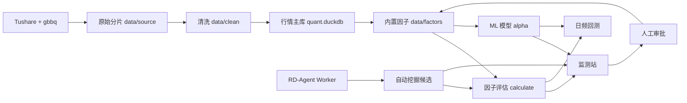

# A 股量化研究与交易一体化项目

本项目覆盖 A 股研究的完整链路：Tushare 取数和公司行动补全、清洗与入库、因子构建、
因子质量评估、RD-Agent 自动因子挖掘、ML 模型训练与监控、日频组合回测，以及统一的
Web 监测和人工审核界面。

所有代码、配置、测试和文档位于单一 Git 仓库。行情数据库、因子值、模型产物和日志
只保留在本地；`AiRecord/` 保存计划、变更、差异、进度和证据，已纳入 Git 的记录
随仓库提交。

## 全链路



核心原则：

- 信号在交易日收盘生成，下一交易日开盘执行，不使用未来数据。
- 因子和标签使用后复权价；回测成交使用原始价，公司行动由账本单独处理。
- 指数成分使用上一个已结束月份的月末快照；全 A 池保留历史退市股票。
- 研究、评估、模型和回测都记录数据快照或配置哈希，避免结果无法追溯。
- 自动挖掘候选与正式因子严格隔离，只有人工批准和原子发布后才能进入正式因子库。

## 当前能力

| 层 | 当前能力 |
|---|---|
| 数据 | 2000-01-04～2026-10-15，6,488 个交易日、5,913 只股票、17,999,882 行；26 张表，约 7.3 GB |
| 辅助数据 | 60 个指数、31 个申万一级行业、历史成分权重、财务三表、财务指标、停牌、涨跌停、公司行动 |
| 因子 | 11 个族、47 个已实现因子、139 个规划因子；构建、自检、公式文档和手工复现 SQL |
| 因子评估 | IC/RankIC、分位收益、净值、多空、换手、多周期衰减、风格暴露、增量 IC、相关性 |
| 自动挖掘 | V1 受控 DSL、RD-Agent Worker、门禁、完整评估、人工审批和正式发布；V2 证据驱动搜索；M5 隔离代码研究沙箱 |
| 模型 | Ridge/ElasticNet、LightGBM、直方图 GBDT；周频数据集、purged walk-forward、评估、账本、监控和生命周期 |
| 回测 | 因子 Top-N、目标权重提供者、原始价账本、公司行动、A 股交易规则、成本、分块回测和运行对比 |
| 应用 | 因子监测、自动挖掘审核、策略创建、回测详情和运行对比，统一由本地 FastAPI 服务提供 |

当前数据版本：`tushare_fullA_20000104_20261015`。

## 目录

| 路径 | 职责 |
|---|---|
| `core/common/` | 项目路径和共享日志 |
| `core/data/` | 取数、清洗、建库脚本和 `quant` 读取层 |
| `core/factors/` | 因子定义、算子、注册表和内置因子族 |
| `research/evaluation/calculate/` | 因子评估计算包 |
| `research/mining/` | 自动因子挖掘契约、DSL、编排、存储和发布 |
| `research/mining_worker/` | Python 3.11 RD-Agent Worker |
| `research/modeling/alpha/` | ML 模型和模型生命周期 |
| `trading/backtest/` | A 股日频回测、账本、成本和结果存储 |
| `apps/monitor/backend/` | FastAPI、SSE、任务调度和挖掘服务 |
| `apps/monitor/frontend/` | 因子、挖掘和回测页面 |
| `configs/` | 挖掘、模型训练和评估配置 |
| `tests/` | 根级单元、联合和真实数据测试 |
| `tools/` | 运维、审计、浏览器验收和性能工具 |
| `docs/` | 按业务域组织的模块文档 |
| `data/` | 本地运行数据，不进入 Git |
| `logs/` | 本地运行日志，不进入 Git |
| `AiRecord/` | 计划、变更、差异、版本、进度和验收证据 |

四个原独立模块的提交历史已经并入当前单仓库，不再作为嵌套仓库或 Git submodule 使用。

## 安装

项目固定使用 Python 3.12；自动挖掘 Worker 单独使用 Python 3.11 Docker 镜像。

```bash
cd /home/hanwen/quant
python3.12 -m venv .venv
.venv/bin/python -m pip install -r requirements.lock
.venv/bin/python -m pip install -e . --no-deps
.venv/bin/pip check
```

运行依赖和锁定方式见 [依赖说明](docs/core/ops/dependencies.md)。

在项目根目录创建本地 `.env`，至少配置：

```text
TUSHARE_TOKEN=<本地 Tushare Token>
TUSHARE_HTTP_URL=http://jiaoch.site
FACTOR_DEEPSEEK_API=<仅自动挖掘 Worker 使用的 DeepSeek Key>
```

`.env` 已被 Git 忽略，不要打印、提交或复制到日志。

检查当前环境和项目布局：

```bash
.venv/bin/python -m pytest --collect-only -q
.venv/bin/python demo.py
```

`demo.py` 和 `demo.ipynb` 提供数据读取接口和常见组合示例，可以逐块运行。

## 数据链路

### 已有 `data/` 时

日常研究直接使用现有数据库和因子产物，不需要重新取数：

```bash
.venv/bin/python -m scripts.sources.fetch_all status
```

检查主库：

```python
import duckdb

conn = duckdb.connect("data/databases/quant.duckdb", read_only=True)
print(conn.execute("SELECT * FROM meta.manifest").fetchall())
```

### 从原始数据完整重建

完整链路是：

```text
reference -> daily -> extra -> index -> core -> gbbq
-> clean -> build_db -> build_factors -> build_factors.validate
```

```bash
cd /home/hanwen/quant

# 1. 一次性参照数据
.venv/bin/python -m scripts.sources.fetch_all reference

# 2. 四个日线接口：daily / adj_factor / stk_limit / daily_basic
.venv/bin/python -m scripts.sources.fetch_all daily \
  --start 20000101 --end 20261015

# 3. 停牌、指数权重和核心研究资源
.venv/bin/python -m scripts.sources.fetch_all extra --end 20261015
.venv/bin/python -m scripts.sources.fetch_all index --end 20261015
.venv/bin/python -m scripts.sources.fetch_all core --end 20261015

# 4. 固定版本公司行动辅助文件
.venv/bin/python -m scripts.sources.fetch_all gbbq

# 5. 清洗、建库
.venv/bin/python -m scripts.clean.pipeline
.venv/bin/python -m scripts.build_db.build

# 6. 构建并自检全部因子
.venv/bin/python -m scripts.build_factors.build
.venv/bin/python -m scripts.build_factors.validate
```

取数硬约束：

- 全局最多 2 个并发请求，只能单进程、2 线程运行。
- 同一时间不要启动第二个取数进程。
- 四个行情接口全量通常需要数小时；分片按年/月落盘，中断后可重跑续传。
- 清洗按年处理，建库会删除并重建 `data/databases/quant.duckdb`。
- 执行完整重建前确认磁盘空间，不要手工修改数据库或 Parquet。

`tools/v5/` 提供历史串联和诊断脚本。串联脚本内可能保留旧截止日期，正式补数时应先核对
参数；分阶段命令以上面的显式日期为准。详细失败门槛见
[数据运行手册](docs/core/ops/v5_runbook.md)。

### 只刷新最近数据

```bash
.venv/bin/python -m scripts.sources.fetch_all daily \
  --start <YYYYMMDD> --end <YYYYMMDD>
.venv/bin/python -m scripts.sources.fetch_all index-daily \
  --codes H00300.CSI,H00905.CSI --start <YYYYMMDD> --end <YYYYMMDD>
.venv/bin/python -m scripts.sources.fetch_all industry --end <YYYYMMDD>

.venv/bin/python -m scripts.clean.pipeline
.venv/bin/python -m scripts.build_db.build
.venv/bin/python -m scripts.build_factors.build
.venv/bin/python -m scripts.build_factors.validate
```

## 数据读取

公开读取入口是 `quant`：

```python
import quant

# 日线长表：raw / hfq / qfq
bars = quant.load_panel(
    start="2024-01-01",
    end="2024-12-31",
    fields=["open", "high", "low", "close", "ret", "status", "can_buy_close"],
    adjust="hfq",
    stocks=["SH600000"],
    drop_suspended=True,
)

# 交易日 × 股票宽表
close = quant.load_panel_wide(
    "close", start="2024-01-01", end="2024-12-31", adjust="hfq"
)

# 未来收益标签
labels = quant.load_label(
    start="2024-01-01",
    end="2024-12-31",
    horizons=[1, 5, 20],
    price="open",
)

# 指数、行业、财务和公司行动
quant.load_index_daily("000300.SH", start="2024-01-01")
quant.load_sw_industry_member(start="2024-01-01", end="2024-12-31")
quant.load_financial("SH600000", table="fina_indicator")
quant.load_corporate_actions(start="2024-01-01", end="2024-12-31")

# 因子长表、宽表和清单
factors = quant.load_factor_panel(
    start="2024-01-01",
    end="2024-12-31",
    names=["MOM_20", "EP_TTM", "PV_CORR_20"],
)
mom20 = quant.load_factor_wide("MOM_20", start="2024-01-01", end="2024-12-31")
catalog = quant.load_factor_list(family="momentum")
```

直接 SQL：

```python
from quant.db import query

query(
    "SELECT trade_date, close FROM md.daily_hfq "
    "WHERE stock_code = 'SH600000' ORDER BY trade_date"
)
```

完整表、字段、单位和读取接口见
[数据库与读取接口](docs/core/data/database.md)。

## 因子构建与评估

### 构建与自检

```bash
# 全部因子
.venv/bin/python -m scripts.build_factors.build
.venv/bin/python -m scripts.build_factors.validate

# 单族或单区间
.venv/bin/python -m scripts.build_factors.build \
  --families momentum,valuation --start 2024-01-01 --end 2024-12-31
.venv/bin/python -m scripts.build_factors.validate --families momentum

# 更新公式和清单文档
.venv/bin/python -m scripts.build_factors.catalog --write-docs

# 查看单因子的公式、白话步骤和手工复现 SQL
.venv/bin/python -m scripts.build_factors.catalog --explain MOM_20
```

新增因子按照 `define(...)` → 构建 → 自检 → 文档生成的顺序完成，详见
[因子库使用说明](docs/core/factors/README.md)。

### Python 调评估

```python
from calculate import EvalParams, evaluate

params = EvalParams(
    factor="MOM_20",
    start="2024-01-01",
    end="2024-12-31",
    universe="all_a",
    horizon=5,
    price="close",
    quantiles=10,
    winsorize=True,
)

for stage, payload in evaluate("MOM_20", params):
    print(stage, payload.keys())
```

全历史轻量 IC 不会构建完整面板：

```python
from calculate import EvalParams, load_daily_ic

history = load_daily_ic(
    EvalParams(factor="MOM_20", start="2000-01-04", end="2026-10-15")
)
print(history.head())
```

指标定义和接口见
[评估计算包](research/evaluation/calculate/README.md)与
[评估指标](docs/research/evaluation/README.md)。

## 监测站

监测站同时提供因子评估、自动挖掘审核和回测页面：

```bash
bash tools/monitor/serve.sh
```

打开 http://127.0.0.1:8800：

| 页面 | 用途 |
|---|---|
| `#/factors` | 因子列表和搜索 |
| `#/factor/MOM_20` | 单因子完整分析或轻量 IC |
| `#/compare` | 2～4 个因子对比 |
| `#/mining` | 自动挖掘运行、候选和审批 |
| `#/backtest` | 历史回测与对比 |
| `#/backtest/new` | 新建因子或提供者策略 |

服务只绑定 localhost，必须单进程单 worker。完整因子分析默认最近 3 年；全历史使用轻量 IC。
因子评估与回测共享原生计算锁，大区间任务建议串行运行。

HTTP 与 SSE 接口见 [监测站 API](docs/apps/monitor/api.md)。

## 自动因子挖掘

自动挖掘需要 RD-Agent Worker 和监测站两个进程。

### 1. 生成 Token

```bash
.venv/bin/python -c \
  'from common.paths import DATA_DIR; from mining.worker_client import ensure_worker_token; ensure_worker_token(DATA_DIR / "mining_worker" / "token")'
```

### 2. 启动 Worker

```bash
docker compose --env-file .env -f compose.mining.yaml up -d --build
curl --fail --silent http://127.0.0.1:8790/health
```

健康接口应返回 `status=ready`、`mode=rdagent` 和 `rdagent_version=1.0.0`。
DeepSeek Key 只进入 Worker 容器，不传给监测站。

### 3. 启动监测站

在另一个终端中：

```bash
cd /home/hanwen/quant
export MINING_WORKER_URL=http://127.0.0.1:8790
bash tools/monitor/serve.sh
```

打开 http://127.0.0.1:8800/#/mining，提交研究假设并等待候选进入人工审核。

默认使用 V1 生产编排。需要启用在开发期、选择期、最终研究期和模块测试段之间隔离的
证据驱动搜索时，可设置 `MINING_SEARCH_V2_ENABLED=true`。V2 当前停在
`review_ready`，尚不能从 V2 页面审批或正式发布；M5 代码研究沙箱默认关闭，只产生
人工审核材料。

运行流程：

```text
研究假设
  -> Worker 生成受控表达式
  -> DSL 白名单校验
  -> 技术门禁和快速筛选
  -> 完整评估
  -> 冻结候选并一次性使用模块测试段
  -> 人工批准或拒绝
  -> 整批全量构建、校验和原子发布
```

候选原因为以下情况时不会进入正式因子库：字段/算子不合法、覆盖率不足、存在前视、
与已有因子高度相关、完整评估失败或测试段失败。

详细启动、排错和停止步骤见
[自动因子挖掘模块](docs/research/mining/README.md)。后续四项扩展和 V3 最终闭环见
[因子挖掘进度记录](FACTOR_MINING_PROGRESS.md)。

## ML 模型

模型层把多个因子转换为预测分数或截面排序，再由策略层决定 Top-N、权重、风险约束和执行。

### 研究到训练

```bash
# P0 特征审计和基线
.venv/bin/python -m scripts.build_alpha.audit_features \
  --start 2012-01-01 --end 2023-12-31
.venv/bin/python -m scripts.build_alpha.run_baselines \
  --baseline B4_ALL_RANK --start 2012-01-01 --end 2023-12-31 --engine weekly

# 周频数据集和 purged walk-forward 切分
.venv/bin/python -m scripts.build_alpha.build_dataset \
  --start 2012-01-01 --end 2023-12-31
.venv/bin/python -m scripts.build_alpha.build_folds

# 使用已有 dataset_id 训练
.venv/bin/python -m scripts.build_alpha.train \
  --dataset-id <dataset_id> \
  --spec configs/alpha/train_sklearn_hist_gbdt.json

# 重放预测、评估并更新模型索引
.venv/bin/python -m scripts.build_alpha.predict \
  --model-id <model_id> --start 2018-01-12 --end 2023-12-29
.venv/bin/python -m scripts.build_alpha.evaluate --model-id <model_id>
.venv/bin/python -m scripts.build_alpha.registry --rebuild
```

当前可训练后端配置位于 `configs/alpha/`。新后端放入
`research/modeling/alpha/modeling/backends/` 并注册，不需要修改共享训练循环。

### 监控和最终留出

```bash
.venv/bin/python -m scripts.build_alpha.monitor --model-id <model_id>
.venv/bin/python -m scripts.build_alpha.lifecycle
.venv/bin/python -m scripts.build_alpha.final_holdout --window-id <window_id>
```

2024-01-01～2026-10-15 已消耗并封存；下一次留出窗口为
2026-10-16～2027-10-15。最终留出只能在模型、特征、门槛和配置冻结后运行，不能根据结果
回头调参。

模型现状、训练结果、监控和生命周期见
[Alpha 模型层](docs/research/modeling/alpha/README.md)与
[模型产物清单](docs/research/modeling/alpha/model_inventory.md)。

## 日频回测

### 命令行

```bash
# 内置 MOM_20 策略
.venv/bin/python -m backtest \
  --strategy mom20 --start 2024-01-01 --end 2026-10-15

# 内置多因子策略，指定指数池和全收益基准
.venv/bin/python -m backtest \
  --strategy multifactor \
  --start 2016-01-01 --end 2026-10-15 \
  --universe index:000905.SH \
  --benchmark H00905.CSI

# 运行已保存的具体策略版本
.venv/bin/python -m backtest \
  --strategy-id <strategy_id> --version <version> \
  --start 2024-01-01 --end 2026-10-15
```

回测遵循：

- 信号日收盘生成目标，下一交易日开盘执行。
- 使用原始价成交，公司行动由账本处理。
- 支持停牌和涨跌停拒单、每日重试、板块申报单位、T+1、现金缓冲和成交额参与率。
- 默认基准为 `H00300.CSI`，中证500池通常使用 `H00905.CSI`。
- 输入行情、因子、公司行动、行业、基准、规则和提供者源码都进入运行快照。

结果写入 `data/databases/backtest.duckdb`，不会修改行情主库。

### Web 页面

启动监测站后打开：

- `#/backtest/new`：创建因子 Top-N 或目标权重提供者策略；
- `#/backtest`：查看历史运行；
- `#/backtest/{run_id}`：查看净值、回撤、超额、成交、持仓、拒单和成本归因；
- `#/backtest/compare?run_ids=...`：对比 2～4 次成功运行。

将已训练模型接入回测时，使用已保存的 `ml_rank` 目标权重提供者策略；模型版本、预测
哈希和提供者源码会进入运行快照。

执行口径、策略配置和接口见
[回测模块](docs/trading/backtest/README.md)、
[策略配置](docs/trading/backtest/strategy_spec.md)与
[回测 API](docs/trading/backtest/api.md)。

## 测试与验收

在项目根目录运行：

```bash
# 全量测试
.venv/bin/python -m pytest -q

# 分模块
.venv/bin/python -m pytest tests -q
.venv/bin/python -m pytest research/evaluation/calculate/tests -q
.venv/bin/python -m pytest trading/backtest/tests -q
.venv/bin/python -m pytest apps/monitor/backend/tests -q
```

可选运维检查：

```bash
# 因子数据自检
.venv/bin/python -m scripts.build_factors.validate

# 最近一次回测执行审计
.venv/bin/python tools/monitor/backtest_audit.py

# 浏览器验收
.venv/bin/python tools/monitor/browser_check.py
.venv/bin/python tools/monitor/mining_check.py --output /tmp/mining-check
.venv/bin/python tools/monitor/backtest_check.py
```

日志按模块写入 `logs/`，超过 128 MB 自动轮转；日志文件名记录该段首末消息时间。
常见故障先看 `data/databases/*.duckdb` 是否存在、接口错误码、对应模块日志和
`tools/monitor` 下的预检工具。

## 数据口径与已知限制

### 代码与价格

- 股票代码统一为 `SH600000`、`SZ000001`、`BJ920000`。
- 指数代码保留 Tushare 形式，如 `000300.SH`。
- `md.daily_bar`：原始价；`md.daily_hfq`：后复权；`md.daily_qfq`：前复权。
- 因子计算用后复权价；成交和公司行动账本用原始价。
- 停牌行保留在数据库中，因子和标签为空；研究时按可交易标记过滤。

### 时间和标签

- 主标签之一为 `fwd_ret_open_5`：t 日收盘生成信号，t+1 开盘起算未来 5 个交易日。
- 财务字段使用公告日次一交易日起可见的时点口径。
- 指数成分使用上一个已结束月份的月末快照，避免当月前视。

### 已知限制

- 自动挖掘的模块测试段与既有模型最终留出存在历史重叠，不能宣称独立样本发现。
- 回测未精确建模并购重组换股、北交所转板和退市对价；长区间持仓撞上这些事件时需复核。
- 回测现金余额不计息；高现金仓位的长期择时策略会低估收益。
- 回测是日频近似，不支持分钟撮合、T+0、融资融券、做空、ETF 和可转债。
- 模块测试段按设计只能被一个候选批次领取；继续研究需要新的数据快照和留出窗口。

完整回测边界见[完整性评估](docs/trading/backtest/completeness.md)和
[待办](docs/trading/backtest/todo.md)。

## 项目深度导读

[项目深度导读](docs/project-guide/README.md)是一套按当前代码编写的工程手册，
覆盖各业务域的技术栈、功能、使用方式、内部结构、数据流和维护边界。

| 章节 | 内容 |
|---|---|
| [全链路总览](docs/project-guide/README.md) | 模块地图、技术栈、产物目录和术语 |
| [共享基础与数据层](docs/project-guide/01-foundation-and-data.md) | 路径、日志、取数、清洗、建库和读取 |
| [因子库](docs/project-guide/02-factor-library.md) | 因子定义、算子、构建、自检和目录 |
| [因子评估](docs/project-guide/03-factor-evaluation.md) | 评估面板、指标注册、stage 和前后端链路 |
| [因子评估指标](docs/project-guide/04-factor-evaluation-metrics.md) | 页面 13 个指标的计算方式、意义和边界 |
| [自动因子挖掘](docs/project-guide/05-factor-mining.md) | V1/V2 状态机、DSL、门禁、审核和发布边界 |
| [Agent 编排与 RD-Agent](docs/project-guide/06-agent-orchestration.md) | Worker v1～v4、证据搜索、分析工具和代码沙箱 |
| [ML 模型层](docs/project-guide/07-ml-modeling.md) | 数据、训练、指标、分析、监控和留出 |
| [回测](docs/project-guide/08-backtest.md) | VectorBT 边界、自定义账本和完整数据流 |
| [监测站](docs/project-guide/09-monitor-web.md) | FastAPI、SSE、调度器和前端 |
| [工程支撑](docs/project-guide/10-engineering-support.md) | 配置、脚本、测试、日志和运维 |

## Git 与文档

```bash
git status
git add <files>
git commit -m "<说明>"
git push
```

不要删除根 `.git`，也不要在任何子目录重新执行 `git init`。远程地址：
https://github.com/rowerman/quant-all.git

建议阅读顺序：

| 文档 | 内容 |
|---|---|
| [项目文档索引](docs/README.md) | 全部模块文档入口 |
| [取数](docs/core/data/sources.md) | Tushare 接口、分片和断点续跑 |
| [清洗](docs/core/data/cleaning.md) | 复权、停牌、涨跌停和校验 |
| [数据库](docs/core/data/database.md) | 表结构、字段和读取接口 |
| [因子库](docs/core/factors/README.md) | 构建、读取和新增因子 |
| [因子评估](research/evaluation/calculate/README.md) | 评估参数、指标和扩展方式 |
| [自动挖掘](docs/research/mining/README.md) | V1 生产链路、V2 实验搜索和 M5 沙箱 |
| [挖掘后续进度](FACTOR_MINING_PROGRESS.md) | 四项后续任务的优先级、拆解和验收入口 |
| [模型层](docs/research/modeling/alpha/README.md) | 数据集、训练、评估、监控和留出 |
| [回测](docs/trading/backtest/README.md) | 执行、账本、成本、结果和已知边界 |
| [监测站](docs/apps/monitor/README.md) | 启动、页面、性能和验收 |
