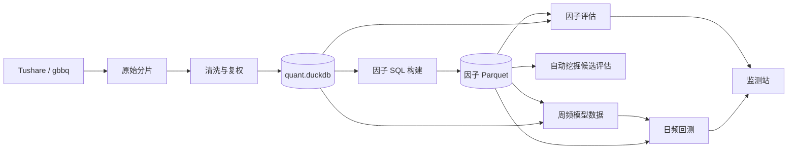

# A 股量化研究链路中的算子设计与 C++ 加速分析报告

- 分析日期：2026-10-27
- 代码快照：`main` 分支，提交 `fe10c55`
- 分析范围：数据获取与清洗、DuckDB 建库、因子构建与评估、自动因子挖掘、
  ML 模型、A 股日频回测、监测站。
- 性能口径：引用仓库已有的 2026-10-09、2026-10-13 和 2026-10-18 实测；
  本次没有重新执行长时间基准。

## 1. 执行摘要

先给结论：

1. **当前项目并不是“所有算子都由 Python 逐行计算”**。
   [core/factors/ops.py](core/factors/ops.py) 中的 `ts_mean`、`ts_corr`、`cs_rank`
   等函数返回的是 DuckDB SQL 片段。Python 负责把表达式组织成 SQL，真正的窗口聚合、
   排名、连接、扫描和大量数值计算由 DuckDB 1.5.5 的 C++ 向量化执行器完成。
2. **把所有现有算子改写成 C++，不会自动带来数量级加速**。普通 SQL 因子已经运行在
   DuckDB 原生内核上，再包一层 C++ 会增加数据搬运、ABI、构建和语义一致成本。
3. **真正还大量使用 Python/NumPy/pandas 精细控制的是评估层**。默认三年完整评估
   实测约 176.6 秒，其中相关性约 120.4 秒，是最明确的热点；风格逐日回归、
   多周期衰减、逐日排名和换手也属于适合批量原生计算的候选。
4. **自动挖掘的最大优化空间首先不是语言，而是减少重复工作**。当前每个候选独立物化、
   独立生成查询，候选之间不复用公共子表达式。先做表达式 DAG、公共子表达式复用、
   批量执行和结果缓存，通常比单纯换 C++ 更有效。
5. **模型层不需要自研 C++ 数值核**。`scikit-learn` 和 `LightGBM` 的核心已经是原生实现。
   只有周频数据集的逐日 rank、去极值和中性化可能复用评估层原生核。
6. **当前日频回测暂不值得整体 C++ 化**。已有的三年全 A 剖析显示，数据装载和分块处理
   占主体，账本、分配和风险约束的单阶段耗时相对小。先把 I/O、分块和重复读取优化完，
   再决定是否重写执行状态机。
7. **最务实的路线是“先算法、后语言，先批处理、后扩展”**：
   先做基准和金标准测试，再用已有 Numba 验证算法，最后只把证明有效的批量核用 C++
   和 `pybind11` 接入。C++ 应作为可选后端，不应直接替换 DuckDB 或全部 Python 实现。

## 2. 当前全链路与计算后端



当前链路中各层的计算责任并不相同：

| 层 | 主要入口 | 当前主要执行后端 | 主要数据形态 |
|---|---|---|---|
| 取数 | `scripts.sources.fetch_all` | Python、requests、线程限流 | 外部接口记录 |
| 清洗 | `scripts.clean.pipeline` | pandas、NumPy | 股票 × 交易日面板 |
| 建库与标签 | `scripts.build_db` | DuckDB SQL | 约 1,800 万行长表 |
| 因子定义 | `core/factors` | Python 生成 SQL | 字符串表达式与 DAG 语义 |
| 因子构建 | `scripts.build_factors` | DuckDB SQL、Parquet | 族 × 年分区 |
| 因子评估 | `research/evaluation/calculate` | DuckDB 取数 + NumPy/pandas 指标 | 数百万行面板、日度序列 |
| 自动挖掘 | `research/mining` | DuckDB、Python 状态机、LLM Worker | 候选表达式、隔离 Parquet |
| 模型 | `research/modeling/alpha` | pandas 预处理、sklearn/LightGBM | 周频数据集 |
| 回测 | `trading/backtest` | pandas/NumPy 状态推进、DuckDB I/O | 日期 × 股票宽表 |
| 监测站 | `apps/monitor` | FastAPI、SSE、JavaScript | JSON 事件与图表 |

### 2.1 当前“算子”到底是什么

`ops.py` 的每个函数都返回 SQL 表达式。例如：

```python
def ts_mean(col: str, n: int) -> str:
    return f"avg({col}) over {frame(n)}"
```

因此它更像“表达式构造器”或“计算图前端”，而不是数值计算器。完整调用关系是：

```text
FactorSpec.layers
  -> factors.ops 生成 SQL 片段
  -> ExpressionCompiler 拆成 CTE 层
  -> scripts.build_factors.sql 拼装一族查询
  -> DuckDB 解析、优化并执行
  -> COPY 到年度 Parquet
```

`DuckDB` 本身由 C++ 编写，内部使用向量化执行、列式数据和并行扫描。当前主要差距不在
“Python 解释器逐行算因子”，而在：

- 查询是否重复扫描相同历史；
- 不同因子或候选是否重复计算相同子树；
- 算法是否选择了合适的数据结构；
- Python 与数据引擎之间是否搬运了不必要的数据；
- 评估指标是否在 Python 中做了大量分组、排序和循环。

### 2.2 当前环境里有没有 C++

仓库业务代码中目前没有 `.cpp`、`.hpp`、`CMakeLists.txt`、Python 扩展模块或编译配置。
`requirements.txt` 已经包含 `numba==0.61.2`，但源码中没有使用 `numba`、`njit` 或
`prange`。当前 `calculate.native` 也不是 C++ 扩展，而是评估阶段的 Python 可重入锁。

当前机器上有 `g++ 13.3.0`，但没有安装 `cmake`、`pybind11`、`nanobind` 或 Cython。
如果正式引入 C++，构建链本身也需要纳入项目依赖和 CI。

## 3. 哪些地方可以引入算子

这里先把“算子”分为几类，避免把 SQL 表达式、数组函数、指标算法和交易状态机混在一起。

| 算子形态 | 典型输入输出 | 当前代表 | 适合的加速方式 |
|---|---|---|---|
| 标量表达式 | 单行数值到单行数值 | `safe_div`、`signed_power` | DuckDB 已足够 |
| 时序窗口算子 | 单股票序列到同长度序列 | `ts_mean`、`ts_corr`、`ts_rank` | SQL；复杂窗口可算法优化 |
| 截面算子 | 单日股票向量到同长度向量 | `cs_rank`、`cs_zscore` | DuckDB；少数算法可批处理 |
| 面板聚合 | 多日多股票到日度结果 | IC、分位收益、换手 | C++/Numba 批量核有潜力 |
| 统计回归 | 日度截面矩阵到系数、残差 | 风格暴露、增量 IC | C++ 批量 OLS 有潜力 |
| 成对相关 | 股票 × 因子矩阵到相关矩阵 | 因子相关性 | 最优先评估 C++ |
| DSL 表达式执行 | AST 到因子面板 | 自动挖掘 | 先做 DAG/CSE，再考虑原生 VM |
| 状态机执行 | 订单、现金、持仓到成交和净值 | 回测账本和分配 | 条件化，当前收益不明确 |

### 3.1 数据层

清洗层已经有大量 NumPy 向量化操作：

- [core/data/scripts/clean/adjust.py](core/data/scripts/clean/adjust.py) 的
  `forward_fill_close`、`last_valid_factor`、`adjust_scale`；
- [core/data/scripts/clean/limits.py](core/data/scripts/clean/limits.py) 的
  `compute_limit_ratios`、`mark_limits`、`mark_tradeable`；
- [core/data/scripts/clean/lifecycle.py](core/data/scripts/clean/lifecycle.py) 的
  生命周期和 ST 区间展开；
- [core/data/scripts/build_db/labels.py](core/data/scripts/build_db/labels.py) 的
  未来收益标签 SQL。

可以提取的算子包括向前填充、窗口标量规则、涨跌停价、复权乘数和标签滑动。但这些操作
大多已经数组化，主要耗时更可能来自 Parquet 读取、清洗编排和 DuckDB 建表。除非剖析明确
证明某个数组函数占主要时间，否则目前不建议为清洗层单独引入 C++。

### 3.2 因子库

当前内置和规划算子覆盖以下类别：

| 类别 | 当前算子 | 功能 |
|---|---|---|
| 滞后与差分 | `ts_delay`、`ts_delta` | 历史值、窗口变化 |
| 窗口聚合 | `ts_mean`、`ts_sum`、`ts_min`、`ts_max`、`ts_median`、`ts_product`、`ts_count` | 趋势、水平、累计和有效计数 |
| 分布统计 | `ts_std`、`ts_skew`、`ts_kurt`、`ts_rank` | 波动、偏度、峰度和时序分位 |
| 关系统计 | `ts_corr`、`ts_cov`、`ts_slope`、`ts_r2` | 量价关系、回归趋势 |
| 特殊时序 | `ts_std_downside`、`ts_row_number`、`ts_arg_max` | 下行风险、极值位置 |
| 截面 | `cs_rank`、`cs_mean`、`cs_std`、`cs_zscore`、`cs_demean`、`cs_scale` | 横截面比较和标准化 |
| 标量 | `safe_div`、`signed_power`、`neg` | 安全除法、保号幂和方向 |

绝大多数应继续由 DuckDB 执行。最值得单独审视的是：

- `ts_rank`：当前用窗口内 `n-1` 次 `lag` 比较实现，计算量随窗口线性增长；
- 多因子之间共享的子表达式：当前每个因子独立成 CTE，DuckDB 不保证跨窗口复用；
- 逐年构建时重复扫描截止年末的全部历史：这是构建编排问题，不是单算子语言问题。

### 3.3 因子评估

评估层包含大量明确的批处理算子：

| 位置 | 当前函数 | 功能 | C++ 适配判断 |
|---|---|---|---|
| 标准化 | `calculate.normalize.winsorize_by_day` | 逐日 MAD 去极值 | 高 |
| 标准化 | `calculate.normalize.zscore_by_day` | 逐日截面 z-score | 高 |
| 日度 IC | `calculate.daily.rank_pct_by_day` | 并列平均名次 | 高 |
| 日度 IC | `calculate.daily._daily_pearson` | 分组 Pearson | 高 |
| 日度 IC | `calculate.daily.daily_ic` | IC、RankIC、样本数 | 中高 |
| 多周期 | `calculate.daily.daily_rank_ic_multi` | 多标签 RankIC | 高 |
| 分层 | `calculate.binning.assign_bins` | 日度分位分组 | 高 |
| 分层收益 | `calculate.binning.bin_returns_multi` | 多标签、多权重收益 | 中高 |
| 换手 | `calculate.binning.bin_turnover` | 分位组合换手 | 中 |
| 自相关 | `calculate.binning.factor_autocorrelation` | 因子秩自相关 | 高 |
| 风格暴露 | `calculate.exposure._daily_regression` | 逐日截面 OLS | 高 |
| 相关性 | `calculate.correlation.daily_spearman_matrix` | 成对 Spearman | 最高 |

这些函数已经在 NumPy 层面做过优化，例如 `rank_pct_by_day` 使用一次排序处理并列块，
`bin_returns_multi` 使用 `bincount` 合并分组，风格回归按交易日批量切块。因此 C++ 不是
从“纯 Python 慢循环”直接变成“机器码”的简单故事；它能带来的提升主要来自：

- 合并多个 Python/NumPy 中间数组；
- 避免重复排序和重复掩码；
- 只计算目标因子所在的相关行列；
- 对逐日小矩阵回归使用缓存友好的连续内存布局；
- 并行时控制线程和内存，而不是创建大量 pandas 临时对象。

### 3.4 自动因子挖掘

挖掘链路目前是：

```text
受控表达式
  -> ExpressionCompiler 生成分层 SQL
  -> 每个候选独立物化为年度 Parquet
  -> 技术门禁
  -> 轻量 RankIC
  -> 前 K 个候选完整评估
```

可以引入的算子优化包括：

1. **表达式 DAG**：相同字段、相同窗口的公共子树只计算一次；
2. **候选批量编译**：同一轮多个候选组合为一次 DuckDB 查询，减少重复扫描；
3. **增量评估**：历史候选值和标签不变时复用已有的公共中间列；
4. **原生表达式执行器**：把受控 AST 编译为 C++ 算子图，直接消费列式 Arrow 数据；
5. **搜索级算子**：相关矩阵、去重、前视检查和分位统计使用共享批量核。

第 1～3 项属于查询和缓存设计，通常先于第 4 项。只有当前三项无法满足吞吐目标，且
剖析显示表达式求值本身占主导时，才值得开发原生表达式 VM。

### 3.5 模型层

模型链路的计算可以拆成：

- 周频数据集组装；
- 逐日 rank、z-score、去极值、缺失指示和中性化；
- 线性、LightGBM、直方图 GBDT 训练；
- 预测、评估、模型监控和生命周期。

训练部分已经是原生后端，没有理由自研 C++ 训练器。比较适合复用的是
[research/modeling/alpha/preprocess.py](research/modeling/alpha/preprocess.py) 中的
逐日 rank/z-score 和 [research/modeling/alpha/dataset.py](research/modeling/alpha/dataset.py)
中的标签截面排名。它们可复用评估层已经验证的原生核，但优先级低于评估相关性。

### 3.6 回测

回测包含几类潜在算子：

- 目标权重到目标股数：`trading/backtest/allocation.py:allocate_shares`；
- 涨停、停牌、T+1 和退市约束：`trading/backtest/orders.py`；
- 单票、行业和换手上限：`trading/backtest/risk.py`；
- 现金、持仓、公司行动和 FIFO 税费：`trading/backtest/ledger.py`；
- 绩效指标：`trading/backtest/metrics.py`。

当前不建议优先 C++ 化，原因见性能证据：全 A 三年回测中，数据装载和分块时段远大于
账本和分配。把顺序状态机改写为 C++ 还会显著增加公司行动、税费、跨块状态和审计成本。
更优先的工程动作是减少重复加载、优化块大小和并行争用，以及把宽表转为更紧凑的列式内存。

### 3.7 监测站

监测站负责接收任务、SSE 推送、展示和审批，不承担重计算。这里适合做缓存、分页和
预计算，不适合放 C++ 算子。当前评估阶段已经通过
[research/evaluation/calculate/native.py](research/evaluation/calculate/native.py)
对后端入口做串行隔离，但该文件的“native”指原生阶段锁，不是 C++ 模块。

## 4. 现有性能证据

### 4.1 因子评估

仓库现有的默认三年完整评估为 `MOM_20`、全 A、5 日 close 标签、10 分位：

| 阶段 | 实测耗时 |
|---|---:|
| 总量 | 176.64 秒 |
| correlation | 120.37 秒 |
| exposure | 16.91 秒 |
| decay | 14.26 秒 |
| incremental_ic | 5.81 秒 |
| overview | 4.85 秒 |
| turnover | 4.04 秒 |
| bins | 2.55 秒 |

相关性约占总墙钟时间的 68%。接近评估行数上限的 2021～2026 区间总耗时
353.20 秒，相关性 222.67 秒；四因子完整对比总耗时 724.72 秒。

另一方面，全历史轻量 IC 仅约 17.4 秒，因为它直接在 DuckDB 内聚合，不构建完整面板。
这组对比非常关键：

- DuckDB 原生聚合并不慢；
- 慢的是完整评估中反复读取多族因子、构建 Python 对象、逐日分组和成对排名；
- C++ 最应该服务这些“批量但仍有 Python/pandas 编排成本”的路径，而不是普通 SQL 窗口。

证据文件：

- `AiRecord/benchmarks/V11/20261013-bench-default.json`
- `AiRecord/benchmarks/V11/20261013-bench-near_limit.json`
- `AiRecord/benchmarks/V11/20261013-bench-compare.json`
- `AiRecord/benchmarks/V11/20261013-bench-full_ic.json`

### 4.2 因子构建

当前因子构建按“族 × 年”串行执行，并在每年将截止年末的全部有效历史交给 DuckDB。
历史记录中，29 个因子、27 年的全量构建约 15 分钟，单族约 2 分钟。当前已扩展到
47 个因子和 297 个族年分区，因此旧耗时只能作为数量级参考。

这里最明显的浪费不是 Python 函数调用，而是：

- 不同族在相同年份重复扫描相同主表；
- 每个族和每年重新执行相同公共子表达式；
- 每个候选在挖掘中再次独立物化；
- 普通窗口已由 DuckDB 优化，但外层编排没有复用查询结果。

因此 C++ 改写 `ops.py` 不太可能解决主要问题。

### 4.3 回测

2026-10-18 的剖析中：

| 案例 | 任务累计耗时 | load | chunk 主循环时段 | allocation |
|---|---:|---:|---:|---:|
| 全 A 三年 | 183.24 秒 | 27.43 秒 | 164.82 秒 | 3.18 秒 |
| 中证 500 十年 | 202.22 秒 | 19.60 秒 | 154.98 秒 | 24.16 秒 |

`chunk` 时段内部还包含信号、探针、基准账本、订单、分配和执行事件，不能把子阶段耗时
与 `chunk` 简单相加。表中仍能看出，数据装载和分块主循环是主要时间，单独重写
`LedgerPortfolio` 不会自动解决整体耗时。

证据文件：`AiRecord/benchmarks/V57/20261018-backtest-profile.jsonl`。

### 4.4 结论

现有证据支持“C++ 对评估热点有潜力”，不支持“把当前 Python 算子全部改写为 C++ 会
大幅加速”。在当前数据规模和实现下，更可信的预期是：

- 普通因子 SQL：基本没有收益，甚至可能因数据搬运而变慢；
- 评估单核：在算法相同的前提下可能有约 1.5～3 倍核内加速；
- 相关性：通过 C++、目标行裁剪和缓存组合，整个阶段有较大优化空间；
- 挖掘：DAG/CSE 和批量执行可能比语言替换带来更高数量级收益；
- 回测和清洗：语言不是当前首要矛盾。

以上倍数都是后续 POC 的假设区间，不是本次实测承诺。

## 5. C++ 是否值得引入

### 5.1 判断矩阵

| 模块/能力 | 是否建议 C++ | 原因 | 推荐顺序 |
|---|---|---|---|
| 普通标量 SQL 算子 | 否 | DuckDB 已原生执行 | 不实施 |
| 普通时序/截面 SQL 算子 | 否 | 查询优化和窗口执行已成熟 | 不实施 |
| 复杂 `ts_rank` | 条件化 | 算法可能比语言更关键 | 先 Numba/SQL 验证 |
| 逐日排名、Pearson、IC | 是 | 批量数组、语义稳定、测试容易 | P1 |
| 分位收益、换手、自相关 | 是 | 可融合中间结果、减少临时数组 | P1 |
| 风格逐日 OLS | 是 | 固定小矩阵、按日循环适合原生核 | P1 |
| 成对 Spearman | 最优先 | 当前端到端最大热点 | P0/P1 |
| 挖掘公共子表达式/批量评估 | 是，但先做算法 | CSE 和批处理优先于 C++ VM | P0 |
| 模型预处理 | 有条件 | 可复用评估核，训练无需重写 | P2 |
| 回测账本和分配 | 暂不 | 当前数据 I/O 和分块占比更高 | P3 |
| 清洗数组规则 | 暂不 | NumPy 已向量化，未见主瓶颈 | P3 |
| LightGBM/sklearn | 否 | 已经是原生后端 | 不实施 |
| Web/SSE | 否 | 不是计算瓶颈 | 不实施 |

### 5.2 为什么不是“全部改成 C++”

1. **DuckDB 已经是 C++**。当前 SQL 表达式最终执行在原生向量化引擎中。
2. **Python 与 C++ 之间的数据传递有成本**。如果为了调用一个简单标量核，把大表拉回
   NumPy，再做一次转换，可能抵消计算加速。
3. **窗口语义复杂**。停牌是否占窗口、并列排名、样本/总体标准差、最小样本数、
   NaN 和无穷值处理都必须与现有实现逐项一致。
4. **查询优化的价值大于语言**。减少扫描、提前过滤、复用结果、缓存排名，通常比把同一
   算法从 NumPy 改成 C++ 收益更大。
5. **维护成本真实存在**。要增加编译器、wheel、ABI、Python 版本、CPU 架构、
   调试符号、崩溃隔离和发布流程。
6. **现有评估曾出现过原生并发崩溃问题**。新增 C++ 扩展会扩大原生代码面，必须比普通
   Python 代码提供更严格的压力测试和回退路径。

## 6. 推荐接入架构

### 6.1 总体原则

推荐结构：

```text
业务调用方
  -> Python Kernel Adapter
     -> Python/NumPy 回退实现
     -> 可选 C++ 扩展 quant_native
        -> 连续数组/Arrow 列式数据
        -> 批量算子实现
        -> 结果数组、计数和错误信息
```

不推荐：

- 每个股票、每天或每个单元格调用一次 C++ UDF；
- 启动独立 C++ 服务再通过 JSON/HTTP 传输大数组；
- 用 C++ 实现完整查询计划、数据库和持久化；
- 直接替换 DuckDB 的所有窗口函数。

### 6.2 推荐目录和构建方式

建议新增但本次不实施的结构：

```text
native/
  CMakeLists.txt
  include/quant_native/
  src/
core/kernels/
  __init__.py
  backend.py
  fallback.py
  native.py
tests/test_native_kernels.py
```

具体选择：

- C++ 标准：C++20；
- Python 绑定：`pybind11`；
- 构建后端：`scikit-build-core` + CMake；
- 产物：独立扩展 `quant_native`；
- Python 适配层统一负责 dtype、内存连续性和后端选择；
- 初始默认使用 Python 回退，只有显式开启或验收通过后才允许 `auto`。

`pybind11` 在这里优于手写 `ctypes`：异常、数组类型、引用生命周期和 GIL 管理更安全。
与 `nanobind` 相比，`pybind11` 的生态和排错资料更成熟；对本项目这种“一次调用处理
整块数组”的场景，绑定层调用开销不是主要矛盾。

### 6.3 建议的公共接口

不要直接让各业务模块调用 C++ 符号。增加一个统一 Python 协议：

```python
from typing import Protocol

import numpy as np


class NativeKernelBackend(Protocol):
    name: str

    def daily_rank_pct(
        self,
        values: np.ndarray,
        group_offsets: np.ndarray,
    ) -> np.ndarray: ...

    def daily_winsorize_mad(
        self,
        values: np.ndarray,
        group_offsets: np.ndarray,
        n_mad: float,
    ) -> np.ndarray: ...

    def daily_pearson(
        self,
        left: np.ndarray,
        right: np.ndarray,
        group_offsets: np.ndarray,
        min_n: int,
    ) -> tuple[np.ndarray, np.ndarray]: ...

    def pairwise_spearman(
        self,
        values: np.ndarray,
        group_offsets: np.ndarray,
        min_n: int,
    ) -> tuple[np.ndarray, np.ndarray]: ...

    def daily_ols(
        self,
        design: np.ndarray,
        response: np.ndarray,
        group_offsets: np.ndarray,
        min_rows: int,
    ) -> dict[str, np.ndarray]: ...
```

数据契约：

- `values` 使用 C 连续 `float64`，缺失值使用 `NaN`；
- `group_offsets` 是长度 `天数 + 1` 的 `int64` 数组，所有样本预先按交易日稳定排序；
- 因子在进入评估前可以保留 `float32`，计算主统计时一次性转换为 `float64`；
- 输入形状、dtype、连续性和 offsets 单调性由 Python 适配层校验；
- 输出顺序与输入一致，不返回 pandas 对象；
- 相关矩阵返回 `(correlation, count)`，业务层再构造 names、Top-N 和 JSON；
- 初始使用 NumPy 连续数组，后续若 DuckDB 或 Polars 能直接提供 Arrow 数据，再通过
  Arrow C Data Interface 减少复制。

### 6.4 线程、异常和日志

- C++ 核内部使用固定线程数，由 `QUANT_NATIVE_THREADS` 控制，默认 `1`；避免在 DuckDB、
  Web 调度和 NumPy 各自启动线程后发生超额订阅。
- 长计算期间释放 GIL，但不允许 C++ 代码自行创建不受控后台线程。
- 不使用全局可变缓存作为正确性基础；缓存必须由上层显式管理并带数据版本键。
- 参数错误返回明确的 `KERNEL-001` 至 `KERNEL-004` 类错误；计算异常转换为 Python
  异常，不能 `abort`、吞错或返回未初始化数组。
- 日志至少记录 `kernel`、`rows`、`groups`、`columns`、`threads`、`elapsed_ms`、
  `backend`、`fallback_reason`，并沿用现有模块日志目录规范。
- 回退必须显式记录原因，不能悄悄从 native 切到 Python 后继续声称性能结果。

现有 `calculate.native` 名称容易混淆。建议保持其并发锁 API 不变，新 C++ 绑定模块命名为
`kernels` 或 `quant_native`，不要复用 `calculate.native` 这个名称承载两套职责。

## 7. 具体补充位置

### 7.1 P0：先消除算法和重复工作

这些动作不需要 C++，但会改变后续 C++ 是否有价值：

1. **相关性只算目标行**
   - 位置：`research/evaluation/calculate/correlation.py:compute_correlation`
   - 现状：构造所有正式因子的成对矩阵，再取目标因子行。
   - 改动方向：至少保证目标行只计算一次；若页面确实需要完整矩阵，再评估上三角并行。
2. **缓存日度排名和缺失掩码**
   - 位置：`daily_spearman_matrix`
   - 现状：每个日期和每个缺失掩码分组都可能重新排序。
   - 改动方向：按因子和日期缓存一次平均名次，再对成对交集重新排名或只做必要校正。
3. **挖掘候选公共子表达式**
   - 位置：`research/mining/expression_compiler.py`、
     `candidate_materialization.py`
   - 现状：每个候选独立 CTE、独立扫描、独立物化。
   - 改动方向：按同一冻结上下文生成候选 DAG，公共字段和窗口只计算一次；批量执行后用
     候选哈希做物化目录。
4. **因子族构建减少重复扫描**
   - 位置：`core/data/scripts/build_factors/sql.py:base_cte`、
     `build.py:build`
   - 现状：每年从库开头扫到目标年末，跨族重复。
   - 改动方向：评估“一族全历史一次构建、按年切分输出”的成本和原子性；保持横截面完整，
     不退回残缺回看段。

### 7.2 P1：首批 C++ 批量核

按顺序实施：

1. `calculate.correlation.daily_spearman_matrix`
   - 功能：日度成对 Spearman、有效计数、并列平均名次；
   - 理由：当前完整评估最大热点；
   - 首轮范围：目标因子对正式因子的单行，或完整矩阵的上三角。
2. `calculate.daily.rank_pct_by_day` 和 `calculate.daily._daily_pearson`
   - 功能：逐日分位、逐日相关和有效样本数；
   - 理由：同时服务 IC、RankIC、多周期衰减和增量 IC。
3. `calculate.normalize.winsorize_by_day`
   - 功能：逐日中位数、MAD、裁剪；
   - 理由：可与其他逐日核融合，减少多次 DataFrame 分组。
4. `calculate.binning.bin_returns_multi` 和 `bin_turnover`
   - 功能：多标签分位收益、市值加权、分位换手；
   - 理由：输入输出稳定，能明显减少临时数组和 pandas unstack。
5. `calculate.exposure._daily_regression`
   - 功能：逐日 OLS、系数、t 值、残差和跳过原因；
   - 理由：固定小矩阵，C++ 能减少 Python 逐日循环和线性代数封装成本。

### 7.3 P2：共享到模型和挖掘

- `alpha.preprocess.transform` 的逐日 rank、z-score、去极值和中性化；
- `alpha.dataset.assemble_dataset` 的标签截面排名；
- 挖掘技术门禁的覆盖率、常数日和前视检查；
- 挖掘候选的轻量 RankIC 和正式因子相关性；
- 只有证明公共子表达式和批处理仍不足时，才设计受控 AST 原生执行器。

### 7.4 P3：回测和清洗

回测可以作为第二阶段研究：

- 先把数据加载、块划分、信号生成和内存峰值分别定量；
- 若执行状态机已成为主瓶颈，再设计事件驱动或列式账本；
- 保持现有 Python 账本作为金标准，逐笔比对现金、持仓、费用、公司行动和拒单；
- 不以“用 C++ 重写”为目标，而以“减少回放次数、I/O 和临时宽表”为目标。

清洗层暂不设 C++ 任务。只有在 `scripts.clean` 的剖析结果显示某个 NumPy 规则函数
占主要时间时，才将纯数组规则提取为共享核。

## 8. 分阶段实施路线

### 阶段 0：基准与金标准

- 固定评估区间、股票池、因子、标签、因子文件哈希和机器资源配置；
- 保存 Python 当前输出为标准答案；
- 覆盖并列、缺失、空截面、常数序列、最小样本和浮点边界；
- 输出逐阶段耗时、峰值 RSS 和中间数据大小。

### 阶段 1：Numba 算法验证

- 选择相关性和逐日排名两个核；
- 用 Numba 先做批量算法实验，确认复制、排序和线程模型是否合理；
- 若核内耗时未达到至少 1.5 倍改善，停止 C++ 化并转向算法或缓存；
- 这一步使用已有依赖，不先引入编译链。

### 阶段 2：单核 C++ POC

- 先用 `pybind11 + scikit-build-core + CMake` 实现一个核；
- 保留 Python 回退和 `native=off` 开关；
- 完成异常、dtype、连续内存、GIL、并发和峰值内存测试；
- 在真实三年默认区间测量端到端收益，而不只看函数级微基准。

### 阶段 3：评估模块接入

- 先接相关性，再接逐日排名、IC、去极值和风格回归；
- 每个阶段都可独立回退；
- 结果 payload、stage 顺序和前端契约不能变化；
- 完成后固定一组真实回归证据和 bench 结果。

### 阶段 4：模型和挖掘复用

- 将稳定的逐日排名和标准化核复用给模型预处理；
- 挖掘先实现候选 DAG/CSE 和批量物化；
- 只有仍存在明确的表达式执行热点时，才进入原生 VM 或 DuckDB 扩展。

### 阶段 5：回测专项

- 重新剖析数据加载、分块、订单、分配、账本和指标；
- 优先处理重复 I/O 和跨块状态；
- C++ 账本只在 Python 状态机被证明为主瓶颈、且能够逐笔一致性验证时开展。

## 9. 测试和验收标准

后续引入 C++ 时至少需要以下测试：

| 类别 | 用例 |
|---|---|
| 数值一致性 | Python 与 C++ 对同一输入逐值比较 |
| 并列语义 | 平均名次、分位边界、常数截面 |
| 缺失语义 | NaN、正负无穷、空日期、单样本日期 |
| 最小值门槛 | IC 最少股票数、OLS 最少样本和有效设计矩阵列 |
| 精度 | `float32` 输入、`float64` 计算、有限值检查和输出 dtype |
| 内存 | 输入连续、不复制、异常路径不泄漏 |
| 并发 | 多线程调用、GIL 释放、固定线程数和重复压力 |
| 回退 | native 缺失、构建失败、运行时异常时显式回退 |
| 集成 | 完整评估 payload 在 native/Python 后端一致 |
| 时间序列 | 截断重算不得读取未来数据 |
| 监控 | 日志字段、错误码和耗时记录完整 |

建议 POC 验收线：

- 核函数中位耗时至少改善 `1.5x`；
- 目标业务阶段至少改善 `20%`；
- 峰值 RSS 不超过现有结果的 `1.2x`；
- 排名类输出完全一致，浮点统计在项目既有容差内一致；
- 所有异常都转换为项目错误，不允许进程崩溃或无提示回退；
- 未达到任一项时停止扩展，不为了使用 C++ 而保留复杂度。

## 10. 风险清单

| 风险 | 影响 | 应对 |
|---|---|---|
| 把 SQL 生成误认为 Python 计算 | 做无效重写 | 先确认执行计划和真正热点 |
| C++ 与 DuckDB 之间复制大表 | 加速被抵消 | 一次批量调用；尽量零拷贝或 Arrow |
| 排名、缺失和并列语义漂移 | 研究结论变化 | Python 金标准、固定随机种子和边界测试 |
| 线程超额订阅 | 延迟和内存上升 | 统一线程预算，默认单线程 |
| 原生崩溃 | 服务不可用 | 回退、子进程压力测试、调试符号和版本锁定 |
| 构建链难维护 | 开发和部署成本上升 | 单一构建后端、wheel、版本检查 |
| 只优化微基准 | 端到端无收益 | 每阶段必须测真实面板和 wall clock |
| 缓存失效 | 使用旧因子结果 | 缓存键包含数据、目录、表达式和代码哈希 |
| 过早开发原生 DSL | 高复杂度低收益 | 先做候选 DAG/CSE 和批量执行 |

## 11. 最终建议

### 11.1 立即采用

- 保持 DuckDB 作为普通因子窗口和聚合的主执行引擎；
- 把相关性作为第一个性能专项，先做目标行裁剪、缓存和 Numba 算法验证；
- 对挖掘优先做公共子表达式复用和批量物化；
- 为评估层建立统一批量核接口和 Python 回退；
- 在任何 C++ 接入前固定真实基准和数值金标准。

### 11.2 条件采用

- 相关性核在 Numba 验证后达到收益门槛时，采用 `pybind11` 实现；
- 逐日排名、IC、去极值和 OLS 作为后续共享 C++ 核；
- 模型预处理复用已验证核；
- 挖掘原生 VM 仅在 DAG/CSE 后仍有明确瓶颈时开展。

### 11.3 暂不采用

- 不整体替换 `core/factors/ops.py`；
- 不把 DuckDB 查询改写为独立 C++ 服务；
- 不在当前阶段重写回测账本；
- 不为清洗层的普通 NumPy 规则单独增加 C++；
- 不自研模型训练内核。

一句话总结：**这个项目已经有大量 C++ 在承担因子窗口计算；下一步值得做的不是在 Python
外面再包一层 C++，而是把评估和挖掘中仍然重复、批量且由 Python 编排的计算抽成可验证的
共享算子，并只对测出收益的热点使用 C++。**

## 附录 A：证据索引

- 因子 SQL 生成：[core/factors/ops.py](core/factors/ops.py)、
  [core/data/scripts/build_factors/sql.py](core/data/scripts/build_factors/sql.py)
- 因子构建入口：[core/data/scripts/build_factors/build.py](core/data/scripts/build_factors/build.py)
- 评估日度统计：[research/evaluation/calculate/daily.py](research/evaluation/calculate/daily.py)
- 评估分层和换手：[research/evaluation/calculate/binning.py](research/evaluation/calculate/binning.py)
- 风格回归：[research/evaluation/calculate/exposure.py](research/evaluation/calculate/exposure.py)
- 因子相关性：[research/evaluation/calculate/correlation.py](research/evaluation/calculate/correlation.py)
- 挖掘编译与物化：[research/mining/expression_compiler.py](research/mining/expression_compiler.py)、
  [research/mining/candidate_materialization.py](research/mining/candidate_materialization.py)
- 模型预处理：[research/modeling/alpha/preprocess.py](research/modeling/alpha/preprocess.py)
- 回测账本与分配：[trading/backtest/ledger.py](trading/backtest/ledger.py)、
  [trading/backtest/allocation.py](trading/backtest/allocation.py)
- 现有评估性能：[docs/apps/monitor/performance.md](docs/apps/monitor/performance.md)
- 评估资源边界：[docs/research/evaluation/native.md](docs/research/evaluation/native.md)
- 回测剖析证据：`AiRecord/benchmarks/V57/20261018-backtest-profile.jsonl`

## 附录 B：本次未做的事项

- 没有重新运行全量评估、回测或完整因子重建；
- 没有创建 C++ 代码或修改依赖；
- 没有改变数据库、因子、模型、日志或测试数据；
- 没有把预期加速倍数当作已经验证的结果。
