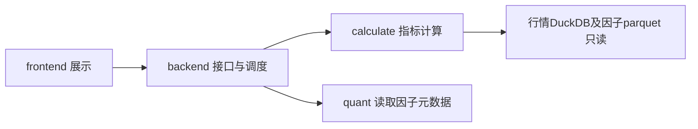

# 使用与维护

从项目根执行：

```bash
bash tools/monitor/serve.sh
```

打开 http://127.0.0.1:8800。默认完整分析最近3年、全A可交易池、5日收盘标签、10组。
首次不需要重建库或安装前端依赖。启动预检会检查主库、因子目录库与本地静态资源；
缺接口依赖时按 `apps/monitor/backend/README.md` 安装。可用 MONITOR_PYTHON 指定解释器，
MONITOR_PORT 修改端口；监听地址固定127.0.0.1，必须单worker运行。



列表页可搜索因子，详情页可切换完整分析/轻量IC，选择区间、股票池、标签、分组、
去极值、行业与Top-N。结果卡片按注册顺序逐段显示；四张分位图的等权、市值加权
并列展示。对比页选择2～4个因子共用参数逐个计算，各因子有效样本可能不同。

全历史完整分析会被保护上限拒绝，改选轻量IC即可。近上限请求与多因子完整对比
需要较长时间，参考 performance.md。缺数据和参数错误在开流前报告；流内错误显示
请求编号，用 `logs/apps/monitor/` 中对应模块日志定位。取消后，运行阶段会先安全结束再退出。
原生计算阶段互斥：两个请求可以同时在线并在阶段边界交替推进，但不会同时进入
DuckDB/NumPy 计算，代价是两个完整分析互相等待（见 performance.md 的并发验收）。

模块调用和修改注意事项见 `research/evaluation/calculate/README.md`、
`apps/monitor/backend/README.md`、`apps/monitor/frontend/README.md`。
接口见 api.md；指标口径见 docs/research/evaluation/README.md。
后端日志按模块目录组织、128MB轮转、文件名为首末消息时间（微秒），不会自动清理历史。

验收命令：

```bash
.venv/bin/python -m pytest -q
# 可选浏览器测试工具只用于验收：Playwright及Chromium
.venv/bin/python tools/monitor/browser_check.py
# 每次用独立进程测一个case；不可同时跑多个重型压测
.venv/bin/python -m tools.monitor.benchmark --case default
# P0-01 固定金标准、输入哈希、逐stage耗时和独立进程RSS
.venv/bin/python -m tools.monitor.operator_baseline --suite all
# 并发验收：双任务重复5轮走真实调度器与SSE；取消与背压必须对真实服务验证
.venv/bin/python -m tools.monitor.stress --mode local --case concurrent --rounds 5
.venv/bin/python -m tools.monitor.stress --mode http --server-pid <pid> --case cancel
```

benchmark另有near_limit/full_ic/compare/concurrent/reject案例。concurrent内部开启两个
任务，用于双请求最坏资源观测；其余案例应依次运行。stress另有cancel/slow场景，
结果追加写入 AiRecord/benchmarks/V11/日期-stress-模式.jsonl；本地模式因 TestClient
会缓冲整段响应，只跑双任务，取消与背压用 `--mode http` 对真实服务验证。

`operator_baseline.py` 用于后续算法和 C++ 优化对照，不作为日常全量 benchmark。它固定
完整评估、相关性单 stage、全历史轻量 IC、单族单年构建、挖掘门禁和边界语义，证据写入
`AiRecord/benchmarks/V105/p0-01-20261027/`。完整评估只跑一次；各案例独立子进程运行，
不要与其他重型分析并发。

批量核和 Numba 原型使用独立门禁：

```bash
.venv/bin/python -m tools.monitor.kernel_baseline --case suite
```

工具先校验数据指纹，再运行固定真实截面微基准；P1-01 以逐日排名达到 `1.5x` 为放行
门禁。Spearman Numba 仅保留诊断，真实 stage 收益留待 P1-03。C++ 单核使用独立工具：

```bash
.venv/bin/python -m tools.monitor.native_kernel_baseline
```

该工具在独立子进程分别测量 Python/C++ 的 5 次热运行中位数和 RSS。P1-02 结果为
`2.358x`。P1-03 已接入评估相关性，并用独立工具验证真实 stage、候选不退化、auto 选择
和内存：

```bash
.venv/bin/python -m tools.monitor.correlation_native_baseline
```

逐日排名和 Pearson 的核级、真实 stage、payload 与 RSS 对照：

```bash
.venv/bin/python -m tools.monitor.daily_native_baseline
```

当前 C++ 替换状态和最新证据见 [批量计算核](../../core/kernels/README.md) 与
[C++ 批量计算扩展](../../native/README.md)。

浏览器验收依赖不进项目环境，需要时临时安装：

```bash
.venv/bin/python -m pip install --target /tmp/monitor-browser-deps playwright
PYTHONPATH=/tmp/monitor-browser-deps PLAYWRIGHT_BROWSERS_PATH=/tmp/monitor-browsers \
  /tmp/monitor-browser-deps/bin/playwright install chromium
```

## 回测运行自检

`tools/monitor/backtest_audit.py` 只读 `data/databases/backtest.duckdb`，按 run_id 打印一次回测的
执行校准、拒单原因、资金分配状态、被现金缩小的买单（含进补回的格数与占比）、
权重偏差最大的格子与各明细表行数，并给出自检结论
（逐笔费用模型偏差、订单/日成本分项加总（日成本含冲击成本）、现金裁剪、兜底费率占比、
买入是否符合所属板块申报单位、分配明细订单是否逐格合法），不通过时退出码为 1：

```bash
.venv/bin/python tools/monitor/backtest_audit.py                 # 最近一次运行
.venv/bin/python tools/monitor/backtest_audit.py --run-id <run_id 或前缀>
```

没有成交的运行不会计算兜底费率占比；这类运行在成本分项和申报单位检查通过时同样可以退出 0。

回测页面验收用 `tools/monitor/backtest_check.py`：跑一次短区间回测并打开详情页截图。

回测耗时与内存剖析用 `tools/monitor/backtest_profile.py`。工具在独立进程中通过生产
调度器和临时结果库运行真实回测，输出阶段耗时、峰值 RSS 与 run_id：

```bash
.venv/bin/python -m tools.monitor.backtest_profile --case all_a_3y
.venv/bin/python -m tools.monitor.backtest_profile --case index_10y
.venv/bin/python -m tools.monitor.backtest_profile --case dual
```

证据追加写入 `AiRecord/benchmarks/V57/`；`dual` 使用两个 worker 同时提交两份回测。

## 申万行业覆盖自检

`tools/v5/audit_sw_industry.py` 只读 `data/databases/quant.duckdb`，按年份统计有行情但无有效行业、
SW2014/SW2021 分段数、carry-forward 和上市日前向补全段数；2016~2026 已分类股票缺失不为 0 时
退出码为 1，尚无任何申万记录的新股单独列为 unclassified：

```bash
.venv/bin/python tools/v5/audit_sw_industry.py --start 2016-01-01 --end 2026-10-15
.venv/bin/python tools/v5/audit_sw_industry.py --json
```

原始分片和空响应审计用 `tools/v5/audit_core_resources.py`。
