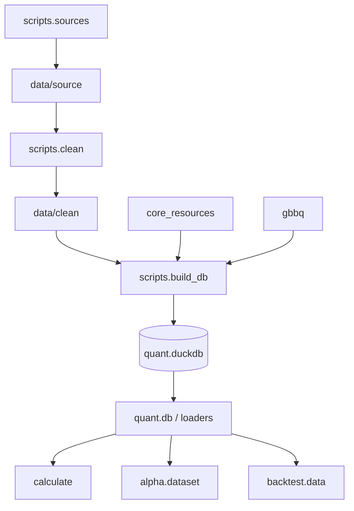

# 共享基础与数据层

本章覆盖 `core/common` 和 `core/data`。前者提供全项目共享的路径与日志能力，后者负责从
外部数据源取数、清洗、建库，并通过 `quant` 包提供统一读取接口。

## 1. 技术栈

| 技术 | 作用 |
|---|---|
| Python 3.12 | 数据处理、脚本编排和读取接口 |
| pandas / NumPy | 年度面板清洗、向量化计算和结果核对 |
| PyArrow / Parquet | 原始分片、清洗数据和因子数据的列式存储 |
| DuckDB | 主行情库、标签表、财务表、公司行动和元数据 |
| Tushare SDK | 经中转地址拉取 A 股数据 |
| requests | Worker 之外的项目内部 HTTP 调用和下载 |
| pytest | 数据接口、清洗规则、建库和一致性测试 |

相关锁定版本见 [requirements.txt](../../requirements.txt) 和
[requirements.lock](../../requirements.lock)。

## 2. 提供功能

### 2.1 共享路径

[core/common/paths.py](../../core/common/paths.py) 的 `PROJECT_ROOT` 是统一根路径，
后续常量都从它派生：

- `DATA_DIR`、`DB_FILE`、`FACTOR_DIR`、`MODEL_DATA_DIR` 等数据路径。
- `MINING_*` 和 `BACKTEST_DB_FILE` 等业务产物路径。
- `log_root_for(module_name)` 把模块名映射到业务域日志目录。
- `ensure_layout_dirs()` 创建运行时可写目录。

业务代码不应自行用相对字符串拼接数据路径。这样做保证脚本从不同工作目录启动时仍能找到
同一份数据。

### 2.2 集中日志

[core/common/logging_conf.py](../../core/common/logging_conf.py) 提供
`TimestampedFileHandler` 和 `get_logger()`：

- 日志目录按模块名划分，例如 `calculate.panel` 写到
  `logs/research/evaluation/calculate_panel/`。
- 文件名格式为“首条日志时间-最后一条日志时间”，时间精确到微秒。
- 单文件超过 128 MB 时自动新建日志段。
- 模块 logger 设置 `propagate=False`，避免重复输出到根 logger。

这套日志实现用于满足模块级排障需要。日志是运行证据，不是业务事实来源；候选状态、
回测状态和模型登记仍分别以数据库或 manifest 为准。

### 2.3 外部数据获取

[core/data/scripts/sources/fetch_all.py](../../core/data/scripts/sources/fetch_all.py)
是统一入口，支持：

```bash
.venv/bin/python -m scripts.sources.fetch_all reference
.venv/bin/python -m scripts.sources.fetch_all daily --start 20000101 --end 20261015
.venv/bin/python -m scripts.sources.fetch_all extra --end 20261015
.venv/bin/python -m scripts.sources.fetch_all index --end 20261015
.venv/bin/python -m scripts.sources.fetch_all core --end 20261015
.venv/bin/python -m scripts.sources.fetch_all gbbq
.venv/bin/python -m scripts.sources.fetch_all status
```

子模块职责：

| 子模块 | 功能 |
|---|---|
| `tushare_src.py` | 客户端、限速回退、按交易日批量拉取、分片续跑 |
| `core_resources.py` | 财务、分红、披露日、申万历史成员等核心资源 |
| `gbbq.py` | 固定版本公司行动文件下载和 SHA-256 校验 |
| `cache.py` | 一次性参照表缓存 |
| `fetch_all.py` | 命令解析和阶段编排 |

数据源硬约束包括：取数单进程、两个线程、同一时间不能启动第二个取数进程；日线分片按
年/月落盘；指数权重使用分片增量和覆盖率门槛。具体接口行为与历史数据异常记录在
[取数说明](../core/data/sources.md)。

### 2.4 清洗

[core/data/scripts/clean/pipeline.py](../../core/data/scripts/clean/pipeline.py)
按年处理原始分片，输出 `data/clean/daily/year=YYYY/part.parquet`。

| 文件 | 职责 |
|---|---|
| `sources.py` | 读取分片、交易日历、股票基础表、曾用名和停牌记录 |
| `io.py` | 股票 × 交易日二维面板组装 |
| `adjust.py` | 复权因子、上一有效收盘、日收益和除权日判定 |
| `lifecycle.py` | 上市、退市、ST、退市整理期和停牌状态 |
| `limits.py` | 涨跌停比例、价格取整、可交易性 |
| `validate.py` | A1～A8 校验和异常表 |
| `manifest.py` | 清洗清单、行数、股票数和异常摘要 |

关键口径：

```text
后复权价 = 原始价 × factor
前复权价 = 原始价 × factor / factor_T
日收益   = change / (close - change)
```

其中 `factor_T` 是股票最后一个有效交易日的复权因子。停牌通过官方停牌记录和“上市期内
无行情”合并识别；涨跌停价优先使用官方数据，缺失时才按板块、ST 和日期规则推算。

### 2.5 标签

[core/data/scripts/build_db/labels.py](../../core/data/scripts/build_db/labels.py)
生成 `md.fwd_return`。每行和 `md.daily_hfq` 对齐，提供 1/3/5/10/15/20 日两套收益：

| 标签族 | 买入价 | 卖出价 |
|---|---|---|
| `fwd_ret_close_N` | `t` 日收盘 | `t+N` 日收盘 |
| `fwd_ret_open_N` | `t+1` 日开盘 | `t+1+N` 日开盘 |

价格使用后复权，停牌区间以前一有效价格填平。`t` 日停牌或未来价格不足时标签为空。
标签表本身不筛股票池，下游负责叠加可交易性。

### 2.6 建库

[core/data/scripts/build_db/build.py](../../core/data/scripts/build_db/build.py)
读取清洗数据和辅助资源，构建：

| schema | 主要内容 |
|---|---|
| `md` | 原始/后复权/前复权日线、未来收益、指数、申万行业指数、日历、停牌区间 |
| `ref` | 股票基础、曾用名、指数目录、指数权重、申万成员、公司行动 |
| `fin` | 利润表、资产负债表、现金流量表、财务指标 |
| `evt` | 官方停牌明细 |
| `meta` | 数据版本、财务/行业/公司行动清单、异常和数据字典 |

当前库路径为 `data/databases/quant.duckdb`，表结构和当前版本说明见
[数据库文档](../core/data/database.md)。建库是重建式流程；只重建标签时使用
`scripts.build_db.labels`，但 DuckDB 不一定回收旧数据块。

### 2.7 统一读取

公开入口是 [core/data/quant/__init__.py](../../core/data/quant/__init__.py)，主要接口：

```python
import quant

bars = quant.load_panel(
    start="2024-01-01",
    end="2024-12-31",
    fields=["open", "close", "ret", "can_buy_close"],
    adjust="hfq",
)
close = quant.load_panel_wide(
    "close", start="2024-01-01", end="2024-12-31", adjust="hfq"
)
labels = quant.load_label(
    start="2024-01-01", end="2024-12-31", horizons=[1, 5, 20], price="open"
)
factors = quant.load_factor_panel(
    start="2024-01-01", end="2024-12-31", names=["MOM_20", "EP_TTM"]
)
```

其他读取接口覆盖日历、股票基础信息、停牌区间、指数权重、指数日线、申万行业成员、
公司行动、财务明细和财务时点面板。需要直接 SQL 时使用
[core/data/quant/db.py](../../core/data/quant/db.py) 的 `query()`。

### 2.8 当前数据规模

当前主库版本为 `tushare_fullA_20000104_20261015`，行情覆盖
2000-01-04～2026-10-15，共 6,488 个交易日、5,913 只股票，三张同构日线表各
17,999,882 行。主库包含 26 张表，约 7.3 GB；另有 60 个指数和 31 个申万一级行业。

这些数字是当前本地数据快照的规模和能力说明，不是代码常量。实际运行时仍应从
`meta.manifest`、各 manifest 和数组形状读取，而不是在业务逻辑中写死。

## 3. 如何使用

### 3.1 使用现有数据

日常研究不需要重新取数和建库，直接从 `quant` 读取。开始前检查数据版本：

```python
from quant.db import query

print(query("SELECT * FROM meta.manifest"))
print(query("SELECT factor_version, factor_count, rows FROM meta.factor_manifest"))
```

### 3.2 从原始分片完整重建

```bash
.venv/bin/python -m scripts.sources.fetch_all reference
.venv/bin/python -m scripts.sources.fetch_all daily \
  --start 20000101 --end 20261015
.venv/bin/python -m scripts.sources.fetch_all extra --end 20261015
.venv/bin/python -m scripts.sources.fetch_all index --end 20261015
.venv/bin/python -m scripts.sources.fetch_all core --end 20261015
.venv/bin/python -m scripts.sources.fetch_all gbbq
.venv/bin/python -m scripts.clean.pipeline
.venv/bin/python -m scripts.build_db.build
```

完整重建会替换主库并占用大量时间和磁盘。只刷新近期数据时，先增量取数，再按项目
[运行手册](../core/ops/v5_runbook.md) 执行清洗、建库和因子更新。

### 3.3 日常只更新标签

```bash
.venv/bin/python -m scripts.build_db.labels
```

该命令适合修改标签实现后的定向重建。正式交付前仍应运行标签自检和相关下游测试。

## 4. 内部结构与调用关系



### 4.1 `core/common`

`paths.py` 被几乎所有模块调用，属于底层依赖；它不反向依赖业务模块。`logging_conf.py`
被各业务域的 `logging_conf.py` 二次封装，使每个模块只关心业务域日志根目录。

### 4.2 取数层

`fetch_all.main()` 选择阶段函数；阶段函数调用 `tushare_src.py` 或
`core_resources.py`，结果写入 `data/source/`。下载器不解析因子或标签，也不修改
`quant.duckdb`。

### 4.3 清洗层

`clean.pipeline` 是唯一编排入口。它逐股票和交易日组装面板，跨年只传递最后有效收盘价。
清洗代码依赖 `quant.codes` 做股票代码归一，依赖配置和错误模块提供路径及错误码。

### 4.4 建库层

`build_db.build` 读取年度清洗 Parquet 和辅助资源，在一个新的 DuckDB 文件中创建 schema、
导入表、生成复权表、标签和 manifest，成功后替换正式库。财务与公司行动构建分别在
`financial.py` 和 `corporate_actions.py` 中完成。

### 4.5 读取层

`quant.loaders` 负责行情和辅助数据，`quant.loaders_factors` 负责因子长表、宽表和目录。
它们返回 pandas DataFrame，不负责模型或回测的业务过滤。调用方必须自己应用股票池、
标签周期和交易时点。

## 5. 关键数据结构

### 5.1 `MarketData`

回测层用 [trading/backtest/data.py](../../trading/backtest/data.py) 的 `MarketData`
约束读取结果。它包含：

- 原始开收盘价和成交额宽表。
- 可交易、停牌、ST、涨跌停和退市标记。
- 因子宽表字典。
- 股票上市日、退市日、板块和可选的指数成分矩阵。
- 可选行业、冲击波动率、基准和公司行动。

构造函数检查所有面板的索引与股票列完全一致，防止数据在模块间传递时错位。

### 5.2 代码与单位

股票代码统一为交易所前缀加 6 位数字。原始数据中的 `600000.SH`、`sh.600000`、
`T600018.SH` 等格式在入库时归一。指数代码保持 Tushare 格式。行情量统一为股，
成交额为元；总市值通常为万元，使用前要确认字段口径。

## 6. 日志、错误与自检

| 前缀 | 范围 |
|---|---|
| `SRC-1xx` | 外部数据源取数 |
| `CLEAN-1xx` | 原始数据读取与对齐 |
| `CLEAN-2xx` | 复权与收益 |
| `CLEAN-3xx` | 生命周期和涨跌停 |
| `CLEAN-4xx` | 建库写入 |
| `CLEAN-5xx` | 数据验收 |
| `FACTOR-1xx/2xx/3xx` | 因子定义、构建和检查 |

常见自检包括：

- 日线状态非空、上市期内交易日没有空洞。
- 除权日与复权因子变化能否互相对应。
- 官方涨跌价格与规则推算价格的一致性。
- 标签行集、停牌空值、尾部缺失和极端收益边界。
- 因子行集与 `md.daily_hfq` 双向差集为零。

## 7. 修改注意事项

1. 修改路径或目录结构时同步更新 `core/common/paths.py` 和布局测试。
2. `data/source/` 是原始证据层，不要把因子、模型或清洗结果写回这里。
3. 复权、上一有效收盘和停牌规则互相依赖，不能单独修改其中一处。
4. 财务字段只能用公告日次一交易日之后的数据，禁止按报告期直接前填。
5. 指数成分池必须使用上一已结束月份的月末快照，不能使用当前月或最新成分。
6. 标签和因子应使用后复权价；回测成交使用原始价。
7. 读取层保持纯读取，不要在 `quant.loaders` 中加入写库逻辑。
8. 修改公司行动数据源、冲突处理或税务规则时，要同步回测账本和审计工具。

