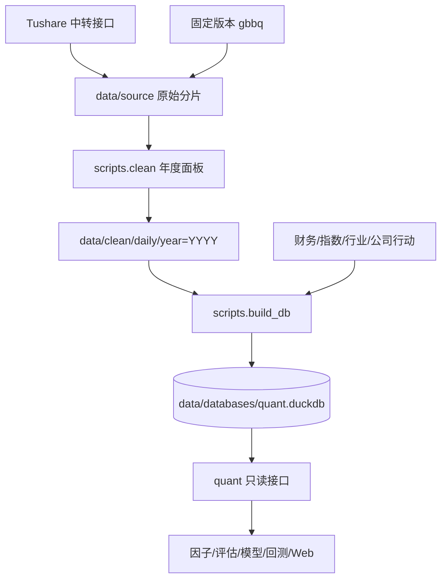

# 共享基础与数据层

本章解释 `core/common` 和 `core/data` 如何把外部 A 股数据变成可复用的 DuckDB
主库，以及研究代码应如何通过 `quant` 读取这些数据。读完应能回答四个问题：数据从
哪里来、一条股票日线经过哪些变换、库里的字段是什么口径、出问题时从哪里定位。

本章不展开因子计算、模型训练、回测和 Web 服务；这些模块如何使用数据，见后续专题。

## 1. 职责边界

数据层负责：

- 从 Tushare 中转接口和固定版本 gbbq 文件取得原始分片。
- 清洗行情、复权因子、停牌、名称变更、财务和公司行动数据。
- 建立统一股票代码、日期、单位和字段口径。
- 生成日线、未来收益标签、财务、行业和指数等 DuckDB 表。
- 通过只读 Python 接口向因子、评估、模型和回测模块提供 DataFrame。

数据层不负责：

- 判断研究股票池是否适合某个策略；读取接口默认返回全量数据。
- 模拟成交、资金、税费和持仓；这些由回测账本负责。
- 将因子 IC、分位收益或模型结果直接解释成可实现投资收益。
- 自动修复源数据冲突；冲突一般显式报错、告警或按既定优先级处理。

## 2. 当前快照与硬约束

以 2026-10-26 工作区为准，当前主库版本为
`tushare_fullA_20000104_20261015`，文件约 7.33 GB，共 26 张表。行情覆盖
2000-01-04～2026-10-15，共 6,488 个交易日、5,913 只股票；`md.daily_bar`、
`md.daily_hfq`、`md.daily_qfq` 和 `md.fwd_return` 均为 17,999,882 行。

这些数字用于说明当前本地快照，不是代码常量。数据版本、日期范围和校验结果应从
`meta.manifest` 与各 manifest 表读取。

全链路必须保持一致的口径：

| 约束 | 项目口径 |
|---|---|
| 股票代码 | `SH600000`、`SZ000001`、`BJ920000` |
| 指数代码 | 保留 Tushare 写法，如 `000300.SH` |
| 股票日期主键 | `stock_code + trade_date` |
| 因子与标签价格 | 后复权价 |
| 回测实际成交价格 | 原始价，公司行动由账本处理 |
| 行情单位 | 价格为元，成交量为股，成交额为元 |
| 财务可用时点 | `trade_date > available_date` |
| 信号与执行 | 收盘生成信号，下一可交易日开盘或收盘按策略执行 |

## 3. 全链路数据流



一条股票日线记录的核心变换如下：

1. `daily`、`adj_factor`、`stk_limit` 和 `daily_basic` 按交易日取得，按
   “接口/年/月”写入原始分片。
2. 清洗层以股票为行、交易日为列组装一年面板，同时读取股票基础、名称变更和停牌记录。
3. 清洗层推导交易状态、上一有效收盘价、收益、除权标记、涨跌停价和可交易标记。
4. 年度长表只保留上市期内的 `trading` 与 `suspended` 行，写入
   `data/clean/daily/year=YYYY/part.parquet`。
5. 建库层从年度 Parquet 建立原始价日线表，再派生后复权、前复权表和未来收益标签。
6. 下游通过 `quant.load_panel()`、`quant.load_label()` 等接口读取，自行选择股票池、
   可交易条件和标签周期。

## 4. 共享基础

### 4.1 路径入口

[core/common/paths.py](../../core/common/paths.py) 是统一路径来源。`PROJECT_ROOT`
从源码位置解析，不依赖启动目录；数据、配置、文档、日志和数据库路径都从它派生。

常用常量包括：

- `DATA_DIR`、`SOURCE_DIR`、`CLEAN_DIR`、`DAILY_DIR`。
- `DB_FILE`、`FACTOR_DB_FILE`、`MINING_DB_FILE`、`BACKTEST_DB_FILE`。
- `FACTOR_DIR`、`MODEL_DATA_DIR`、`MINING_DATA_DIR`。
- 挖掘目录与配置文件路径。

`ensure_layout_dirs()` 创建运行时目录。`log_root_for(module_name)` 按业务域选择日志
根目录。业务代码应引用这些常量，不应写相对路径；测试通过
[tests/test_project_layout.py](../../tests/test_project_layout.py) 校验公共包和关键路径。

### 4.2 集中日志

共享实现位于 [core/common/logging_conf.py](../../core/common/logging_conf.py)，数据脚本的
薄封装位于 [core/data/scripts/logging_conf.py](../../core/data/scripts/logging_conf.py)。

日志行为：

- 模块名中的点替换为下划线后成为子目录，例如 `build_db.build` 写入
  `logs/core/data/build_db_build/`。
- 第一次写入才创建文件，文件名为“首条记录时间-最后一条记录时间”，精确到微秒。
- 每次写入后文件名中的结束时间随最后一条记录更新。
- 当前段再加一条消息会超过 128 MB 时，先关闭旧段，再创建新段。
- logger 设置 `propagate=False`，避免同一条消息写入根 logger。
- logger 对同一目录只安装一个带标记的 handler，重复调用 `get_logger()` 不会重复挂载。

日志是排障证据，不是业务事实来源。成交、候选、模型和标签状态仍应查询对应数据库或
manifest。当前实现没有跨进程文件锁；多个进程并发写同一模块日志前需要额外隔离。

### 4.3 股票代码

[core/data/quant/codes.py](../../core/data/quant/codes.py) 负责代码解析和板块判断。
`normalize_code()` 接受 `600000.SH`、`sh.600000`、`sh600000`、`600000` 等写法，
统一成 `SH600000`。`board_of()` 根据六位代码识别主板、创业板、科创板、北交所和 B 股，
用于涨跌停规则。

历史代码是特殊边界。Tushare 可能用 `T600018.SH` 表示曾占用同一数字代码的历史主体；
这些行无法稳定映射到现上市主体时，由 `normalize_codes()` 记 WARNING 并返回 `None`。
退市清单中的历史主体与在市股票撞码时，`stock_reference()` 和建库层按“在市优先”去重。

## 5. 外部数据获取

统一入口是
[core/data/scripts/sources/fetch_all.py](../../core/data/scripts/sources/fetch_all.py)。
它不是标准 `argparse` 子命令，而是手工解析第一个动作和 `--start`、`--end`、
`--codes` 参数；未知参数不会显示帮助，也不能用 `--help` 安全探测。

| 动作 | 主要行为 |
|---|---|
| `reference` | 交易日历、全部状态股票基础表、曾用名 |
| `daily` | 按交易日拉取 `daily`、`adj_factor`、`stk_limit`、`daily_basic` |
| `extra` | 官方停牌记录和指数历史成分权重 |
| `index` | 指数目录、精选指数日线、申万一级行业日线、成分权重 |
| `index-daily --codes ...` | 只刷新指定指数日线并与已有缓存合并 |
| `core --end ...` | 财务四表、事件、分红和申万历史成员 |
| `industry --end ...` | 申万历史成员、缺口候选和逐股修复 |
| `gbbq` | 下载固定版本公司行动文件并校验摘要 |
| `refresh --start ... --end ...` | 刷新参照、日行情、停牌和指数资源 |
| `status` | 查看日频接口、核心资源和 gbbq 的落盘状态 |
| `all` | 只执行 `reference`、`daily`、`extra`，不包含 `index`、`core`、`gbbq` 或 `industry` |

未传日期时，日频动作使用 `20000101`～`20261015` 的代码默认值；更新版本时应显式传
`--start` 和 `--end`。典型命令：

```bash
.venv/bin/python -m scripts.sources.fetch_all reference
.venv/bin/python -m scripts.sources.fetch_all daily --start 20260901 --end 20261015
.venv/bin/python -m scripts.sources.fetch_all index --end 20261015
.venv/bin/python -m scripts.sources.fetch_all core --end 20261015
.venv/bin/python -m scripts.sources.fetch_all industry --end 20261015
.venv/bin/python -m scripts.sources.fetch_all index-daily \
  --codes H00300.CSI,H00905.CSI --start 20261015 --end 20261015
.venv/bin/python -m scripts.sources.fetch_all gbbq
.venv/bin/python -m scripts.sources.fetch_all status
```

关键实现边界：

- 中转服务并发上限较低，日频拉取固定为单进程、两个线程，并用信号量限制请求；
  同一时刻不要启动第二个取数进程。
- `tushare_src.call()` 对网络、限流和服务端临时错误退避重试；权限错误立即抛
  `SourcePermissionError`，重试耗尽抛 `SourceRateLimitError`。
- 日频接口按月分片，续跑以完整月分片为单位，不重新打开每个交易日文件。
- 核心资源使用分页和清单记录；空响应记为 `empty`，不会伪装成完整文件。
- 指数权重接口单次只返回最近 7,000 行且结果可能不稳定，下载器通过窗口拆分、并集合并
  和覆盖率门槛处理。当前产物覆盖 12 个宽基指数；中证全指不建立历史成员池。
- gbbq 是固定提交和 SHA-256 的外部文件。摘要不符时拒绝使用，不能悄悄换成另一版本。

更细的接口实测、行业分片和指数权重问题见
[取数说明](../core/data/sources.md)。

## 6. 清洗

唯一编排入口是
[core/data/scripts/clean/pipeline.py](../../core/data/scripts/clean/pipeline.py)。
`run()` 按年调用 `process_year()`，跨年只传每只股票最后一个有效交易日的收盘价。
年度执行顺序是：

```text
交易日与存活股票
-> 四类日频数据组成二维面板
-> 上市/停牌/ST/退市整理期状态
-> 上一有效收盘与除权标记
-> 涨跌停价和可交易标记
-> 只保留上市期内的 trading/suspended 行
-> 年度 Parquet
```

按年处理是因为全历史二维面板会占用十几 GB 内存；年度切分把峰值压到单年百万级单元格。

### 6.1 输入与单位

`scripts.clean.sources` 从 `data/source/tushare/raw/<接口>/year=YYYY/month=MM.parquet`
读取行情类数据。映射到面板时同步换算：

- Tushare `vol` 的手数乘 100，落为 `volume_share` 股数。
- Tushare `amount` 的千元乘 1000，落为 `amount_cny` 元。
- 原始价保留未复权，`adj_factor` 落为 `factor`。
- `total_mv`、`circ_mv` 保持万元，`turnover_rate`、`dv_ttm` 保持百分数。

### 6.2 状态与生命周期

`scripts.clean.lifecycle` 先为每年选定可能上市的股票，再按上市日、退市日和当日是否有
价格构造内部状态：

| 内部状态 | 含义 | 是否落盘 |
|---|---|---|
| `not_listed` | 上市日前 | 否 |
| `trading` | 上市期内且有行情 | 是 |
| `suspended` | 上市期内无行情，或命中官方停牌记录 | 是 |
| `ended` | 退市日后 | 否 |

上市前和退市后的交易日不铺空行，区间由 `ref.stock_basic.list_date` 与 `delist_date`
表达。这样既表示生命周期，又避免制造大量无效行，但下游做全 A 池时必须检查这两个字段。

ST 与退市整理期来自 `namechange` 的证券简称区间：

- 匹配 `ST`、`*ST`、`SST`、`S*ST` 前缀标记 ST。
- 简称含“退”或“退市”时标记退市整理期。
- `st_source` 记录该股票是否有名称变更覆盖，无法判断时标记 `no_change_record`。

### 6.3 复权、昨收和除权

`scripts.clean.adjust` 保持三类价格口径：

```text
原始价   = close
后复权价 = close × factor
前复权价 = close × factor / factor_T
日收益   = change / (close - change)
```

`factor_T` 是该股票最后一个有效交易日的复权因子。前复权以未来终值为基准，价格水平包含
全样本信息，因此不适合提前生成历史标签或做严格时点比较；后复权用于因子和标签。

`pre_close` 的主口径是 `close - change`，与交易所当日涨跌幅一致。除权识别则使用
“上一有效交易日收盘价”与 `close - change` 的比较：

```text
abs(change - (close - previous_valid_close)) > 1e-4 × abs(close)
```

停牌日没有价格。计算昨收时先对收盘价序列前向填充，再下移一行；跨年种子和 `carry_close`
也取上一年最后一个有效交易日。如果只做简单的一行下移，停牌期间发生除权的股票在复牌
首日会漏标。

### 6.4 停牌与可交易性

最终停牌状态是两部分的并集：

- Tushare `suspend_d` 的官方停牌记录。
- 股票处于上市期内但当日没有行情。

涨跌停价优先使用官方 `stk_limit`。任一官方价格缺失时，才按板块、日期、ST、上市阶段和
退市整理期规则推算。规则覆盖主板、创业板、科创板、北交所、B 股、注册制新股前 5 日、
2014 年后上市首日特殊限幅和老规则。价格一律按 A 股最小价位四舍五入到 0.01 元。

可交易标记是保守近似：

- `can_buy_close`：当日交易且收盘未封涨停。
- `can_sell_close`：当日交易且收盘未封跌停。
- `can_buy_open_next`：下一交易日交易且下一开盘未封涨停。
- `can_sell_open_next`：下一交易日交易且下一开盘未封跌停。

没有涨跌停约束时视为可交易。该标记没有模拟排队、盘口深度和部分成交，不能替代回测。
一段停牌会汇总到 `md.suspend_segment`，连续超过 20 个交易日标记为长停牌。

### 6.5 校验边界

`scripts.clean.validate.run_all()` 当前直接计算：

| 检查 | 内容 |
|---|---|
| A1 | 状态非空、枚举合法、上市期内交易日无空洞 |
| A2 | 除权标记与复权因子跳变是否对应 |
| A3 | 官方涨跌额收益与因子收益的差异 |
| A4 | 收盘价是否越过涨跌停价 |
| A6 | 停牌股票日和单股最长停牌 |
| A7 | 异常明细总行数 |

逐年 `rule_consistency` 记录规则涨停价与官方涨停价的一致率，可视为 A5 的诊断数据，但
没有独立硬门禁。当前代码没有单独的 A8 校验。`run_all()` 将结果写入 manifest 和异常表，
不因异常数量非零自动中止；完整清洗后仍需人工查看检查项，不能用“命令退出 0”等同于
“数据全部正确”。

异常表定位到 `stock_code + trade_date`，类型包括涨跌停越界、收益口径差异、除权与因子
跳变不对应和价格非正。更细的校验口径和历史实测见
[清洗说明](../core/data/cleaning.md)。

## 7. 标签

[core/data/scripts/build_db/labels.py](../../core/data/scripts/build_db/labels.py) 从
`md.daily_hfq` 生成 `md.fwd_return`。决策时点是 `t` 日收盘后，周期固定为
1、3、5、10、15、20 个交易日：

| 列族 | 买入 | 卖出 | 需要的未来行数 |
|---|---|---|---|
| `fwd_ret_close_N` | `t` 收盘 | `t+N` 收盘 | `N` |
| `fwd_ret_open_N` | `t+1` 开盘 | `t+1+N` 开盘 | `N+1` |

停牌段用上一有效价格填平，因此持有期内的复牌跳空会计入终点收益。`t` 日停牌时，当天不是
可建仓决策点，整行标签为空；尾部不足所需未来行数时为空。表行集与 `md.daily_hfq`
完全一致，不筛股票池，也不附可交易标记。

建库自动生成并执行 `verify_labels()`。任一条件不满足都会以建库失败处理：

- 标签表与后复权日线行数一致。
- 停牌行没有标签。
- 每档标签的非尾部缺失数等于理论尾部缺失数。
- 一日收益与 `fwd_ret_close_1` 的差异占比不超过 0.5%。
- 没有收益小于 -100% 或绝对值超过 2000% 的行。

标签公式和常见误读见 [标签口径](../core/data/label.md)。

## 8. 建库

### 8.1 入口与破坏性边界

建库入口是
[core/data/scripts/build_db/build.py](../../core/data/scripts/build_db/build.py)：

```bash
.venv/bin/python -m scripts.build_db.build
```

正式建库会先执行财务源字段和磁盘空间预检，然后**直接删除现有
`data/databases/quant.duckdb`**，在原路径创建新库并逐表导入。当前实现不是“先写临时库、
成功后再替换正式库”，也没有自动备份；预检通过后若后续导入失败，旧库已经丢失，只留下
缺失或不完整的新库。操作前必须自行备份，并确保没有读取或写入进程占用主库。

`--skip-financial` 用于磁盘不足时排查，仍会删除主库且跳过财务预检，不能当作正式构建。

### 8.2 主要表

| schema | 表 | 内容 |
|---|---|---|
| `md` | `daily_bar` / `daily_hfq` / `daily_qfq` | 三张同构日线，只有四价与 `vwap` 口径不同 |
| `md` | `fwd_return` | 两套成交通道、六档周期的未来收益 |
| `md` | `index_daily` / `sw_index_daily` | 精选指数和申万一级行业日线 |
| `md` | `calendar` / `suspend_segment` | 交易日历与跨年停牌区间 |
| `ref` | `stock_basic` / `namechange` | 股票生命周期与简称历史 |
| `ref` | `index_basic` / `index_weight` | 指数目录和月末成分权重 |
| `ref` | `sw_industry_classify` / `sw_industry_member` | 申万分类目录与时点成员区间 |
| `ref` | `corporate_action` | 现金分红、送转、配股和拆并事件账本 |
| `fin` | 四张财务表 | 利润表、资产负债表、现金流和财务指标核心字段 |
| `evt` | `suspend_daily` | 官方停牌明细 |
| `meta` | 六张元数据表 | manifest、异常、字段字典和各专题摘要 |

唯一日线列定义来源是 [core/data/quant/schema.py](../../core/data/quant/schema.py) 的
`DAILY_COLUMNS`。建库和读取层都引用它，三张日线表必须保持列完全一致。

### 8.3 财务时点

[core/data/scripts/build_db/financial.py](../../core/data/scripts/build_db/financial.py)
导入收入、资产负债、现金流和财务指标数据。原始数据保留修订记录，正式表按
`stock_code + report_date + available_date + report_type` 去重，优先级依次看
`update_flag`、`f_ann_date`、`ann_date`。

`available_date` 对利润表、资产负债表和现金流优先取 `f_ann_date`，否则取 `ann_date`；
财务指标使用 `ann_date`。读取日面板时先用 `ASOF LEFT JOIN` 找
`trade_date > available_date` 的最近一期，因此公告日当天收盘信号不能使用该期财务数据。

财务指标保留 Tushare 百分数口径，例如 ROE 为百分数；因子层负责转成小数。财务金额为元。
完整原始字段仍在 `data/source/tushare/raw_financial/`。

### 8.4 行业与公司行动

申万成员合并 SW2014、SW2021、最新快照和逐股修复记录。冲突按“最新调入日优先；同日优先
有明确调出日的历史记录，再取较早结束者”解析；分类切换日为 2021-12-13。
`source_in_date`、`source_out_date`、`source_l3_code`、`source_api` 和
`carry_forward` 用于追溯。范围完全缺失时若最早记录晚于上市日，会向前补到上市日，但不会
用 `stock_basic.industry` 静态分类兜底。

公司行动的主源是 gbbq 类别 1，它包含送转、现金分红和配股条款。Tushare 分红记录用于：

- 与 gbbq 重叠事件交叉校验。
- 补充 gbbq 没有的事件。
- 在两边都缺失时，仅当总股本比例与复权因子比例一致时使用 `share_count` 兜底。

同股票同除权日以 gbbq 为主，冲突写入 `meta.corporate_action_manifest`。配股记录缺少正数
配股价时整条事件不执行；账本要求除权日唯一、股数乘数为正、现金分红和配股比例非负。
`corporate_action.build()` 在事务中替换表；完整主库重建没有同样的原子性保护。

```bash
.venv/bin/python -m scripts.build_db.corporate_actions
```

该命令只增量更新已有主库的公司行动表，不重建行情；主库不存在时直接失败。

## 9. 统一读取接口

公开入口是 [core/data/quant/__init__.py](../../core/data/quant/__init__.py)。默认数据库
路径来自 `common.paths.DB_FILE`；`quant.db.get_conn()` 默认只读打开，写库必须显式传
`read_only=False`。

| 接口 | 主要参数 | 返回与边界 |
|---|---|---|
| `load_panel` | `start/end/fields/adjust/stocks/drop_suspended` | 日线长表，日期闭区间，始终返回主键列 |
| `load_panel_wide` | `field/start/end/adjust` | 交易日 × 股票宽表，不提供股票过滤参数 |
| `load_label` | `horizons/price/stocks` | 校验六档周期和两套通道后返回标签长表 |
| `load_label_wide` | `horizon/price` | 单档标签宽表 |
| `load_calendar` | `start/end` | 交易日历 |
| `load_stock_basic` | `status` | 支持 `listed/delisted/suspended` 或 `L/D/P` |
| `load_suspend_segments` | 无 | 停牌区间长表 |
| `load_corporate_actions` | `start/end/stocks` | 按除权日闭区间读取公司行动 |
| `load_index_weight` | `index_code/start/end` | 历史成分权重；旧名 `load_index_constituents` 保留兼容 |
| `load_index_daily` | `index_code/start/end` | 精选指数日线 |
| `load_sw_index_daily` | `index_code/start/end` | 申万一级行业日线 |
| `load_sw_industry_member` | `start/end/stocks/classification` | 与区间相交的时点行业区间 |
| `load_index_basic` | `index_code/market/category` | 指数目录 |
| `load_financial` | `stock_code/table/start/end/fields` | 单只股票的财务原始记录 |
| `load_financial_panel` | `table/start/end/fields/stocks/drop_suspended` | 公告日时点日面板 |
| `load_financial_manifest` | 无 | 四张财务表的入库摘要 |
| `load_members` | `table/name` | 当前只支持申万 `industry_member` |

`load_panel()` 默认 `adjust="raw"`，`load_panel_wide()` 默认 `adjust="hfq"`，两者默认口径
不同，调用时应显式写明。`drop_suspended=True` 只保留 `status="trading"`，不会额外判断是否
封涨跌停或进入某个股票池。

### 9.1 最小读取示例

```python
import quant

bars = quant.load_panel(
    start="2024-01-01",
    end="2024-12-31",
    stocks=["SH600000"],
    fields=["open", "close", "ret", "can_buy_open_next"],
    adjust="hfq",
)

label_5 = quant.load_label(
    start="2024-01-01",
    end="2024-12-31",
    horizons=[5],
    price="open",
    stocks=["SH600000"],
)

financial = quant.load_financial_panel(
    table="fina_indicator",
    start="2024-01-01",
    end="2024-12-31",
    fields=["roe_yearly", "or_yoy"],
    stocks=["SH600000"],
)

actions = quant.load_corporate_actions(
    start="2024-01-01",
    end="2024-12-31",
    stocks=["SH600000"],
)
```

需要直接 SQL 时：

```python
from quant.db import query

manifest = query("SELECT * FROM meta.manifest")
sample = query(
    "SELECT * FROM md.daily_hfq "
    "WHERE stock_code = ? AND trade_date = ?",
    ["SH600000", "2024-01-02"],
)
```

读取层返回 pandas DataFrame，不负责缓存、横截面标准化或交易成本。因子读取接口
`load_factor_panel()`、`load_factor_wide()` 和 `load_factor_list()` 属于下一章。

## 10. 错误、日志与诊断

数据层可预期异常位于 [core/data/scripts/errors.py](../../core/data/scripts/errors.py)。

| 错误类 | 错误码 | 当前用途 |
|---|---|---|
| `QuantError` | `QUANT-000` | 项目数据类异常基类 |
| `SourceError` | `SRC-100` | 取数请求、分页、字段或空响应异常 |
| `SourcePermissionError` | `SRC-101` | 接口无权限，不继续重试 |
| `SourceRateLimitError` | `SRC-102` | 重试耗尽或持续限流 |
| `SourceEmptyError` | `SRC-103` | 已定义，当前取数代码未直接抛出 |
| `DataReadError` | `CLEAN-101` | 原始分片、日历、基础表缺失或面板形状不符 |
| `CalendarError` | `CLEAN-102` | 已定义，当前清洗代码未直接抛出 |
| `AdjustError` | `CLEAN-201` | 未知复权口径 |
| `MissingFactorError` | `CLEAN-202` | 有效交易日内缺复权因子 |
| `LifecycleError` | `CLEAN-301` | 已定义，当前生命周期代码未直接抛出 |
| `LimitRuleError` | `CLEAN-302` | 已定义，当前涨跌停代码未直接抛出 |
| `DbWriteError` | `CLEAN-401` | 建库、财务、行业或公司行动写入失败 |
| `ValidationError` | `CLEAN-501` | 已定义，当前清洗校验未直接抛出 |

错误类存在不等于运行时一定会输出该错误码。“已定义但当前未抛出”的项不能在排障文档中
描述成实际失败路径。完整建库把后续异常包装为 `DbWriteError` 并保留原异常链；读取接口
的参数错误通常是 `ValueError`，数据库文件不存在是 `FileNotFoundError`。

排查顺序：

1. 运行 `fetch_all status` 检查原始分片和核心资源。
2. 查看 `logs/core/data/<module>/` 的最后一段日志，定位失败模块。
3. 检查 `data/clean/manifest.json`、`meta.manifest` 和各专题 manifest。
4. 用 `meta.anomaly` 和 `stock_code + trade_date` 定位清洗异常。
5. 财务问题检查 `meta.financial_manifest`；公司行动问题检查
   `meta.corporate_action_manifest`。

## 11. 测试映射

当前定向测试共 141 个，全部通过。主要映射如下：

| 主题 | 测试 |
|---|---|
| 路径、公共包 | [test_project_layout.py](../../tests/test_project_layout.py) |
| 日志分段与轮转 | [test_common_logging.py](../../tests/test_common_logging.py)、[test_logging_conf.py](../../tests/test_logging_conf.py) |
| 代码归一 | [test_codes.py](../../tests/test_codes.py) |
| 取数续跑与资源清单 | [test_sources.py](../../tests/test_sources.py)、[test_core_resources.py](../../tests/test_core_resources.py)、[test_index_source.py](../../tests/test_index_source.py) |
| gbbq 校验 | [test_gbbq_source.py](../../tests/test_gbbq_source.py) |
| 复权与昨收 | [test_adjust.py](../../tests/test_adjust.py) |
| 生命周期与停牌 | [test_lifecycle.py](../../tests/test_lifecycle.py) |
| 涨跌停和可交易性 | [test_limits.py](../../tests/test_limits.py) |
| 标签 | [test_labels.py](../../tests/test_labels.py) |
| 财务时点 | [test_build_db_financial.py](../../tests/test_build_db_financial.py) |
| 行业区间 | [test_build_db_extra.py](../../tests/test_build_db_extra.py) |
| 公司行动 | [test_corporate_actions.py](../../tests/test_corporate_actions.py) |
| 读取接口 | [test_loaders.py](../../tests/test_loaders.py) |

测试覆盖正常路径和关键边界，但没有自动执行真实网络取数、完整 27 年清洗或完整主库重建。
完整建库的“先删后建”失败恢复也没有集成测试，因此手工备份和变更前检查仍是必要步骤。

## 12. 量化知识

### 12.1 复权与公司行动

后复权保持历史价格不变，用后续公司行动调整未来价格；收益序列可直接用于因子和标签。
前复权把最新价格固定，历史价格随之后行动变化；数值会因新数据刷新而改变。公司行动若
处理错误，会把分红、送转或拆并误判成巨大收益，影响 IC、分层和回测账本。

### 12.2 停牌、涨跌停与可交易性

停牌日的“无收益”不应被当作正常零收益样本；标签或因子决策点需要显式剔除。涨停封板时
理论上无法按收盘买入，跌停封板时可能无法卖出。当前可交易标记只根据价格和状态做保守
近似，未模拟排队、盘口和部分成交，因此研究中的可买标记仍可能高估真实执行率。

### 12.3 生命周期与幸存者偏差

只读当前上市股票会排除退市股并高估历史表现。本库保留 `delisted` 股票及其退市前行情，
研究股票池应按交易日检查上市日、退市日、ST、退市整理和停牌，而不是用今天仍在交易
的代码回看历史。

### 12.4 财务前视偏差

报告期不是可用日。财报可能在报告期后数周或数月公告，并可能修订。重述数据若回填到更早
时点，会制造前视偏差。正式研究只能使用信号日之前已经公告的版本，且公告日当天收盘信号
仍不能提前使用公告内容。

### 12.5 研究结论边界

日线、标签和因子评估没有完整模拟 A 股 T+1、涨跌停、停牌、资金约束、税费、滑点和冲击
成本。即使因子与未来收益相关，也不能直接宣称是可获得收益；交易可行性需要回测模块给出
更完整的答案。

## 13. 修改检查清单

1. 修改路径或目录时同步检查 `common.paths`、`ensure_layout_dirs()` 和布局测试。
2. 修改日线字段时同步 `DAILY_COLUMNS`、建库、三张同构表、读取接口和数据字典。
3. 修改复权、昨收或停牌规则时，一起核对收益、除权标记、标签和异常表。
4. 修改标签周期或成交通道时，同步 `LABEL_HORIZONS` / `LABEL_PRICES`、读取校验和文档。
5. 修改财务入库时保持 `trade_date > available_date`，并验证修订版本去重。
6. 修改指数成员或行业数据时验证月末快照、分类切换日和区间重叠。
7. 修改公司行动时同步检查 gbbq 摘要、冲突处理、`ref.corporate_action` 和回测账本。
8. 修改读取接口时保持只读、显式口径和参数校验，不要把业务股票池写进数据层。
9. 修改清洗或建库后先运行对应定向测试；涉及跨模块口径时再补联合测试。
10. 正式重建前备份主库、确认磁盘空间、停止并发读写，并记录实际数据版本。
