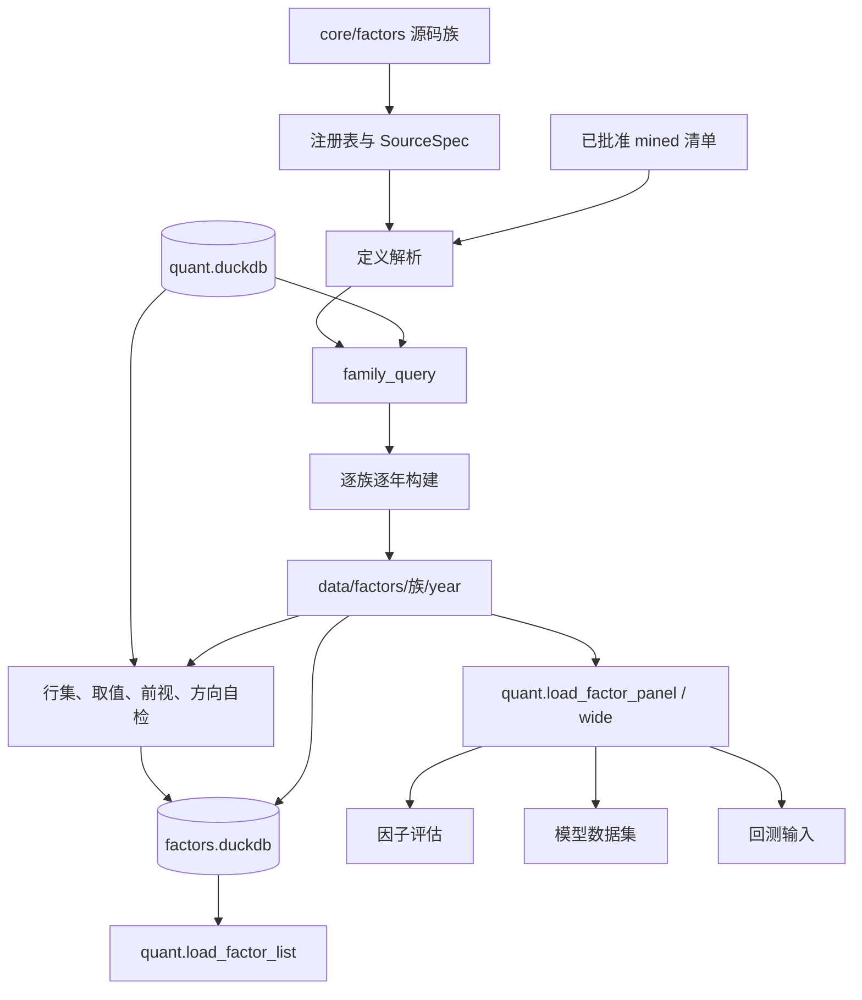

# 因子库

本章解释因子如何被定义、注册、计算、自检、索引和读取。读完应能回答：

- 一个 `define(...)` 最终怎样变成年度 Parquet；
- 时序窗口、横截面算子、附加数据源和财务时点连接分别按什么口径执行；
- 因子自检实际会拦截哪些问题，哪些结论只是诊断；
- 评估、模型和回测应通过什么接口读取同一份因子值；
- 修改因子或重建年份时，哪些数据和研究结果会被改变。

因子库只负责把研究假设变成可重复读取的因子值。股票池、标签、指标、模型和交易规则分别由
后续模块负责，不能把因子覆盖率或单因子 IC 直接当作可交易收益。

## 1. 职责边界与当前快照

因子库负责：

- 用不可变的 `FactorSpec` 描述因子名、族、公式、白话步骤、SQL 层、方向和依赖。
- 从 `md.daily_hfq` 读取后复权行情，按股票和交易日计算因子。
- 把因子值按族、按年写成 Parquet，并维护可重建的目录库。
- 通过 `quant` 提供因子清单、长表面板和宽表读取接口。
- 解析人工审批后正式发布的 `mined` 因子，使调用方不需要区分内置和已发布来源。

因子库不负责：

- 自动决定研究股票池。构建时的横截面包含当日全部有效交易行，评估层再施加
  “可买、非 ST、上市满 60 天”等筛选。
- 自动进行行业或风格中性化。现有算子可以表达标准化，但没有自动中性化步骤。
- 判断一个因子能否产生交易收益。自检只检查实现一致性、基本数值状态和历史方向。
- 重建或修改 `mined` 因子。正式发布由挖掘发布链单独完成。
- 保证整次构建跨文件原子完成；这一边界见第 4 节。

以 2026-10-26 的当前工作区为例，本地快照为：

| 项目 | 当前状态 |
|---|---|
| 内置因子 | 47 个，属于 11 个源码族 |
| 规划清单 | 186 条，其中已实现 47 条、待实现 139 条 |
| 年度产物 | 11 个族各有 `year=2000`～`year=2026`，共 297 个族年文件 |
| 因子数据规模 | `data/factors` 约 1.8 GB |
| 目录覆盖率累计 | 族年基础行合计 845,994,454；非空因子值约 7.98 亿个 |
| 当前已发布 `mined` | 工作区没有正式 `data/factors/mined` 链接 |

这些数字用于帮助理解规模，不是代码常量。因子数量以注册表为准，产物范围和覆盖率以
`factors.duckdb` 的 `meta.factor_coverage`、`meta.factor_build` 和
`meta.factor_manifest` 为准。

## 2. 在全链路中的位置



关键源码入口：

| 路径 | 职责 |
|---|---|
| [core/factors/registry.py](../../core/factors/registry.py) | `FactorSpec`、注册、解析和族清单 |
| [core/factors/ops.py](../../core/factors/ops.py) | 时序与截面 SQL 算子 |
| [core/factors/sources.py](../../core/factors/sources.py) | 指数与财务附加数据源、连接规则 |
| [core/data/scripts/build_factors/build.py](../../core/data/scripts/build_factors/build.py) | 构建、写 Parquet 和构建记录 |
| [core/data/scripts/build_factors/sql.py](../../core/data/scripts/build_factors/sql.py) | 年窗口、输入层和因子 SQL 生成 |
| [core/data/scripts/build_factors/validate.py](../../core/data/scripts/build_factors/validate.py) | 四类自检 |
| [core/data/scripts/build_factors/catalog.py](../../core/data/scripts/build_factors/catalog.py) | 目录库、视图和文档生成 |
| [core/data/quant/loaders_factors.py](../../core/data/quant/loaders_factors.py) | 因子清单与数值读取 |
| [core/factors/published.py](../../core/factors/published.py) | 已发布 `mined` 定义解析 |

## 3. 因子定义与注册

### 3.1 `FactorSpec` 契约

[core/factors/registry.py](../../core/factors/registry.py) 的 `FactorSpec` 是不可变数据类：

| 字段 | 含义 | 当前是否强校验 |
|---|---|---|
| `name` | 大写字母开头，只含大写字母、数字和下划线 | 是，构造时校验 |
| `family` | 所属族，必须是 `ALL_FAMILIES` 之一 | 是 |
| `formula` | 面向文档的公式文本 | 否；内置因子测试要求非空 |
| `description` | 金融含义 | 否；内置因子测试要求非空 |
| `steps` | 白话计算步骤 | 是，至少一条且每条非空 |
| `layers` | 按顺序执行的 SQL 表达式 | 是，至少一层且每层非空 |
| `lookback` | 声明的最大回看交易日，默认从表达式推导 | 只校验不小于推导值 |
| `direction` | `1` 表示越大越看多，`-1` 表示越大越看空 | 是 |
| `fields` | 依赖的日线字段 | 只写元数据，不自动检查 SQL 是否真的引用 |
| `extra_sources` | 依赖的附加数据源 key | 校验 key 是否存在，不检查 SQL 列依赖 |

`direction` 不会改变因子值，也不在构建 SQL 中乘正负号。它只用于目录展示、自检时判断
实测 Rank IC 符号是否与定义一致。因子值本身应为“方向已经表达清楚”的最终数值。

### 3.2 回看推导的真实边界

`required_lookback()` 只识别两类文本模式：

- `lag(..., n) over w`；
- `ROWS BETWEEN n PRECEDING AND CURRENT ROW`。

推导结果取所有层中的最大值，不会把多层窗口串行相加。需要在多层表达式中使用累计回看时，
应显式填写 `lookback`。不过当前构建查询实际从主库开头计算到目标年末，`lookback`
**不参与查询截断或性能优化**；它目前是定义一致性和目录元数据。真正限制窗口的是
`family_query()` 中的全历史 `base` CTE。

### 3.3 注册与发现

导入 `factors` 包时，[core/factors/__init__.py](../../core/factors/__init__.py)
依次导入 11 个内置族模块。每个模块调用 `define()`，再由 `register()` 写入进程内注册表：

- `all_factors()` 返回当前注册的内置因子，按族和名称排序。
- `family_factors(family)` 只接受 11 个内置族；`mined` 不在其中。
- `available_specs()` 合并内置因子与 `mined/definitions.json` 中的已发布定义。
- `resolve(name)` 先查内置注册表，再查已发布清单；找不到时抛 `FactorRegistryError`。

同名因子的普通注册默认报错，必须显式传入 `overwrite=True` 才能覆盖。正式发布链会额外
阻止新 `mined` 名称与内置因子或其他已发布因子重名。

当前 11 个内置族和因子数为：

| 族 | 数量 | 主要含义 |
|---|---:|---|
| `momentum` | 5 | 动量与反转 |
| `volatility` | 4 | 波动、偏度和彩票效应 |
| `liquidity` | 3 | 成交额、换手与非流动性 |
| `volume_price` | 2 | 量价相关与成交均价偏离 |
| `technical` | 3 | RSI、均线乖离和布林带位置 |
| `valuation` | 3 | EP、BP 和规模 |
| `fundamental` | 18 | 盈利、成长、杠杆、现金流和应计 |
| `cn_special` | 2 | 涨跌停与隔夜收益等 A 股特征 |
| `market` | 2 | 相对强弱和贝塔 |
| `alpha101` | 3 | Alpha101 的当前已实现子集 |
| `gtja191` | 2 | GTJA191 的当前已实现子集 |

### 3.4 附加数据源

[core/factors/sources.py](../../core/factors/sources.py) 用 `SourceSpec` 描述外部列：

| 数据源 | 内容 | 连接方式 |
|---|---|---|
| `index_000300` | 沪深300 日收益 | 按 `trade_date` 等值连接 |
| `index_000905` | 中证500 日收益 | 按 `trade_date` 等值连接 |
| `index_000985` | 中证全指日收益 | 按 `trade_date` 等值连接 |
| `fin_income` | 利润表核心字段 | 按股票和公告可用日 ASOF 连接 |
| `fin_balance` | 资产负债表核心字段 | 按股票和公告可用日 ASOF 连接 |
| `fin_cashflow` | 现金流量表核心字段 | 按股票和公告可用日 ASOF 连接 |
| `fin_indicator` | 财务指标核心字段 | 按股票和公告可用日 ASOF 连接 |

指数源只按日期连接，因此同一交易日的所有股票得到相同指数收益。财务源连接条件为：

```sql
base.stock_code = source.stock_code
AND base.trade_date > source.ann_date
```

财务源中的 `ann_date` 实际来自建库层生成的 `available_date`，即公告日或修订公告日的
可用日期。使用严格大于意味着公告日当天不用于收盘信号，次一交易日起才可用。最终因子值
落盘时仍以有效交易日为输入，因此非交易日公告会自然顺延到下一有效交易日。

同一股票、同一可用日存在多条报告时，源 SQL 先按 `report_date DESC, update_flag DESC`
取一条。不同财务报表之间分别做 ASOF，不强行要求来自同一报告期；这是当前实现的边界，
修改财务因子时应检查多表口径是否同步。

## 4. 从定义到因子产物

### 4.1 一次完整运行

以构建动量族 2024 年为例：

```bash
.venv/bin/python -m scripts.build_factors.build \
  --families momentum --start 2024-01-01 --end 2024-12-31
```

执行顺序如下：

1. `open_source()` 以只读方式把主库挂载为 `src`；主库不存在时抛
   `FileNotFoundError`。
2. `year_windows()` 从 `src.md.calendar` 找出请求区间覆盖的年份及首末交易日。
3. 未指定族时，默认构建 `factors.used_families()` 返回的全部已注册内置族；不会包含
   `mined`。
4. 构建器按“族 → 年”的顺序串行执行，不并行启动多个族。
5. 每年生成一条 SQL，把该族全部因子一次算出并写成一个 Parquet。
6. 写完后查询该族全部年份的覆盖率和极值统计。
7. 所有族、所有年份成功后，更新目录定义、覆盖率、视图、构建记录和 manifest。

### 4.2 年查询如何组装

[core/data/scripts/build_factors/sql.py](../../core/data/scripts/build_factors/sql.py)
生成的查询由四部分构成：

- `spine`：`md.daily_hfq` 中目标日期区间的全部行，包含停牌和退市股票历史。
- `base`：截至目标年末、`status = 'trading'` 的全部历史行。
- `enriched`：当因子声明 `extra_sources` 时，把附加数据源左连接到 `base`。
- 每因子 CTE 链：逐层计算 `v1`、`v2`…，最后一层把有限值转成 `float32`。

最终以 `spine LEFT JOIN` 各因子结果，按 `stock_code + trade_date` 输出。因此：

- 停牌行保留在主键行集中，但因子值为空。
- 窗口只在有效交易日上推进，停牌不占用“20 个交易日”。
- 个股长期停牌后复牌时，仍能取到复牌前自己的历史窗口。
- 截面算子看到目标截止日以前的完整交易横截面，而不是只看某一年。

这里有一个重要的性能和实现事实：`base` 没有“只取 `lookback` 个交易日”的下界。默认构建
每个族只执行一次截止到区间末的全部历史查询，再把结果按年分区；这样既保留完整回看，
也避免“族 × 年”反复扫描同一段历史。`yearly` 模式仍保留旧路径，用作回退和性能对照。

### 4.3 SQL 层与命名窗口

单层因子直接写成一个表达式。多层因子的中间层结果命名为 `v1`、`v2`…，后续层可以直接
引用。每个因子 CTE 都声明：

```sql
WINDOW w AS (PARTITION BY stock_code ORDER BY trade_date)
```

`w` 用于 `lag`、`row_number` 等时序窗口。显式滚动聚合使用
`PARTITION BY stock_code ORDER BY trade_date ROWS BETWEEN ...`；截面算子使用
`PARTITION BY trade_date`。多层写法主要解决 DuckDB 不允许窗口函数任意嵌套的问题。

最后一层统一执行：

```sql
CASE WHEN isfinite(expr) THEN expr ELSE NULL END
```

再转换为 `FLOAT`。中间层保持 DuckDB 默认数值精度，`NaN` 和正负无穷不会落盘。

### 4.4 年度文件和更新边界

产物路径固定为：

```text
data/factors/<family>/year=YYYY/part.parquet
```

每个文件包含 `stock_code`、`trade_date` 以及该族全部因子列，使用 ZSTD 压缩，row group
大小为 200,000。默认 `full_history` 模式先在 `data/factors/.staging/` 生成完整年度分区，
校验列类型、主键、行数和文件数量后再发布；`yearly` 模式直接写年度文件。

完整年度构建时，因子文件的主键集合应与当年 `md.daily_hfq` 主键集合一致。若只构建某年中的
一段日期，构建器仍会覆盖该年份原有的 `part.parquet`，留下一个不完整的年度文件。因此：

- 局部验证可使用临时 `factor_dir`；
- 正式更新优先按完整年度边界执行；
- 部分日期重建后，必须重新构建该族的完整年份，不能直接发布或用于全历史研究；
- `full_history` 在计算或校验失败时不会改动正式文件；发布阶段失败会恢复该族各年度旧文件；
- 进程被强制终止时可能遗留 `.staging/`，这些目录不会复用，需按运行日志确认后清理；
- 不同族依次发布，后一个族失败不会回滚已经成功发布的前一个族，目录库仍会记录整次运行失败。

DuckDB 会为每个族执行一条全历史 SQL，默认设置 `memory_limit=3GB`，允许使用临时文件溢出；
可用 `QUANT_FACTOR_BUILD_MEMORY_LIMIT` 覆盖。固定两年动量基准中，逐族逐年路径耗时
22.30 秒，一次全历史构建耗时 13.14 秒，下降 41.1%，峰值 RSS 由 3491.6MB 降至
3236.6MB。

### 4.5 目录库

[core/data/scripts/build_factors/catalog.py](../../core/data/scripts/build_factors/catalog.py)
维护 `data/databases/factors.duckdb`：

| 表或对象 | 内容 |
|---|---|
| `meta.factor_definition` | 已实现和规划因子的定义、步骤、SQL、方向 |
| `meta.factor_coverage` | 因子 × 年份的行数、非空数、覆盖率、极值、均值、分位数 |
| `meta.factor_check` | 行集、取值、前视和方向自检 |
| `meta.factor_build` | 每次构建的 run id、范围、因子数、写入行数、状态和错误 |
| `meta.factor_manifest` | 当前目录里的族、因子数和规模摘要 |
| `v.<family>` | 通过 `read_parquet` 建立的族视图，包括存在数据的 `v.mined` |

目录库不是因子值的事实来源。定义来自源码或已发布清单，数值来自 Parquet；目录库是可通过
构建和刷新重建的索引。`meta.factor_manifest.rows` 是按“族 × 年”去重后统计的基础行数，
不是所有因子值的总和。逐个因子的值数量看 `meta.factor_coverage`。

构建成功会更新定义、覆盖率、视图、构建记录和 manifest。构建异常会尝试写入一条
`status='failed'` 的构建记录，但不会刷新定义、覆盖率或 manifest。单个族内的发布异常
会回滚该族年度文件，已成功发布的多个族不做跨族回滚。

## 5. 算子、窗口与缺失值

### 5.1 时序算子

[core/factors/ops.py](../../core/factors/ops.py) 提供以下主要类别：

| 类别 | 算子 |
|---|---|
| 滞后与差分 | `ts_delay`、`ts_delta` |
| 窗口聚合 | `ts_mean`、`ts_sum`、`ts_min`、`ts_max`、`ts_median`、`ts_product`、`ts_count` |
| 分布统计 | `ts_std`、`ts_skew`、`ts_kurt`、`ts_rank` |
| 关系统计 | `ts_corr`、`ts_cov`、`ts_slope`、`ts_r2` |
| 特殊时序 | `ts_std_downside`、`ts_row_number`、`ts_arg_max` |
| 截面算子 | `cs_rank`、`cs_mean`、`cs_std`、`cs_zscore`、`cs_demean`、`cs_scale` |
| 标量算子 | `safe_div`、`signed_power`、`neg` |

时序统计的窗口长度按行数计算，每个“行”是输入 `base` 中的有效交易日。窗口不满时的行为
取决于 SQL 聚合本身：

| 表达式 | 历史不足时的当前行为 |
|---|---|
| `lag(x, n)` | 前 n 行返回空值 |
| `avg/sum/min/max/median` | 窗口内只要有一个非空值就可计算，不要求凑满 n 行 |
| `stddev_samp` | 至少两个非空值才可计算 |
| `corr/cov/slope/r2` | 通常至少两个有效观测，且常数序列可能返回空值 |
| `ts_rank(x, n)` | 比较最近 n-1 个可用滞后值，分母固定为 n-1，早期缺失前值不计入 |

因此不能笼统说“历史不足一律为空”。动量类 `lag` 因子在上市初期为空，而 20 日均值从
第一个有效交易日起就可能已有值。研究时必须结合具体算子判断，不应统一调用
`fillna(0)`。

`ts_std` 默认使用样本标准差；`ts_cov` 默认 `covar_samp`；截面标准差默认总体口径
`stddev_pop`。这些差异会改变数值，修改算子或替换实现时应同步检查公式和测试。

### 5.2 横截面算子

`cs_rank` 按每个 `trade_date` 对当日全部有效交易行排序，输出约 0～1 的分位；
`cs_zscore` 减去当日均值再除以当日总体标准差，标准差为 0 时返回空值；
`cs_demean` 只去均值；`cs_scale` 除以当日绝对值之和。

横截面范围来自 `base`，不是评估模块的可交易股票池。ST、停牌、次新股和历史退市风险
是否剔除由下游决定。若研究要求特定股票池，应先在评估层过滤，不能把全市场截面排名直接
解释成可交易组合排名。

项目没有“自动时序标准化”或“自动截面标准化”阶段。是否标准化、何时标准化以及是否做
行业/风格中性化，由具体因子公式或下游研究流程决定。

### 5.3 复权、单位与金融含义

- 价格类计算使用 `md.daily_hfq` 的后复权价，除权日不会产生未解释的价格跳空。
- `amount_cny` 单位为元；`total_mv`、`circ_mv` 单位为万元；`turnover_rate` 和财务
  原始比率通常为百分数。因子表达式负责转换成小数或目标量纲。
- 估值因子 EP_TTM 只对正 `pe_ttm` 取倒数，亏损股置空；BP 同样只保留正 `pb`。
- 财务因子只使用公告可用日之后的数据，避免把尚未披露的财报用于历史信号。
- `direction` 是研究者对经济含义的声明，不是统计保证。实测 IC 相反可能表示假设失效、
  方向写错、样本变化或实现有误，不能只改 `direction` 掩盖问题。

覆盖率只说明非空比例，不说明因子的预测能力；IC 只说明历史排序关系，不包含交易成本、
涨跌停、停牌、资金约束和容量。因子研究结论必须经过后续评估与回测才能讨论可执行收益。

## 6. 自检

### 6.1 命令与参数

```bash
.venv/bin/python -m scripts.build_factors.validate
.venv/bin/python -m scripts.build_factors.validate --families volatility --samples 20
.venv/bin/python -m scripts.build_factors.validate --no-catalog
```

参数含义：

| 参数 | 含义 |
|---|---|
| `--families` | 逗号分隔的内置族；空字符串表示全部已有产物的内置族 |
| `--samples` | 均匀抽样日期数的目标值；每年还会额外加入第三个交易日 |
| `--ic-start` / `--ic-end` | 方向检查的 IC 日期范围，必须同时提供才生效 |
| `--no-catalog` | 只打印，不写入 `meta.factor_check` |

未提供 IC 区间时，使用早于主库最大数据年份的最近一个已构建完整年份；如果不存在，则用
最后构建年份。`mined` 不在 `FAMILIES` 中，当前 validate CLI 不检查已发布族。

### 6.2 四类检查

**行集检查** 对每个已构建年份执行两个 `EXCEPT`：

- 因子键相对当年 `md.daily_hfq` 的多余键；
- 当年 `md.daily_hfq` 相对因子文件的缺失键。

它比较的是主键集合，不检查重复主键。行集差异是当前唯一会让 CLI 最终返回
`FactorCheckError` 的检查。部分日期覆盖一个年度文件时，会因为其余主键缺失而失败。

**取值检查** 统计每列 `isinf` 或 `isnan` 的数量，并附带统计“当日非空截面标准差为 0”的
天数。真正写入 `value` 的是非有限值数量；截面常数的天数目前只写进 `detail`，不会自动
判定失败。

**前视检查** 对每年第三个交易日和均匀抽样日期，用同一个 `family_query()` 截断到该日
重算，再与已落盘值比较。它同时检查：

- 数值非空部分的相对误差；
- 已落盘值和截断重算值的空值状态是否一致。

相对误差定义为 `abs(stored - recomputed) / max(1, abs(recomputed))`，当前容差为
`1e-5`。空值不一致也单独记录。当前结果只写目录库，不会自动抛错。

**方向检查** 使用与评估面板相同的全 A 研究池口径：

- 当日 `can_buy_close`；
- 非 ST；
- 距上市日至少 60 个自然日；
- 因子和 `fwd_ret_close_5` 都有限。

每个交易日至少 5 只股票才计算 Rank IC；有效 IC 少于 20 天时标记“方向未判定”。否则
输出 Rank IC 均值、ICIR，并对照 `FactorSpec.direction`。这是方向合理性诊断，不是因子
准入硬门禁，也没有考虑交易成本。

### 6.3 自检能证明什么

自检可以证明：

- 完整年度文件的键集合是否与主库一致；
- 抽样日期上，当前 SQL 在截断历史下能否重算出相同结果；
- 当前产物是否出现非有限值或已知截面常数；
- 抽样区间里 Rank IC 符号是否与声明方向一致。

自检不能证明：

- 所有日期、所有股票都没有前视偏差；
- 因子公式在经济上正确或仍然有效；
- 因子可以形成可执行组合；
- `mined` 因子、部分年度文件或缺失列也可安全读取；
- 非有限值、前视容差和方向不一致已经阻断发布。除行集差异外，这些目前不会让 validate
  CLI 返回失败。

## 7. 读取接口

[core/data/quant/loaders_factors.py](../../core/data/quant/loaders_factors.py) 暴露三个
公开接口，并从 `quant` 包重新导出。

### 7.1 `load_factor_list`

```python
import quant

all_defined = quant.load_factor_list()
implemented = quant.load_factor_list(status="implemented")
planned_momentum = quant.load_factor_list(family="momentum", status="planned")
```

返回列包括 `name`、`family`、`family_label`、`status`、`direction`、`lookback`、
`formula`、`description`、`steps`、`expr`、`last_year`、`avg_coverage` 和
`non_null_rows`。数据来自目录库，不扫描 Parquet。

该接口：

- 默认读取 `data/databases/factors.duckdb`；
- 可用 `db_path` 指向测试或暂存目录；
- 未知 `family` 或 `status` 不会主动报错，而是返回空表；
- 目录库不存在时抛 `FileNotFoundError`。

### 7.2 `load_factor_panel`

```python
panel = quant.load_factor_panel(
    start="2024-01-01",
    end="2024-12-31",
    names=["MOM_20", "EP_TTM", "PV_CORR_20"],
)

valuation = quant.load_factor_panel(
    start="2024-01-01",
    end="2024-12-31",
    families=["valuation"],
)

sample = quant.load_factor_panel(
    start="2024-01-02",
    end="2024-01-05",
    names=["MOM_20"],
    stocks=["SH600000"],
)
```

返回长表，列为主键 `stock_code`、`trade_date` 加请求因子，按
`trade_date, stock_code` 排序。

选择规则：

- 传 `names` 时，按名称解析族并读取这些因子；输出列按 `names` 顺序排列。
- 只传 `families` 时，读取这些族的全部已注册因子。
- `names` 和 `families` 都为空时，读取磁盘上全部已构建族。
- 同时传 `names` 和 `families` 时，已命名的因子仍按其真实族读取；不会补入仅在
  `families` 中但未被名称选中的其他因子。
- 所有因子默认输出到所有股票；`stocks` 只限制主键骨架的股票。

读取器以族顺序中的第一个族作为主键骨架，其余族按 `stock_code + trade_date` 左连接。
这个设计依赖各族完整年度文件的键集一致。若局部构建造成年份覆盖不一致，接口不会自动修复
或证明所有族完整，需要通过行集自检发现。

`built_names()` 只检查排序后的最后一年文件来确定族内实际列。它不能发现中间年份缺列或
历史 schema 漂移；跨年研究应结合行集检查和完整测试。

### 7.3 `load_factor_wide`

```python
mom20 = quant.load_factor_wide(
    "MOM_20", start="2024-01-01", end="2024-12-31"
)
```

该接口调用 `load_factor_panel(names=[name])` 后透视：

- 索引为 `trade_date`；
- 列为 `stock_code`；
- 值为指定因子；
- 不提供股票筛选参数。

### 7.4 读取错误

| 场景 | 当前异常 |
|---|---|
| 因子根目录没有数据 | `FactorDataError`，提示先运行构建 |
| 请求未知内置或已发布因子 | `FactorRegistryError` |
| 请求未构建的内置族 | `FactorDataError` |
| 请求非法族名 | `FactorDataError` |
| 落盘文件缺少请求列 | `FactorDataError` |
| 因子目录库不存在 | `FileNotFoundError` |

## 8. 目录刷新与文档生成

### 8.1 命令

```bash
# 按当前注册表和已发布清单刷新定义、族视图与 manifest
.venv/bin/python -m scripts.build_factors.catalog --refresh

# 重新生成 docs/core/factors/catalog.md 与 formulas.md
.venv/bin/python -m scripts.build_factors.catalog --write-docs

# 查看单个内置因子的公式、步骤、SQL 和复现示例
.venv/bin/python -m scripts.build_factors.catalog --explain MOM_20
```

`--refresh` 不重新计算覆盖率和自检，也不新增构建记录；它只是让目录定义和视图与当前
注册表/已发布清单重新对齐。`--write-docs` 生成 Markdown，不更新目录数据库。

### 8.2 生成内容的边界

`catalog.md` 和 `formulas.md` 由内置注册表与规划清单生成：

- 它们包含内置 47 个已实现因子和 139 个待实现规划项；
- 不自动列出已发布 `mined` 因子；
- 修改内置因子定义后，应及时运行 `--write-docs`，避免源码、目录与文档漂移；
- 这两份文档由脚本生成，不能手工改代码后只改文档。

`--explain` 先查内置注册表，再查规划清单。它不会解析 `mined` 清单，因此不能用
`--explain` 查看已发布挖掘因子。详细公式、步骤和复现方法仍应以
[docs/core/factors](../../docs/core/factors) 中的专题文档为准。

## 9. 已发布 `mined` 因子

### 9.1 产物契约

人工审批后的正式因子位于：

```text
data/factors/.mined-versions/<batch_id>/
data/factors/mined -> .mined-versions/<batch_id>
```

`mined` 是一个原子切换的符号链接。版本目录包含：

- `definitions.json`：版本为 `mining_published_factors_v1` 的定义清单；
- `year=YYYY/part.parquet`：整个已发布族重算后的数值；
- 每个定义条目保留因子名、公式、步骤、SQL 层、方向和来源候选/审批信息。

没有 `mined` 链接时，`load_manifest()` 返回空因子清单，不报错；JSON 损坏、根节点类型错误、
版本不支持或条目重复时会抛 `FactorRegistryError`。

### 9.2 发布为什么是整族重算

[research/mining/publication_builder.py](../../research/mining/publication_builder.py)
不会只把新候选追加到旧 Parquet。发布准备阶段会：

1. 重新校验候选表达式和语义哈希。
2. 检查名称与语义不重复。
3. 把旧已发布定义与新候选合并。
4. 从统一起始日重算整个 `mined` 族到冻结上下文的留出截止日。
5. 校验完整行集、覆盖率、前视偏差和产物摘要。
6. 复制正式目录库并在副本中合并定义、覆盖率和视图。

这样做保证某个版本目录中的 `definitions.json` 与所有年度数值一一对应，不会出现只追加
新列却沿用旧历史文件的状态。

### 9.3 原子提交与回滚

[research/mining/publication_commit.py](../../research/mining/publication_commit.py)
使用临时链接和 `os.replace()` 切换 `mined`，同时替换目录库并写入提交日志。提交前保留
旧链接目标和旧目录库副本；任一步失败时恢复旧链接和旧目录库。发布服务重启后会根据批次
状态和 `commit.json` 收尾或回滚未完成批次。

读取方仍使用统一的 `quant.load_factor_panel()` 或 `factors.resolve()`。发布批次、审批
状态机和资格门禁属于阶段 05/06 的范围，本章只说明因子库侧契约。

### 9.4 当前限制

- 普通 `scripts.build_factors.build` 只重算 11 个源码族，不会更新 `mined`。
- `validate` 当前不检查 `mined`。
- `catalog --write-docs` 和 `catalog --explain` 当前不展示 `mined`。
- `catalog --refresh` 会读取已发布清单，并用已有 `mined` Parquet 建 `v.mined`。
- 不要手工删除 `.mined-versions` 中的当前目标或直接编辑 `definitions.json`；这会破坏
  定义、数值和目录库的一致性。

## 10. 日志、错误与排障

### 10.1 日志位置

构建、自检和目录模块使用集中日志封装：

| logger | 目录 |
|---|---|
| `build_factors.build` | `logs/core/factors/build_factors_build/` |
| `build_factors.validate` | `logs/core/factors/build_factors_validate/` |
| `build_factors.catalog` | `logs/core/factors/build_factors_catalog/` |

日志采用懒创建，首次输出时才建立文件。文件名格式为
`<首条时间>-<最后一条时间>.log`，时间精确到微秒；单文件达到 128 MB 后切换新段。
日志同时打印到终端，且 logger `propagate=False`。

### 10.2 错误码

| 错误码 | 异常类 | 当前实际用途 |
|---|---|---|
| `FACTOR-101` | `FactorRegistryError` | 非法名称、族、方向、层、步骤、未知源、重复注册、无定义清单 |
| `FACTOR-201` | `FactorBuildError` | 请求区间无交易日、未知构建族；其他 DuckDB 异常当前直接向上抛 |
| `FACTOR-202` | `FactorDataError` | 无落盘族、未构建族、缺失因子列 |
| `FACTOR-301` | `FactorCheckError` | 无可检查年/产物、行集检查失败 |
| `FACTOR-401` | `FactorApiError` | 已定义但当前普通因子路径未直接使用 |

常见排障顺序：

1. 查终端错误码和最近 `meta.factor_build` 记录。
2. 查对应模块日志目录中的最后日志段。
3. 确认主库、因子目录和目录库版本是否来自同一数据快照。
4. 对目标族运行完整年度构建，再运行行集和前视检查。
5. 查 `meta.factor_coverage` 的空值比例、极值和非有限值诊断。
6. 若是 `mined`，查发布批次状态和提交日志，不要用普通构建修复。

## 11. 最小修改示例

新增一个内置技术因子时：

```python
from factors.ops import ts_mean, ts_std
from factors.registry import define

define(
    name="BOLL_WIDTH_20",
    family="technical",
    formula="4 * std(close, 20) / mean(close, 20)",
    description="20 日布林带相对宽度，描述波动状态。",
    steps=(
        "计算 20 日收盘价标准差和均值",
        "用 4 倍标准差除以均值",
    ),
    layers=f"4 * {ts_std('close', 20)} / {ts_mean('close', 20)}",
    direction=-1,
    fields=("close",),
)
```

随后执行：

```bash
.venv/bin/python -m scripts.build_factors.build --families technical
.venv/bin/python -m scripts.build_factors.validate --families technical
.venv/bin/python -m scripts.build_factors.catalog --write-docs
```

正式环境应优先按完整年度范围重建技术族，避免留下部分年份文件。添加因子还会改变该族
Parquet schema 和历史研究输入，不能把它当作只影响新日期的轻量增量。

## 12. 测试映射

| 测试 | 已验证内容 |
|---|---|
| [tests/test_factor_registry.py](../../tests/test_factor_registry.py) | 族覆盖、命名、重复注册、步骤、lookback 推导和规划一致性 |
| [tests/test_factor_ops.py](../../tests/test_factor_ops.py) | 时序/截面算子与 pandas、DuckDB 小面板结果 |
| [tests/test_factor_build.py](../../tests/test_factor_build.py) | 2024 动量族临时构建、文件 schema、行集、停牌空值、跨年窗口和目录 |
| [tests/test_factor_validate.py](../../tests/test_factor_validate.py) | 行集、取值、前视泄漏识别、方向 IC 和金标准重算 |
| [tests/test_factor_loaders.py](../../tests/test_factor_loaders.py) | 清单、长表、族筛选、股票筛选、宽表和缺数据错误 |
| [tests/test_factor_catalog.py](../../tests/test_factor_catalog.py) | 公式文档、单因子讲解、复现 SQL 与库值一致 |
| [tests/test_fundamental_factors.py](../../tests/test_fundamental_factors.py) | 财务公告日次一交易日生效和多财报连接 |
| [tests/test_mining_publication.py](../../tests/test_mining_publication.py) | `mined` 原子发布、失败回滚、清单和 `quant` 读取 |

测试仍有一些边界没有完整覆盖：

- 正式构建器没有跨文件事务失败恢复测试；
- 部分日期构建覆盖整年文件的保护没有自动拦截；
- 行集检查使用集合差，未单独检查重复主键；
- `built_names()` 只看最后一年文件，历史 schema 漂移覆盖不足；
- 前视检查是抽样，不是全历史无前视证明；
- 非有限值、前视容差和方向相反目前不会阻断 validate 退出。

## 13. 修改检查清单

1. 新因子名称、族、方向、步骤和金融含义是否明确，且没有与内置或已发布因子重名。
2. `layers` 是否只使用有效交易日、正确复权价和已有附加数据源列。
3. 多层窗口是否需要显式 `lookback`，是否误以为该字段会限制构建查询。
4. 财务因子是否按 `available_date` 时点连接，没有按报告期直接对齐。
5. 是否理解聚合窗口可以在历史不足时提前出值，并明确是否需要最少观测保护。
6. 截面因子是否明确使用了全市场还是后续股票池，是否错误解释为可交易排名。
7. `fields` 和 `extra_sources` 是否与真实 SQL 一致，尽管当前代码不会自动证明。
8. 是否按完整年度重建，避免部分日期覆盖正式年度文件。
9. 是否重跑行集、取值、前视和方向检查，并查看日志与目录记录。
10. 是否重新生成公式/目录文档，并检查依赖该因子的评估、模型和回测测试。
11. 是否区分内置因子构建与 `mined` 原子发布流程，没有手工改正式链接或清单。
12. 是否在目录库不可用或产物缺失时通过 `quant` 暴露明确错误，而不是静默补零。
