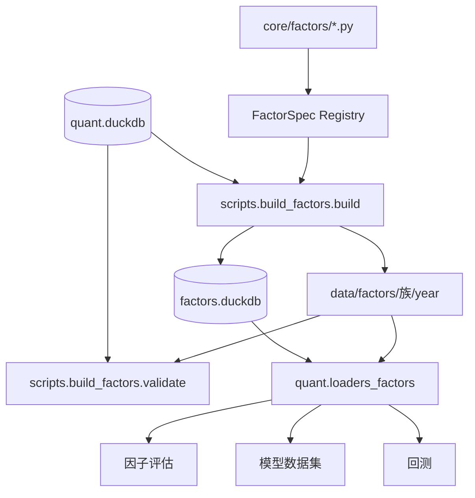

# 因子库

因子库解决三个问题：怎样描述一个因子、怎样用统一算子把它算成 Parquet、怎样让评估、
模型和回测读取同一份定义和数值。

核心源码位于 [core/factors](../../core/factors)，构建和自检位于
[core/data/scripts/build_factors](../../core/data/scripts/build_factors)。

## 1. 技术栈

- Python 数据类：`FactorSpec`、`SourceSpec` 定义不可变契约。
- DuckDB SQL：表达时序窗口、截面排名、财务 ASOF 连接和跨年计算。
- pandas / PyArrow：读取 Parquet、分组核对和目录统计。
- Parquet：按族、按年保存因子值。
- DuckDB 因子目录库：保存定义、覆盖率、自检和构建记录。

## 2. 提供功能

### 2.1 内置因子族

[core/factors/registry.py](../../core/factors/registry.py) 定义 11 个源码内置族：

| 族 | 内容 |
|---|---|
| `momentum` | 动量与反转 |
| `volatility` | 波动与风险 |
| `liquidity` | 流动性与成交活跃度 |
| `volume_price` | 量价关系 |
| `technical` | 技术形态 |
| `valuation` | 估值与规模 |
| `fundamental` | 财务质量、成长和现金流 |
| `cn_special` | A 股特色因子 |
| `market` | 市场与相对强度 |
| `alpha101` | WorldQuant Alpha101 的已实现子集 |
| `gtja191` | 国泰君安 Alpha191 的已实现子集 |

另有可选 `mined` 族，只由自动挖掘审批发布形成。`ALL_FAMILIES` 包含它，但
`all_factors()` 只返回源码内置因子；`available_specs()` 才会合并已发布定义。

### 2.2 因子定义

[core/factors/registry.py](../../core/factors/registry.py) 的 `FactorSpec` 包含：

| 字段 | 含义 |
|---|---|
| `name` | 大写因子标识，只允许字母、数字和下划线 |
| `family` | 所属族，决定目录和文档分组 |
| `formula` | 面向文档的公式文本 |
| `description` | 金融含义 |
| `steps` | 白话计算步骤，必填 |
| `layers` | 按顺序执行的 SQL 层，最后一层为因子值 |
| `lookback` | 计算所需最大回看交易日 |
| `direction` | `1` 越大越看多，`-1` 越大越看空 |
| `fields` | 依赖的日线字段 |
| `extra_sources` | 依赖的外部数据源 |

`required_lookback()` 会从 `lag(...)` 和 `ROWS BETWEEN` 中推导最小回看窗口。手写
`lookback` 小于推导值会在构造 `FactorSpec` 时直接失败。

### 2.3 附加数据源

[core/factors/sources.py](../../core/factors/sources.py) 的 `SourceSpec` 描述指数和财务
来源：

- `index_000300`、`index_000905`、`index_000985` 按交易日连接。
- 四张财务来源按 `available_date` 做 ASOF 连接。
- 财务连接固定使用 `trade_date > available_date`，确保公告日次一交易日才可用。

构建脚本把每个数据源包装成 CTE，业务因子只引用规范化列名，例如 `fi_roe`、
`idx_ret_300`。

### 2.4 因子构建

[core/data/scripts/build_factors/build.py](../../core/data/scripts/build_factors/build.py)
负责：

1. 打开只读行情库。
2. 按因子族和年份计算 SQL 层。
3. 为跨年窗口补充全局回看和个股回看。
4. 把 `NaN`、`inf` 转成空值，精度落为 `float32`。
5. 按 `data/factors/<family>/year=YYYY/part.parquet` 写文件。
6. 更新因子目录库中的定义、覆盖率和构建记录。

构建可重复执行，指定族或年份时可做局部更新：

```bash
.venv/bin/python -m scripts.build_factors.build
.venv/bin/python -m scripts.build_factors.build \
  --families momentum,valuation --start 2024-01-01 --end 2024-12-31
```

### 2.5 因子自检

[core/data/scripts/build_factors/validate.py](../../core/data/scripts/build_factors/validate.py)
检查四类问题：

| 检查 | 做法 |
|---|---|
| 行集 | 因子产物与 `md.daily_hfq` 双向差集必须为零 |
| 取值 | 非有限值数量必须为零 |
| 前视 | 在首、中、末抽样日期截断重算，与全量值比较 |
| 方向 | 用历史 IC 符号检查是否与 `direction` 一致 |

```bash
.venv/bin/python -m scripts.build_factors.validate
.venv/bin/python -m scripts.build_factors.validate --families volatility --samples 20
```

前视检查等价于验证“按年切块不会改变结果”。通过标准是截断重算的数值误差和空值差异
都在配置容差内。

### 2.6 因子目录与文档

[core/data/scripts/build_factors/catalog.py](../../core/data/scripts/build_factors/catalog.py)
维护因子目录库并自动生成：

- 因子定义、公式、白话步骤和表达式。
- 年度/全历史覆盖率。
- 行集、取值、前视和方向检查结论。
- 构建版本、构建时间和行数。
- `formulas.md` 与 `catalog.md`。

命令行讲解：

```bash
.venv/bin/python -m scripts.build_factors.catalog --explain MOM_20
```

它会输出公式、白话步骤和针对指定股票的可执行 SQL。

## 3. 如何使用

### 3.1 读取已计算因子

```python
import quant

panel = quant.load_factor_panel(
    start="2024-01-01",
    end="2024-12-31",
    names=["MOM_20", "EP_TTM", "PV_CORR_20"],
)
mom20 = quant.load_factor_wide(
    "MOM_20", start="2024-01-01", end="2024-12-31"
)
catalog = quant.load_factor_list(family="momentum")
```

`load_factor_panel()` 返回长表，`load_factor_wide()` 返回交易日 × 股票宽表，
`load_factor_list()` 从目录库读取元数据。

### 3.2 注册新因子

在对应族文件中调用 `define()`：

```python
from factors.ops import ts_mean, ts_std
from factors.registry import define

define(
    name="BOLL_WIDTH_20",
    family="technical",
    formula="4 * std(close, 20) / mean(close, 20)",
    description="20 日布林带相对宽度，描述波动状态。",
    steps=(
        "计算 20 日收盘价标准差和均值",
        "用 4 倍标准差除以均值",
    ),
    layers=f"4 * {ts_std('close', 20)} / {ts_mean('close', 20)}",
    direction=-1,
    fields=("close",),
)
```

随后构建、检查并更新目录：

```bash
.venv/bin/python -m scripts.build_factors.build --families technical
.venv/bin/python -m scripts.build_factors.validate --families technical
.venv/bin/python -m scripts.build_factors.catalog --write-docs
```

### 3.3 读取已发布 `mined` 因子

人工审批并通过原子发布后，因子定义从 `data/factors/mined/definitions.json` 恢复，
数值从 `data/factors/mined/year=YYYY/part.parquet` 读取。调用方仍使用
`quant.load_factor_panel()`、`load_factor_wide()` 或 `factors.resolve()`，不需要区分
内置与已发布路径。

## 4. 内部结构与调用关系



### 4.1 算子层

[core/factors/ops.py](../../core/factors/ops.py) 只生成 SQL 片段，不直接读取数据。
算子分为：

- 时序：`ts_delay`、`ts_delta`、均值、求和、极值、标准差、偏度、峰度、乘积、计数。
- 时序统计：相关、协方差、斜率、R²、下行波动、时序分位。
- 截面：`cs_rank`、`cs_zscore`、`cs_demean`、`cs_scale`。
- 标量：安全除法、保号幂和取负。

许多指标需要特殊实现。例如 `percent_rank()` 会忽略窗口帧，所以 `ts_rank` 通过
多次滞后比较实现“只在最近 N 日排名”的语义。

### 4.2 多层 SQL

DuckDB 不允许窗口函数无限嵌套。因子可把一个表达式拆成 `layers`，构建器依次生成
`v1`、`v2` 等中间列。外层层只引用前面已生成的别名，避免把复杂逻辑塞进单条 SQL。

### 4.3 注册与发现

导入 `factors` 包时，`core/factors/__init__.py` 依次导入所有族模块，每个模块调用
`define()` 注册。因此构建脚本只需要 `all_factors()`，不需要写死 47 个名称。

### 4.4 目录库

目录库不是因子值的替代品。事实来源有两部分：

- 因子定义和文档元数据来自源码或 `mined/definitions.json`。
- 因子数值来自年度 Parquet。
- 目录库是可重建索引，用于前端列表、覆盖率和检查记录。

## 5. 关键数据处理约束

### 5.1 行集与缺失

- 因子文件行集与主日线完全一致，包括停牌和退市股票的历史行。
- 停牌行因子值为空，停牌日不占时序窗口。
- 历史不足时不做插补，次新股前若干日为空是合法结果。

### 5.2 跨年计算

按年构建不是按年独立算。输入分两部分：

1. 从年初向前扩展最长回看窗口的全市场交易日。
2. 每只股票在年初前最近若干个有效交易日，避免长期停牌股票丢失窗口。

这样既保证每天横截面完整，也保证个股窗口连续。

### 5.3 精度

中间 SQL 使用较高精度，落盘值转换为 `float32`。写文件前统一把非有限值转换为空，
避免评估、模型和回测读到 `inf`。

## 6. 日志、错误与维护

因子相关日志写入 `logs/core/factors/<module>/`。常用错误码：

| 错误码 | 含义 |
|---|---|
| `FACTOR-101` | 因子定义非法或重复 |
| `FACTOR-201` | 因子构建失败 |
| `FACTOR-202` | 因子产物缺失或结构错误 |
| `FACTOR-301` | 自检未通过 |

修改因子时注意：

1. 因子值和公式变化会改变历史研究结果，应视为新版本而非静默覆盖。
2. `features`、`extra_sources` 必须与实际 SQL 一致。
3. 财务字段必须保留公告日时点，不能直接按报告期连接。
4. 新增多层窗口时检查 DuckDB 是否允许该嵌套。
5. 修改内置因子后，应重新构建、自检，并检查依赖该因子的评估、模型和回测测试。
6. 普通因子构建不能覆盖 `mined`；后者只由发布服务管理。

