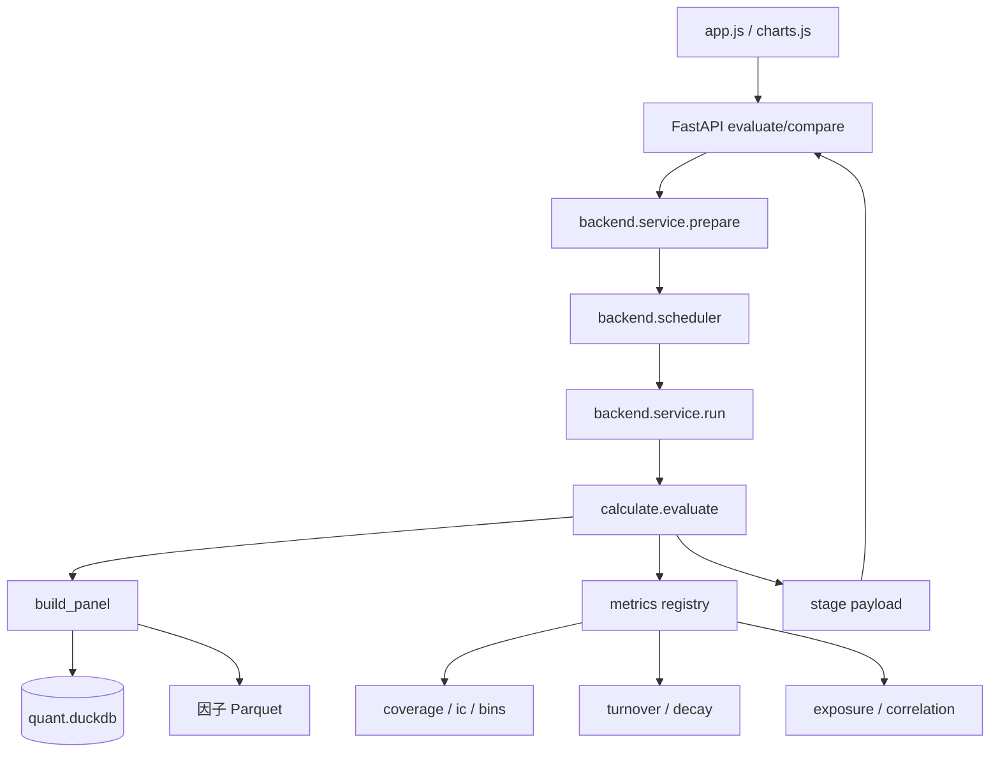

# 因子评估

因子评估模块读取因子 Parquet、未来收益标签和股票池信息，计算因子质量指标，并按固定
阶段流式输出。它不修改因子、不写评估结果数据库，也不模拟真实交易。

核心代码位于
[research/evaluation/calculate](../../research/evaluation/calculate)，Web 适配位于
[apps/monitor/backend](../../apps/monitor/backend)。

## 1. 技术栈

| 技术 | 用途 |
|---|---|
| DuckDB | 只读连接行情库，聚合并对齐因子、标签、股票池和风格原料 |
| pandas / NumPy | 逐日截面相关、分箱、时序统计和净值计算 |
| SciPy | 特定统计与回归结果的交叉验证 |
| Parquet | 按年读取因子值 |
| FastAPI / SSE | 把计算阶段实时推送给页面 |
| ECharts | 前端只负责展示服务端结果 |

## 2. 提供功能

### 2.1 评估输入

[research/evaluation/calculate/params.py](../../research/evaluation/calculate/params.py)
的 `EvalParams` 定义一次评估：

- 因子名。
- 起止日期。
- 股票池：`all_a` 或 `index:<代码>`。
- 标签周期：1/3/5/10/15/20 个交易日。
- 价格通道：收盘或次日开盘。
- 分位组数：5/10/20。
- Pearson IC 是否做 3 倍 MAD 去极值。

参数对象不可变。评估请求开始后，因子、股票池和标签口径不会在同一组结果中变化。

### 2.2 共享评估面板

[research/evaluation/calculate/panel.py](../../research/evaluation/calculate/panel.py)
的 `build_panel()` 把以下原料对齐成一张长表：

- `data/factors/<族>/year=*/part.parquet` 的因子值。
- `md.fwd_return` 的主标签和 1 日标签。
- `md.daily_hfq` 的可交易、ST、上市天数、市值、换手、估值和成交额。
- 指数池的月末权重快照。
- 衰减阶段需要的多周期标签列。

面板主键是 `stock_code + trade_date`，构建时检查唯一性。它不做全局排序，因为排序几百万
行成本高，后续指标都按交易日分组。

### 2.3 股票池

全 A 池：

```text
can_buy_close
且非 ST
且非停牌
且上市满 60 个自然日
```

指数池使用上一个已结束月份的月末权重快照，再叠加同一套可交易过滤。这样做避免使用
当月月末才披露的成分信息。

### 2.4 轻量 IC

[research/evaluation/calculate/history.py](../../research/evaluation/calculate/history.py)
的 `load_daily_ic()` 不构建完整面板，而是在 DuckDB 中按日聚合 IC、RankIC 和有效样本数。
适合全历史快速查看预测能力，但不提供覆盖率分布、分位组合、风格暴露和相关性。

### 2.5 完整分析

完整分析包含：

1. 覆盖率与取值分布。
2. IC / RankIC 汇总。
3. IC 时序与分布。
4. 分位收益、分位净值、多空价差和收益分布。
5. 分位换手和因子自相关。
6. 多周期衰减。
7. 七个 Barra 近似风格暴露。
8. 剔除风格后的增量 IC。
9. 与其他已落盘因子的相关性。

13 个页面指标的计算和含义见
[因子评估指标](04-factor-evaluation-metrics.md)。

### 2.6 候选因子复用

`FactorView` 把“因子名、展示元数据、Parquet glob、正式对照目录”解耦。正式因子通过
`resolve_factor()` 构造视图；自动挖掘候选也构造同样的视图。因此候选可以使用同一面板、
同一指标和同一 stage 契约，而不会写入正式因子目录。

## 3. 如何使用

### 3.1 Python 调用

```python
from calculate import EvalParams, evaluate

params = EvalParams(
    factor="MOM_20",
    start="2024-01-01",
    end="2024-12-31",
    universe="all_a",
    horizon=5,
    price="close",
    quantiles=10,
    winsorize=True,
)

for stage, payload in evaluate("MOM_20", params):
    print(stage, payload.keys())
```

只运行指定阶段：

```python
stages = ("overview", "ic_series", "bins", "decay")
for stage, payload in evaluate("MOM_20", params, stages=stages):
    handle(stage, payload)
```

### 3.2 底层复用

```python
from calculate import build_panel, resolve_factor

context = build_panel(params, factor=resolve_factor("MOM_20"))
daily_ic = context.daily_ic()
bins = context.bins()
styles = context.styles()
exposures = context.exposures()
```

这些方法在一次请求内缓存中间结果。例如 `exposure` 与 `incremental_ic` 共用同一份回归
结果，避免重复计算。

### 3.3 Web 页面

启动服务后打开：

```text
http://127.0.0.1:8800/#/factors
http://127.0.0.1:8800/#/factor/MOM_20
http://127.0.0.1:8800/#/compare
```

页面可以切换完整分析或轻量 IC，并设置日期、股票池、标签、价格通道、分位组数和
去极值。对比页面按输入顺序计算 2～4 个因子。

### 3.4 HTTP 接口

```bash
curl -N 'http://127.0.0.1:8800/api/evaluate/stream?factor=MOM_20&mode=ic'
curl -N 'http://127.0.0.1:8800/api/compare/stream?factors=MOM_20,MOM_60&mode=ic'
```

返回是 SSE。每条事件包含 stage 名和 JSON；首个 `meta` 事件回显参数和已选指标，最末
`done` 事件包含耗时。

## 4. 内部结构与调用关系



### 4.1 参数与股票池

`params.py` 负责格式、枚举和上限；`universe.py` 负责全 A 和指数池定义。全 A 过滤条件
与因子构建自检中的 `POOL_FILTER` 保持一致，避免评估结果与因子自检口径冲突。

### 4.2 面板上下文

`EvalContext` 是完整分析请求的共享上下文，包含：

- `params` 和 `FactorSpec`。
- 面板 DataFrame。
- 股票池和标签列映射。
- 延迟计算的 `daily_ic()`、`bins()`、`bin_matrices()`、`styles()` 和
  `exposures()`。

指标计算函数签名统一为 `compute(context, options) -> dict`。指标只读上下文，不能修改
面板或向全局状态写缓存。

### 4.3 指标注册表

[research/evaluation/calculate/metrics/base.py](../../research/evaluation/calculate/metrics/base.py)
的 `Metric` 绑定 key、中文标签、stage、计算函数和参数声明。指标模块由
`metrics/__init__.py` 自动发现。

新增指标流程：

1. 在 `metrics/` 下新增模块。
2. 定义 `compute(context, options)`。
3. 调用 `register_metric()`。
4. 使用已有 stage；如果是全新阶段，再加入 `STAGE_ORDER`。
5. 前端为该 key 增加渲染分支，或接受通用 JSON 展示。

### 4.4 Stage 顺序

`STAGE_ORDER` 是前后端公共契约：

```text
meta
overview
ic_series
ic_dist
bins
bin_curves
spread
bin_dist
turnover
decay
exposure
incremental_ic
correlation
done
```

顺序固定后，页面可以先创建卡片，再按事件到达逐步填充。

### 4.5 逐日统计

`daily.py` 按交易日计算 Pearson IC 和 Spearman RankIC。每个周期独立取因子和标签都
有限的有效配对，单日少于 5 只股票时不生成相关系数。RankIC 对原始有效配对取平均并列
名次，Pearson 去极值只影响 IC。

### 4.6 分箱与组合

`binning.py` 先按交易日对池内因子值取平均名次，再均分成 Q 组。并列值可落在同一组。
组内收益支持等权和按总市值加权；净值曲线固定使用 1 日前瞻收益，避免重叠期收益被重复
累乘。

### 4.7 风格拆分

`styles.py` 计算 SIZE、VALUE、MOMENTUM、SHORT_REV、VOL、LIQUIDITY、BETA_60
七个近似风格；`exposure.py` 在“池内且因子非空”的同样本上逐日做截面 OLS，并生成残差。
行业层默认关闭，因为当前静态行业分类不适合解释历史。

### 4.8 相关性

`correlation.py` 按月读取正式因子，对每一对因子逐日取有限交集、重新排名并计算
Spearman，再对有效日期等权平均。不同因子对可能有不同交集，所以结果矩阵不保证半正定，
不能直接当协方差矩阵。

### 4.9 后端保护

- `prepare()` 在读库前校验参数、因子是否存在和资源上限。
- `Scheduler` 默认两个执行线程、四个等待名额，队列满返回 429。
- 原生计算阶段由 `calculate.native.native_section` 串行保护。
- 完整面板限制 2400 个交易日和约 800 万行上界。
- 全历史查询应使用 `load_daily_ic()`，不能绕过限制运行完整分位分析。

## 5. 数据流

```text
HTTP 参数
  -> RequestSpec 校验
  -> 因子目录和 Parquet 存在性检查
  -> 交易日数与面板规模预检
  -> build_panel 读取并对齐数据
  -> Metric.compute 按 stage 计算
  -> json_safe 转为有限 JSON
  -> SSE 推送到前端
  -> renderMetric 选择表格/折线/热力图
```

一次评估不写数据库。页面刷新后需要重新计算；挖掘候选则会把所属阶段的评估报告另存为
候选证据。

## 6. 边界与常见误读

- 分位净值和多空价差是研究展示，不等于可执行回测。
- Pearson IC 的 MAD 去极值不能改变 RankIC。
- 重叠持有期会让日度 IC 自相关，普通 t 值不能机械解释为独立样本显著性。
- 不同日期、股票池、标签周期或价格通道下的结果不能直接比较。
- 风格缺失在公司截面内填 0 只是回归假设，不代表真实没有暴露。
- 相关性矩阵不是组合优化可用的协方差矩阵。
- 评估目录读取失败、因子未落盘、股票池无成分时应直接报错，不能用空结果代替。

## 7. 日志与错误

日志写入 `logs/research/evaluation/`。常用错误码：

| 错误码 | 含义 |
|---|---|
| `EVAL-101` | 参数或交易日范围非法 |
| `EVAL-102` | 面板过大或结构异常 |
| `EVAL-103` | 股票池非法或成分缺失 |
| `EVAL-104` | 因子未知或未落盘 |
| `EVAL-201` | 指标注册或计算错误 |
| `EVAL-301/302/303` | 风格、指数或行业数据问题 |
| `MONITOR-102` | 服务容量已满 |
| `MONITOR-103` | 数据产物缺失 |

## 8. 修改注意事项

1. 面板列是公共契约，只增不删；新增列要同步 `PANEL_COLUMNS`、测试和模型/挖掘消费者。
2. 不要把池外行或停牌行错误地放进 IC；每个周期必须独立取有效配对。
3. 分位由因子值决定，不能因为标签缺失而重新分组。
4. 净值固定使用 1 日标签，不能拿多日重叠标签直接累乘。
5. 修改 stage 顺序或 payload 结构时同步前端渲染、挖掘候选页和 API 文档。
6. 原生锁只保护后端入口；直接并行调用底层计算函数仍需调用方自行隔离。

