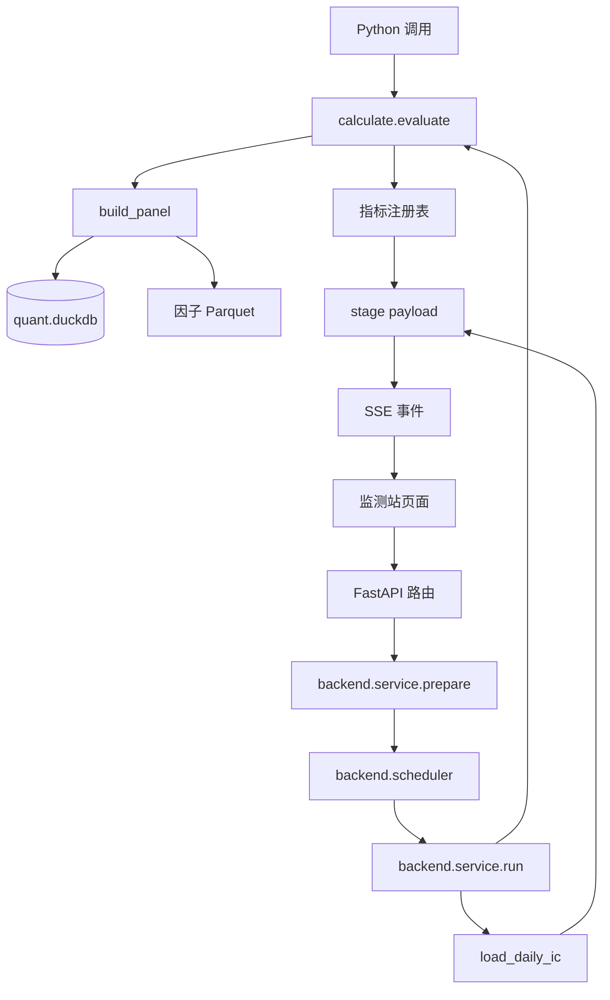

# 因子评估

本章解释项目如何把已落盘的因子值、未来收益标签和股票池信息组织成一次可复现的评估，
以及 Python、HTTP 和 SSE 三种入口实际如何调用这些能力。读完后应能回答：

- 一次评估接受哪些参数，默认值是什么。
- 因子、标签、股票池和风格原料如何对齐。
- 轻量 IC 与完整分析有什么区别。
- 13 个指标按什么 stage 顺序产出，payload 如何进入页面。
- 请求排队、慢客户端、断连、取消和原生计算锁如何处理。
- 出错时应看哪个错误码、哪个日志目录。
- 哪些结果只能支持研究判断，不能直接当成可实现收益。

具体 13 个指标的公式、分组门槛和金融解释由
[因子评估指标](04-factor-evaluation-metrics.md)继续展开。本章重点在评估框架、公共契约
和执行资源。

## 1. 职责与位置

因子评估的核心代码位于
[research/evaluation/calculate](../../research/evaluation/calculate)，Web 适配位于
[apps/monitor/backend](../../apps/monitor/backend)。

评估层负责：

- 读取正式或候选因子 Parquet。
- 从 `quant.duckdb` 读取标签、日线状态、市值、换手、估值和指数成分。
- 把数据对齐成以 `stock_code + trade_date` 为键的评估面板。
- 按股票池和标签周期计算覆盖率、IC、分层、衰减、风格和相关性等指标。
- 按固定 stage 流式返回 JSON 可序列化结果。
- 为监测站提供参数预检、任务容量、背压、取消和错误映射。

评估层不负责：

- 修改、注册或发布因子。
- 写评估结果数据库；普通页面请求刷新后需要重新计算。
- 模拟成交、持仓、费用、T+1、涨跌停或资金约束。
- 把 IC、分位收益或残差 IC 直接解释成可实现投资收益。
- 修复数据层或因子构建层的错误。

调用关系如下：



以 2026-10-26 的工作区为准，因子目录包含 11 个族、297 个族年分区；评估侧注册 13 个
指标、12 个业务 stage，并提供 1 个全 A 池和 12 个指数池。这些都是当前数据快照，
不是代码常量；实际因子的可评估清单应从注册表和落盘文件动态解析。

普通评估不落盘。自动挖掘候选会把某个阶段的评估报告另存为候选证据，但那是挖掘模块的
持久化行为，不是 `calculate.evaluate()` 自身写文件。

## 2. 公共接口

### 2.1 `EvalParams`

[params.py](../../research/evaluation/calculate/params.py) 中的 `EvalParams` 是冻结的输入
对象。一次评估开始后，参数不能在指标计算过程中变化。

| 字段 | 默认值 | 约束与含义 |
|---|---|---|
| `factor` | 无 | 非空字符串；必须与注册因子名和 `FactorView.name` 一致 |
| `start` | 无 | 严格 `YYYY-MM-DD`，闭区间起点 |
| `end` | 无 | 严格 `YYYY-MM-DD`，闭区间终点，不能早于 `start` |
| `universe` | `all_a` | 全 A 池或 `index:<指数代码>`；构造对象时先做格式保存，建面板时解析 |
| `horizon` | `5` | 主标签周期，只允许 `1/3/5/10/15/20` 个交易日 |
| `price` | `close` | 标签价格通道，只允许 `close/open` |
| `quantiles` | `10` | 分层组数，只允许 `5/10/20` |
| `winsorize` | `True` | Pearson IC 是否按日做 3 倍 MAD 去极值；不影响 RankIC |

日期必须是规范日期字符串；整数不接受布尔值，`winsorize` 必须是真正的布尔类型。
`describe()` 会回显参数、主标签列和全部枚举值，用于 `meta` 事件。

`default_params(factor)` 不是固定日期。它读取主库日历，以最新交易日为终点，回看最近
三个自然年，例如最新日为 2026-10-15 时起点按 `2024-10-15` 构造。HTTP 请求使用
`/api/options` 返回的同一默认值；Python 不传 `params` 时也会调用 `default_params()`。

价格通道与周期共同决定标签列：

```text
主标签           fwd_ret_{price}_{horizon}
1 日净值标签     fwd_ret_{price}_1
```

面板中的主标签统一改名成 `label`，1 日标签改名成 `label_1d`；衰减阶段额外需要的周期
使用 `label_h{h}`。不要在指标代码里手写 `fwd_ret_*` 列名，应通过
`EvalParams.label_column`、`label_column_for()` 或 `EvalContext.horizon_label()` 获取。

### 2.2 Python 入口

| 入口 | 作用 | 关键行为 |
|---|---|---|
| `resolve_factor(name, factor_dir=...)` | 解析正式因子 | 必须已注册、所属族至少有一个年度文件，且最后一个年度文件含该列 |
| `build_panel(params, ..., factor=None)` | 构建共享面板 | 校验日期、交易日上限、行数上界、标签列和主键；可传候选 `FactorView` |
| `evaluate(factor, params=None, stages=None, metric_options=None, ...)` | 正式因子完整入口 | 先校验 stage 与指标参数，再建面板并按 stage 生成结果 |
| `evaluate_context(context, stages=None, ...)` | 在已建面板上计算 | 正式因子和挖掘候选共用；不重新解析因子文件 |
| `load_daily_ic(params, ..., factor=None)` | 轻量全历史 IC | 在 DuckDB 内聚合逐日 IC，不构建完整面板，不受 2400 日/800 万行限制 |
| `FactorView(...)` | 明确因子来源 | 正式因子为 `formal=True`；候选通过临时 `parquet_glob` 和 `formal=False` 复用同一契约 |
| `open_source(db_file)` | 只读挂载主库 | 内存连接别名固定为 `src`，工作内存 1 GB、2 个 DuckDB 线程 |

`evaluate()` 的 `stages` 是已实现业务 stage 的序列，不是完整的 `STAGE_ORDER`。传空序列
只产出 `meta` 和 `done`；传字符串、未知 stage 或未实现 stage 会直接报 `EVAL-101`。
调用方传入的顺序不会改变执行顺序，最终始终按 `STAGE_ORDER` 排列。

`metric_options` 是“指标 key -> 参数映射”。未提供的指标使用自身默认参数，未知指标、
未知参数或类型/枚举错误在读面板前报 `EVAL-201`。当前可配置项是：

- `exposure.industry`：默认 `off`，可显式设为已注册的 `stock_basic`。
- `incremental_ic.industry`：与暴露分开配置，默认 `off`。
- `correlation.top_n`：默认 `10`，允许 `1` 到 `100`。

最小 Python 示例：

```bash
PYTHONPATH="$PWD:$PWD/apps/monitor" .venv/bin/python - <<'PY'
from calculate import EvalParams, evaluate

params = EvalParams(
    factor="MOM_20",
    start="2024-05-06",
    end="2024-05-31",
    universe="all_a",
    horizon=5,
    price="close",
    quantiles=10,
    winsorize=True,
)

for stage, payload in evaluate(
    "MOM_20",
    params,
    stages=("overview", "ic_series"),
):
    print(stage, sorted(payload))
PY
```

直接调用 `calculate` 时应从项目根启动，或者像 `tools/monitor/serve.sh` 一样把仓库根和
`apps/monitor` 放进 `PYTHONPATH`。在 `research/evaluation/calculate/` 目录里直接执行
Python 文件会破坏包导入路径。

### 2.3 股票池

[universe.py](../../research/evaluation/calculate/universe.py) 当前注册 13 个股票池：

| 池 | 口径 |
|---|---|
| `all_a` | `can_buy_close`、非 ST、上市满 60 个自然日 |
| `index:<代码>` | 上一个已结束月份的月末指数权重快照，再叠加同一套可交易过滤 |

可选指数为沪深 300、中证 500、中证 1000、上证 50、中证 800、中证 100、中证 A500、
科创 50、深证成指、创业板指、国证 2000 和北证 50。实际代码见 `INDEX_UNIVERSES`，
接口通过 `list_universes()` 返回，不应在前端或业务代码复制一份硬编码列表。

全 A 过滤中的“上市满 60 日”是自然日，不是 60 个交易日。`can_buy_close` 是清洗层给出的
保守可买代理，仍不等同于真实成交可行性。

指数池按“评估交易日所在月份”查找“前一个月最后一个交易日”的权重，并要求权重大于 0。
例如评估 2024 年 1 月时使用 2023-12 月末快照；这避免使用当月收盘后才完整的成分信息。
指数成立前没有前一月快照时，成员集合为空。

当前实现存在一个重要边界：`resolve_universe()` 只校验池子标识，`build_panel()` 不要求
池内至少有股票。全 A 池通常不会为空，但指数池在成立前或权重缺失时可能得到
`in_universe=False` 的面板。此时覆盖率可返回空池统计，分位类指标可能返回空 payload，
暴露阶段会报 `EVAL-301`，HTTP 预检不会统一拦截。这是已知实现风险，文档不做
“所有空池都会提前报错”的错误承诺。

### 2.4 指标与 stage

指标注册位于
[metrics/base.py](../../research/evaluation/calculate/metrics/base.py)。每个 `Metric`
绑定唯一 `key`、中文标签、stage、`compute(context, options)` 和可选参数声明。
`metrics/__init__.py` 自动发现同目录模块；同 stage 内保持注册顺序，跨 stage 按
`STAGE_ORDER` 排序。

完整分析当前注册 13 个指标：

| stage | 指标 key | 输出主题 |
|---|---|---|
| `overview` | `coverage`, `ic_stats` | 覆盖率、取值分布、IC/RankIC 汇总 |
| `ic_series` | `ic_series` | 逐日 IC、累计 IC、滚动均值 |
| `ic_dist` | `ic_dist` | IC/RankIC 直方图与分布统计 |
| `bins` | `bin_returns` | 分位期收益、单调性、两套权重 |
| `bin_curves` | `bin_curves` | 分位累计净值 |
| `spread` | `spread` | 最高分位减最低分位 |
| `bin_dist` | `bin_dist` | 分位收益分布 |
| `turnover` | `turnover` | 分位换手与因子自相关 |
| `decay` | `decay` | 多周期衰减 |
| `exposure` | `exposure` | 7 个近似风格暴露 |
| `incremental_ic` | `incremental_ic` | 风格残差 IC 与同样本原始 IC |
| `correlation` | `correlation` | 与已有正式因子的相关性 |

完整顺序是：

```text
meta
overview
ic_series
ic_dist
bins
bin_curves
spread
bin_dist
turnover
decay
exposure
incremental_ic
correlation
done
```

`meta` 和 `done` 是包装 stage，不属于 `planned_stages()` 返回的业务 stage。指标的
payload 可以变化细节字段，但 `key`、所属 stage 和外部入口不应无迁移地改名。

## 3. 评估面板

### 3.1 SQL 数据流

[panel.py](../../research/evaluation/calculate/panel.py) 的 `build_panel()` 先用一条 SQL
完成核心对齐：

1. 从因子族的年度 Parquet 读取目标因子和目标日期区间，转成 `factor`。
2. 从 `md.fwd_return` 取主标签、1 日标签和衰减需要的多周期标签。
3. 指数池额外构造逐日 `member` CTE，使用前一月月末权重快照。
4. 与 `md.daily_hfq` 内连接，取得由交易状态派生的可交易标记，以及市值、换手、估值、
   成交额、收盘价和收益。
5. 投影成固定列清单；股票池外行保留，并以 `in_universe` 标记。

因此面板不是“因子文件的所有行”，而是因子值、标签和日线表在相同
`stock_code + trade_date` 上的交集。之后即使股票不在池内，只要三表键能对齐，仍可能
留在面板中供覆盖率分母使用。

面板列契约如下：

| 类别 | 列 | 说明 |
|---|---|---|
| 键 | `stock_code`, `trade_date` | 联合主键；构建后检查重复 |
| 主数据 | `factor`, `label`, `label_1d` | float64；主标签允许为空 |
| 池标记 | `in_universe`, `is_st`, `can_buy_close`, `can_sell_close` | bool |
| 生命周期 | `listed_days` | 从上市日到交易日的自然日，int32 |
| 风格原料 | `total_mv`, `circ_mv`, `turnover_rate`, `pe_ttm`, `pb`, `amount_cny`, `close`, `ret` | float32 |
| 衰减标签 | `label_h{h}` | 默认 5 日主标签时为 `label_h3/label_h10/label_h20` |

`PANEL_COLUMNS` 是稳定列契约。新增列应追加并同步测试，不要删除或重排已有列。
面板不做 `ORDER BY`，因为几百万行排序成本高，后续指标都按交易日分组。

### 3.2 样本与空值

- 主标签由 `horizon + price` 决定；1 日标签始终使用同一价格通道。
- 多周期标签只追加 1/3/5/10/20 衰减档位中尚未出现的档位。
- 区间末端的未来价格不足时，对应标签为空；不会向后填充。
- 因子 Parquet 中可存在空值或非有限值。IC 会额外剔除非有限配对。
- 风控和分层使用的 `can_buy_close`、`is_st`、上市天数来自日线表，不重新从价格推算。

`meta.panel` 的覆盖率使用“非空”统计；IC 的有效样本还要求值有限且单日配对达到门槛。
因此不要把 `meta.panel.coverage_*` 直接当成某种 IC 的有效配对率。`coverage` 指标会
另外报告 `missing` 和 `non_finite`。

### 3.3 多周期标签

假设主参数为 5 日、收盘价：

| 面板列 | 来源 |
|---|---|
| `label` | `fwd_ret_close_5` |
| `label_1d` | `fwd_ret_close_1` |
| `label_h3` | `fwd_ret_close_3` |
| `label_h10` | `fwd_ret_close_10` |
| `label_h20` | `fwd_ret_close_20` |

主周期为 15 日时数据层有标签，但衰减曲线不单列 15 日；衰减阶段使用最接近的已支持档位，
15 日在当前顺序下回退到 10 日，同时 payload 的 `eval_horizon` 仍保留 15，供读者区分。
具体计算见阶段 04 文档。

### 3.4 请求内缓存

`EvalContext` 只在当前请求内缓存中间结果：

- `daily_ic()` 缓存 Pearson IC 和 RankIC 序列。
- `bins()` 缓存分位表。
- `bin_matrices()` 缓存组号宽表和秩宽表，供换手与自相关共用。
- `styles()` 懒加载 7 个风格原始值。
- `exposures(industry_key)` 缓存逐日回归、残差和行业信息，供 `exposure` 与
  `incremental_ic` 共用。

缓存不写磁盘，也不跨请求复用。直接调用底层 `daily_ic()`、`run_exposure()` 等函数不会
自动获得这些缓存。

完整面板上的 `daily_ic()`、多周期 RankIC 和增量 IC 默认经 `kernels.auto` 选择逐日排名
与 Pearson 后端；Pearson IC 的逐日 MAD 和风格暴露的 MAD/z-score 也经同一后端选择。
分位分组、秩宽表、多标签分位收益、组号换手和因子自相关也经同一后端选择；单标签
`bin_daily_returns` 继续使用 pandas 分组求和，以保持分位图市值加权的既有逐值语义。
路由层必须先按交易日稳定整理为连续分组；全历史轻量 IC 仍在 DuckDB 内聚合，不经过这组
数组核。P1-05 后固定三年 `overview` 加速 `2.535x`、`exposure` 加速 `1.203x`；
P1-06 后 `bins`、`turnover` 和 `decay` 分别加速 `1.621x`、`1.854x`、`3.255x`，
实际 C++ 替换模块数累计为 9。

## 4. 执行路径

### 4.1 完整 Python 评估

`evaluate()` 的实际顺序是：

1. 校验请求的 stage 集合和全部 `metric_options`。
2. 未传 `EvalParams` 时读取主库最新交易日，构造最近三年的默认参数。
3. 解析正式因子并构建共享面板。
4. `evaluate_context()` 产出 `meta`。
5. 按 `STAGE_ORDER` 依次计算本次选中的指标。
6. 产出 `done`，记录各 stage 耗时和总耗时。

`meta` 包含因子定义、参数描述、股票池、面板概览、全部指标声明、本次实际 stage 和已解析
指标参数。完整分析的 `meta.metrics` 是全部 13 个指标，即使本次只选了部分 stage。

`meta` 之前必须先建好面板，因为面板行数、股票数和覆盖率要写进摘要。因此 SSE 客户端会
先收到 `queued/status`，完整分析建面板期间可能暂时没有业务事件。`meta.elapsed_ms`
是面板构建耗时；`evaluate_context()` 的 `done.total_elapsed_ms` 只覆盖面板构建之后的
指标阶段总和，HTTP 最外层 `done.total_elapsed_ms` 才覆盖整次请求。

Python 是生成器调用。异常发生在第几个 `next()`，调用方就会在该位置收到异常；此前已经
产出的 stage 不能回滚。需要一次性结果时，调用方应自行把事件收集到字典。

传入的 `params.factor` 与 `evaluate(factor, ...)` 或显式 `FactorView.name` 不一致时会
直接报 `EVAL-101` 或 `EVAL-104`，不会用错配的因子继续计算。

每个 stage payload 都经过 `json_safe()` 转换：NumPy 标量、数组、日期和 pandas 类型会变成
原生 JSON 类型；NaN、正负无穷会变成 `null`。因此“指标计算结果为空”和“非有限数”在前端
通常都表现为空值，需要结合指标的 `days`、`n`、`insufficient` 等字段判断原因。

### 4.2 轻量 IC

[history.py](../../research/evaluation/calculate/history.py) 的 `load_daily_ic()` 是另一条
路径：

- 在 DuckDB 中直接对齐因子、标签、日线和指数成员。
- 每个交易日按有效配对重新取平均名次并计算 Pearson IC、RankIC 和样本数。
- 返回以交易日为索引、包含 `ic/rank_ic/n` 的 DataFrame。
- 不构建完整面板，因此不做 2400 交易日和 800 万行完整面板限制。
- 使用 1 GB DuckDB 工作内存、4 个 DuckDB 线程，并在自动清理的临时目录溢写。

单日有效配对少于 5 只时，该日仍可能出现在结果中，`n` 保留实际配对数，但
`ic/rank_ic` 为空。完全没有有效配对的日期不会出现。

Web 的 `mode=ic` 只开放 `overview/ic_series/ic_dist` 三个 stage，不提供覆盖率分布、
分位组合、暴露和相关性。它与完整面板在相同日期、因子、股票池、标签和去极值设置下，
IC/RankIC 数值由一致性测试保证相等。

### 4.3 候选因子复用

挖掘候选先物化到独立临时目录，再构造
`FactorView(formal=False, parquet_glob=<候选路径>)`：

- `build_panel(params, factor=view)` 走同一套股票池、标签、行数和主键校验。
- `evaluate_context(context)` 走同一指标注册表和 stage 顺序。
- 相关性阶段对候选只计算“候选 vs 正式因子”，避免构建正式因子之间的全矩阵。
- 候选评估不注册因子，不向正式 `data/factors/` 写入，也不改变正式注册表。

候选与正式因子同公式、同参数时的面板值和 13 个指标由根目录
[test_mining_evaluation_consistency.py](../../tests/test_mining_evaluation_consistency.py)
做联合一致性检查。

### 4.4 HTTP 参数

启动监测站的推荐命令：

```bash
bash tools/monitor/serve.sh
```

服务默认监听 `127.0.0.1:8800`，必须单进程单 worker。请求参数如下：

| 参数 | 用于 | 默认/约束 |
|---|---|---|
| `factor` | 单因子 | 单因子请求必填 |
| `factors` | 对比 | 2 到 4 个不同因子，逗号分隔 |
| `start`, `end` | 两个入口 | 默认取 `/api/options` 的最近三年；严格日期 |
| `universe` | 两个入口 | 默认 `all_a` |
| `horizon` | 两个入口 | 默认取主因子默认值，当前为 5 |
| `price` | 两个入口 | 默认 `close` |
| `quantiles` | 两个入口 | 默认 10；轻量 IC 虽接受但不使用分层 |
| `winsorize` | 两个入口 | 只接受小写字符串 `true/false`，默认 `true` |
| `mode` | 两个入口 | `full` 或 `ic`，默认 `full` |
| `stages` | 两个入口 | 逗号分隔；必须属于该 mode 的可用 stage |
| `metric_options` | 完整分析 | JSON 对象；未知指标、参数和非法值在开流前拒绝 |

未知参数和同名重复参数会被拒绝。对比模式按请求中的因子顺序串行计算，所有因子共享日期、
股票池、标签、分组数和指标参数；每个因子的有效样本仍可能因覆盖率不同而不同。
对比只占一个调度任务槽。

完整模式会额外检查：

- 区间交易日数不超过 2400。
- 每个因子的区间面板行数上界不超过 800 万。
- 主标签和 1 日标签列存在。

行数预检通过读取因子 Parquet 的文件级元数据完成，不扫描数据本身。估算会把日期区间
覆盖的整个年度文件都计入，因此是保守上界，临界情况下可能拒绝实际未超限的短区间。

### 4.5 SSE 协议

单因子与对比接口都会返回 `text/event-stream`：

```text
GET /api/evaluate/stream
GET /api/compare/stream
```

事件顺序如下；`status` 可在运行期间多次出现，心跳是 SSE 注释而不是业务事件：

| 事件 | 含义 |
|---|---|
| `queued` | 已预留调度名额，包含排队状态快照 |
| `status` | 预检、运行、等待原生锁、取消或终态状态 |
| `meta` | 参数、因子、面板概览、指标和本次 stage |
| 业务 stage | `{"stage": ..., "metrics": {...}, "elapsed_ms": ...}` |
| `factor_done` | 当前因子全部业务 stage 完成；对比模式每个因子一个 |
| `done` | 整个请求完成并给出总耗时；对比时在全部因子后发送一次 |
| `error` | 流开始后的失败；包括公开错误码、消息和请求编号 |
| `: heartbeat` | 约每 10 秒一次，避免代理把长任务当作断线 |

调度器给每个业务事件和非心跳事件加上 `request_id`。开流前的参数、因子、容量或预检错误
直接返回 JSON，不进入 SSE；开流后的内部失败走 `error` 事件，不向页面发送堆栈。

示例：

```bash
curl -N --get 'http://127.0.0.1:8800/api/evaluate/stream' \
  --data-urlencode 'factor=MOM_20' \
  --data-urlencode 'start=2024-05-06' \
  --data-urlencode 'end=2024-05-31' \
  --data-urlencode 'mode=ic'
```

## 5. 并发、背压与取消

### 5.1 调度容量

[scheduler.py](../../apps/monitor/backend/scheduler.py) 默认创建两个执行线程和四个等待
位置，总容量为 6 个已预留请求。流程是：

1. 请求先 `reserve()`，预检前就占用容量。
2. 参数和资源预检运行；失败则 `discard()` 释放名额。
3. 预检成功后提交线程任务。
4. 任务真正结束时才释放容量，不以输出 `done` 的时刻代替线程退出。

并发运行 2 个、排队 4 个后，新请求返回 HTTP 429 和 `MONITOR-102`。运行中的任务即使
取消也会暂时保留自己的名额，直到当前原生阶段返回并清理生成器。

### 5.2 原生计算锁

[native.py](../../research/evaluation/calculate/native.py) 用共享可重入锁串行保护原生
阶段。锁覆盖：

- 创建因子评估生成器。
- 每次 `next()` 推进，包括建面板和指标计算。
- 结果到 JSON 安全类型的转换。
- 生成器关闭及对象释放。

锁不覆盖等待客户端读取事件队列的时间。每个任务的事件队列最多 2 条；慢消费者会让
计算线程在 `send()` 处等待，但此时原生锁已经释放，其他任务仍可推进。

两个任务可以在 stage 边界交替执行，而不是整个请求从头到尾独占。因子评估和回测虽然有
独立 Scheduler，但共用同一原生锁，因此它们的重计算阶段也不能重叠。

取消等待原生锁的任务可以立即退出且不会创建计算生成器。已经进入 DuckDB、NumPy 或
回归计算的当前 stage 不能被强制中断；取消只在当前 stage 返回后、下一次推进前生效。
这是线程内计算的保护边界，不是硬超时，也不是进程级强杀。

### 5.3 断连与关闭

- 浏览器 AbortController 或 HTTP 客户端断开后，流生成器在 `finally` 中取消 Job。
- 排队任务立即从等待中移除；运行任务进入 `cancelling`，在安全边界转为 `cancelled`。
- 事件缓冲区满时，取消信号也会唤醒发送循环，避免终态事件永远等不到空位。
- 服务关闭时取消全部任务、等待执行线程退出，并关闭评估、回测和挖掘服务。
- 直接调用 `calculate.evaluate()` 不走 Scheduler 和原生锁；并行调用底层计算函数需要
  调用方自行隔离。

常见状态为 `queued/preflight/running/waiting_native/cancelling/success/failed/cancelled`。
`status` 快照还包含排队、原生锁等待、运行和取消等待耗时，用于判断慢在容量还是计算。

## 6. 错误与日志

### 6.1 错误码

计算错误定义在
[calculate/errors.py](../../research/evaluation/calculate/errors.py)，接口错误和后端映射见
[backend/errors.py](../../apps/monitor/backend/errors.py)。

| 错误码 | HTTP | 典型触发 |
|---|---:|---|
| `EVAL-101` | 400 | 参数、日期、stage、无交易日或超过 2400 日 |
| `EVAL-102` | 400 | 面板超过 800 万行、空面板、主键重复或面板结构失败 |
| `EVAL-103` | 400 | 未知股票池，或对非指数池请求成分 CTE |
| `EVAL-104` | 404 | 因子未注册、未落盘或落盘文件缺少目标列 |
| `EVAL-201` | 400 | 指标重复注册、未知指标、参数非法或指标注册信息错误 |
| `EVAL-301` | 400 | 池内无可回归因子、风格表重复、无法拆分 |
| `EVAL-302` | 400 | 风格取数失败或缺少 `md.index_daily` |
| `EVAL-303` | 400 | 行业源缺失、无表或未知行业源 |
| `MONITOR-101` | 400 | 普通 HTTP 查询参数错误 |
| `MONITOR-102` | 429 | 两运行、四等待名额已满 |
| `MONITOR-103` | 503 | 数据产物缺失或服务正在关闭 |
| `MONITOR-104` | 500 | 未预期运行时错误；公开消息不包含内部堆栈 |
| `MONITOR-105` | 400 | 请求已取消、已断连或不允许再启动 |

`EVAL-103` 当前只保证“池子标识或池类型非法会报错”。指数权重表没有成员、指数尚未成立
等数据情况不保证在预检阶段抛出该错误，前文所述空池行为以实际代码为准。

### 6.2 日志位置

评估计算日志写入 `logs/research/evaluation/`，模块名中的点替换成下划线：

| 模块 | 目录 |
|---|---|
| `calculate.panel` | `logs/research/evaluation/calculate_panel/` |
| `calculate.evaluate` | `logs/research/evaluation/calculate_evaluate/` |
| `calculate.history` | `logs/research/evaluation/calculate_history/` |
| `calculate.styles` | `logs/research/evaluation/calculate_styles/` |
| `calculate.exposure` | `logs/research/evaluation/calculate_exposure/` |
| `calculate.correlation` | `logs/research/evaluation/calculate_correlation/` |

后端日志使用另一套模块目录，位于 `logs/apps/monitor/`，例如：

- `logs/apps/monitor/backend_app/`
- `logs/apps/monitor/backend_scheduler/`

两类日志段都按“首条记录时间-最后一条记录时间”命名，时间精确到微秒；当前段加入下一条
消息后会超过 128 MB 时另开新段。记录内容包括请求编号、stage、因子、股票池、样本量、
耗时，以及异常堆栈。日志是排障证据，不是结果存储；评估结果不会从日志重放。

排障时先用页面公开的 `request_id` 搜索 `backend_app` 和 `backend_scheduler` 日志，再用
`calculate_panel`、具体指标阶段或 `calculate_history` 日志确认数据规模和计算阶段。
相关性后端完成日志还包含实际 backend、requested、fallback reason、线程数、面板行数、
日期组数和阶段耗时；这些诊断字段不写入相关性 API payload。

## 7. 量化解释与边界

### 7.1 评估回答的问题

- 覆盖率回答因子是否在目标股票池和日期内有值，以及有多少能与未来收益配对。
- IC/RankIC 回答因子横截面排序与未来收益排序的日度关系。
- 分位收益和单调性回答因子高低组是否呈现可重复的收益梯度。
- 换手和自相关回答信号变化速度与潜在交易需求。
- 衰减回答不同未来收益周期上的关系强弱。
- 风格暴露回答因子的收益区分是否可能来自规模、估值、动量等共同风格。
- 增量 IC 回答剔除这些近似风格后，是否还保留横截面排序信息。
- 相关性回答目标因子与其他正式因子是否高度重复。

这些问题共同支持“这个因子是否值得继续研究”，但都不完整回答“策略能否赚钱”。

### 7.2 样本口径

不同股票池、日期、标签周期、价格通道、分组数、去极值设置和行业开关会改变样本及结果，
不能直接比较。比较因子时应固定全部共同参数，并同时查看：

- 池内覆盖率和有效配对率。
- 每日有效股票数及分布。
- 样本覆盖的年份和市场状态。
- 分位组合的多种权重结果。
- 风格残差和因子相关性。
- 样本外区间是否仍保留同方向证据。

### 7.3 常见误读

- Pearson IC 的 MAD 去极值只影响 IC，不影响对原始值排名的 RankIC。
- IC 显著不等于稳定收益；多日标签重叠会制造日度序列自相关，普通 t 值只能作参考。
- 分位净值没有模拟 T+1、涨跌停、停牌、融券、手续费、印花税、滑点和市场冲击。
- 最高减最低的研究价差不是可执行多空组合，尤其不能忽略 A 股卖空和成交约束。
- 市值加权的目标是展示组内权重敏感性，不是完整指数或真实组合构建。
- 风格缺失后置 0 是“中性假设”，不是事实上没有暴露。
- `survivor_share` 和 `delta` 只是同样本对照，不是可加的风格贡献或解释率。
- 相关性矩阵允许每对因子使用不同交集和不同有效日，不能直接当成协方差矩阵。
- 指数历史成分只能降低前视风险；数据源权重修订、停牌和成交可行性仍会限制结论。
- 研究结果不包含交易成本和容量，不能直接等同于可实现净收益。

## 8. 测试映射与修改检查

### 8.1 主要测试

| 范围 | 代表测试 | 证明内容 |
|---|---|---|
| 参数、面板、股票池 | `test_eval_panel.py`、`test_eval_regressions.py` | 列契约、主键、标签、全 A/指数池、上限、严格参数 |
| IC 与轻量一致性 | `test_eval_ic.py`、`test_eval_history.py`、`test_consistency.py` | 逐日相关、去极值、并列名次、两条路径一致 |
| 指标与 stage | `test_eval_*.py`、`test_eval_registry.py` | 13 指标、输出结构、注册顺序、stage 选择 |
| Python 完整链路 | `test_eval_evaluate.py` | 真实因子上全部 stage、耗时和 meta/done |
| 候选复用 | `test_mining_evaluation_consistency.py` | 候选与正式因子全部面板值和指标一致 |
| 调度与背压 | `test_scheduler.py`、`test_preflight_concurrency.py` | 容量、慢消费者、取消、关闭、预检预留 |
| 原生锁 | `test_eval_native.py`、`test_native_concurrency.py` | 锁边界、等待状态、因评与回测互斥 |
| HTTP/SSE | `test_app.py` | 参数错误、事件顺序、对比、429、流内错误 |
| 日志 | `test_logging.py` | 首尾时间命名和 128 MB 轮转 |

本轮针对评估与相关后端入口执行了 146 个定向测试，全部通过；没有运行全项目测试。
测试只产生缓存、日志或临时文件，没有修改业务数据。

### 8.2 修改检查清单

1. 改 `EvalParams` 字段时同步校验、`describe()`、默认参数、HTTP 参数、测试和文档。
2. 改面板列时同步 `PANEL_COLUMNS`、`panel_columns()`、挖掘与模型消费者。
3. 改股票池时保持全 A 可交易口径与因子自检一致，并重新核对指数月末快照的时点。
4. 改标签时明确价格通道、持有周期和可用终点，禁止回填未来标签。
5. 改 stage 时同步 `STAGE_ORDER`、注册表、meta、HTTP stage 选项、前端和挖掘报告。
6. 新增指标时只读 `EvalContext`，使用请求内缓存，不在指标内部写全局状态或磁盘。
7. 改并发路径时保持“预检前预留、事件队列不持锁、真正结束才释放容量、关闭生成器”。
8. 改错误映射时区分开流前 JSON 和流内 `error`，不要在公开消息中暴露路径或堆栈。
9. 保持普通评估只读；需要持久化必须由调用方明确负责，不能偷偷改写正式因子或评估库。
10. 新结论必须附样本、日期、股票池和标签口径；不能把研究图表写成交易回测收益。

### 8.3 已知限制

- 指数池无成员时没有统一预检拦截，不同指标可能分别表现为空结果、样本不足或拆分报错。
- 完整面板行数上界按整年文件元数据估计，保守但可能误拒跨年短区间。
- 运行中的原生计算不能在 stage 中途取消；请求仍可能单次运行数分钟。
- 事件队列只有 2 条，极慢客户端会反压计算线程，但不会让锁被长期占用。
- 普通评估结果不持久化，服务重启后无法恢复已完成请求。
- 静态行业层默认关闭；开启后仍存在历史前视和退市股缺失风险。
- 相关性矩阵不是半正定保证的协方差矩阵。
- 所有 t 值使用普通标准误，没有 HAC/Newey-West 修正。
- 直接并行调用底层计算函数绕过后端原生锁，不能沿用监测站的并发安全保证。
