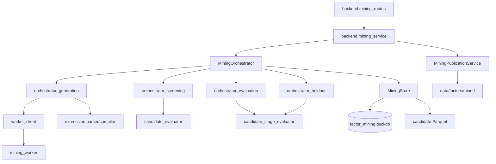

# 自动因子挖掘

自动因子挖掘把研究假设转换为受控因子表达式，再经过安全校验、技术门禁、快速筛选、
完整评估、模块测试段、人工审批和正式发布。它不直接让大模型执行 SQL 或 Python，
而是把模型输出限制为冻结字段和算子组成的 DSL。

核心代码位于 [research/mining](../../research/mining)。Agent 与 RD-Agent 的完整
调度过程见 [Agent 编排与 RD-Agent](06-agent-orchestration.md)。

## 1. 技术栈

| 技术 | 用途 |
|---|---|
| Python 数据类 | 请求、候选、冻结上下文、评估、审批和发布契约 |
| DuckDB | 运行、候选、事件、证据和审批元数据 |
| Parquet | 候选因子值、评估输入和发布因子值 |
| 自研表达式解析器 | 解析、校验、规范化和编译受控 DSL |
| FastAPI / SSE | 挖掘审核 API 与运行事件流 |
| RD-Agent / DeepSeek | Worker 侧候选生成，详见专题文档 |
| 文件锁、事务、条件更新 | 幂等、并发和状态一致性 |

## 2. 提供功能

### 2.1 挖掘运行

用户提交研究假设和预算。系统冻结：

- 股票池 `all_a`。
- 标签 `fwd_ret_open_5`。
- 价格通道 `hfq`。
- 研究、完整评估和测试段日期。
- 数据版本和指纹。
- 字段、算子、已有因子清单及哈希。
- 轮次、候选数、完整评估数、LLM 调用和表达式深度。

冻结内容由 `FrozenContext` 表示。同一上下文可复用于多个运行，但运行期间不可修改。

### 2.2 受控 DSL

DSL 语法只接受：

- 数字。
- 冻结字段。
- 冻结函数。
- 括号、逗号、四则运算和一元正负号。

不支持字符串、日期字面量、注释、字段限定名、子查询、多语句、`SELECT`、Python 代码
或未登记函数。窗口长度为 1～252，表达式深度受运行预算限制。

```text
expression := additive
additive := multiplicative (("+" | "-") multiplicative)*
multiplicative := unary (("*" | "/") unary)*
unary := ("+" | "-") unary | primary
primary := number | field | function "(" expression ("," expression)* ")"
```

解析后生成 AST，再做字段、算子、参数、窗口、深度、节点数和量纲校验。编译器按后序
顺序把嵌套窗口拆成 `v1`、`v2` 等 DuckDB 层，避免窗口内再次套窗口。

### 2.3 候选身份

候选有两种哈希：

| 哈希 | 输入 | 用途 |
|---|---|---|
| `semantic_hash` | 规范表达式、方向、回看、依赖字段、输出类型和参数 | 判断计算语义是否重复 |
| `content_hash` | schema、语义哈希、名称、机制、说明和步骤 | 审批版本绑定与稳定候选 ID |

修改说明或步骤只改变内容哈希，需要重新审批；修改表达式会同时改变两个哈希。正式名称
由语义哈希决定，Worker 返回的名称不是权威值。

### 2.4 技术门禁

候选物化为因子后，至少检查：

1. 行集与 `md.daily_hfq` 双向差集为零。
2. 非有限值为零，覆盖率不低于冻结阈值。
3. 有足够截面的交易日中，常数日占比不超过配置上限。
4. 首、中、末日期截断重算与全量结果一致，防止未来函数。
5. 与正式因子的最大绝对平均秩相关低于阈值。
6. 无法建立足够相关性样本时失败关闭，不能放行。

### 2.5 快速筛选和完整评估

研究期快速筛选计算轻量 RankIC、ICIR、覆盖率和确定性排序。按以下顺序选前 K 个候选：

```text
abs(rank_ic_mean) desc
abs(rank_ic_ir) desc
coverage desc
content_hash asc
candidate_id asc
```

完整评估复用因子评估的共享面板和指标注册表，计算分位、衰减、风格暴露等全部结果。
完整评估不能绕过股票池、标签、面板规模和质量规则。

### 2.6 模块测试段

候选冻结后，系统唯一领取一次测试段，使用独立 `holdout/factor/` 目录重新物化数值。
测试段通过标准只要求评估链路完整、无执行错误且至少有足够有效交易日；预测指标原样保存，
但不用于通过判定、候选重排或再次生成。

### 2.7 人工审批

审批请求必须绑定：

- 候选内容和语义哈希。
- 冻结上下文哈希。
- 技术门禁哈希。
- 通过的测试段报告和领取批次。
- 汇总证据哈希。

批准和拒绝都是最终决定。完全相同的重复请求幂等；相反决定或证据变化返回冲突。

### 2.8 正式发布

同一冻结上下文中全部已批准候选作为一个批次。发布服务：

1. 校验审批资格与快照。
2. 在隔离目录重建此前已发布 `mined` 定义和本批新定义。
3. 全历史校验行集、float32、非有限值、覆盖率和前视。
4. 写入 `definitions.json`。
5. 原子切换 `data/factors/mined` 符号链接和因子目录库。
6. 失败时恢复旧版本。

候选、审批和发布是三个独立状态，不因审批成功就自动进入正式因子库。

## 3. 如何使用

### 3.1 准备 Worker

```bash
.venv/bin/python -c \
  'from common.paths import DATA_DIR; from mining.worker_client import ensure_worker_token; ensure_worker_token(DATA_DIR / "mining_worker" / "token")'
docker compose --env-file .env -f compose.mining.yaml up -d --build
curl --fail --silent http://127.0.0.1:8790/health
```

DeepSeek Key 只在 Worker 容器中配置，不进入监测站主服务。

### 3.2 启动监测站

```bash
export MINING_WORKER_URL=http://127.0.0.1:8790
bash tools/monitor/serve.sh
```

页面入口：

```text
http://127.0.0.1:8800/#/mining
http://127.0.0.1:8800/#/mining/new
```

### 3.3 Python 创建运行

```python
from mining import FrozenContext, MiningRunRequest, MiningStore

store = MiningStore()
request = MiningRunRequest(
    idempotency_key="client-run-001",
    hypothesis="短期价格反转可能带来超额收益",
)
context = FrozenContext(data_fingerprint="<64 位数据指纹>")
run = store.create_run(request, context)
```

应用层通常使用 `MiningOrchestrator.create_run()`，因为它会先检查 Worker 健康状态，并
自动冻结完整上下文。

### 3.4 校验表达式

```python
from mining import validate_expression

validated = validate_expression("rank(mean(ret, 20))", direction=1)
```

校验失败在解析或执行 SQL 前抛出 `MINING-114`，不会留下候选文件。

### 3.5 页面操作

1. 输入至少 8 个字符的研究假设。
2. 可调整轮次、候选数、完整评估数和 LLM 调用上限。
3. 查看运行事件、预算消耗和候选列表。
4. 打开候选详情，核对定义、四阶段证据和图表。
5. 填写审核人和备注，批准或拒绝。
6. 批准后，在同一运行内整批发布全部已批准候选。

## 4. 内部结构与调用关系



### 4.1 契约模块

`contract_requests.py`、`contract_candidates.py`、`contract_evidence.py` 和
`contracts.py` 定义请求、候选、证据和汇总对象。所有外部 JSON 都先经过严格解析，
未知字段和非法类型直接失败。

### 4.2 表达式模块

- `expression_parser.py`：词法和语法分析。
- `expression_ast.py`：AST 节点。
- `expression_validation.py`：字段、算子、参数、深度和量纲校验。
- `expression_compiler.py`：分层 SQL 与稳定命名。
- `catalog.py`：字段、算子、可用时点和 schema 一致性。

### 4.3 状态模块

`states.py` 固定运行、候选和发布状态。`storage.py` 组合多个存储 mixin：

| 子模块 | 责任 |
|---|---|
| `storage_runs.py` | 运行、上下文、中断和恢复 |
| `storage_candidates.py` | 候选定义、去重和状态 |
| `storage_evidence.py` | 评估报告和技术门禁 |
| `storage_review.py` | 测试段、审批 |
| `storage_publications.py` | 发布批次 |
| `storage_events.py` | 不可变事件和临时目录清理 |
| `storage_schema.py` | DuckDB schema |

所有状态更新使用预期旧状态条件，防止并发跳过状态机。

### 4.4 评估模块

`candidate_materialization.py` 把 SQL 结果写入候选目录；`candidate_evaluator.py`
执行技术门禁和快速筛选；`candidate_stage_evaluator.py` 提供完整评估和测试段单阶段入口；
`evaluation_contract.py` 固定输入和输出。

### 4.5 发布模块

`publication_builder.py` 构建完整 `mined` 目录，`publication_validation.py` 校验，
`publication_commit.py` 负责原子提交与回滚，`publication_service.py` 编排后台发布。

## 5. 状态与数据

运行状态：

```text
queued -> generating -> screening -> evaluating
       -> holding_out -> review_ready -> completed
```

失败、取消、中断和过期分别进入 `failed`、`cancelled`、`interrupted` 和 `stale`。
同一时刻只允许一个运行占用执行槽，其他运行保持排队。

候选主状态：

```text
proposed -> validating -> technical_failed | screening
screening -> screened_out | evaluating
evaluating -> evaluated -> holdout_running
holdout_running -> holdout_failed | review_ready
review_ready -> approved | rejected
approved -> building -> published
```

数据位置：

| 内容 | 路径 |
|---|---|
| 候选元数据 | `data/databases/factor_mining.duckdb` |
| 运行目录 | `data/factor_mining/runs/<run_id>/` |
| 候选缓存 | `data/factor_mining/cache/` |
| 候选因子 | `.../<candidate_id>/factor/year=YYYY/part.parquet` |
| 评估报告 | `.../<candidate_id>/evaluations/<stage>.json` |
| 正式发布 | `data/factors/mined -> .mined-versions/<batch_id>` |

## 6. 幂等、取消与恢复

- 同一幂等键和相同请求返回原运行。
- 同一候选重复写入幂等；语义相同但内容不同返回冲突。
- 取消会同时终止 Worker 作业，并在安全阶段边界停止编排。
- 进程重启只把活动状态标为 `interrupted`，不自动重放。
- 显式恢复后复用已经完成的 Worker 轮次、报告、门禁和测试段领取记录。
- 数据、目录或正式因子清单变化会把运行和未终态候选原子标为 `stale`。

## 7. 日志与错误

日志写入 `logs/research/mining/<module>/`，只记录运行 ID、候选 ID、阶段、状态、错误码
和哈希，不记录 Key、完整假设、原始 Prompt 或模型响应。

主要错误码：

| 范围 | 含义 |
|---|---|
| `MINING-100` | 未分类错误 |
| `MINING-101` | 契约或参数非法 |
| `MINING-102` | Worker 或运行槽位忙 |
| `MINING-103` | Worker 不可用 |
| `MINING-104/105` | 候选非法或重复冲突 |
| `MINING-106/107` | 评估失败或测试段冲突 |
| `MINING-108` | 审批依据冲突 |
| `MINING-109/110` | 发布失败或记录不存在 |
| `MINING-111/112/113` | 状态、存储或恢复冲突 |
| `MINING-114/115` | DSL 非法或目录漂移 |
| `MINING-116`～`119` | Worker 超时、取消、协议或配置错误 |
| `MINING-120` | 快照过期 |
| `MINING-121`～`123` | 发布资格、全量校验或提交失败 |

## 8. 修改注意事项

1. 修改字段、算子或量纲时必须升级目录 schema，并同步冻结上下文与测试。
2. 不得让 Worker 访问行情库、候选库或正式因子目录；模型输出必须经过主服务二次校验。
3. 不得把测试段反馈送回 Worker 或用于候选重排。
4. 不得绕过审批直接写 `mined`，也不得覆盖历史发布批次。
5. 修改状态机要同步条件更新、事件、恢复逻辑和前端可用操作。
6. 评估阈值变化会改变证据哈希，必须让旧审批失效。
7. 候选大产物和事件需要保留审计信息；自动清理只允许处理超时的临时目录。

