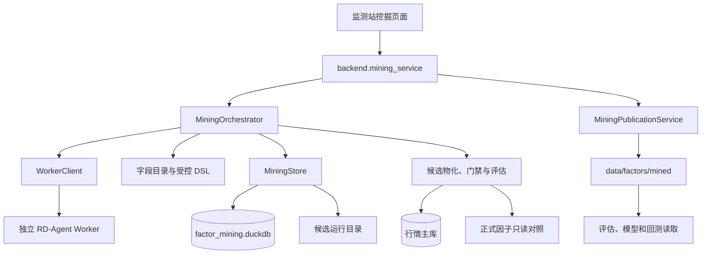

# 自动因子挖掘

自动因子挖掘把一段研究假设转换为受控因子表达式，再经过技术门禁、研究期快速筛选、
完整评估、一次性模块测试段、人工审批和整批正式发布。它不让大模型直接执行 SQL 或
Python，而是把模型输出限制在冻结字段、冻结算子和受控 DSL 内。

读完本章应能回答五个问题：

- 一个研究假设怎样变成候选，候选又怎样走到正式因子库。
- 哪些内容在运行开始前被冻结，哪些变化会使运行和审批失效。
- 技术门禁、快速筛选、完整评估和模块测试段分别回答什么问题。
- 人工批准与正式发布有什么区别，失败后怎样恢复。
- 自动搜索和样本外评估仍有哪些不能消除的研究偏差。

核心代码位于 [research/mining](../../research/mining)。RD-Agent Worker 的进程边界、
部署、协议和取消细节见 [Agent 编排与 RD-Agent](06-agent-orchestration.md)，监测站
路由与前端状态见 [监测站](09-monitor-web.md)。

## 1. 职责边界与当前状态

自动挖掘模块负责：

- 冻结一次研究所依赖的数据、字段、算子、因子清单、时间窗口和预算。
- 把 Worker 返回的未信任表达式解析、规范化、校验并编译为 DuckDB SQL。
- 管理运行、候选、评估、测试段、审批和发布状态。
- 在独立目录物化候选因子，复用正式因子评估面板和质量规则。
- 将人工批准的候选整批重建为 `mined` 正式因子族并原子切换可见版本。

自动挖掘不负责：

- 自动批准候选，或把批准等同于“因子已经盈利”。
- 训练模型、生成交易策略或执行回测。
- 让 Worker 读取行情库、候选库或正式因子目录。
- 用模块测试段结果再次提示 Worker、重排候选或训练第二个模型。

截至 2026-10-26，本模块的 S2～S9 已交付，综合验收结论见
[S9 验收记录](../research/mining/acceptance.md)。当前工作区没有活动候选库、候选运行
目录或正式 `data/factors/mined` 链接，因此本章描述的是可执行代码和契约，不是某次
正在进行的研究运行。

当前冻结数据版本为 `tushare_fullA_20000104_20261015`。字段目录包含 95 个字段声明，
其中 84 个允许进入表达式；另有 34 个冻结算子。目录 schema 为 `mining_catalog_v1`，
质量规则版本为 `mining_quality_v1`。

## 2. 全链路位置



主服务只接收 Worker 返回的未信任表达式草稿。稳定因子名、依赖字段、回看窗口、
语义哈希、内容哈希和候选 ID 都由主服务的受控目录重新计算，Worker 返回的名称不是
权威值。

## 3. 公开入口与契约

公共 Python 入口由 [mining/__init__.py](../../research/mining/__init__.py) 导出。常用
对象和方法包括：

| 入口 | 作用 |
|---|---|
| `MiningRunRequest` | 提交假设、幂等键、预算和模型配置 |
| `FrozenContext` | 固化数据、规则、时间窗口、正式因子清单和预算 |
| `CandidateDefinition` | 保存规范化表达式、方向、依赖、步骤和发现位置 |
| `validate_expression()` | 解析、校验、编译并生成稳定候选身份 |
| `MiningStore` | 运行、候选、证据、审批和发布元数据存储 |
| `MiningOrchestrator` | 后台执行、取消、恢复和预算进度 |
| `evaluate_candidate()` | 物化候选并执行技术门禁、快速筛选和可选完整评估 |
| `evaluate_full_candidate()` | 在研究期已有产物上执行完整评估 |
| `evaluate_holdout_candidate()` | 在隔离目录执行一次性模块测试段 |
| `MiningPublicationService` | 资格预检、全量构建、提交、回滚和重启恢复 |

### 3.1 运行请求

[contract_requests.py](../../research/mining/contract_requests.py) 定义
`MiningConstraints`、`MiningRunRequest` 和 `FrozenContext`。

| 请求字段 | 规则 |
|---|---|
| `idempotency_key` | 8～128 个字符，只含字母、数字、点、下划线、冒号和连字符 |
| `hypothesis` | 去首尾空白后 8～4000 个字符 |
| `constraints` | 必须是 `MiningConstraints` |
| `llm_profile` | 1～40 个字符，只含字母、数字、下划线、点和连字符 |

运行 ID 由 schema 版本和幂等键生成；请求哈希包含规范化假设、完整约束、模型配置和
schema 版本，不包含幂等键本身。应用层先检查 Worker 健康，再调用存储层创建或复用运行，
所以 Worker 不可用时不会把请求静默降级为 Mock。

默认预算如下。页面可以覆盖其中部分字段，最终实际值会冻结进上下文。

| 约束 | 默认值 | 允许范围或含义 |
|---|---:|---|
| `universe` | `all_a` | 首版固定 |
| `label` | `fwd_ret_open_5` | 首版固定 |
| `price_channel` | `hfq` | 首版固定，因子使用后复权价 |
| `direction` | `either` | `either/positive/negative` |
| `max_rounds` | 3 | 1～10 轮 |
| `max_candidates` | 12 | 1～40 个 |
| `full_eval_top_k` | 4 | 1～`min(8, max_candidates)` |
| `max_llm_calls` | 30 | 1～60 次 |
| `max_expression_depth` | 6 | 2～8 层 |
| `min_coverage` | 0.30 | 0～1 |
| `max_failure_rate` | 0.75 | `(0, 1]` |
| `min_quality_checks_for_failure_stop` | 4 | 1～`max_candidates` |
| `seed` | 42 | 整数，随上下文冻结 |
| `excluded_fields` | 空 | 本次运行额外禁用的字段 |

### 3.2 冻结上下文

`FrozenContext` 固化以下内容：

| 类别 | 内容 |
|---|---|
| 数据 | 数据版本、64 位数据指纹 |
| 研究口径 | 股票池、标签、价格通道 |
| 时间 | 研究、完整评估、模块测试段起止日期 |
| 规则 | 允许字段、算子、已有正式因子清单 |
| 预算 | 轮次、候选数、评估数、调用数、深度、覆盖率、失败停止阈值和种子 |
| Worker | 模型配置名和实际模型名 |

默认时间窗口如下：

| 用途 | 日期 |
|---|---|
| 全历史构建和回看预热起点 | 2000-01-04 |
| Agent 研究与快速筛选 | 2012-01-01～2025-10-15 |
| 研究期完整评估 | 2020-01-01～2025-10-15 |
| 模块测试段 | 2025-10-16～2026-10-15 |

契约要求
`research_start <= full_eval_start <= full_eval_end <= research_end <
holdout_start <= holdout_end`。当前页面使用上述固定窗口；Python 契约允许在不破坏
顺序的前提下传入其他窗口。

上下文哈希覆盖完整 `material()`，但 `created_at` 只作为持久化审计字段，不进入上下文
哈希。字段和算子映射会规范化排序和去重，所以仅改变输入顺序不会改变哈希。数据指纹
由清洗清单哈希、行情库文件大小和修改时间生成，是轻量变更检测，不是行情库所有页面的
内容哈希。

### 3.3 候选身份

[contract_candidates.py](../../research/mining/contract_candidates.py) 使用两个哈希：

| 哈希 | 输入 | 用途 |
|---|---|---|
| `semantic_hash` | schema、规范表达式、方向、回看、依赖字段、输出类型和参数 | 判断计算语义是否重复 |
| `content_hash` | schema、语义哈希、名称、机制、说明和白话步骤 | 绑定审核版本并生成候选 ID |

修改说明、机制或步骤只改变 `content_hash`，需要重新审核；修改表达式等计算内容会同时
改变两者。`discovery_round` 和 `discovery_index` 不进入候选 ID，只用于记录发现顺序。
正式因子名由语义哈希前 24 位生成，格式为 `MINE_<24 位大写十六进制>`。

候选在同一个运行内必须同时满足内容哈希和语义哈希唯一。完全相同的重复写入幂等；
语义相同但说明不同会返回 `MINING-105`。不同运行可以保留相同候选用于审计。

## 4. 一次运行的端到端时序

```text
创建运行并冻结上下文
  -> queued
  -> 生成阶段：多轮 Worker 候选写入筛选队列
  -> 技术阶段：逐候选重校验、物化并执行门禁
  -> 快速筛选：研究期轻量 RankIC 与覆盖率
  -> 冻结入围批次：按确定性顺序选前 K 个
  -> 完整评估：复用共享面板执行全部 stage
  -> 模块测试段：一次性领取，在隔离目录求值
  -> review_ready：等待人工审批
  -> approved/rejected
  -> building -> published/build_failed
```

### 4.1 生成阶段

[orchestrator_generation.py](../../research/mining/orchestrator_generation.py) 按
`min(max_rounds, max_llm_calls)` 执行轮次。每轮向 Worker 请求不超过
`min(剩余候选名额, max_candidates_per_round)` 个候选，默认每轮最多 4 个。

每轮请求先写成稳定事件。恢复时，如果 `round_<n>_requested` 和
`round_<n>_completed` 已存在，不会重复调用 Worker。反馈只包含轮次、入库数、拒绝数、
重复数和错误码，不包含原始表达式、RankIC、完整评估或测试段结论。

以下条件会提前停止生成：

- 达到轮次或 LLM 调用预算。
- 候选总数达到 `max_candidates`。
- 最新一轮没有新增合法候选。
- 运行被取消或被判定快照过期。

### 4.2 技术门禁与快速筛选

[orchestrator_screening.py](../../research/mining/orchestrator_screening.py) 对每个新
候选执行：

```text
proposed -> validating
  -> technical_failed
  -> screening -> screened_out
  -> screening（通过，等待完整评估）
```

[candidate_materialization.py](../../research/mining/candidate_materialization.py)
会再次校验冻结表达式、稳定名称、回看、依赖、输出类型和参数，拒绝落库后语义漂移的
候选。因子值先写入候选根目录旁的 hidden staging，完成后一次替换 `factor/`；正式因子
目录及其子目录不能作为候选根目录。

同一发现轮次至少两个候选且表达式 DAG 有共享计算时，编排器先调用
[candidate_batch.py](../../research/mining/candidate_batch.py) 批量物化。共享节点
在一条 DuckDB 查询中只计算一次，结果临时写成宽 Parquet，再逐候选拆入独立 staging。
单候选、无共享计算或批量查询失败时保留原逐候选路径。单候选失败只标记该候选，批量
共享层和全部回退均失败时返回 `MINING-124`。测试段使用相同规则写入各自的
`holdout/factor/`。

质量检查数和失败率按已经进入技术或研究期评估的候选计算。检查数达到冻结下限后，
失败比例大于等于 `max_failure_rate` 会以 `MINING-106` 终止运行，不进入完整评估和
测试段。

### 4.3 完整评估和测试段

[orchestrator_evaluation.py](../../research/mining/orchestrator_evaluation.py) 对快速
筛选通过的候选按以下键升序选前 K：

```text
abs(rank_ic_mean) desc
abs(rank_ic_ir) desc
coverage desc
content_hash asc
candidate_id asc
```

未入围的 `screening` 候选标为 `screened_out`。入围候选依次进入 `evaluating`，完整
评估复用正式因子评估的共享面板和全部指标，完成后进入 `evaluated`。

[orchestrator_holdout.py](../../research/mining/orchestrator_holdout.py) 在领取测试段前
要求技术门禁及 technical、quick、full 报告齐全，并用候选 ID、门禁哈希和报告 ID
生成批次证据哈希。测试段领取是候选库全局唯一的：

| 约束 | 当前行为 |
|---|---|
| 唯一键 | 固定 segment ID `2025-10-16_2026-10-15` |
| 批次冻结 | 候选 ID 集合与证据哈希必须完全一致 |
| 重复调用 | 同批次同证据幂等 |
| 其他批次 | 返回 `MINING-107`，不能换候选或重新排序 |
| 恢复 | 只能继续原领取批次，不能重新打开测试段 |

测试段使用 `holdout/factor/` 独立物化，不覆盖研究期 `factor/`。预测指标只保存为证据，
不用于通过判定、候选重排或再次生成。

## 5. 受控字段目录与 DSL

### 5.1 字段目录

目录配置位于 [catalog.json](../../configs/mining/catalog.json)，读取和数据库 schema
核对逻辑位于 [catalog.py](../../research/mining/catalog.py)。目录支持：

- `daily_hfq` 基表字段。
- 指数日收益的按日期连接。
- 财务利润表、资产负债表、现金流和财务指标的 ASOF 连接。

财务字段先取截至当日最新可用报告期，再要求 `trade_date > available_date`。公告当日
不可见，次一交易日才可用。股票代码、日期、标签、状态、审计字段和未复权价格不能进入
因子表达式。

目录校验会逐项比对来源、表、列和数据库类型。字段、来源或 schema 不一致时抛出
`MINING-115`，不会带着漂移目录继续研究。

### 5.2 语法与规模限制

[expression_parser.py](../../research/mining/expression_parser.py) 实现不依赖
`eval` 的解析器：

```text
expression := additive
additive := multiplicative (("+" | "-") multiplicative)*
multiplicative := unary (("*" | "/") unary)*
unary := ("+" | "-") unary | primary
primary := number | field | function "(" expression ("," expression)* ")"
```

当前硬限制：

| 限制 | 值 |
|---|---:|
| 原始或规范化表达式长度 | 最多 12000 UTF-8 字节 |
| AST 节点数 | 最多 256 |
| 表达式深度 | 运行预算 2～8，默认 6 |
| 时序窗口 | 1～252 个交易日；部分算子最小为 2 |
| 数字绝对值 | 非零时在 `1e-12`～`1e12` |
| 函数参数数 | 目录声明，最多 8 |
| `signed_power` 指数 | -4～4 |

字符串、日期字面量、注释、反引号、字段限定名、子查询、多语句、SQL/Python 代码和未知
函数都会在执行 SQL 前以 `MINING-114` 拒绝。

### 5.3 规范化和分层编译

解析器统一函数别名、数字格式、空白和可交换参数顺序。`delay`、`average`、`stddev`
分别规范化为 `lag`、`mean`、`std`；字段名区分大小写。

[expression_compiler.py](../../research/mining/expression_compiler.py) 按后序顺序把每个
时序或截面窗口拆为 `v1`、`v2` 等独立 CTE，避免 DuckDB 嵌套窗口。例如：

```text
rank(mean(close, 5) + lag(close, 1))
```

会拆成五日均值、一日滞后和截面排名层。加法和减法要求同量纲；标量可与任一量纲组合；
排名、标准化、相关和 `r2` 输出标量。布尔字段在执行时转为 0/1。

[expression_dag.py](../../research/mining/expression_dag.py) 另为同一冻结上下文中的
候选组建立确定性 DAG，记录跨候选共享子树、候选根节点和潜在节点求值减少比例。
[expression_batch.py](../../research/mining/expression_batch.py) 已把后序 DAG 接入
候选筛选和测试段：共享计算节点各生成一个 CTE 列，最终只输出各候选根列。4 候选固定
案例的分析 SQL 由 4 条降为 1 条，物化中位耗时由 11.40 秒降至 3.52 秒，峰值 RSS
由约 1225MB 降至 1218MB。该收益来自 DuckDB DAG 批量执行，不是 C++ 替换。

## 6. 候选评估与质量门禁

### 6.1 技术门禁

[evaluation_gates.py](../../research/mining/evaluation_gates.py) 在研究期快速筛选窗口
执行四组硬检查，其中“取值”组同时包含非有限值、覆盖率和截面退化。
[evaluation.json](../../configs/mining/evaluation.json) 当前规则版本为
`mining_quality_v1`。

| 检查 | 当前实现 | 失败行为 |
|---|---|---|
| 行集 | 候选键集与 `md.daily_hfq` 双向差集都为零 | 技术门禁失败 |
| 取值 | 非有限值为零；覆盖率不低于冻结 `min_coverage`；至少存在一个有 5 个非空值的交易日；这些交易日中标准差为 0 的比例不超过 1% | 技术门禁失败 |
| 前视 | 首、中、末共 3 个确定性交易日截断重算；空值差异为零，最大相对误差不超过 `1e-5` | 技术门禁失败 |
| 正式因子相关性 | 最多 100 个确定性交易日，单日至少 5 只股票，成对至少 20 日，最大绝对平均秩相关必须小于 0.90 | 样本不足或超阈值均失败关闭 |

正式因子相关性只比较候选与当前正式因子，不比较同一批尚未发布的新候选。当前代码在
找不到任何正式因子对照时返回 `passed=true` 和 `reason=no_formal_peers`；这是现有实现
边界，不应解释成候选经过了相关性验证。

[evaluation_correlation.py](../../research/mining/evaluation_correlation.py) 将目标与
正式 peer 对齐为日期股票矩阵后，通过统一 `kernels` 后端调用 `daily_row_spearman`。
默认 `auto` 使用 C++，扩展不可用时回退 Python。单次筛选只缓存一次正式 peer 网格，
不跨运行共享，也不计算同一批候选之间的相关性。

固定四候选、批量物化后筛选时，技术阶段相对未缓存 Python 由 `40.941s` 降至 auto
`32.890s`，改善 `19.66%`；缓存后候选相关性由 Python `4.411s` 降至 native
`3.243s`（`1.360x`）。证据位于
`AiRecord/benchmarks/V121/p2-02-20261028/`。

门禁不通过是正常研究结论，通过 `TechnicalGate.passed=false` 和逐项 `checks` 保留证据。
评估引擎自身异常才会使用 `MINING-106`。每个阶段报告的 `input_hash` 包含候选、上下文、
因子树哈希、阶段参数和完整质量规则，阈值或产物变化会使旧证据失效。

### 6.2 快速筛选

[candidate_evaluator.py](../../research/mining/candidate_evaluator.py) 使用：

- 股票池 `all_a`。
- 标签 `fwd_ret_open_5`。
- 5 个交易日标签周期和开盘价通道。
- 10 个分位组和 3 倍 MAD 去极值。
- 研究期逐日 RankIC。

有效 RankIC 日少于 20 天时快速筛选失败。通过后保存 RankIC 均值、ICIR、正/负方向胜率、
年度同号率和耗时。以下只是警告，不是硬失败：

| 警告 | 默认阈值 |
|---|---:|
| 绝对 RankIC 均值 | 低于 0.02 |
| 绝对 ICIR | 低于 0.2 |
| 年度同号率 | 低于 0.60 |

轻量筛选直接在 DuckDB 内取得逐日 RankIC，不构建完整面板。完整评估另走
`build_panel()` 和全部 stage，因此两条路径共享口径，但计算成本和前置规模检查不同。
固定研究期 C++ 对照中位 `0.755s`，慢于 SQL `0.658s`，所以轻量 RankIC 继续保留
DuckDB 路径，不计入 C++ 替换。

### 6.3 完整评估

[candidate_stage_evaluator.py](../../research/mining/candidate_stage_evaluator.py) 在
候选 `factor/` 上调用正式因子评估的面板和全部 stage。完整评估的通过条件当前是：

- 完整评估链路执行成功。
- 结果能以规范化 JSON 写入 `evaluations/full.json`。
- 没有抛出执行异常。

完整评估没有额外的 RankIC、分位收益或风格暴露数值门槛。图表数值是研究证据，不是
批准条件；审批人需要自行判断其经济含义和稳定性。

### 6.4 模块测试段

测试段在冻结候选后只运行一次，并重新物化独立数值。通过条件为：

1. 所有既有评估 stage 都执行并返回完整结果。
2. 有效 RankIC 日不少于 20 天。
3. 没有执行错误。

通过条件不检查 RankIC 大小、收益方向或经济显著性，预测指标原样保存。测试段与模型
最终留出在历史上存在区间重叠，因此结论只能表示挖掘模块隔离验收，不能表述为全项目
独立盲测。

## 7. 状态、存储、幂等与恢复

### 7.1 状态机

完整状态表位于 [states.py](../../research/mining/states.py)。

运行状态：

```text
queued
  -> generating -> screening -> evaluating -> holding_out
  -> review_ready

活动阶段 ----------------> interrupted
任意允许阶段 ------------> failed | cancelled | stale
review_ready -----------> completed | stale
interrupted ------------> failed | cancelled | stale
```

`generating`、`screening`、`evaluating` 和 `holding_out` 是活动阶段，同一候选库同时只
允许一个运行占用执行槽。`queued` 可以并存；`interrupted` 会释放执行槽但不会自动恢复。

当前 `MiningOrchestrator` 正常完成后停在 `review_ready`，不自动写入 `completed`。
`completed` 是状态机允许的终态，但当前编排流程不会自行进入；页面也把
`review_ready` 视为事件流可结束的状态。

候选状态：

```text
proposed -> validating -> technical_failed | screening
screening -> screened_out | evaluating
evaluating -> evaluated -> holdout_running
holdout_running -> holdout_failed | review_ready
review_ready -> approved | rejected
approved -> building -> published | build_failed
build_failed -> building
活动阶段 -> interrupted
允许阶段 -> failed | cancelled | stale
```

`technical_failed`、`screened_out`、`holdout_failed`、`published`、`rejected`、
`failed`、`cancelled` 和 `stale` 是终态。`build_failed` 可重试，不是终态。

发布批次状态：

```text
staging -> validating -> published
staging | validating -> failed
failed -> rolled_back
```

当前服务发生构建、校验或提交失败并完成回滚后，通常把批次收口为 `failed`，把候选收口
为 `build_failed`。`rolled_back` 已由状态机支持，但不是当前服务失败路径记录的主要
终态。

### 7.2 数据库与文件

候选元数据库为 `data/databases/factor_mining.duckdb`，schema 为 `mining_v1`。未知
schema 版本直接拒绝启动，不做静默迁移。

主要表：

| 表 | 责任 |
|---|---|
| `mining.run` | 请求摘要、运行状态、执行槽和中断信息 |
| `mining.run_context` | 可复用的不可变上下文快照 |
| `mining.candidate` | 候选定义、哈希、发现顺序和状态 |
| `mining.evaluation` | technical/quick/full/holdout 报告 |
| `mining.technical_gate` | 门禁结论和检查哈希 |
| `mining.holdout_usage` | 模块测试段唯一领取记录 |
| `mining.approval` | 最终人工审批 |
| `mining.publication_batch` | 整批发布目标、状态和哈希 |
| `mining.publication` | 批次内逐候选发布关联 |
| `mining.event` | 运行内连续编号的不可变事件 |

事实来源是数据库。文件系统保存可重建的大产物：

| 内容 | 路径 |
|---|---|
| 运行根目录 | `data/factor_mining/runs/<run_id>/` |
| 候选根目录 | `data/factor_mining/runs/<run_id>/candidates/<candidate_id>/` |
| 研究期因子 | `<候选根目录>/factor/year=YYYY/part.parquet` |
| 测试段因子 | `<候选根目录>/holdout/factor/year=YYYY/part.parquet` |
| 快速和完整评估 | `<候选根目录>/evaluations/quick.json`、`full.json` |
| 测试段评估 | `<候选根目录>/evaluations/holdout.json` |
| 发布暂存 | `data/factor_mining/publications/<run_id>/attempt-N/` |
| 正式发布版本 | `data/factors/.mined-versions/<batch_id>/` |
| 正式链接 | `data/factors/mined -> .mined-versions/<batch_id>` |

`data/factor_mining/cache/` 是存储层提供的隔离缓存目录。批量物化只在运行目录下创建
随机 `.batch-materialization.staging-*`，处理后立即删除；可复用产物仍放在每个候选
根目录，并依靠 materialization manifest 校验身份和树哈希。

### 7.3 幂等与并发

所有状态写入使用本机文件锁、DuckDB 事务和带预期旧状态的 `UPDATE ... WHERE` 条件。
数据库更新和对应事件在同一事务中提交；事件插入失败会回滚状态变化。

- 同一幂等键、请求、上下文和 Worker 模式返回原运行。
- 同一运行内相同候选内容重复写入幂等；语义重复但内容不同返回冲突。
- 运行首次进入 `generating` 时检查是否已有其他活动运行。
- 测试段同批次同证据幂等，不同批次不能重复领取。
- 审批用条件更新保证并发下只有一个最终决定。
- 发布批次启动会把整批候选原子改为 `building`，同一候选库只允许一个活动发布批次。

### 7.4 取消、中断和恢复

取消会：

- 设置编排器取消事件。
- 尝试取消当前 Worker 作业。
- 在一个事务中把运行和可终止候选收口为 `cancelled`。

取消只在阶段或候选边界生效，不能在单个 DuckDB 查询或完整评估 stage 中途抢占。
`review_ready` 和终态运行不会被取消接口改写。

进程重启时，`MiningWebService.initialize()` 把遗留活动运行和候选标为 `interrupted`，
不会自动重放。用户显式恢复后：

- 运行只能回到中断前阶段。
- 已完成的 Worker 轮次从事件复用。
- 已落库的评估、门禁和测试段领取记录直接复用。
- 未完成阶段从中断状态继续。

启动清理只删除中断运行目录下超过 24 小时的 `.tmp` 文件和 `staging` 目录。普通候选
大产物保留到人工清理。

### 7.5 快照失效

[snapshot.py](../../research/mining/snapshot.py) 在创建运行和主要阶段边界核对：

- 清洗清单和行情库文件元数据指纹。
- 当前字段目录和算子目录。
- 当前正式因子清单。

编排器在阶段边界发现变化时会终止运行，并把全部未终态候选原子标为 `stale`，错误码为
`MINING-120`。页面在审批前还会重新核对快照并把运行收口为 `stale`；发布预检发现变化
时直接拒绝启动批次。底层存储方法本身不统一执行全局快照检查，调用方不能绕过公开服务
边界。快照检查使用文件大小和 mtime，无法识别在同一文件上被原地修改且大小、时间戳都被
伪造的变化；这是轻量研究的工程边界。

## 8. 人工审批

[contract_evidence.py](../../research/mining/contract_evidence.py) 和
[storage_review.py](../../research/mining/storage_review.py) 定义审批契约与存储。

审批必须绑定：

- 候选内容哈希和语义哈希。
- 冻结上下文哈希。
- 最近一次通过的技术门禁。
- 全部通过的测试段报告。
- 测试段领取批次和证据哈希。
- 审核人和非空备注。

当前证据哈希由门禁检查哈希、测试段报告 ID、测试段批次哈希和领取证据哈希规范化生成。
测试段领取证据又绑定进入测试段前的 technical/quick/full 报告 ID，因此审批不是只绑定
一个页面按钮或一句结论。

审批只有 `approved` 和 `rejected` 两种最终决定：

- 完全相同的重复请求幂等。
- 相反决定、审核人、备注或证据变化返回 `MINING-108`。
- 审批没有固定时间有效期，但数据、目录、因子清单、候选或证据变化会阻止后续发布。
- `technical_failed`、`screened_out`、`holdout_failed`、`failed`、`cancelled`、
  `stale` 和 `rejected` 不能进入审批。

批准只改变候选到 `approved`，不会自动构建或发布。

## 9. 正式发布

[publication_service.py](../../research/mining/publication_service.py) 负责资格预检和
后台批次；构建、校验和提交分别在
[publication_builder.py](../../research/mining/publication_builder.py)、
[publication_validation.py](../../research/mining/publication_validation.py) 和
[publication_commit.py](../../research/mining/publication_commit.py) 中实现。

### 9.1 发布资格

同一运行的发布批次必须包含当前全部 `approved` 或 `build_failed` 候选，不能漏选、增选
或混入其他状态。启动前还会核对：

- 页面提交的 `expected_context_hash` 仍匹配。
- 行情、目录和正式因子快照未变化。
- 每个候选仍有通过的批准记录。
- 门禁、测试段和证据哈希仍与批准时一致。
- 同一候选库没有其他 `staging/validating` 批次。

`build_failed` 候选可用新的 attempt 重试；每次尝试都有独立批次 ID、暂存目录和状态。

### 9.2 全量构建与校验

发布不只计算新候选，而是重建：

```text
此前已发布的 mined 定义 + 本批新候选
```

构建范围固定为 2000-01-04 至冻结上下文的测试段结束日。正式写入前必须通过：

1. 与 `md.daily_hfq` 的键集双向一致，且 `(stock_code, trade_date)` 唯一。
2. 每个因子的落盘类型为 float32。
3. 所有落盘值都不是 NaN 或无穷值。
4. 每个因子全历史覆盖率不低于冻结的 `min_coverage`。
5. 首、中、末三个截止日截断重算与原全量结果一致，容差 `1e-5`。
6. 不重名，也不与已有 `mined` 候选语义哈希重复。

校验通过后写入 `definitions.json`，并记录运行、候选、审批、内容哈希和语义哈希来源。
暂存因子目录库由正式因子目录库副本生成，避免直接修改线上库。

### 9.3 提交与回滚

正式可见性切换包含多个文件步骤，不是一笔跨文件系统事务：

1. 把暂存 `mined` 族移动到 `.mined-versions/<batch_id>`。
2. 写入 `commit.json`，记录旧链接和旧因子库副本。
3. 用临时符号链接原子替换 `data/factors/mined`。
4. 在暂存因子目录库中刷新 `v.mined`。
5. 原子替换 `data/databases/factors.duckdb`。
6. 把提交日志状态改为 `committed`。
7. 在一个数据库事务中把批次和候选收口为 `published`。

每一步都是可恢复的原子文件操作，但它们之间仍存在短暂窗口。任一步失败时根据提交日志
恢复旧链接和旧因子库，批次记为 `failed`，候选记为 `build_failed`。

服务启动时会检查未完成批次：

- 没有提交日志：不回放构建，直接失败收口。
- 日志未到 `committed`：恢复旧正式链接和目录库。
- 日志已 `committed` 但数据库未收口：按候选 ID 从新定义清单恢复正式名并完成发布状态。

### 9.4 发布后读取

正式 `mined` 定义由 `definitions.json` 和因子目录库共同提供：

- `factors.all_factors()` 只返回源码内置定义。
- `factors.resolve(name, factor_dir)` 同时解析内置和已发布因子。
- `factors.available_specs(factor_dir)` 返回两类定义合集。
- `quant.load_factor_list()` 从正式因子目录库读取 `mined` 元数据。
- 评估、模型和回测通过统一解析入口读取 Parquet 数值。

普通内置因子构建不会自动覆盖 `mined`。发布成功也不代表因子通过成本、容量、A 股成交
约束或策略回测；这些问题必须由回测模块回答。

## 10. 错误与日志

### 10.1 错误码

稳定错误码定义在 [errors.py](../../research/mining/errors.py)，HTTP 映射由监测站统一
转换。

| 错误码 | HTTP | 含义 |
|---|---:|---|
| `MINING-100` | 400 | 未分类挖掘错误 |
| `MINING-101` | 400 | 契约、参数或请求体非法 |
| `MINING-102` | 429 | 已有运行占用执行槽 |
| `MINING-103` | 503 | Worker 不可用 |
| `MINING-104` | 400 | 候选定义非法 |
| `MINING-105` | 409 | 幂等键、候选或事件重复冲突 |
| `MINING-106` | 422 | 技术、快速、完整或测试段评估失败 |
| `MINING-107` | 409 | 测试段领取或恢复冲突 |
| `MINING-108` | 409 | 审批依据变化或最终决定冲突 |
| `MINING-109` | 500 | 通用正式发布失败 |
| `MINING-110` | 404 | 运行、候选、审批或发布记录不存在 |
| `MINING-111` | 409 | 状态或并发更新冲突 |
| `MINING-112` | 503 | 候选库不可用、损坏或事务失败 |
| `MINING-113` | 409 | 中断运行不能按请求恢复 |
| `MINING-114` | 400 | 表达式语法、字段、算子、参数或安全规则非法 |
| `MINING-115` | 500 | 字段目录损坏或实际 schema 漂移 |
| `MINING-116` | 504 | Worker 作业超时 |
| `MINING-117` | 409 | Worker 作业取消或重启中断 |
| `MINING-118` | 502 | Worker 请求或响应协议非法 |
| `MINING-119` | 503 | Worker 鉴权、Key 或模型配置不可用 |
| `MINING-120` | 409 | 数据、目录或正式因子快照过期 |
| `MINING-121` | 409 | 发布资格、批次组成或并发冲突 |
| `MINING-122` | 422 | 正式因子全量校验失败 |
| `MINING-123` | 503 | 发布提交、回滚或启动恢复失败 |
| `MINING-124` | 422 | 候选批量边界或共享层物化失败 |

### 10.2 日志

[logging_conf.py](../../research/mining/logging_conf.py) 复用集中日志处理器。模块名中的
点替换为下划线，例如 `mining.evaluation.candidate` 写入：

```text
logs/research/mining/mining_evaluation_candidate/
```

日志文件名继续遵循“首条记录时间-最后一条记录时间”，单段超过 128 MB 时轮转。
状态日志只写运行 ID、候选 ID、阶段、状态、错误码和哈希；以下内容不会进入业务日志
或事件表：

- API Key、Token、Authorization、密码和密钥类字段。
- 完整研究假设。
- 原始 Prompt、模型响应和完整表达式。
- 原始请求体。

日志和事件是排障证据，不是状态事实来源。运行、候选、审批和发布状态仍以候选数据库
为准。

## 11. 量化知识与研究边界

受控 DSL 解决的是“不执行任意代码”和“不越过已登记字段”的安全问题；它不能消除研究
选择偏差。

- 多轮生成和从多个候选中选前 K 个会形成多重检验。未看到的结果并不意味着不存在过拟合。
- 快速筛选使用研究期标签，完整评估与研究期重叠；它们回答“候选在这套历史数据上表现
  如何”，不是未知样本上的发现。
- 模块测试段只按链路完整和有效日数量通过，不要求收益显著；通过代表可以进入人工审核，
  不代表有稳定超额收益。
- 测试段被模型最终留出使用过，并且候选库对固定 segment 只允许一次领取，因此不能把
  它表述为全项目独立盲测。
- Worker 反馈只包含摘要，不使用测试段结果重写假设；这隔离了反馈泄漏，但不能消除研究
  人员在查看结果后的主观选择。
- 技术门禁没有正式因子对照时会放行相关性检查；同一批新候选之间也没有发布前的两两
  相关性矩阵，组合使用时仍可能高度集中。
- 高 RankIC、分位收益或风格中性化结果都没有自动包含停牌、涨跌停、T+1、费用、滑点、
  融券和容量，不能直接当成可实现收益。
- “批准”是人的研究决定，“发布”是工程状态切换；批准不等于可交易，发布也不等于策略
  有效。

## 12. 最小核验示例

以下命令只读配置并执行表达式校验，不写候选库或正式因子目录：

```bash
.venv/bin/python - <<'PY'
from mining import load_catalog, load_quality_policy, validate_expression

catalog = load_catalog()
policy = load_quality_policy()
validated = validate_expression(
    "rank(mean(ret, 20))",
    direction=1,
)

print(catalog.schema_version, len(catalog.allowed_fields), len(catalog.operators))
print(policy.schema_version, policy.quick_min_valid_days)
print(validated.factor_name)
print(validated.canonical_expression)
print(validated.semantic_hash)
PY
```

真实创建运行会写候选库、依赖行情快照并调用 Worker，不属于最小只读检查。测试必须使用
临时候选库和临时候选根目录；正式数据目录不能接收候选物化结果。

## 13. 测试映射与修改检查

### 13.1 测试主题

| 主题 | 测试入口 |
|---|---|
| 字段目录、schema 漂移和生成文档 | [test_mining_catalog.py](../../tests/test_mining_catalog.py) |
| 请求、上下文、候选哈希和审批契约 | [test_mining_contracts.py](../../tests/test_mining_contracts.py) |
| DSL 安全、算子、量纲和财务时点 | [test_mining_expression.py](../../tests/test_mining_expression.py) |
| 运行/候选/发布状态机 | [test_mining_states.py](../../tests/test_mining_states.py) |
| 存储事务、幂等、并发、恢复和清理 | [test_mining_storage.py](../../tests/test_mining_storage.py) |
| 评估输入、物化和质量规则 | [test_mining_evaluation_contract.py](../../tests/test_mining_evaluation_contract.py) |
| 生成、筛选、完整评估、测试段和快照 | [test_mining_orchestrator.py](../../tests/test_mining_orchestrator.py) |
| 全量构建、提交、回滚和下游读取 | [test_mining_publication.py](../../tests/test_mining_publication.py) |
| 候选与正式因子全指标一致性 | [test_mining_evaluation_consistency.py](../../tests/test_mining_evaluation_consistency.py) |
| 真实短区间端到端 | [test_mining_orchestrator_real.py](../../tests/test_mining_orchestrator_real.py) |
| Worker 协议与主服务二次校验 | [test_mining_worker_protocol.py](../../tests/test_mining_worker_protocol.py)、[test_mining_worker_client.py](../../tests/test_mining_worker_client.py) |
| 日志脱敏 | [test_mining_logging.py](../../tests/test_mining_logging.py)、[test_mining_worker_logging.py](../../tests/test_mining_worker_logging.py) |

2026-10-26 的文档复核基线：

- 除评估一致性测试和真实短区间测试外，选择的 13 个挖掘测试文件共收集 184 个用例，
  结果为 `183 passed, 1 failed`，耗时约 105.58 秒。
- 唯一失败是
  `test_published_mined_factor_is_atomic_and_readable`，追加发布的正式键集校验返回
  `MINING-122`，报告与 `md.daily_hfq` 相差 2 行。
- 该用例单独重跑通过，耗时约 96.32 秒。由于失败不能稳定复现，本轮把它记录为顺序相关
  或偶发问题，不修改业务代码，也不把整套定向测试表述为全部通过。
- 评估一致性、真实短区间编排和挖掘错误码 HTTP 映射合计 15 个用例全部通过，耗时约
  167.18 秒。

### 13.2 修改检查清单

1. 修改请求或上下文字段时，检查数据字典、DuckDB schema、哈希和已有上下文复用。
2. 修改候选字段时，同时检查语义哈希、内容哈希、审批失效和候选目录名。
3. 新增字段或算子时，先更新目录，再核对真实行情库 schema、单位、可用时点和单元测试。
4. 修改 DSL 限制或编译方式时，验证所有冻结算子、嵌套窗口、量纲、长度和节点上限。
5. 修改质量阈值或规则版本时，确保旧门禁、测试段证据和审批不能沿用。
6. 修改状态时同步状态表、条件更新、事件、恢复、重试和页面可用操作。
7. 修改测试段时必须保持一次性领取，不能把结果反馈给 Worker 或用于重排。
8. 修改发布流程时验证整批资格、全历史重建、文件顺序、回滚、启动恢复和下游读取。
9. 修改日志时保持原始假设、表达式、Prompt、模型响应和密钥不落日志或事件表。
10. 新增候选大产物时说明保留周期；自动清理只能作用于中断运行下的超期临时目录。
11. 修改本章示例或路径时检查相对链接、命令参数和当前数据版本。
12. 完成代码修改后运行对应测试；若定向测试出现偶发失败，单独复现并同时记录两次结果。

