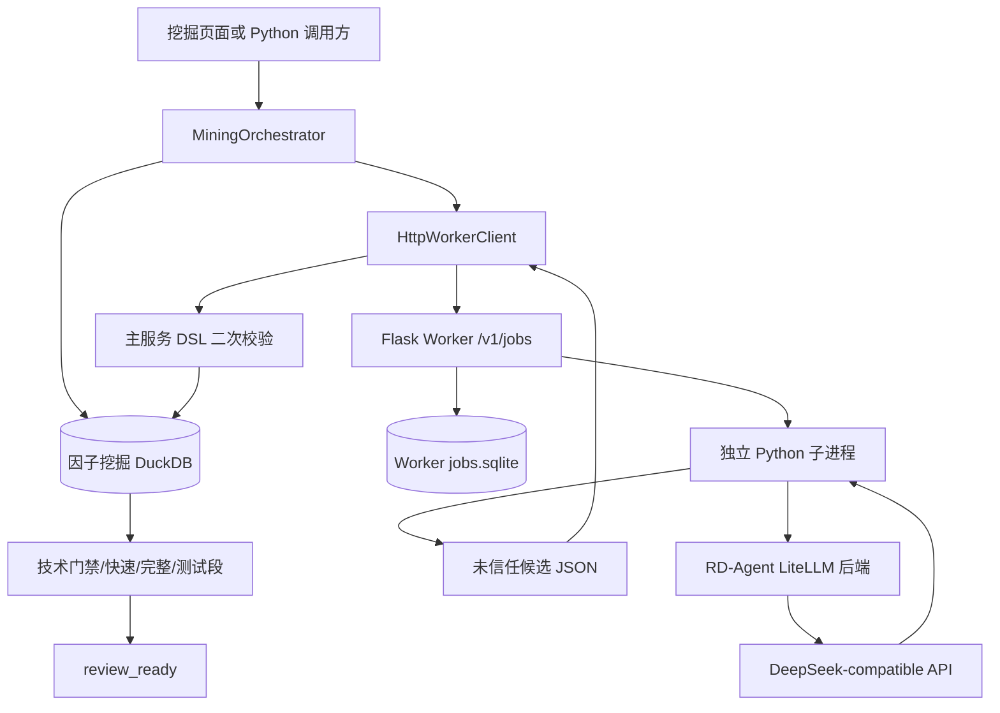

# Agent 编排与 RD-Agent

本章解释项目使用了 RD-Agent 的哪些能力，以及 `MiningOrchestrator` 如何把独立的
LLM Worker、受控 DSL、确定性评估、候选存储和一次性测试段组织成一条自动因子研究
流程。

先给出结论：当前系统不是 RD-Agent(Q) 的完整多智能体闭环，也没有运行 Qlib coder、
workspace、候选代码生成或任意 Python/SQL。LLM 只负责提出受控表达式草稿；运行调度、
协议校验、候选去重、评估排序、测试段领取和状态恢复都由本项目的确定性 Python 代码
完成。人工审批和正式发布由挖掘主流程之后的模块负责，详见
[自动因子挖掘](05-factor-mining.md)。

## 1. 职责与位置

### 1.1 模块解决的问题

阶段 06 负责以下边界：

- 启动独立 Worker，并确认版本、模型、Key、Token 和状态库可用。
- 为一次运行冻结数据、时间窗口、字段目录、算子目录、正式因子清单和预算。
- 按轮次调用 LLM，生成数量、深度和方向受约束的候选表达式。
- 把 Worker 响应视为不可信输入，在主服务重新解析、校验、命名和去重。
- 执行技术门禁、研究期快速筛选、前 K 完整评估和一次性模块测试段。
- 保存运行、候选、事件和报表，让中断任务能够从原阶段显式恢复。
- 在同一台主机上限制活动挖掘运行和活动 Worker 作业各为一个槽位。

阶段 06 不负责：

- 重新定义候选 DSL、技术门禁阈值或评估指标；这些分别属于阶段 05 和阶段 03、04。
- 人工批准、正式构建和 `mined` 因子发布；主流程停在 `review_ready`。
- 证明候选具有可交易收益。LLM 生成、候选筛选和测试段只提供研究证据。
- 提供跨主机的任务队列、高可用 Worker 集群或多租户隔离。

### 1.2 全链路位置



上游入口既可以来自监测站，也可以直接调用 Python 公共接口。监测站路由和 SSE 传输
见[监测站与 Web 应用](09-monitor-web.md)，本章只说明编排和 Worker 契约。

### 1.3 当前工作区快照

以 2026-10-26 当前工作区为准：

| 项目 | 当前值 |
|---|---|
| 主项目 Python | 3.12 |
| Worker Python | 3.11，镜像内实际为 3.11.17 |
| RD-Agent | 1.0.0 |
| 默认模型 | `deepseek/deepseek-chat` |
| Worker 镜像 | `quant-mining-worker:s4` |
| Worker schema | `mining_worker_v1` |
| 编排配置 schema | `mining_orchestrator_v1` |
| 挖掘领域 schema | `mining_v1` |
| Worker 地址 | `http://127.0.0.1:8790` |
| Worker 作业库 | `data/mining_worker/jobs.sqlite` |

这些值用于说明当前实现，不是永不变化的业务常量。版本、模型和超时以
[configs/mining/worker.json](../../configs/mining/worker.json)及
[research/mining_worker/requirements.lock](../../research/mining_worker/requirements.lock)
为准。

## 2. RD-Agent 的实际使用范围

### 2.1 固定上游版本

固定版本 `1.0.0` 对应上游 tag `v1.0.0`，该 tag 指向 commit
`484776c211e4fbbeef03e0ec00d6bbee7362a4f4`。上游仓库采用 MIT License，安装包元数据
声明 Python `>=3.10`；本项目只把 Worker 固定在 Python 3.11，避免主项目与 RD-Agent
重依赖互相影响。

上游项目：

```text
https://github.com/microsoft/RD-Agent/tree/484776c211e4fbbeef03e0ec00d6bbee7362a4f4
```

上游许可证：

```text
https://github.com/microsoft/RD-Agent/blob/484776c211e4fbbeef03e0ec00d6bbee7362a4f4/LICENSE
```

### 2.2 已安装但未启用的能力

固定 wheel 内包含通用 `Scenario`、`Hypothesis`、`Experiment`、`Developer`、
`Evaluator`、`Trace` 等抽象，也包含 Qlib 场景的
`QlibFactorHypothesisGen`、`QlibFactorHypothesis2Experiment`、
`QlibFactorCoSTEER`、`QlibFactorRunner` 和 `QlibFactorExperiment2Feedback`。

本项目没有导入或运行这些 Qlib 循环。它们可以生成和修改实验代码、操作 workspace，
这超出了当前生产研究的安全与审计边界。

### 2.3 实际导入和调用

[research/mining_worker/rdagent_generator.py](../../research/mining_worker/rdagent_generator.py)
只使用：

```python
from rdagent.log import rdagent_logger
from rdagent.oai.llm_conf import LLM_SETTINGS
from rdagent.oai.llm_utils import APIBackend
```

RD-Agent 1.0.0 中的 `APIBackend` 是一个工厂函数，返回具体后端；默认实例为
`LiteLLMAPIBackend`。项目实际调用：

```python
response = APIBackend().build_messages_and_create_chat_completion(
    user_prompt=user,
    system_prompt=system,
    json_mode=True,
)
```

调用前后还会：

- 关闭 `LLM_SETTINGS.log_llm_chat_content`。
- 关闭流式聊天 `chat_stream`。
- 设置 `max_retry=1`。
- 用不带持久化副作用的对象替换 `rdagent_logger.storage`。
- 检查请求模型与 Worker 固定模型一致。
- 严格要求返回 JSON 对象和 `candidates` 数组。

调用失败、JSON 非法、候选数超预算或响应字段不合法时，Worker 子进程返回
`MINING-118`。错误文本会遮盖环境中的 API Key 和常见 `sk-*`、Bearer Token 形式，
最多保留 500 个字符。

### 2.4 为什么只保留 LLM 后端

完整 RD-Agent 研究循环追求开放式探索，而生产候选流程还需要：

- 禁止 LLM 读取行情库、候选库、正式因子目录和 Key 以外的运行环境。
- 把输出限制在冻结 DSL 和目录内。
- 在主进程重新计算名称、依赖、哈希和候选 ID。
- 记录确定性的预算、状态、证据和一次性测试段。
- 在超时、取消、重启和快照变化时保持可恢复、可审计。

因此本项目保留 RD-Agent 的模型调用封装，把调度、校验、评估和发布留给确定性代码。
这限制了探索自由度，但让失败原因和候选身份能够稳定定位。

## 3. 进程与模块边界

### 3.1 主服务

| 模块 | 责任 |
|---|---|
| [mining.orchestrator](../../research/mining/orchestrator.py) | 运行生命周期、单实例执行器和终止收口 |
| [orchestrator_generation](../../research/mining/orchestrator_generation.py) | 多轮 Worker 调用、反馈和候选入库 |
| [orchestrator_screening](../../research/mining/orchestrator_screening.py) | 技术门禁、快速筛选和失败率停止 |
| [orchestrator_evaluation](../../research/mining/orchestrator_evaluation.py) | 前 K 选择和完整评估 |
| [orchestrator_holdout](../../research/mining/orchestrator_holdout.py) | 候选批次冻结和一次性测试段 |
| [worker_client](../../research/mining/worker_client.py) | HTTP 调用、轮询、取消和响应二次校验 |
| [storage_runs](../../research/mining/storage_runs.py) | 运行、上下文、状态迁移和恢复 |
| [states](../../research/mining/states.py) | 运行及候选状态迁移唯一约束 |
| [snapshot](../../research/mining/snapshot.py) | 数据、目录和正式因子快照核对 |

主服务保存候选、评估和正式数据，只通过 HTTP 把一轮有界生成请求发给 Worker。

### 3.2 Worker

| 模块 | 责任 |
|---|---|
| [mining_worker.service](../../research/mining_worker/service.py) | Flask 服务、鉴权、后台作业线程和取消 |
| [mining_worker.job_store](../../research/mining_worker/job_store.py) | SQLite 幂等、状态和单作业槽 |
| [mining_worker.protocol](../../research/mining_worker/protocol.py) | 请求、响应、候选和作业视图 |
| [mining_worker.generator](../../research/mining_worker/generator.py) | 子进程启动、超时和进程组终止 |
| [mining_worker.rdagent_generator](../../research/mining_worker/rdagent_generator.py) | Prompt、RD-Agent 调用和 JSON 解析 |
| [mining_worker.worker_config](../../research/mining_worker/worker_config.py) | 固定版本、模型、超时和候选上限 |

Flask 主线程接收请求后启动作业线程，再把 RD-Agent 调用放进独立 Python 子进程。子进程
使用新进程组，因此超时或取消时可以终止整组进程。

### 3.3 数据隔离

Worker 容器只挂载：

| 宿主路径 | 容器路径 | 用途 |
|---|---|---|
| `data/mining_worker/` | `/state` | `jobs.sqlite` |
| `logs/research/mining/` | `/logs` | Worker 事件日志 |

Worker Token 通过 Compose secret 只读挂载到
`/run/secrets/mining_worker_token`。行情库、候选库、正式因子目录和 `.env` 均不作为
卷挂载进 Worker。容器根文件系统只读，`/tmp` 使用临时内存文件系统。

Compose 只把端口绑定到宿主机 `127.0.0.1:8790`。容器内部监听
`0.0.0.0` 是为了端口转发，不等于 Worker 暴露到公网。

## 4. 公共接口与数据结构

### 4.1 Python 编排接口

公开入口由 [mining.__init__](../../research/mining/__init__.py)导出。常用接口如下：

| 方法 | 主要输入 | 行为 |
|---|---|---|
| `create_run(request, background=True)` | `MiningRunRequest` | 先检查 Worker，再冻结上下文并幂等创建运行；默认后台执行 |
| `execute(run_id)` | 运行 ID | 同步执行或从持久化状态继续，直到阶段结束或终止 |
| `resume(run_id, background=True)` | 中断运行 ID | 只恢复 `interrupted` 运行，并回到中断前阶段 |
| `cancel(run_id)` | 运行 ID | 设置取消信号、尽力取消 Worker，并原子收口运行和未终态候选 |
| `progress(run_id)` | 运行 ID | 从事件、候选和测试段领取记录恢复预算进度 |
| `close()` | 无 | 取消活动运行并等待本实例执行器退出 |

`MiningProgress` 包含：

- `run_id`、`status`、`current_stage`。
- 请求轮数、完成轮数、已用 LLM 轮次。
- 已存候选数、质量检查数、完整评估数、失败候选数。
- 测试段是否已经领取以及冻结预算。

`create_run()` 的幂等性以 `idempotency_key` 为外部键，以请求哈希和上下文哈希共同校验。
同一键对应不同假设、预算、Worker 模式或冻结上下文时返回 `MINING-105`，不会覆盖旧运行。

### 4.2 Worker HTTP 接口

| 方法 | 路径 | 鉴权 | 成功响应 | 主要失败 |
|---|---|---|---|---|
| `GET` | `/health` | 不需要 Bearer | 200，返回 ready 状态 | 503，Token 未配置或依赖未就绪 |
| `POST` | `/v1/jobs` | 必须 | 202，返回作业视图 | 400、401、409、429 |
| `GET` | `/v1/jobs/<job_id>` | 必须 | 200，返回作业视图 | 404 |
| `POST` | `/v1/jobs/<job_id>/cancel` | 必须 | 非终态为 202；已终态返回 200 | 404 |

`/health` 不校验 Bearer，但会先检查 Worker Token 是否至少 32 个字符。Compose
健康检查不需要把 Token 写进命令；如果 Token 未配置，健康检查会收到 503。

业务接口要求：

```text
Authorization: Bearer <mining_worker_token>
```

错误响应使用：

```json
{
  "error_code": "MINING-118",
  "error_message": "请求不符合 Worker 协议"
}
```

HTTP 请求体上限为 512 KiB。Worker 使用严格 JSON 字段解析，缺少字段、未知字段、类型
错误和越界值都会在启动 LLM 前失败。

### 4.3 WorkerGenerateRequest

请求的 `schema_version` 必须为 `mining_worker_v1`，JSON 字段必须恰好包含以下 16 项：

| 字段 | 类型与约束 | 含义 |
|---|---|---|
| `schema_version` | 固定字符串 | 协议版本 |
| `request_id` | 1～160 个安全标识字符 | 一轮请求的稳定 ID |
| `run_id` | 1～160 个安全标识字符 | 所属运行 |
| `round_index` | 1～10 | 轮次 |
| `hypothesis` | 8～4000 字符 | 研究假设 |
| `context_hash` | 64 位小写十六进制 | 冻结上下文哈希 |
| `field_catalog_hash` | 64 位小写十六进制 | 字段目录哈希 |
| `operator_catalog_hash` | 64 位小写十六进制 | 算子目录哈希 |
| `llm_model` | 非空，最多 200 字符 | 请求模型 |
| `max_candidates` | 1～8 | 本轮候选上限 |
| `max_expression_depth` | 2～8 | 表达式深度上限 |
| `direction` | `either/positive/negative` | 方向约束 |
| `excluded_fields` | 最多 300 个字符串 | 禁用字段 |
| `fields` | 1～300 个 JSON 对象 | 允许字段目录 |
| `operators` | 1～100 个 JSON 对象 | 允许算子目录 |
| `feedback` | 最多 20 个 JSON 对象 | 安全轮次反馈 |

字符串数组会去首尾空白、去除重复并保留首次出现顺序。目录和反馈中的每个 JSON 对象
最多 12000 字节。

项目由运行 ID 和轮次生成：

```text
request_id = <run_id>:round:<round_index>
job_id     = "wjob_" + SHA256({"request_id": request_id})[:24]
```

因此同一轮重试会落到同一作业 ID，Worker 可以依靠持久化记录判断幂等。

### 4.4 Worker 响应和作业视图

成功结果必须严格包含：

```json
{
  "schema_version": "mining_worker_v1",
  "candidates": [
    {
      "expression": "mean(close, 20)",
      "mechanism": "价格趋势",
      "description": "20 日收盘价均值",
      "direction": 1,
      "steps": ["计算 20 日均值"]
    }
  ],
  "usage": {
    "calls": 1,
    "candidates": 1,
    "mode": "rdagent",
    "model": "deepseek/deepseek-chat"
  }
}
```

约束：

- `candidates` 不能为空。
- `expression` 最多 12000 字符；仍需由主服务重新解析 DSL。
- `mechanism` 最多 200 字符，`description` 最多 2000 字符。
- `direction` 只能是 `1` 或 `-1`。
- `steps` 有 1～20 项。
- `usage` 必须是 JSON 对象，浮点值不能是 `NaN` 或无穷值。
- 响应不能携带额外的顶层字段。

Worker 返回的候选名称、依赖、回看窗口和哈希都不是权威值。主服务重新计算规范表达式、
字段依赖、输出类型、语义哈希、内容哈希和稳定候选 ID。

作业状态为：

```text
queued
running
succeeded
failed
cancelled
interrupted
```

作业视图还包含 `job_id`、`request_id`、可选 `result`、错误码、错误文本和三个 UTC
时间字段。客户端会再次按协议解析响应，不直接接受 Worker 的 JSON。

### 4.5 幂等、冲突和单作业槽

Worker SQLite 同时只允许一个 `queued` 或 `running` 作业：

- 相同 `request_id` 和相同请求内容再次提交，返回原作业，HTTP 202。
- 相同 `request_id` 但请求内容改变，返回 `MINING-105`，HTTP 409。
- 已有其他活动作业，返回 `MINING-102`，HTTP 429。
- 不存在的作业返回 `MINING-110`，HTTP 404。

冲突检查先于忙碌检查，因此同一请求的幂等重试不会被自己的活动作业判定为忙碌。

## 5. 配置和预算

### 5.1 Worker 配置

[configs/mining/worker.json](../../configs/mining/worker.json)当前值：

| 字段 | 默认值 | 约束 |
|---|---:|---|
| `default_model` | `deepseek/deepseek-chat` | 不能为空 |
| `job_timeout_seconds` | 300 | `>0` 且不超过客户端等待时限 |
| `client_timeout_seconds` | 330 | 主服务总轮询时限 |
| `poll_interval_seconds` | 0.25 | `>0` |
| `max_candidates_per_round` | 4 | 1～8 |

配置还固定 `rdagent_version=1.0.0`、`python_version=3.11` 和
`schema_version=mining_worker_v1`。未知字段或缺失字段都会让配置加载失败。

### 5.2 编排预算

[configs/mining/orchestrator.json](../../configs/mining/orchestrator.json)当前值：

| 字段 | 默认值 | 允许范围或固定值 |
|---|---:|---|
| `universe` | `all_a` | 首版固定 |
| `label` | `fwd_ret_open_5` | 首版固定 |
| `price_channel` | `hfq` | 首版固定 |
| `direction` | `either` | `either/positive/negative` |
| `max_rounds` | 3 | 1～10 |
| `max_candidates` | 12 | 1～40 |
| `full_eval_top_k` | 4 | 1～`min(8, max_candidates)` |
| `max_llm_calls` | 30 | 1～60 |
| `max_expression_depth` | 6 | 2～8 |
| `min_coverage` | 0.30 | 0～1 |
| `max_failure_rate` | 0.75 | `(0, 1]` |
| `min_quality_checks_for_failure_stop` | 4 | 1～`max_candidates` |
| `seed` | 42 | 整数 |
| `excluded_fields` | 空 | 去重后的字段名单 |

冻结时间口径：

| 区间 | 当前值 |
|---|---|
| 研究期 | 2012-01-01～2025-10-15 |
| 完整评估 | 2020-01-01～2025-10-15 |
| 模块测试段 | 2025-10-16～2026-10-15 |

`max_llm_calls` 是编排层的轮次预算，不是精确的 token 预算。当前代码把生成轮数限制为
`min(max_rounds, max_llm_calls)`，每轮对应一次 Worker 作业；RD-Agent 或网络层内部
重试、模型服务计费单位仍需查看对应日志和供应商账单。

`seed` 当前只进入冻结预算和上下文哈希，没有写入 `WorkerGenerateRequest`，也没有显式
设置 RD-Agent 的 chat seed。因此它不能使 LLM 输出可重复，只是研究配置的一部分。

### 5.3 冻结上下文

创建运行前，`build_frozen_context()` 会读取：

- 行情库文件大小、修改时间和数据 manifest 内容哈希。
- 当前版本化字段目录及允许字段。
- 当前算子目录。
- 已落盘的正式因子名称。
- LLM profile、固定模型和完整预算。

这些内容进入 `FrozenContext`，并生成 `context_hash`。运行期间不能用新配置覆盖该哈希；
不同上下文不能复用同一幂等键。

## 6. 一次运行的完整调度

### 6.1 创建和启动

```text
提交 idempotency_key + hypothesis + 可选预算
  -> 合并页面默认预算并校验 MiningRunRequest
  -> 调用 Worker /health
  -> 读取数据、目录和正式因子并创建 FrozenContext
  -> create_run() 原子写入运行、上下文和 run_created 事件
  -> 后台线程进入 generating
```

如果 Worker URL 未配置、Token 非法、RD-Agent 版本不匹配或 Key 未配置，运行会在付费
调用前失败。生产环境没有自动 Mock 回退；Mock 只允许测试显式注入。

### 6.2 运行状态

运行状态：

```text
queued
  -> generating
  -> screening
  -> evaluating
  -> holding_out
  -> review_ready
```

旁路终态为：

- `failed`：不可恢复的执行、评估或存储错误。
- `cancelled`：调用方取消。
- `stale`：冻结快照失效。
- `interrupted`：主服务重启，原阶段保留，等待显式恢复。

`review_ready` 不是发布完成。人工批准后，候选才可能进入 `approved`、`building` 和
`published`。编排器本身不写这些后续状态。

### 6.3 多轮生成

每轮按以下顺序执行：

1. 读取已持久化事件；如果该轮已有 `round_completed`，直接复用。
2. 计算剩余候选预算。
3. 从最近最多 19 轮完成记录生成安全反馈。
4. 写入幂等的 `round_requested` 事件。
5. 提交 Worker 作业并记录 `worker_job_submitted`。
6. 轮询到终态，主服务重新校验每个候选。
7. 合法候选写入候选库；语义重复候选计数但不再次入库。
8. 写入 `round_completed` 事件。
9. 如果本轮没有任何新候选，停止后续生成。

反馈只包含：

- 轮次。
- 新增候选数。
- 被拒绝候选数。
- 重复候选数。
- 被拒绝错误的错误码集合。

反馈不包含完整研究假设、原始模型响应、表达式正文、研究期指标或测试段结果。

### 6.4 Worker 子进程

```text
POST /v1/jobs
  -> Bearer Token 校验
  -> 严格解析 WorkerGenerateRequest
  -> SQLite 幂等和单作业检查
  -> 后台线程启动独立 Python 子进程
  -> rdagent_generator 构造 Prompt 并调用 APIBackend
  -> 子进程 stdout 输出单行 JSON
  -> Worker 校验并保存 succeeded 响应
```

Worker 只把目录名称、说明和约束传给模型，不传数据库连接、文件系统路径或可执行命令。
模型输出中的 SQL、Python、未知字段、未知算子、方向不符或超预算内容由主服务再次拒绝。

### 6.5 主服务二次校验

主服务对每个草稿执行：

1. 检查请求方向与候选声明方向是否一致。
2. 重新解析表达式 DSL。
3. 检查字段、算子、深度、窗口、量纲和安全规则。
4. 计算规范表达式、回看窗口和依赖字段。
5. 计算语义哈希、内容哈希和稳定候选 ID。
6. 在当前运行内识别语义重复。

候选被拒绝时记录脱敏后的序号、`MINING-114` 和原因，不把原始不可信内容直接写入日志。

### 6.6 技术门禁和快速筛选

候选进入 `screening` 前先执行技术门禁。当前门禁重点包括：

- 至少存在 20 个有效日。
- 因子值必须为有限数。
- 覆盖率不低于冻结的 `min_coverage`。
- 截面不能长期退化。
- 在截断日复算中不能表现出前视。
- 与正式因子的相关性检查按阶段 05 规则执行。

技术门禁通过后，在研究期使用轻量 RankIC 流程快速筛选。完整评估候选按以下字典序
确定性排序：

```text
abs(rank_ic_mean) 降序
-> abs(rank_ic_ir) 降序
-> coverage 降序
-> content_hash 升序
-> candidate_id 升序
```

如果候选质量检查数量达到冻结下限，且失败比例达到 `max_failure_rate`，编排以
`MINING-106` 停止，不继续完整评估。没有任何候选通过快速筛选时同样失败。

### 6.7 完整评估和测试段

前 K 个候选逐个执行完整评估，并通过 `evaluated` 状态。随后：

1. 冻结入围候选列表的 `finalists_selected` 事件。
2. 用技术、快速和完整报表 ID 及门禁哈希生成批次证据哈希。
3. 在同一候选数据库中唯一领取模块测试段。
4. 按冻结顺序执行测试段。
5. 测试报告为 `passed` 的候选进入 `review_ready`。
6. 测试报告为 `failed` 的候选进入 `holdout_failed`。

只要测试段本身完成，所有候选通过或失败都不会把运行改成异常；运行仍进入
`review_ready` 供人工查看证据。若测试段执行发生 `error`，编排器将候选和运行按
`MINING-106` 失败处理。

测试段结果不会进入下一轮 Worker 反馈，也不会用于重新排序本批候选。

## 7. 并发、预算与停止

### 7.1 两个单槽位

主服务侧：

- 每个 `MiningOrchestrator` 使用 `ThreadPoolExecutor(max_workers=1)` 串行执行运行。
- 候选库状态迁移会在运行进入 `generating` 时用本机文件锁检查是否存在其他活动运行。
- 因此同一候选数据库最多只有一个 `generating/screening/evaluating/holding_out` 运行。
- 同一编排器实例的后台提交可以在线程池中排队。
- 当前没有跨进程的持久化调度队列；生产监测站应保持单 Web 进程。多个进程同时提交时，
  后进入活动阶段的尝试会得到 `MINING-102` 并保留 `queued` 状态，但另一个进程不会
  自动重新调度它，不能依赖跨进程接力排队。

Worker 侧：

- SQLite 检查同一时刻只有一个 `queued/running` 作业。
- Flask 可以为请求创建线程，但生成槽位仍由作业库约束。
- 单作业槽避免并发调用争用模型配额，也简化取消和重启恢复。

### 7.2 停止条件

生成与评估会在以下任一条件停止：

- 达到最大轮数或 LLM 调用预算。
- 候选总数达到上限。
- 某轮没有新增合法候选。
- 达到质量检查下限且失败率达到阈值。
- 没有候选通过快速筛选。
- Worker、存储或评估发生不可恢复错误。
- 调用方取消。
- 数据、目录或正式因子快照失效。

预算和阈值进入冻结上下文，运行中修改配置文件不会改变当前运行。

## 8. 超时、取消和恢复

### 8.1 超时

默认时序：

| 层级 | 时限 | 行为 |
|---|---:|---|
| 单个 HTTP 请求 | 10 秒 | 网络请求超时 |
| Worker 子进程生成 | 300 秒 | 终止子进程组，作业记 `MINING-116` |
| 主服务等待作业 | 330 秒 | 先请求 Worker 取消，再抛 `MINING-116` |
| 作业轮询 | 0.25 秒 | 低频查询 SQLite 作业状态 |

`client_timeout_seconds` 控制从提交后开始的整个轮询等待，不控制每次 HTTP 请求。
`/health` 不调用模型，因此 ready 只说明版本、Key 和 Token 配置通过，不证明外部模型
服务此刻可达。

### 8.2 取消

主服务取消会：

1. 设置运行取消事件。
2. 从内存或最近提交事件中找到 Worker 作业。
3. 尽力调用 Worker 取消接口。
4. Worker 标记作业取消并终止对应进程组。
5. 编排器在阶段边界停止新的候选计算。
6. 原子将运行和全部未终态候选收口为 `cancelled`。

`review_ready` 和终态运行不会被取消接口改写。已经开始且不检查取消信号的原生数据库
操作不能在中间强行停止，只能在当前计算返回后停止后续阶段。

### 8.3 Worker 重启

Worker 启动时会把遗留的 `queued/running` 作业改成 `interrupted`，错误码
`MINING-117`，不自动重放。当前 `request_id` 由 `run_id + round_index` 确定，调用方
恢复同一轮时会再次提交同一 ID；Worker 的幂等记录会返回原 `interrupted` 作业，而不是
创建新的付费调用。当前编排器会把该状态按取消处理，没有自动换 ID 重试机制。若要重新
消耗预算，必须创建新的运行，或在后续实现中显式设计新的重试身份。

### 8.4 主服务重启

监测站启动时调用 `interrupt_active_runs()`：

- 活动运行进入 `interrupted`，保存 `interrupted_from` 原阶段。
- 活动候选进入 `interrupted`。
- 运行和候选均记录 `MINING-113`。
- 不会自动恢复或再次调用模型。

显式 `resume()` 后：

- 已完成的 `round_requested/round_completed` 事件直接复用。
- 已入库候选、门禁、报表和测试段领取记录不会重复计算。
- Worker 不会因已完成轮次再次被调用。
- 未完成阶段从原阶段继续，运行和候选回到中断前状态。

中断运行只能恢复到原阶段，不能借恢复跳转阶段。

### 8.5 快照失效

创建运行和每个编排阶段开始时都会核对冻结上下文：

- 行情数据库大小或修改时间变化。
- 数据 manifest 内容哈希变化。
- 字段目录内容变化。
- 算子目录内容变化。
- 正式因子清单变化。

任一变化触发 `SnapshotStaleError` 和 `MINING-120`，运行及未终态候选原子进入
`stale`。指纹使用数据库文件元数据和 manifest 哈希，不是整个数据库内容哈希；原地
修改但保持文件大小和修改时间不变的情况无法由当前轻量指纹识别。

## 9. 安全和日志

### 9.1 安全边界

| 边界 | 当前实现 |
|---|---|
| API Key | 只进入 Worker 容器环境 |
| Worker Token | 宿主机私有文件、Compose 只读 secret |
| 浏览器 | 不接收 Key 或 Worker Token |
| Worker 文件系统 | 根只读，仅状态和日志目录可写 |
| 临时文件 | `/tmp` 使用 tmpfs |
| 网络 | Worker 端口仅绑定宿主机回环地址 |
| 模型输入 | 只包含冻结字段、算子、假设和安全反馈 |
| 模型输出 | 只能作为 DSL 草稿，不能直接执行 |
| 聊天日志 | RD-Agent 聊天内容日志关闭，trace storage 丢弃 |

Token 首次由 `ensure_worker_token()` 生成，值是 `secrets.token_urlsafe(48)`，文件权限为
`0600`。Worker 要求 Token 至少 32 个字符，并使用常量时间比较 Bearer 头。

### 9.2 日志位置

| 模块 | 目录 |
|---|---|
| 主编排器 | `logs/research/mining/mining_orchestrator/` |
| Worker 客户端 | `logs/research/mining/mining_worker_client/` |
| Worker 服务 | `logs/research/mining/mining_worker_service/` |
| 候选存储 | `logs/research/mining/mining_storage/` |

日志继续使用项目统一的分段时间戳文件，单段达到 128 MB 后轮转。Worker 事件只写
作业 ID、轮次、候选数量、状态和错误码；假设、表达式、Prompt、模型响应和 Key 被排除
或遮盖。HTTP 访问日志仍会记录请求路径和状态码，因此日志目录本身也需要访问控制。

### 9.3 错误边界

| 错误码 | 主要含义 | 常见位置 |
|---|---|---|
| `MINING-101` | 请求、上下文或领域对象不合法 | 主服务契约 |
| `MINING-102` | 已有活动运行或 Worker 作业 | 主服务/Worker |
| `MINING-103` | Worker 不可达或一般调用失败 | HTTP 客户端 |
| `MINING-105` | 幂等键或候选内容冲突 | 主服务/Worker |
| `MINING-106` | 门禁、筛选、完整评估或测试段失败 | 编排器 |
| `MINING-110` | 运行、候选或 Worker 作业不存在 | 存储/Worker |
| `MINING-111` | 状态迁移或并发写入冲突 | 候选库 |
| `MINING-112` | 候选库不可用或事务失败 | 候选库 |
| `MINING-113` | 中断运行不能自动恢复或恢复方式错误 | 主服务重启 |
| `MINING-114` | 模型表达式未通过 DSL 二次校验 | Worker 客户端 |
| `MINING-115` | 字段目录与实际 schema 漂移 | 目录加载 |
| `MINING-116` | Worker 生成或主服务等待超时 | Worker/客户端 |
| `MINING-117` | Worker 作业取消或重启中断 | Worker/客户端 |
| `MINING-118` | Worker 协议或模型响应非法 | Worker/客户端 |
| `MINING-119` | Token、Key、模型、版本或健康状态不可用 | Worker/客户端 |
| `MINING-120` | 数据、目录或正式因子快照失效 | 编排器/审批 |

主服务 HTTP 层根据 `MiningError.status` 映射 400、404、409、422、429、500、502、
503 或 504。Worker 客户端还会把作业错误码映射回
`WorkerTimeoutError`、`WorkerCancelledError`、`WorkerResponseError` 和
`WorkerConfigurationError`，便于上层统一收口。

## 10. 启动、使用和排错

### 10.1 启动 Worker

首次启动前确保 `.env` 中有 `FACTOR_DEEPSEEK_API`，然后生成或复用本机 Token：

```bash
.venv/bin/python -c \
  'from common.paths import DATA_DIR; from mining.worker_client import ensure_worker_token; ensure_worker_token(DATA_DIR / "mining_worker" / "token")'
```

启动并检查容器：

```bash
docker compose --env-file .env -f compose.mining.yaml up -d --build
docker compose --env-file .env -f compose.mining.yaml ps
```

使用主服务同一客户端做只读健康检查：

```bash
export MINING_WORKER_URL=http://127.0.0.1:8790
.venv/bin/python -c \
  'from mining.worker_client import HttpWorkerClient; print(HttpWorkerClient.from_environment().health())'
```

预期结果包含：

```text
status=ready
mode=rdagent
rdagent_version=1.0.0
model=deepseek/deepseek-chat
llm_configured=True
state_store=ready
```

### 10.2 调用编排器

以下示例省略了真实运行必须提供的合法 `MiningRunRequest` 内容。创建并执行会调用付费
模型和真实评估数据，只在明确需要研究运行时使用：

```python
from mining import MiningOrchestrator

orchestrator = MiningOrchestrator()
run = orchestrator.create_run(request, background=False)
result = orchestrator.execute(run["run_id"])
progress = orchestrator.progress(run["run_id"])
orchestrator.close()
```

只读查看已有运行时，不需要调用 Worker：

```python
from mining import MiningOrchestrator

orchestrator = MiningOrchestrator()
print(orchestrator.progress(run_id).to_dict())
orchestrator.close()
```

生产代码不得为了通过启动检查而自动切换到 Mock。

### 10.3 排错顺序

1. 检查 `docker compose ps` 和 `/health` 的错误码。
2. `MINING-119` 检查 Token 文件、Bearer、Key、Worker 模型和 RD-Agent 版本。
3. `MINING-103` 检查 `MINING_WORKER_URL`、8790 端口、容器网络和超时。
4. `MINING-102` 检查是否有其他运行或 Worker 作业占用单槽。
5. `MINING-116` 检查模型响应时间、Prompt 大小和供应商状态。
6. `MINING-118` 检查 Worker 协议字段、JSON 结构和模型输出。
7. `MINING-114` 检查模型是否引用未知字段、未知算子或非法方向。
8. `MINING-120` 检查运行后行情库、manifest、目录或正式因子是否变化。
9. 运行状态与实际阶段不一致时，以候选库事件和候选状态为准，不要只看前端文本。

## 11. 测试映射

| 测试范围 | 证明的行为 |
|---|---|
| [worker protocol](../../tests/test_mining_worker_protocol.py) | 严格字段、稳定 ID、版本和配置约束 |
| [worker service](../../tests/test_mining_worker_service.py) | 健康检查、鉴权、幂等冲突、单槽、取消、超时和重启中断 |
| [worker client](../../tests/test_mining_worker_client.py) | S3 二次校验、预算、错误映射、取消和 Token 文件权限 |
| [worker logging](../../tests/test_mining_worker_logging.py) | 原始假设、表达式和 Prompt 不进入事件日志 |
| [orchestrator](../../tests/test_mining_orchestrator.py) | 完整链路、预算、反馈、失败阈值、测试段、恢复和快照失效 |
| [orchestrator real](../../tests/test_mining_orchestrator_real.py) | 真实行情短区间从技术门禁走到测试段 |
| [storage](../../tests/test_mining_storage.py) | 单运行槽、中断释放、原阶段恢复和事务语义 |
| [mining API](../../apps/monitor/backend/tests/test_mining_api.py) | 无 Worker 时不静默 Mock、运行接口、恢复和 SSE 交接 |

2026-10-26 本轮阶段审计执行了前述前五个 Worker/编排测试文件，共 28 个用例全部通过。
真实短区间、存储和 Web 用例作为联合验证入口记录，本轮没有重复运行长链路或付费模型。

常用定向命令：

```bash
.venv/bin/pytest -q \
  tests/test_mining_worker_protocol.py \
  tests/test_mining_worker_service.py \
  tests/test_mining_worker_client.py \
  tests/test_mining_worker_logging.py \
  tests/test_mining_orchestrator.py
```

## 12. 量化和研究解释边界

- LLM 只扩展假设空间，不负责证明因子有效。确定性门禁和评估降低工程风险，不消除
  多重检验、数据窥探和模型偏差。
- 预算限制能控制调用成本和搜索规模，但不能把大量候选搜索自动转化为统计显著性。
- 快速筛选和完整评估都使用研究期数据；它们用于筛选研究候选，不是未知样本确认。
- 模块测试段只验证隔离执行、完整 stage 和最小有效样本，不要求收益显著，也不是全市场
  可执行回测。
- 模块测试段是全局一次性领取，候选批次之外也可能与模型最终留出区间重叠；不能把它
  宣称为完全独立的第二套样本。
- 测试段失败和成功都不会自动形成可交易策略。T+1、涨跌停、停牌、费用、滑点、融券和
  容量约束必须由回测模块处理。
- 固定数据、目录、模型名、预算和 Prompt 仍不足以保证完全可复现；供应商模型版本、
  服务端行为、随机性和外部 API 变化都可能改变输出。

## 13. 已知限制

- `GET /health` 不调用模型，不能替代真实模型可用性探测。
- Worker 的 SQLite 单槽只适合当前单主机、单 Worker 部署。
- 主服务没有跨进程持久化调度队列；多 Web 进程同时运行会得到忙碌错误。
- `max_llm_calls` 统计编排轮次，不是 token、请求重试或供应商账单的精确计量。
- `seed` 当前没有传给模型或 RD-Agent，不能保证 LLM 输出可复现。
- 原生数据库和评估计算不接受中途强制中断，只能在检查点停止。
- 快照指纹使用数据库元数据和 manifest 哈希，不检查数据库内部完整内容。
- Worker 重启后，同一轮不会自动生成新作业；当前恢复会把遗留的 `interrupted` 作业按
  取消处理，需要新运行或后续实现新的重试身份。
- 当前没有隐藏思维链、原始 Prompt 或原始模型响应的本地留存，排障主要依赖状态和
  脱敏错误码。

## 14. 修改检查清单

1. 修改请求、响应或作业状态时同步升级 schema、主客户端和 Worker 测试。
2. 升级 RD-Agent、Python 或模型时同步配置、依赖锁、镜像、health 和联合测试。
3. 不要让 Worker 决定候选名称、依赖、哈希或发布资格。
4. 不要把行情库、候选库、正式因子目录或 `.env` 挂载进 Worker。
5. 不要在 Worker 中执行模型生成的 SQL、Python 或 shell。
6. 保持请求幂等、单槽检查和重启不自动重放的规则。
7. 反馈和日志不得包含测试段结果、原始 Prompt、完整假设或模型响应。
8. 修改预算时同步 `MiningConstraints`、配置、页面限制和契约测试。
9. 修改快照范围时说明是否能识别原地覆盖和数据库内部变化。
10. 完成后运行 Worker、客户端、编排器定向测试，并检查只修改了目标文档和进度文件。
