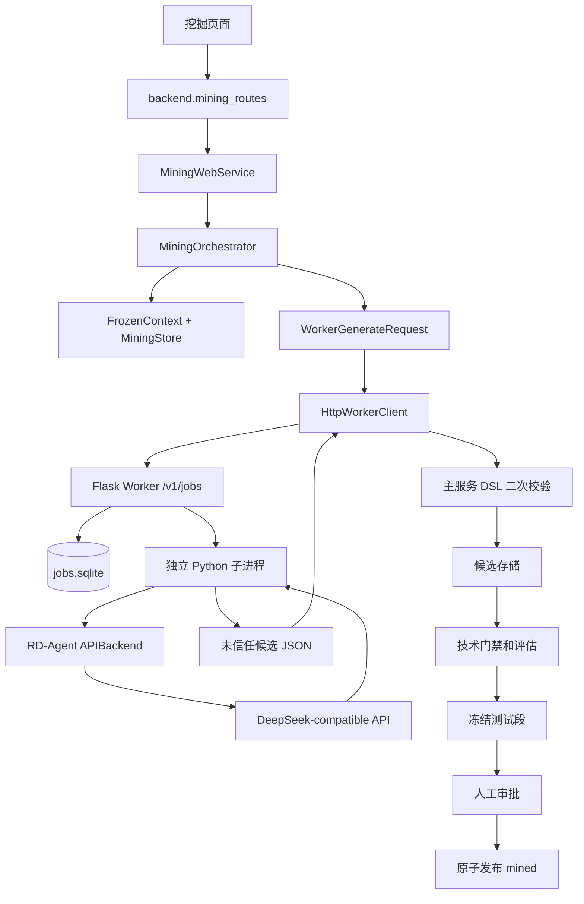

# Agent 编排与 RD-Agent

本章解释两件事：项目使用的 RD-Agent 是什么，以及本项目如何在其基础上构建一条受控、
可恢复的自动因子研究流程。

需要先明确结论：当前系统不是直接运行 RD-Agent(Q) 的完整多智能体闭环，也没有启用
RD-Agent 的 Qlib coder、workspace 或自动执行 Python/SQL。主流程的 Agent 调度由本项目
的 `MiningOrchestrator` 实现；RD-Agent 1.0.0 主要负责底层 LLM 调用和消息构造。

## 1. 技术栈

| 技术 | 用途 |
|---|---|
| Python 3.12 | 主服务编排、DSL 校验、存储、评估和 Web |
| Python 3.11 | 独立 Worker 容器 |
| RD-Agent 1.0.0 | LiteLLM/OpenAI 兼容的 LLM 调用封装 |
| DeepSeek `deepseek/deepseek-chat` | 默认候选生成模型 |
| Flask | Worker 本地 HTTP 作业服务 |
| SQLite | Worker 请求幂等和作业状态 |
| DuckDB | 运行、候选、事件和审批状态 |
| Requests | 主服务到 Worker 的本地 HTTP 客户端 |
| Docker Compose | Worker 隔离、密钥挂载和健康检查 |

### 1.1 上游项目定位

RD-Agent 是 Microsoft 开源的 Research & Development Agent 框架，目标是让 LLM Agent
参与数据驱动研发的提出假设、实现实验、执行评估和根据反馈迭代。包元数据摘要为
“Research & Development Agent”，版本 1.0.0，使用 MIT License，支持 Python 3.10/3.11。

上游项目地址：

```text
https://github.com/microsoft/RD-Agent
```

其量化方向 RD-Agent(Q) 强调 data-centric 的多智能体研究，将因子研究和模型研究放在
同一套假设-实验-反馈循环中。上游仓库包含 Qlib 因子场景、模型场景、数据科学、Kaggle、
LLM finetune 和强化学习等不同场景。

### 1.2 上游核心抽象

RD-Agent 1.0.0 的通用结构可概括为：

| 抽象 | 作用 |
|---|---|
| `Scenario` | 定义任务背景、数据、评价指标和可执行环境 |
| Hypothesis / Proposal | 根据历史 trace 和知识提出研究假设 |
| Experiment | 把假设转换成可执行实验 |
| Developer / Coder | 生成或修改代码、文件或实验配置 |
| Runner | 在环境中执行实验 |
| Evaluator / Feedback | 评估结果并把经验反馈给下一轮 |
| Evolving Agent / Trace | 组织多轮研究循环并保存演化轨迹 |
| LLM Backend | 通过 LiteLLM/OpenAI 等接口完成生成 |

上游 Qlib 因子场景会进一步使用 `FactorHypothesisGen`、`FactorHypothesis2Experiment`、
`FactorCoSTEER`、`QlibFactorRunner` 和 `QlibFactorExperiment2Feedback` 等组件，并可能
在 workspace 中生成和执行代码。这些能力构成了 RD-Agent(Q) 的完整研究自动化基础。

### 1.3 本项目实际使用的上游能力

[research/mining_worker/rdagent_generator.py](../../research/mining_worker/rdagent_generator.py)
只导入：

```python
from rdagent.log import rdagent_logger
from rdagent.oai.llm_conf import LLM_SETTINGS
from rdagent.oai.llm_utils import APIBackend
```

实际调用：

```python
response = APIBackend().build_messages_and_create_chat_completion(
    user_prompt=user,
    system_prompt=system,
    json_mode=True,
)
```

因此当前使用的是 RD-Agent 的：

- LiteLLM/OpenAI 兼容模型后端。
- Prompt 与 Chat Completion 调用封装。
- RD-Agent logger 接口的关闭输出处理。

当前没有使用 Qlib coder、CoSTEER、Experiment Runner、Factor Workspace、自动代码修改或
上游多智能体调度。

### 1.4 为什么这样二次开发

完整 RD-Agent(Q) 面向开放式研究和代码执行，能力强，但用于生产因子发布需要额外解决：

- 大模型不能直接访问行情库和正式因子目录。
- 模型输出必须限制在可审计 DSL 内。
- 候选必须冻结数据、字段、算子和预算。
- 主服务要重新校验模型返回的一切名称、依赖和哈希。
- 评估要有确定性门禁、一次性测试段和人工审批。
- 任何失败都需要稳定错误码、幂等、恢复和发布回滚。

项目因此保留 RD-Agent 的 LLM 后端，用确定性工程代码承担调度、校验、评估和发布。这个
设计牺牲上游开放式探索能力，换取安全边界、可复现性和可维护性。

## 2. 提供功能

- 接收研究假设并生成受预算约束的候选因子表达式。
- 把模型输出限制在冻结字段和算子组成的 DSL 内。
- 对候选做语法、语义、量纲、成本和安全二次校验。
- 支持多轮生成和结构化反馈。
- 支持单槽位并发、幂等、超时、取消、中断和显式恢复。
- 把候选交给技术门禁、快速筛选、完整评估和一次性测试段。
- 通过 Web 展示证据并完成人工审批和整批原子发布。
- 以独立 Worker 隔离模型 Key、RD-Agent 重依赖和不可信响应。

## 3. 二次开发后的模块结构



### 3.1 主服务侧

| 模块 | 责任 |
|---|---|
| `mining.orchestrator` | 运行生命周期和阶段循环 |
| `orchestrator_generation` | 多轮 Worker 调用、反馈和候选入库 |
| `orchestrator_screening` | 技术门禁和快速筛选 |
| `orchestrator_evaluation` | 入围候选和完整评估 |
| `orchestrator_holdout` | 冻结候选和一次性测试段 |
| `worker_client` | HTTP 作业提交、轮询、取消和响应二次校验 |
| `contracts` | 请求、候选、上下文和证据数据结构 |
| `storage` | DuckDB 状态、事件和事务 |

### 3.2 Worker 侧

| 模块 | 责任 |
|---|---|
| `mining_worker.service` | Flask 本地 HTTP 服务、鉴权、作业线程 |
| `mining_worker.job_store` | SQLite 作业状态和单活动作业约束 |
| `mining_worker.protocol` | 请求、草稿、响应和作业视图 |
| `mining_worker.generator` | 独立子进程、超时和进程组终止 |
| `mining_worker.rdagent_generator` | 构造 Prompt、调用 RD-Agent 并解析 JSON |
| `mining_worker.worker_config` | 固定版本、模型、超时和候选上限 |

Worker 固定使用 Python 3.11，主项目使用 Python 3.12。这样 RD-Agent 的重依赖不会影响
主服务环境。

## 4. Agent 的“智能”和“调度”分别在哪里

### 4.1 智能生成

每轮由 LLM 根据以下输入生成候选：

- 用户研究假设。
- 轮次。
- 候选数量上限。
- 表达式深度上限。
- 允许的字段目录。
- 允许的算子目录。
- 方向约束和被排除字段。
- 最近若干轮的结构化反馈。

模型必须返回类似：

```json
{
  "candidates": [
    {
      "expression": "rank(mean(ret, 20))",
      "mechanism": "短期反转",
      "description": "20 日平均收益的截面排名",
      "direction": 1,
      "steps": ["计算 20 日平均收益", "按日截面排名"]
    }
  ]
}
```

模型看不到完整行情数据，也不能返回可执行 SQL 或 Python。

### 4.2 确定性调度

以下决策都由代码完成，不交给 LLM：

- 是否启动新一轮。
- 本轮最多生成几个候选。
- 哪些草稿合法。
- 重复候选如何识别。
- 哪个候选进入完整评估。
- 何时因失败率停止。
- 何时领取测试段。
- 何时进入人工审核。
- 哪些候选有发布资格。

因此系统更准确的定义是“LLM 负责候选生成，确定性编排器负责研究流程”，而不是一个
可以自由决定工具调用和执行路径的多 Agent 群体。

## 5. 一次运行如何调度

### 5.1 创建与冻结

```text
页面提交 hypothesis + idempotency_key + 可选预算
  -> MiningWebService 合并默认预算
  -> MiningRunRequest 校验
  -> Worker health
  -> 读取数据清单、字段目录、算子目录和正式因子清单
  -> 构造 FrozenContext 和 context_hash
  -> MiningStore.create_run()
  -> MiningOrchestrator 单线程调度
```

如果 Worker 未配置、未就绪或版本不匹配，运行在付费调用前失败。

### 5.2 单槽位执行

`MiningOrchestrator` 使用 `ThreadPoolExecutor(max_workers=1)`。同一时间只允许一个运行
进入活动阶段，其他运行排队。这个限制与 Worker 同一时间只运行一个作业一致，避免并发
候选争抢计算资源并简化预算和审计。

### 5.3 多轮生成

```text
for round_index in 1..min(max_rounds, max_llm_calls):
  读取已持久化事件
  如果该轮已完成：复用结果，不重复调用
  计算剩余候选预算
  构造安全反馈摘要
  构造 WorkerGenerateRequest
  提交 Worker 作业并轮询
  主服务重新校验每个草稿
  入库合法候选，统计拒绝和重复
  写入 round_completed 事件
  如果没有新增候选则停止
```

反馈只包含轮次、新增数、拒绝数、重复数和错误码集合，不包含原始模型响应、完整假设、
测试段收益或未来标签。

### 5.4 Worker 作业执行

```text
POST /v1/jobs
  -> Bearer Token 校验
  -> WorkerGenerateRequest 严格解析
  -> SQLite 检查 request_id 幂等和活动槽位
  -> 后台线程启动独立子进程
  -> rdagent_generator 调用 APIBackend
  -> 子进程 stdout 返回单行 JSON
  -> Worker 解析并保存 succeeded 结果
```

子进程使用新进程组。主服务或 Worker 超时和取消时可以终止整个进程组，避免留下模型调用
工作线程。

### 5.5 主服务二次校验

Worker 返回的表达式是“未信任输入”。主服务会：

1. 重新解析 DSL。
2. 检查字段和算子是否在冻结目录。
3. 检查方向、深度、窗口和量纲。
4. 生成规范表达式。
5. 计算回看窗口、依赖字段、语义哈希、内容哈希和稳定候选 ID。
6. 在当前运行内去重。

Worker 返回的名称、依赖和哈希都不被直接信任。

### 5.6 评估闭环

候选入库后，编排器：

1. 执行技术门禁。
2. 执行研究期快速筛选。
3. 统计失败率；达到限制后停止后续质量检查。
4. 按 RankIC、ICIR、覆盖率和哈希选择前 K 个优质候选。
5. 执行完整评估。
6. 冻结候选批次。
7. 唯一领取测试段并评估。
8. 进入 `review_ready` 等待人工决定。

测试段结果不能反馈给 Worker，也不能用于重新排序候选。

## 6. 预算、停止和并发

默认预算来自 [configs/mining/orchestrator.json](../../configs/mining/orchestrator.json)：

```json
{
  "max_rounds": 3,
  "max_candidates": 12,
  "full_eval_top_k": 4,
  "max_llm_calls": 30,
  "max_expression_depth": 6,
  "min_coverage": 0.3,
  "max_failure_rate": 0.75,
  "min_quality_checks_for_failure_stop": 4
}
```

停止条件：

- 达到最大轮数或 LLM 调用预算。
- 候选总数达到上限。
- 某轮没有新增合法候选。
- 至少检查指定数量的候选后，失败率达到阈值。
- 没有候选通过快速筛选。
- Worker、存储或评估发生不可恢复错误。

预算和阈值冻结进上下文，不能在运行中修改。

## 7. 超时、取消和恢复

### 7.1 超时

默认 Worker 生成时限 300 秒，主服务等待上限 330 秒。主服务先超时会主动请求 Worker
取消；Worker 子进程超时后终止进程组并写 `MINING-116`。

### 7.2 取消

取消会：

1. 设置编排器取消事件。
2. 调用 Worker 取消接口。
3. 终止 RD-Agent 子进程组。
4. 在阶段边界停止候选评估。
5. 把运行和未终态候选收口为取消状态。

不能强行中断已经开始且不受取消检查保护的原生数据库操作。

### 7.3 重启

Worker 重启时把旧的 `queued`/`running` 作业标为 `interrupted`，不自动重放，避免重复
消耗 LLM 预算。主服务重启时把活动运行标为 `interrupted`；用户显式恢复后从原阶段继续，
已完成事件和报告直接复用。

### 7.4 快照失效

创建运行和阶段边界会重新核对行情数据、字段目录、算子目录和正式因子清单。任一内容变化，
运行与未终态候选原子进入 `stale`。

## 8. 安全边界

- Worker 容器根文件系统只读，只挂载状态目录和日志目录。
- 主行情库、候选库、正式因子目录和 `.env` 不挂载进 Worker。
- DeepSeek Key 只进入 Worker 环境，不进入主服务和浏览器。
- Worker Token 使用只读 secret，HTTP 接口要求 Bearer 鉴权。
- RD-Agent trace storage 被替换为丢弃实现，聊天内容日志关闭。
- Prompt 只给字段和算子目录，不给数据库连接或任意文件路径。
- 主服务拒绝 `eval`、SQL 拼接和任何未登记函数。

## 9. 与上游版本的维护关系

固定版本：

| 项目 | 固定值 |
|---|---|
| RD-Agent | `1.0.0` |
| Worker Python | `3.11` |
| 默认模型 | `deepseek/deepseek-chat` |
| Worker 镜像 | `quant-mining-worker:s4` |
| 作业库 | `data/mining_worker/jobs.sqlite` |

升级 RD-Agent、Python 或模型前必须：

1. 更新 `configs/mining/worker.json`。
2. 重新编译并锁定 Worker 依赖。
3. 更新 Docker 镜像。
4. 验证 `rdagent.oai` 调用签名和 health 版本。
5. 运行协议、Worker、编排、Web 和发布联合测试。
6. 记录新版本证据，不能覆盖旧记录。

## 10. 使用与排错

启动：

```bash
docker compose --env-file .env -f compose.mining.yaml up -d --build
curl --fail --silent http://127.0.0.1:8790/health
export MINING_WORKER_URL=http://127.0.0.1:8790
bash tools/monitor/serve.sh
```

常见问题：

| 错误 | 检查 |
|---|---|
| `MINING-119` | Token、Key、模型和 RD-Agent 版本 |
| `MINING-103` | Worker 是否运行、8790 端口是否可达 |
| `MINING-116` | 模型是否超时、Prompt 是否过大 |
| `MINING-118` | 响应是否严格符合 JSON 和协议 |
| `MINING-114` | 模型是否使用未允许字段或算子 |
| `MINING-120` | 运行期间数据、目录或正式因子是否变化 |

当前调度器不提供模型隐藏思维链，也不会把原始 Prompt 或响应写入本地日志。页面事件只展示
已持久化的阶段和摘要。

## 11. 修改注意事项

1. 不要直接引入上游 Qlib coder 执行模型生成代码；这会越过当前 DSL 和目录边界。
2. 不要把主服务编排器替换成无预算的 LLM 循环。
3. 不要让 Worker 自己决定稳定名称、哈希、依赖或发布资格。
4. 修改请求或响应结构必须升级 `mining_worker_v1` schema。
5. 反馈内容必须脱敏，不能包含测试段结果。
6. 新模型或 Prompt 版本要进入运行冻结上下文，保证结果可追溯。
7. Worker 作业和主运行都必须保持幂等；不能因为重试重复消耗付费调用。

