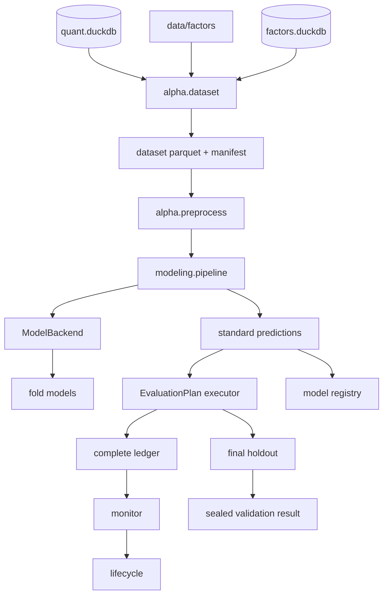

# ML 模型层

阅读目标：理解模型层如何把当前可见的因子和上下文特征转换成未来收益的截面分数，
以及数据集、切分、训练、产物、评估、登记、监控和最终留出如何衔接。本文描述当前
实现，不把历史模型卡中的阶段结论当成永久结论。

一句话职责：模型层负责建立可复现的周频研究数据集，训练截面排序模型，写出可校验的
样本外预测，并为下游评估、完整回测和生命周期提供稳定输入。它不负责生成因子、执行
交易、处理涨跌停成交或构造完整投资组合账本。

## 1. 全链路位置



模型分数只表示同一信号日内股票未来收益排名的相对高低。分数通过 Top-N、平滑、回滚或
暂停等策略变成目标权重后，仍需由回测层执行 T+1、停牌、涨跌停、成本、资金和公司行动。
因此 RankIC、分位收益和周频研究模拟器的改善不能直接解释成可获得的实盘收益。

核心代码：

- 模型包：[research/modeling/alpha](../../research/modeling/alpha)
- 通用训练契约：[research/modeling/alpha/modeling/contracts.py](../../research/modeling/alpha/modeling/contracts.py)
- 通用训练流水线：[research/modeling/alpha/modeling/pipeline.py](../../research/modeling/alpha/modeling/pipeline.py)
- 注册后端：[research/modeling/alpha/modeling/backends](../../research/modeling/alpha/modeling/backends)
- CLI 包装：[core/data/scripts/build_alpha](../../core/data/scripts/build_alpha)
- 配置：[configs/alpha](../../configs/alpha)

## 2. 当前快照

以下为 2026-10-26 对当前工作区只读核对的结果。源码和产物变化后应重新生成，不能把
这些数字当成固定常量。

| 项目 | 当前结果 |
|---|---|
| 正式开发数据集 | `6a59680fd71c50a8` |
| 数据区间 | 2012-01-06～2023-12-29 |
| 周频样本 | 2,138,239 行、613 个日期、5,500 只股票 |
| 数据版本 | `tushare_fullA_20000104_20261015` |
| 因子版本与数量 | `factors_v1`，47 个已实现因子 |
| 上下文特征 | `log_mv`、`turnover_rate`、`listed_days` |
| 训练特征 | 50 个根特征加 50 个缺失指示，共 100 个 |
| 默认开发折 | `wf_2018`～`wf_2023` 六折 |
| 正式样本外预测 | 1,194,198 行、300 个周频日期 |
| 模型索引 | `alpha_model_registry_v3` |
| 登记模型 | 4 个，其中 3 个活跃、1 个归档 |
| 下游运行链接 | 28 条 |
| 当前最终留出 | `final_holdout_2ba777e855f5`，`fail_final_holdout` |

当前模型：

| 模型 ID | 类型 | 当前用途 |
|---|---|---|
| `lightgbm_ensemble_label_rank_6aea5c9299d5` | 五种子 LightGBM rank 集成 | 实验主模型、监控和生命周期主模型 |
| `ridge_label_rank_aaff2cb2fbcf` | Ridge | 线性参照、生命周期回退模型 |
| `sklearn_hist_gbdt_label_rank_83e1200e554f` | Scikit-learn 直方图 GBDT | 新挑战者，已有开发期评估、账本、监控和生命周期 |
| `lightgbm_label_rank_aaae94773921` | 单种子 LightGBM | 已归档历史对照 |

模型 manifest 的 `status` 只表示训练状态。评估、完整账本、监控、生命周期和最终留出
的完成情况应读取 `data/models/index.json` 中的 `downstream`，不能从
`status=trained/evaluated` 推断整个研究生命周期。

## 3. 固定研究口径

[research/modeling/alpha/config.py](../../research/modeling/alpha/config.py) 中的
`ResearchContract` 约束第一版研究：

| 字段 | 当前值 | 含义 |
|---|---|---|
| `label` | `fwd_ret_open_5` | 未来 5 个交易日开盘到开盘收益 |
| `horizon` | 5 | 标签周期 |
| `price` | `open` | 标签使用开盘价格通道 |
| `universe` | `all_a` | 全 A 可交易股票池 |
| `rebalance` | `weekly` | 每周最后交易日生成信号 |
| `top_n` | 30 | 研究组合持仓数 |
| `weighting` | `equal` | 等权 |
| `benchmark` | `H00300.CSI` | 沪深 300 全收益 |
| `dev_start/dev_end` | 2012-01-01～2023-12-31 | 开发期 |
| `holdout_start/holdout_end` | 2024-01-01～2026-10-15 | 已消耗的最终留出窗口 |
| `min_listed_days` | 60 | 上市满 60 个自然日 |
| `purge_days/embargo_days` | 6 / 6 | 5 日标签之外的交易日隔离 |

契约会拒绝标签和时间粒度不匹配、最终留出与开发期重叠、`purge` 或 `embargo` 小于
`horizon + 1` 等配置。普通数据集和预测入口默认拒绝跨入 2024-01-01；只有最终留出
入口能使用注册窗口打开对应区间。

## 4. 公共接口与数据结构

### 4.1 数据集

`DatasetSpec` 的默认字段：

| 字段 | 默认值或规则 |
|---|---|
| `name` | `weekly_fwd_open_5_v1` |
| `start/end` | 研究契约开发期 |
| `features` | `None` 表示因子目录中的全部 implemented 因子 |
| `label` | 仅支持 `fwd_ret_open_5` |
| `universe` | 仅支持 `all_a` |
| `min_listed_days` | 60，必须为非负整数 |
| `allow_holdout` | `False`，最终留出构建时显式设为 `True` |

`build_dataset()` 返回 `DatasetArtifact`；`load_dataset(dataset_id)` 返回
`(DataFrame, manifest)`。数据集主键是 `stock_code + trade_date`，结果按二者排序。

### 4.2 训练

`TrainingSpec` 是与算法无关的训练规格：

| 字段 | 作用 |
|---|---|
| `backend` | `linear`、`lightgbm` 或 `sklearn_hist_gbdt` |
| `config` | 后端专属 JSON 参数 |
| `target` | 当前固定为 `label_rank` |
| `seeds` | 非空时形成多种子集成；必须严格递增、不重复且至少两个 |
| `model_type` | 可选，决定 manifest 中的模型类型 |
| `top_n/quantiles` | 下游研究口径和分位评估参数 |
| `preprocess` | rank/z-score、缺失指示、去极值和中性化配置 |

`ModelBackend` 协议只处理单折算法：

```text
build_config
config_dict
with_seed
fit_fold
refit
predict
save_model
load_model
manifest_metadata
```

新增后端放在
[research/modeling/alpha/modeling/backends](../../research/modeling/alpha/modeling/backends)
并在模块导入时注册。后端目录会自动发现，不需要修改共享折循环或固定后端清单。
后端不得自行改变股票池、标签、组合规则或最终验收口径。

### 4.3 评估

`EvaluationPlan` 描述候选、参照、控制、评分规则、持仓规则和门槛：

| 类型 | 作用 |
|---|---|
| `ResearchContract` | 固定研究口径 |
| `DatasetSpec` | 数据集构建范围与特征 |
| `TrainingSpec` | 一次模型训练 |
| `ModelArtifact` | 训练产物索引 |
| `EvaluationPlan` | 候选比较与选择 |
| `SourceSpec` | `model`、`baseline` 或 `blend` 分数来源 |
| `ScorePolicy` | 原始分数或因果 rank 平滑 |
| `RiskGatePolicy` | 组合级市值、流动性和行业暴露门槛 |
| `MonitorPolicy/LifecyclePolicy` | 监控与生命周期状态机 |
| `FinalHoldoutSpec` | 一次性留出窗口和数据门槛 |

### 4.4 预测接口

```python
from alpha.predict import load_predictions, model_artifact_snapshot, predict

folder, manifest, frame = load_predictions(
    model_id,
    start="2018-01-12",
    end="2023-12-29",
)
replayed = predict(model_id, "2018-01-12", "2023-12-29")
snapshot = model_artifact_snapshot(model_id)
```

- `load_predictions()` 读取已落盘分片，完整校验后再按闭区间截取。
- `predict()` 加载训练数据集和模型文件，重新计算样本外预测；请求覆盖完整预测区间时
  还核对合并 SHA256。普通调用不能跨入最终留出。
- `model_artifact_snapshot()` 汇总模型文件、训练数据集和预测内容哈希，供回测输入快照。
- 标准预测固定为 `trade_date`、`stock_code`、`score`，分数必须是有限值，键不能重复。

## 5. 从原始数据到周频数据集

### 5.1 数据来源

| 数据 | 当前入口或表 | 用途 |
|---|---|---|
| 因子 | `quant.load_factor_panel()`、`data/factors` | 模型特征 |
| 日行情与状态 | `quant.load_panel()`、`md.daily_hfq` | 可交易、ST、停牌、市值、换手、上市日 |
| 标签 | `quant.load_label()`、`md.fwd_return` | `fwd_ret_open_5` |
| 交易日历 | `quant.load_calendar()`、`md.calendar` | 每周最后交易日 |
| 申万行业 | `ref.sw_industry_member` | 时点行业和可选中性化 |
| 因子目录 | `factors.duckdb` | 已实现因子清单和版本 |

因子和标签使用后复权口径，回测成交使用原始价。模型层不重新生成复权价，也不改变数据层
的停牌、涨跌停和公司行动处理。

### 5.2 构建顺序

`build_dataset()` 的真实顺序如下：

1. 读取因子目录中的已实现因子；若传入 `features`，先拒绝保留列、未来列和重复上下文列。
2. 读取行情库和因子库 manifest，得到数据版本、因子版本、因子行数等版本指纹。
3. 按自然年切分读取范围，每次读取因子面板、日线状态、5 日标签和交易日历。
4. 先用完整区间交易日历计算每周最后交易日，再把每个周频日期分配到对应年份。
5. 将因子、日线状态和标签按 `stock_code + trade_date` 左连接；行业按信号日时点连接。
6. 计算 `eligible`、上下文特征、`label_raw`、`label_rank` 和 `sample_weight`。
7. 合并年度结果，检查主键唯一，写出 `data.parquet` 和 `manifest.json`。

数据集 ID 由 `DatasetSpec`、特征清单、数据版本、因子版本和数据集代码 SHA256 生成。
相同输入应得到相同 ID；任何一项变化都可能生成新目录。

### 5.3 可交易股票池

当前代码的可交易条件为：

```text
eligible =
    can_buy_close
    and not is_suspended
    and not is_st
    and not is_delisting
    and listed_days >= 60
```

`listed_days` 是信号日与上市日之间的自然日差。不可交易股票仍保留在数据集中，方便检查
生命周期和历史覆盖，但 `sample_weight=0`，不会进入模型拟合。

这些条件只是研究池代理。它们不能保证次日开盘一定可以成交，也没有处理卖出侧的跌停、
流动性、冲击成本和资金约束；这些属于完整回测层。

### 5.4 周频信号日和标签

周频信号日取完整交易日历中每周最后一个开市日，不按自然年分别补造“年末最后一天”。
信号日在收盘后确定，下一交易日开盘是研究契约中的执行时点。

标签同时保留：

| 列 | 定义 |
|---|---|
| `label_raw` | 未来 5 日开盘通道收益 |
| `label_rank` | 当日可交易且标签有效股票中的百分位，平均秩处理并列 |
| `sample_weight` | 可交易且 `label_rank` 非空时为 1，否则为 0 |

模型拟合的是截面百分位标签，不是原始收益。这样降低极端收益对平方损失的支配，但也意味着
模型优化的是排序目标；分数本身不是预期收益，不能直接按分数大小解释收益幅度。

### 5.5 上下文特征

| 特征 | 计算 | 注意点 |
|---|---|---|
| `log_mv` | `ln(total_mv)` | 市值必须为正，否则为空 |
| `turnover_rate` | 日行情换手率 | 保持数据层单位 |
| `listed_days` | 信号日与上市日自然日差 | 不按交易日计算 |

上下文特征和因子一起参与预处理，也会生成 `__missing` 指示列。因此当前正式数据集有
47 个因子、3 个上下文根特征和 50 个缺失指示，共 100 个模型输入。

### 5.6 数据集 manifest

`data/models/datasets/<dataset_id>/` 当前包含：

```text
data.parquet
manifest.json
```

manifest 记录数据集 ID、规格、原始特征、上下文特征、数据与因子版本、行数、日期数、
股票数、日期范围、可用行数、标签覆盖率、逐特征缺失率、年度行数和代码哈希。

`data.parquet` 通过临时文件替换写入，但 manifest 在其后直接覆盖，两者不是一个跨文件
事务。`load_dataset()` 校验目录 ID 与 manifest ID，不重新核对 Parquet 内容哈希。
需要完整输入快照时，应使用 `model_artifact_snapshot()` 或回测输入快照。

## 6. 截面预处理

预处理实现位于
[research/modeling/alpha/preprocess.py](../../research/modeling/alpha/preprocess.py)，
每个特征按 `trade_date` 独立处理，不使用全样本均值或未来日期。

### 6.1 实际顺序

对每个根特征依次执行：

1. 转为数值，把 `inf/-inf` 转换为空值。
2. 只在 `eligible=True` 的股票上保留原值。
3. 可选按日做 1% / 99% winsorize。
4. `rank` 模式按日计算百分位，缺失填 `0.5`；`zscore` 模式按日使用总体标准差，
   缺失填 `0`。
5. 可选行业中性化，再可选按日对 `log_mv` 做一元回归并保留残差。
6. `zscore` 模式最后按 `clip_z` 截断；默认配置为 5。
7. 生成由原始特征到空值的 `<name>__missing` 指示列。

默认训练规格使用 rank、开启缺失指示、关闭 winsorize、行业/市值中性化和额外截断。
注意中性化发生在 rank 之后；行业残差或市值残差不会再重新 rank。

V120 起，特征 rank、标签 rank、1%/99% 分位裁剪和总体标准差 z-score 通过
`alpha.kernel_ops` 进入统一 `kernels` 后端。每次预处理只做一次日期稳定分组，并按原
行序回填；中性化和市值残差仍由 Python 执行。默认 `QUANT_KERNEL_BACKEND=auto`，
扩展不可导入时回退 Python。固定 213.8 万行开发集上，rank 由 26.095 秒降至 7.951 秒，
zscore 由 6.607 秒降至 3.509 秒；python/native/auto 的 float32 列哈希完全一致。
详见 [模型截面预处理](../research/modeling/alpha/preprocessing.md)。

### 6.2 中性化边界

- 行业中性化使用信号日可见的申万一级行业，缺失行业归入 `UNKNOWN` 组。
- 市值中性化只在当日可交易股票上估计一元回归，并返回残差。
- 所有统计都按日计算，改变未来日期不会改变过去样本的变换结果。
- 行业组均值在缺失填充后计算，当前实现没有再次把不可交易行排除；不可交易行可能以
  填充值参与行业截距。默认模型不启用行业中性化，正式行业中性化实验应单独审计。
- 行业区分支、历史行业修订和极端小样本仍可能影响稳健性。当前默认模型不中性化，
  所以这些风险主要影响显式开启中性化的实验。

缺失指示列让模型区分“真实低值”和“缺失后填充值”。但缺失本身可能与数据质量、公司类型
或未来生存状态相关，加入指示列不能自动消除选择偏差。

## 7. Purged walk-forward

### 7.1 当前六折

当前正式折表来自 `data/models/splits/walk_forward_v1.csv`：

| 折 | 训练期 | 验证期 | 测试期 |
|---|---|---|---|
| `wf_2018` | 2012-01-04～2016-12-22 | 2017-01-03～2017-12-29 | 2018-01-10～2018-12-28 |
| `wf_2019` | 2012-01-04～2017-12-21 | 2018-01-02～2018-12-28 | 2019-01-10～2019-12-31 |
| `wf_2020` | 2012-01-04～2018-12-20 | 2019-01-02～2019-12-31 | 2020-01-10～2020-12-31 |
| `wf_2021` | 2012-01-04～2019-12-23 | 2020-01-02～2020-12-31 | 2021-01-12～2021-12-31 |
| `wf_2022` | 2012-01-04～2020-12-23 | 2021-01-04～2021-12-31 | 2022-01-12～2022-12-30 |
| `wf_2023` | 2012-01-04～2021-12-23 | 2022-01-04～2022-12-30 | 2023-01-11～2023-12-29 |

默认模式是扩展窗口：每折训练起点固定，验证期是测试年前一完整自然年，测试期是该自然年。
`purge` 和 `embargo` 各 6 个交易日。测试起始日晚于自然年首日，因为这些日期被
embargo 隔离；六折合并后得到 300 个有效周频预测日，而不是完整六个自然年的全部周末。

### 7.2 为什么需要 purge 和 embargo

`fwd_ret_open_5` 的标签使用未来 5 个交易日价格。若训练样本的标签窗口跨入验证期，
或验证样本的标签跨入测试期，模型选择会间接看到后面时间段的信息。

代码要求隔离长度至少为 `horizon + 1` 个交易日，并在生成切分表时调用
`validate_label_gap()` 检查训练/验证、验证/测试边界。当前训练入口读取 CSV 后只重新
检查测试段没有进入最终留出，没有再次验证 CSV 中的标签间隔；因此切分表本身应按受控
脚本生成并版本化，不能手工编辑。

### 7.3 数据窥探边界

六折测试预测拼接后才形成整体样本外指标。超参数选择使用每折验证集，最终模型使用
train+valid 重拟合，再预测该折 test。模型筛选、分数平滑、Top-N 和 buffer 比较仍在
开发期内进行，必须视为研究迭代，不能把开发期结果当作独立未来证据。

## 8. 模型训练

### 8.1 通用折循环

[research/modeling/alpha/modeling/pipeline.py](../../research/modeling/alpha/modeling/pipeline.py)
按测试起始日排序折，并执行：

1. 对全数据集按 manifest 的特征和预处理配置做截面转换。
2. 每折只取该日期的 train、valid、train+valid 和 test 行。
3. 训练数据要求 `sample_weight > 0` 且目标非空；测试只要求 `eligible=True`。
4. 对每个种子调用 `fit_fold()`，用验证集选参或早停。
5. 用 train+valid 和选定轮数/正则参数重拟合。
6. 对 test 生成分数；多种子时在每个日期截面内转 rank 后等权平均。
7. 保存成员模型、主预测、指标、配置、特征和 manifest。

如果一个折的训练、验证、重拟合或测试样本为空，流水线直接失败，不跳过该折。

### 8.2 线性后端

`linear` 支持 Ridge 和 ElasticNet：

- 在 `alpha_grid` 中逐个拟合训练集。
- 用验证集 RankIC 均值选择 `alpha`；并列时选较大的 `alpha`。
- 在 train+valid 上用选中的参数重拟合。
- 单折模型保存为 `.npz` 模型包。

正则化降低小样本和高相关特征下的系数不稳定，但不会修复标签泄漏、错误股票池或错误的
数据可用日。因子高度相关时，线性系数也不能直接当作经济贡献。

### 8.3 LightGBM 后端

`lightgbm` 使用验证集每日 RankIC 早停：

1. 在训练集上拟合 LightGBM。
2. 以验证集排序表现决定最佳迭代轮数。
3. 在 train+valid 上按最佳轮数关闭早停重拟合。
4. 单折模型保存为文本 `.txt`。

默认五种子集成使用固定种子 `0..4`。每个种子独立训练，在每个信号日把成员分数转为
截面百分位 rank 后等权平均。全部成员预测和稳定性报告保留，不能根据样本外表现事后
挑选种子。

### 8.4 Scikit-learn 直方图 GBDT 后端

`sklearn_hist_gbdt` 使用固定的
`HistGradientBoostingRegressor` 配置：

1. 在训练集内部按固定比例划出早期停止样本。
2. 按验证损失选择迭代轮数，并另用正式验证年计算 RankIC 记录。
3. 在 train+valid 上按选定轮数关闭早停重拟合。
4. 单折模型保存为 `.joblib`。

该后端的内部早期停止不是按时间顺序切训练集，但其样本都位于该折训练期内；正式验证年
仍由共享流水线隔离。新增后端如果使用内部验证，必须明确它是否依赖时间顺序。

### 8.5 模型 ID 与恢复

模型 ID 由数据集 ID、数据版本、数据集代码哈希、折、训练规格、后端及相关源码哈希组成，
格式为 `<model_type>_<target>_<12位摘要>`。

训练前若同 ID 目录已有 `manifest.json` 和 `metrics.json`，并且未使用 `--force`：

1. 校验 manifest 和 metrics 的模型 ID。
2. 校验全部折模型文件是否存在且 SHA256 一致。
3. 读取并完整校验已落盘预测，再核对行数。
4. 全部通过才复用，否则失败；`--force` 才会重建同一目录。

恢复检查不重新计算数据集内容哈希。数据集损坏但主键和 manifest 仍可读时，不一定能在
训练恢复前被发现；发现训练数据质量问题时，应保留旧产物并用修正确认后的输入生成新 ID。

## 9. 模型产物

### 9.1 目录

```text
data/models/models/<model_id>/
  manifest.json
  config.json
  features.json
  metrics.json
  fold_models.csv
  models/
  predictions/year=YYYY/part.parquet
  member_predictions/seed=N/year=YYYY/part.parquet
```

单模型不一定有 `member_predictions`；集成模型每个种子都保留成员预测。训练指标最初只
包含验证信息和样本外成交/IC 模型层指标，`metrics.json` 中的 `evaluated=false` 表示尚未
运行组合研究评估，不表示模型文件不可用。

### 9.2 manifest 主要字段

| 字段 | 含义 |
|---|---|
| `schema_version` | 当前新模型为 `alpha_model_v2`；历史模型可为 v1 |
| `model_id/model_type/backend` | 模型身份和后端来源 |
| `dataset_id/data_versions` | 训练数据及其版本 |
| `label/target/universe` | 标签与研究池 |
| `raw_features/context_features/features` | 根特征和预处理后特征 |
| `preprocess` | 重放时必须恢复的变换配置 |
| `folds/fold_models` | 日期边界、样本数、模型文件和选择结果 |
| `member_predictions` | 集成成员预测元数据 |
| `prediction_files/prediction_sha256` | 年度分片和合并预测哈希 |
| `code_sha256/model_sha256` | 代码和模型集合摘要 |

历史 v1 manifest 通过
[research/modeling/alpha/modeling/manifests.py](../../research/modeling/alpha/modeling/manifests.py)
归一化读取，不原地改写。新增字段时应同时检查训练写出、历史读取、预测重放和登记校验。

### 9.3 预测校验

`load_predictions()` 的完整校验顺序：

1. 模型目录名与 manifest 的 `model_id` 一致。
2. 年度键是四位数字，分片存在且日期属于对应年份。
3. 三列齐全，日期和股票代码非空，分数全部有限。
4. 分片及合并结果都没有重复键。
5. 每个分片哈希和合并哈希与 manifest 一致。
6. 行数、日期数、起止日期与 manifest 一致。
7. 全部通过后才按请求区间截取，空区间抛 `ALPHA-401`。

模型目录和预测按年度分片写入时使用单文件临时替换，但整个模型目录不是事务提交。
写入中断可能留下不完整目录；恢复必须依靠 manifest 和哈希失败关闭，不能把目录存在
当作训练成功。

## 10. 模型评估计划与完整账本入口

### 10.1 评估计划

当前正式计划是
[configs/alpha/development_evaluation_v85.json](../../configs/alpha/development_evaluation_v85.json)。
它包含 9 个候选和 1 个 B4 控制：

- Ridge、LightGBM 集成和直方图 GBDT 的原始或 4 周 rank 平滑；
- Ridge/LightGBM 的 45 名 buffer；
- LightGBM 与 Ridge 的 50/50 rank 融合；
- 不可选择的 B4 全因子 rank 控制。

当前正式评估为 `evaluation_d57dd9e6e750`，状态 `pass_evaluation`，选中
`LIGHTGBM_SMOOTH_4W`。评估产物包含 47 个有哈希的文件，包括计划、候选表、决策、
逐周结果、订单、年度表和每个候选的规范化分数。

### 10.2 P3 经济门

默认门槛要求候选相对 Ridge：

- RankIC、ICIR、年化净收益、最大回撤至少两项严格改善；
- 双边年化换手不超过 Ridge 的 2 倍；
- 2018～2023 每一年 RankIC 和净超额都为正。

所有候选未通过时保留 Ridge。通过候选再按年化收益、Sharpe、最大回撤、换手、优先级和
名称排序。门槛是研究规则，不是统计显著性检验。

### 10.3 组合风险门

v3 计划在进入完整账本前检查目标持仓的 13 周滚动绝对暴露，至少需要 8 个有效观测：

| 维度 | 上限 |
|---|---:|
| SIZE 绝对暴露 | 2.0 |
| LIQUIDITY 绝对暴露 | 2.0 |
| 行业最大主动权重 | 0.35 |

风险门通过不代表交易可执行。它只约束研究目标组合的风格和行业集中度，不验证成交量、
冲击成本或停牌后的补单。

### 10.4 下游消费

`evaluation_executor` 把每个候选的平滑后分数写成不可变 Parquet。完整账本入口
`accept_plan` 按评估 ID 和候选名读取并校验这些分数，再交给回测层执行。它不会在
账本阶段重新平滑、融合或根据结果替换候选。

评估目录复用时会核对计划、来源、数据集、代码和全部声明输出哈希。任一产物损坏时
失败关闭；只有显式 `--force` 才重建。完整账本细节由回测模块文档负责。

## 11. 登记、监控和生命周期

### 11.1 模型登记

[research/modeling/alpha/registry.py](../../research/modeling/alpha/registry.py)
扫描活跃和归档模型目录，校验 manifest、config、features、metrics、模型文件、预测分片、
训练数据集和运行 manifest，然后原子重建 `data/models/index.json`。

索引是派生入口，不是事实来源。当前 v3 索引区分：

- `status_scope=training`：模型 manifest 的训练状态；
- `downstream.evaluations`：评估计划运行；
- `downstream.acceptances`：完整账本验收；
- `downstream.monitoring`：监控包；
- `downstream.lifecycles`：生命周期包；
- `downstream.final_holdouts`：最终留出运行。

模型目录或预测损坏时，登记重建失败并保留旧索引。`ALPHA-401` 表示产物损坏，
`ALPHA-402` 表示索引结构、目录身份或登记冲突。

### 11.2 监控

`alpha.monitor` 读取现有模型、预测、标签、完整账本和目标持仓暴露，生成滚动监控。
它不训练模型、不重跑回测，也不读取封存的最终留出。

固定窗口为 13 个周频信号日，至少 8 个有效观测：

| 指标 | Warning | Alert |
|---|---:|---:|
| 滚动部署 RankIC | 低于 0 | 连续 2 周低于 0 |
| 滚动净超额 | 低于 0 | 不高于 -10% |
| 当前回撤 | 不高于 -28% | 不高于 -35% |
| 双边年化换手 | 基准的 1.5 倍 | 基准的 2.0 倍 |
| 可交易股票分数缺失率 | 高于 1% | 高于 5% |
| 最大绝对风格暴露 | 高于 1.5 | 高于 2.0 |
| 最大行业主动权重 | 高于 25% | 高于 35% |

监控包位于 `data/models/models/<model_id>/monitoring/<monitor_id>/`，包含时序、告警、
衰减演练、机器/人工报告、manifest 和完成标记。输入或代码变化应生成新 ID，不覆盖历史包。

### 11.3 生命周期

`alpha.lifecycle` 把监控观测转换成因果状态：

| 状态 | 活动模型 | 仓位乘数 |
|---|---|---:|
| `normal` | 主模型 | 1.0 |
| `reduced` | 主模型 | 0.5 |
| `rollback` | Ridge 回退模型 | 1.0 |
| `paused` | 无 | 0.0 |

默认规则为：连续 4 期 warning/alert 降权，连续 2 期 alert 回滚，连续 4 期 alert
暂停，缺失率超过 5% 立即暂停，连续 4 期 `ok` 恢复。所有决策状态在信号日收盘生成，
下一交易日开盘执行。

当日监控的 5 日标签尚未完整，因此生命周期使用上一信号日可观察到的滚动 RankIC，
超额、回撤、换手、缺失和暴露仍使用信号日已可知数据。未来监控变化不能改变之前状态。

年度重训日程从固定训练起点生成，每年首个信号日记录 `retrain_due`。该事件只表示重训
到期，不会自动训练或晋升挑战者；新模型仍需完整样本外验证。

### 11.4 最终留出

`alpha.final_holdout` 使用注册窗口执行冻结模型的一次性验证，不训练、不调参、不按结果
替换候选。窗口配置见
[configs/alpha/holdout_windows.json](../../configs/alpha/holdout_windows.json)：

| 窗口 | 区间 | 状态 |
|---|---|---|
| `holdout_2024_2026` | 2024-01-01～2026-10-15 | 已消耗、封存、只读 |
| `holdout_2026_2027` | 2026-10-16～2027-10-15 | 待使用，当前数据不足 |

当前验证 ID 为 `final_holdout_2ba777e855f5`：

- 模型评估有 142 个 5 日标签完整的周频日；
- 完整账本从 2024-01-05 运行到 2026-10-15；
- 主候选相对 Ridge 只有年化净收益一项改善；
- 2024 年主候选净超额为 -31.46%；
- 预注册 P3 门失败，状态为 `fail_final_holdout`。

失败是经济效果失败，不是执行结构失败。不得在同一窗口重新调参并宣称获得独立成功；
后续研究应使用新模型和新的未来窗口。

## 12. 常用命令

### 12.1 数据集与折

```bash
.venv/bin/python -m scripts.build_alpha.build_dataset \
  --start 2012-01-01 --end 2023-12-31
.venv/bin/python -m scripts.build_alpha.build_folds \
  --start 2012-01-01 --end 2023-12-31
```

`build_dataset --features MOM_20,EP_TTM` 可以构建显式特征集；
`--force` 会重建同 ID 数据集。`build_folds` 还支持 `--mode expanding|rolling`
和 `--window-years`。这些命令会写正式 `data/models`，验证文档时不要无目的执行长任务。

### 12.2 训练与预测

```bash
.venv/bin/python -m scripts.build_alpha.train \
  --dataset-id 6a59680fd71c50a8 \
  --spec configs/alpha/train_lightgbm_ensemble.json

.venv/bin/python -m scripts.build_alpha.predict \
  --model-id lightgbm_ensemble_label_rank_6aea5c9299d5 \
  --start 2018-01-12 --end 2023-12-29
```

训练成功后命令自动重建模型索引；若训练产物未进入索引，命令失败退出。预测命令按
请求区间与各折样本外测试期的交集重放模型；交集内没有任何可重放样本时失败。

### 12.3 评估、登记、监控与生命周期

```bash
.venv/bin/python -m scripts.build_alpha.evaluate_plan \
  --plan configs/alpha/development_evaluation_v85.json
.venv/bin/python -m scripts.build_alpha.registry --rebuild
.venv/bin/python -m scripts.build_alpha.monitor
.venv/bin/python -m scripts.build_alpha.lifecycle
```

历史最终留出只读加载：

```bash
.venv/bin/python -m scripts.build_alpha.final_holdout \
  --load final_holdout_2ba777e855f5
```

新窗口必须显式提供 `--window-id` 和冻结的 `--plan`，并满足数据、标签覆盖和最少信号日
要求。不要用默认未来窗口直接启动未准备的数据验证。

## 13. 最小只读核验

不训练模型时，可以检查当前登记和标准预测：

```python
from alpha.predict import load_predictions
from alpha.registry import get_registered_model

model_id = "lightgbm_ensemble_label_rank_6aea5c9299d5"
record = get_registered_model(model_id)
_, manifest, predictions = load_predictions(
    model_id,
    start="2023-12-01",
    end="2023-12-29",
)
print(record["window"])
print(manifest["prediction_dates"], len(predictions))
print(predictions.head())
```

该示例只读取正式产物，不重新训练、不覆盖预测，也不触碰封存留出。

## 14. 日志、错误与排障

### 14.1 日志

模型层日志根目录为 `logs/research/modeling/`，每个 logger 写入自己的子目录。例如：

```text
logs/research/modeling/alpha_dataset/
logs/research/modeling/alpha_registry/
logs/research/modeling/alpha_monitor/
logs/research/modeling/alpha_lifecycle/
logs/research/modeling/scripts_build_alpha_train/
logs/research/modeling/scripts_build_alpha_build_dataset/
logs/research/modeling/scripts_build_alpha_evaluate/
```

日志文件名包含首末信息时间；单文件达到 128 MB 后创建新文件，目录与模块职责对应。
模型层不额外捕获并吞掉异常，算法和产物错误会继续向上抛出。

### 14.2 错误码

| 错误码 | 错误类 | 主要场景 |
|---|---|---|
| `ALPHA-101` | `AlphaConfigError` | 研究契约、日期或配置非法 |
| `ALPHA-102` | `AlphaDataError` | 数据读取、行集或标签对齐失败 |
| `ALPHA-201` | `AlphaSplitError` | 切分、purge、embargo 或日期边界非法 |
| `ALPHA-202` | `AlphaPreprocessError` | 预处理配置或输入结构非法 |
| `ALPHA-301` | `AlphaModelError` | 训练、后端、模型保存或预测失败 |
| `ALPHA-302` | `AlphaEvaluationError` | 评估输入、计划、指标或风险门槛失败 |
| `ALPHA-401` | `AlphaArtifactError` | 数据集、模型、预测或元数据缺失/损坏 |
| `ALPHA-402` | `AlphaRegistryError` | 模型索引、目录身份或登记冲突 |
| `ALPHA-403` | `AlphaMonitorError` | 监控来源、阈值或监控产物非法 |
| `ALPHA-404` | `AlphaLifecycleError` | 生命周期来源、状态或产物非法 |
| `ALPHA-405` | `AlphaFinalHoldoutError` | 留出窗口、冻结输入或结果非法 |

排障顺序：先看最新日志中的错误码和路径，再用 `manifest.json`、`features.json` 和
`metrics.json` 核对模型身份，随后运行 `load_predictions()` 检查分片、键和哈希，
最后检查训练数据集 manifest 与登记索引。不要在未确认来源前用 `--force` 覆盖产物。

## 15. 量化知识边界

- 截面 rank 让模型学习排序，但不把分数转换为预期收益；Top-N 等权仍需回测解释收益。
- 日频因子经过周频采样后，5 日标签逐周重叠，普通独立样本 t 值偏乐观。
- purge 和 embargo 防的是标签窗口跨界泄漏，不解决特征本身使用不可用数据的问题。
- 财务标签泄漏通常来自公告可用日而非命名；模型层只消费数据层已经对齐的特征。
- 行业和市值中性化改变的是截面暴露，不等于消除风险；默认模型不中性化。
- LightGBM 可以学习非线性，但容量、树深、叶节点样本和正则参数仍需固定验证流程。
- 多种子 rank 集成主要降低随机训练波动，不产生新信息，也不保证样本外稳定。
- IC、分位收益、研究模拟器和完整账本回答不同问题；只有完整账本能处理交易约束。
- 最终留出是一次性消费的样本。看到结果后再改模型或门槛，会把独立验证变成调参集。

## 16. 测试映射

当前模型相关测试共 208 个（包括正式产物只读检查）。主要映射：

| 主题 | 测试文件 |
|---|---|
| 契约、数据集和标签 | [test_alpha_config.py](../../tests/test_alpha_config.py)、[test_alpha_dataset.py](../../tests/test_alpha_dataset.py) |
| 预处理因果性与原生核一致性 | [test_alpha_preprocess.py](../../tests/test_alpha_preprocess.py)、[test_cpp_model_preprocess.py](../../tests/test_cpp_model_preprocess.py) |
| 切分、purge 和 embargo | [test_alpha_split.py](../../tests/test_alpha_split.py) |
| 周频面板与基线 | [test_alpha_panel.py](../../tests/test_alpha_panel.py)、[test_alpha_baselines.py](../../tests/test_alpha_baselines.py) |
| 模型后端 | [test_alpha_linear.py](../../tests/test_alpha_linear.py)、[test_alpha_gbdt.py](../../tests/test_alpha_gbdt.py)、[test_alpha_sklearn_hist_gbdt.py](../../tests/test_alpha_sklearn_hist_gbdt.py)、[test_alpha_ensemble.py](../../tests/test_alpha_ensemble.py) |
| 训练和重放 | [test_alpha_train.py](../../tests/test_alpha_train.py)、[test_alpha_modeling.py](../../tests/test_alpha_modeling.py) |
| 预测哈希与快照 | [test_alpha_predict.py](../../tests/test_alpha_predict.py) |
| 指标、计划和风险 | [test_alpha_evaluate.py](../../tests/test_alpha_evaluate.py)、[test_alpha_evaluation_plan.py](../../tests/test_alpha_evaluation_plan.py)、[test_alpha_risk.py](../../tests/test_alpha_risk.py) |
| 模型解释与暴露 | [test_alpha_explain.py](../../tests/test_alpha_explain.py)、[test_alpha_exposure.py](../../tests/test_alpha_exposure.py)、[test_alpha_audit.py](../../tests/test_alpha_audit.py) |
| 登记与历史产物 | [test_alpha_registry.py](../../tests/test_alpha_registry.py)、[test_alpha_model_card.py](../../tests/test_alpha_model_card.py) |
| 监控和生命周期 | [test_alpha_monitor.py](../../tests/test_alpha_monitor.py)、[test_alpha_lifecycle.py](../../tests/test_alpha_lifecycle.py)、[test_alpha_lifecycle_accept.py](../../tests/test_alpha_lifecycle_accept.py) |
| 完整账本接入 | [test_alpha_ledger_acceptance.py](../../tests/test_alpha_ledger_acceptance.py)、[test_alpha_backtest_accept.py](../../tests/test_alpha_backtest_accept.py) |
| 留出窗口 | [test_alpha_holdout.py](../../tests/test_alpha_holdout.py)、[test_alpha_final_holdout.py](../../tests/test_alpha_final_holdout.py) |
| 联合因果流水线 | [test_alpha_integration.py](../../tests/test_alpha_integration.py) |

文档验证不运行长训练、真实回测、付费调用或新的最终留出实验。优先运行受影响的单元测试；
只有改动跨数据集、训练和下游接入时才增加联合测试。

## 17. 修改检查清单

1. 标签、决策时点、股票池、调仓、Top-N、成本或基准改变时建立新研究版本。
2. 任何会改变过去样本取值的全样本统计都不能进入截面预处理。
3. 新模型先实现 `ModelBackend` 并注册，不在共享流水线加入模型类型分支。
4. 新模型必须输出标准三列预测，并保留有限值、唯一键和哈希校验。
5. 不覆盖历史模型、预测、评估、监控、生命周期或留出结果；相同问题使用新 ID 和新版本。
6. 最终留出只能通过显式窗口入口读取；普通训练、预测、监控和生命周期仍拒绝跨入。
7. 回测统一通过 `load_predictions()` 或评估产物读取分数，不另写无校验的分片读取。
8. 新增配置字段时同步更新训练 manifest、重放解析、模型 ID、登记索引和测试。
9. 模型 manifest 的 `status` 与下游运行状态分开解释，不从训练状态推断经济结论。
10. 修改评估或风险门槛前固定新计划并重新生成分析 ID；不要改写旧决策。
11. 最终留出失败结论保留，不在同一窗口重调参后改写为成功。
12. 文档中的命令、路径、错误码、产物数字和链接应随当前实现重新核对。
