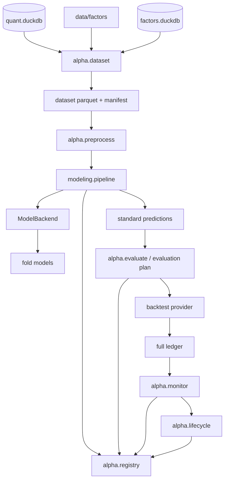

# ML 模型层

ML 模型层把 t 日收盘可获得的因子和上下文特征转换成未来收益的截面排序分数。它不负责
组合约束或成交执行，模型分数通过标准预测产物交给评估计划和回测 provider。

核心代码位于 [research/modeling/alpha](../../research/modeling/alpha)，训练和运行
入口位于 [core/data/scripts/build_alpha](../../core/data/scripts/build_alpha)。

## 1. 技术栈

| 技术 | 用途 |
|---|---|
| pandas / NumPy | 周频数据集、截面预处理、分数和指标 |
| scikit-learn | Ridge、ElasticNet、直方图 GBDT |
| LightGBM | 单模型、多种子 rank 集成和 TreeSHAP |
| joblib / npz / txt | 模型持久化 |
| DuckDB | 读取因子、标签、行情和行业数据 |
| Parquet | 数据集、预测、分数和评估产物 |
| pytest | 训练、预测、注册、监控和留出验证 |

## 2. 提供功能

- 构建周频、可交易的训练和样本外数据集。
- 生成原始收益和截面百分位标签。
- 提供按日 rank、z-score、去极值、缺失指示和中性化预处理。
- 支持 Ridge、ElasticNet、LightGBM 和直方图 GBDT。
- 支持 purged walk-forward、验证集选参、重拟合和多种子 rank 集成。
- 写出带哈希的标准预测、模型、配置、指标和 manifest。
- 评估模型、基线和融合候选，执行经济门和风险门。
- 支持特征重要性、消融、暴露分析、模型登记、监控和生命周期。
- 使用独立最终留出入口执行一次性样本外验证。

## 3. 研究任务与固定口径

当前第一版研究契约由
[research/modeling/alpha/config.py](../../research/modeling/alpha/config.py) 的
`ResearchContract` 定义：

| 项目 | 当前口径 |
|---|---|
| 标签 | `fwd_ret_open_5` |
| 决策时点 | 每周最后交易日收盘 |
| 执行时点 | 下一交易日开盘 |
| 股票池 | 全 A 可交易 |
| 组合 | Top-30 等权、只做多 |
| 基准 | `H00300.CSI` 沪深 300 全收益 |
| 开发期 | 2012-01-01～2023-12-31 |
| 最终留出 | 2024-01-01～2026-10-15 |
| purge / embargo | 各 6 个交易日 |

模型只输出分数，不决定行业约束、资金分配、涨跌停处理或成交价格。

## 4. 从原始数据到模型数据的全过程

### 4.1 数据选择

模型数据由以下来源组成：

| 数据 | 来源 | 用途 |
|---|---|---|
| 因子值 | `data/factors` 的已实现和已发布因子 | 原始特征 |
| 行情与交易状态 | `md.daily_hfq` | 可交易、ST、停牌、市值、换手和上市天数 |
| 未来收益 | `md.fwd_return` | 标签 `fwd_ret_open_5` |
| 交易日历 | `md.calendar` | 周最后交易日 |
| 申万行业 | `ref.sw_industry_member` | 可选行业中性化和暴露分析 |
| 因子目录 | `factors.duckdb` | 已实现因子清单和版本 |

### 4.2 已有清洗与模型层清洗边界

原始取数、复权、停牌、ST、涨跌停和生命周期由数据层完成。模型层不重复猜测行情清洗
规则，但会做二次约束：

- 只保留周最后交易日。
- 把 `inf` 和非数值转换为空值。
- 用 `eligible` 标记可训练、可预测股票。
- 标签只在可交易股票截面内排百分位。
- 禁止把 `label*`、`fwd_*`、`ret` 和保留列作为特征。
- 数据集主键 `stock_code + trade_date` 必须唯一。

### 4.3 可交易股票池

```text
eligible =
    can_buy_close
    且非停牌
    且非 ST
    且非退市整理期
    且上市满 60 个自然日
```

历史退市股票保留在数据中；上市前、退市后和停牌日不进入信号池。

### 4.4 周频信号日

按完整交易日历取每周最后交易日，不能按自然年分别取“每年最后一天”，也不能把区间末尾
不完整周随意补齐。每个信号日对应下一交易日开盘执行。

### 4.5 标签构造

数据集同时保留：

| 列 | 含义 |
|---|---|
| `label_raw` | 未来 5 日开盘通道收益 |
| `label_rank` | 当日可交易且标签有效股票中的百分位 |
| `sample_weight` | 可交易且标签有效时为 1，否则为 0 |

排序模型拟合 `label_rank`，用 `sample_weight` 排除不可训练样本。

### 4.6 上下文特征

除了因子目录中的特征，每个样本还构造：

- `log_mv = ln(total_mv)`，市值必须为正。
- `turnover_rate`，当日换手率。
- `listed_days`，从上市日到信号日的自然日数。

### 4.7 数据集产物

`DatasetSpec`、特征清单、数据版本和代码哈希共同生成 `dataset_id`。产物：

```text
data/models/datasets/<dataset_id>/
  data.parquet
  manifest.json
```

manifest 记录行数、日期数、股票数、可用样本、标签覆盖率、缺失率、年度行数和数据版本。

## 5. 预处理

预处理实现位于
[research/modeling/alpha/preprocess.py](../../research/modeling/alpha/preprocess.py)。

### 5.1 默认 rank

每个交易日、每个因子独立计算百分位 rank，缺失值填 `0.5`。这样可以降低不同因子量纲和
长尾对模型的影响。

### 5.2 z-score

配置为 `method="zscore"` 时，按交易日计算均值和总体标准差，缺失值填 `0`，可配置
`clip_z` 截断。

### 5.3 去极值

可选 `winsorize=true`，每个交易日把特征压缩到 1% 和 99% 分位。默认模型配置使用
rank 且不额外去极值。

### 5.4 缺失指示

`missing_indicator=true` 时为每个原始特征生成 `<name>__missing`，在可交易股票中标记
原值是否缺失。指示列与处理后的特征一起进入模型。

### 5.5 中性化

可配置：

- `industry`：按交易日 × 时点申万一级行业去组均值。
- `log_mv`：按交易日对 `log_mv` 做一元回归，保留残差。

默认训练配置不中性化。任何全样本统计都不允许进入截面预处理，避免未来信息泄漏。

## 6. 训练流程

### 6.1 通用训练规格

[research/modeling/alpha/modeling/contracts.py](../../research/modeling/alpha/modeling/contracts.py)
的 `TrainingSpec` 定义：

- `backend`：`linear`、`lightgbm` 或 `sklearn_hist_gbdt`。
- `config`：算法参数。
- `target`：默认 `label_rank`。
- `seeds`：可选多种子集成。
- `preprocess`：预处理配置。
- `top_n` 和 `quantiles`：下游研究口径。

### 6.2 Purged walk-forward

默认六折测试年份为 2018～2023。每折：

```text
expanding train: 2012 起点到验证年前
purge:           训练和验证之间 6 个交易日
valid:           测试年前一完整自然年
embargo:         验证和测试之间 6 个交易日
test:            当年样本外
```

验证集用于选参或早停；最终模型在 train+valid 上重拟合，并对当年 test 生成样本外预测。
标签跨过切分点会通过 `validate_label_gap()` 直接失败。

### 6.3 线性后端

`LinearBackend` 支持 Ridge 和 ElasticNet：

1. 在训练集上拟合 `alpha_grid` 中的每个候选。
2. 用验证集 RankIC 选 alpha。
3. 在 train+valid 上按选中 alpha 重拟合。
4. 对 test 生成分数。

### 6.4 LightGBM 后端

`LightGbmBackend`：

1. 在训练集拟合。
2. 只使用验证集 RankIC 早停。
3. 取最佳迭代轮数。
4. 在 train+valid 上重拟合。
5. 对 test 生成分数。

### 6.5 直方图 GBDT 后端

`SklearnHistGbdtBackend` 使用固定的
`HistGradientBoostingRegressor` 配置，在训练集内部划出验证比例早停，再按最佳迭代数在
train+valid 上关闭早停重拟合。

### 6.6 多种子 rank 集成

LightGBM 五种子配置使用 `seed 0..4`。每个种子独立训练，在每个信号日把成员分数转换为
截面百分位 rank，再等权平均。成员预测和稳定性报告全部保留，不能根据样本外表现事后删种。

### 6.7 模型无关流水线

[research/modeling/alpha/modeling/pipeline.py](../../research/modeling/alpha/modeling/pipeline.py)
统一处理：

- 折循环。
- 训练、验证、重拟合和预测。
- 多种子集成。
- 模型文件保存。
- 标准预测分片。
- 指标、manifest、features、config 和实验索引。
- 断点复用与哈希校验。

新增算法只需实现 `ModelBackend` 并注册，不修改共享折循环。

## 7. 训练产物

```text
data/models/models/<model_id>/
  manifest.json
  config.json
  features.json
  metrics.json
  fold_models.csv
  models/
  predictions/year=YYYY/part.parquet
  member_predictions/seed=N/year=YYYY/part.parquet
```

manifest 通常包含：

- 数据集、标签、股票池、基准和模型类型。
- 原始特征、上下文特征和转换后特征。
- 每个折的日期、样本数、模型文件和选择结果。
- 模型文件、预测文件和训练代码哈希。
- 预测行数、日期数、起止日期和合并 SHA256。

模型 ID 由数据集、折、规格、预处理、后端源码和模型类型确定，因此相同输入得到稳定 ID。

## 8. 输出指标与结果分析

### 8.1 模型层指标

- RankIC 均值。
- RankIC 标准差。
- ICIR。
- t 值。
- RankIC 正值比例。
- 有效交易日。
- 分年度 RankIC。
- 10 分位平均收益、单调性和最高减最低。
- 分数一周自相关。

### 8.2 组合层指标

完整账本或周频研究模拟器输出：

- 年化收益。
- 年化净超额。
- Sharpe。
- 最大回撤。
- 单边/双边换手。
- 总成本。
- 分年度收益和超额。

### 8.3 解释与消融

`alpha.explain` 和 `scripts.build_alpha.explain_model` 支持：

- LightGBM gain 重要性。
- TreeSHAP 特征贡献。
- 按因子族聚合重要性。
- 删除因子族的重训消融。
- 交易日截面内单因子置换。
- 根特征相关性和高相关簇。
- Top-30 组合的风格与行业暴露。

### 8.4 研究结论示例

当前正式主模型是五种子 LightGBM 集成，Ridge 是回退模型，直方图 GBDT 是后加入的
挑战者。2024-2026 最终留出已完成一次验证，状态为 `fail_final_holdout`：主候选相对
Ridge 只有年化净收益改善，RankIC、ICIR、Sharpe 和最大回撤仍然较差，完整账本也落后
简单 B4 全因子 rank 基线。该失败结论必须保留，不能在同一留出集重新调参后宣称成功。

## 9. 模型评估计划

[configs/alpha/development_evaluation_v85.json](../../configs/alpha/development_evaluation_v85.json)
描述候选、参照、评分规则、持仓规则和经济/风险门槛。

来源类型：

| 类型 | 含义 |
|---|---|
| `model` | 按 `model_id` 读取标准预测 |
| `baseline` | 从数据集重新计算 B1-B4 基线分数 |
| `blend` | 多个模型按日 rank 加权融合 |

执行器读取已经落盘的评估分数，不识别具体模型类型。候选可配置：

- 原始 rank。
- 4 周 rank 平滑。
- Top-30。
- Top-30 加 rank buffer。

经济门和质量门通过后，才允许进入完整账本。

## 10. 预测读取与回测接入

下游有两个不同接口：

| 接口 | 行为 |
|---|---|
| `alpha.predict.predict()` | 加载数据集和模型，重新计算并核对预测哈希 |
| `alpha.predict.load_predictions()` | 读取已落盘样本外预测并校验 |

标准预测固定为：

```text
trade_date | stock_code | score
```

`load_predictions()` 会校验年度文件、列、唯一键、有限值、SHA256、行数和日期范围。
回测 provider `ml_rank` 通过这个接口取得分数，再把分数平滑、排序并转成 Top-N 等权目标。

## 11. 监控与生命周期

### 11.1 监控

`alpha.monitor` 读取模型、预测、标签、完整账本和暴露产物，输出：

- 分数分布与缺失率。
- 滚动 RankIC。
- 净超额、换手和回撤。
- 风格与行业暴露。
- Warning/Alert 和衰减演练。

监控不训练模型、不重跑回测，也不读取封存的最终留出。

### 11.2 生命周期

`alpha.lifecycle` 把监控结果转换为状态：

| 状态 | 动作 |
|---|---|
| `normal` | 主模型满仓 |
| `reduced` | 主模型半仓 |
| `rollback` | 切换到 Ridge |
| `paused` | 清仓 |

状态在信号日收盘生成，下一交易日开盘执行。未来 5 日标签形成的监控 RankIC 只能使用上一
信号日已完成的观测，不能使用当日尚未结束的标签。

年度重训到期只记录 `retrain_due`，不会自动训练或晋升挑战者。新模型必须重新通过完整
样本外验证。

## 12. 如何使用

### 12.1 构建数据集与折

```bash
.venv/bin/python -m scripts.build_alpha.build_dataset \
  --start 2012-01-01 --end 2023-12-31
.venv/bin/python -m scripts.build_alpha.build_folds
```

### 12.2 训练

```bash
.venv/bin/python -m scripts.build_alpha.train \
  --dataset-id <dataset_id> \
  --spec configs/alpha/train_lightgbm_ensemble.json
```

训练成功后自动更新模型索引。

### 12.3 重放预测与评估

```bash
.venv/bin/python -m scripts.build_alpha.predict \
  --model-id <model_id> --start 2018-01-12 --end 2023-12-29
.venv/bin/python -m scripts.build_alpha.evaluate --model-id <model_id>
```

### 12.4 通用评估计划

```bash
.venv/bin/python -m scripts.build_alpha.evaluate_plan \
  --plan configs/alpha/development_evaluation_v85.json
```

### 12.5 注册、监控和生命周期

```bash
.venv/bin/python -m scripts.build_alpha.registry --rebuild
.venv/bin/python -m scripts.build_alpha.monitor
.venv/bin/python -m scripts.build_alpha.lifecycle
```

## 13. 内部数据流



## 14. 错误与日志

日志写入 `logs/research/modeling/`。主要错误语义：

| 错误码 | 含义 |
|---|---|
| `ALPHA-1xx` | 配置或研究契约 |
| `ALPHA-2xx` | 数据、预处理或切分 |
| `ALPHA-3xx` | 训练、评估或模型产物 |
| `ALPHA-401` | 模型、预测、数据集或元数据损坏 |
| `ALPHA-402` | 模型索引或登记冲突 |
| `ALPHA-404` | 生命周期来源或状态非法 |

## 15. 修改注意事项

1. 标签、股票池、调仓、组合、成本或基准改变都形成新的研究版本。
2. 最终测试集只能使用一次；普通训练、预测和监控接口必须继续拒绝跨入留出。
3. 新模型实现 `ModelBackend`，不要在共享流水线加入模型类型分支。
4. 所有模型输出统一为 `trade_date + stock_code + score`。
5. 不覆盖历史模型、预测、监控和生命周期 ID。
6. 历史模型 manifest 只做读取归一化，不原地升级。
7. 回测只读取评估计划生成并校验过的不可变分数，不能自行重新平滑或换候选。
8. 任何输入、阈值或代码变化都要产生新 ID，并让旧审批/验收失效。

