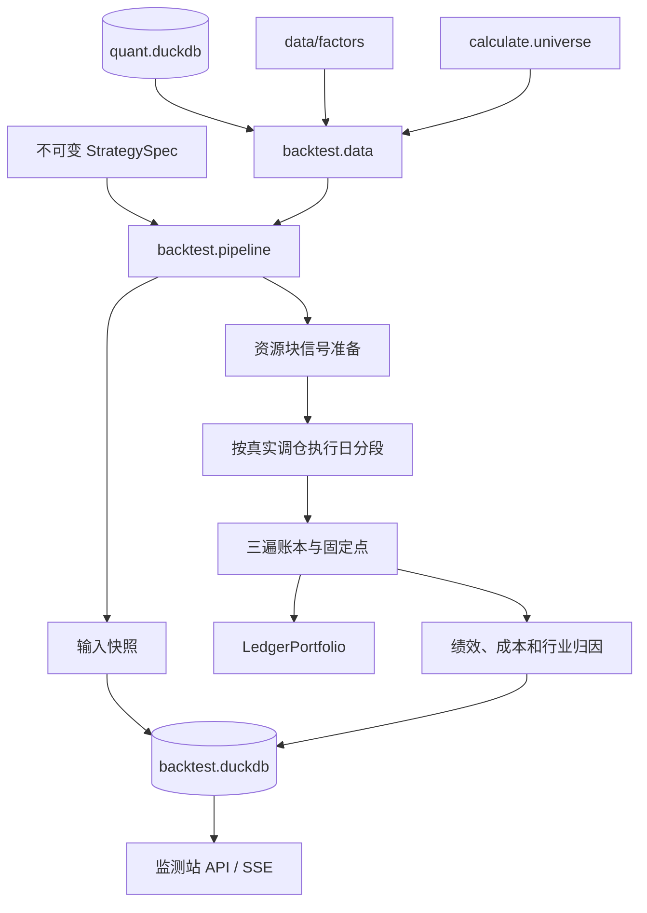

# 回测

阅读目标：理解当前回测如何把策略版本、行情、因子和股票池转换成逐日目标权重，
再按 A 股交易规则、成本和公司行动记成真实现金、持股与绩效；同时分清哪些结果
可以由当前实现回答，哪些仍是研究近似或已知缺口。

一句话职责：回测层负责“信号日目标 → 执行日订单 → 成交与公司行动记账 →
逐日净值和归因”，不负责训练模型、发现因子或构造样本外预测。

## 1. 职责边界与在全链路中的位置



回测的输入是已经落库的行情、因子、指数成分、行业和公司行动，以及一个不可变的
`StrategySpec`。输出是一次运行的日结果、成交、税务批次、逐日持仓、拒单、目标权重、
资金分配、公司行动、行业暴露、指标和输入快照。

回测层不生成因子，不重新判断财务字段可用日，也不替模型证明样本外有效性。模型或
分位评估给出的是分数或研究代理；只有回测层处理真实价格、资金、申报单位、停牌、
涨跌停、成本、公司行动和组合会计。

核心源码位于 [trading/backtest](../../trading/backtest)。已有的专题文档更细，本指南
负责把它们组织成一条可阅读的实现链：

- [回测模块说明](../trading/backtest/README.md)
- [策略规格](../trading/backtest/strategy_spec.md)
- [数据与落库契约](../trading/backtest/data_contract.md)
- [执行账本边界](../trading/backtest/vectorbt_adapter.md)
- [公司行动](../trading/backtest/corporate_action_ledger.md)
- [接口与流事件](../trading/backtest/api.md)
- [绩效与归因](../trading/backtest/reports.md)
- [模块完整性评估](../trading/backtest/completeness.md)

## 2. 当前快照与硬约束

以下为 2026-10-26 对当前工作区只读核对的结果。它们是诊断快照，不是永久常量。

| 项目 | 当前值 |
|---|---|
| 起始提交 | `5eb833b` |
| 回测包测试 | 收集 351 个用例 |
| 后端回测接口测试 | 23 个用例 |
| 调度与原生锁测试 | 11 个用例 |
| 可见 provider | 3 个：`ml_rank` v3、`momentum_timing` v1、`momentum_trailing_stop` v1 |
| 回测结果表 | `daily`、`position`、`order`、`rejection`、`target_weight`、`holding`、`allocation`、`liquidation`、`corporate_action`、`industry_exposure` |
| 当前回测库 | 15 个策略定义、23 个策略版本、90 次运行、7 份输入快照 |
| 输入快照 schema | `backtest_input_snapshot_v5` |
| 数据快照 schema | `backtest_data_snapshot_v3` |

资源与收敛上限定义在 [config.py](../../trading/backtest/config.py)：

| 常量 | 当前值 | 含义 |
|---|---:|---|
| `MAX_TRADE_DAYS` | 2700 | 单次区间最多约十年交易日 |
| `MAX_PANEL_CELLS` | 8,000,000 | 单个已加载面板的硬上限 |
| `CHUNK_CELL_BUDGET` | 1,500,000 | 资源块目标规模 |
| `MAX_CHUNKS` | 16 | 资源块数上限 |
| `MAX_ALLOCATION_ITERATIONS` | 24 | 单个调仓执行段的资金分配固定点上限 |
| `MAX_PROVIDER_STATE_PASSES` | 20 | 读取持仓状态的 provider 外层固定点上限 |

需要区分两条入口：

- `pipeline.iter_run()` / `run()` 在预估面板超过 800 万格时会先规划资源块再执行。
- 直接调用 `load_market_data()` 是单块取数入口，超过 800 万格会抛 `BT-401`，
  不会自动分块。

## 3. 公共接口与数据结构

### 3.1 策略规格

[specs.py](../../trading/backtest/specs.py) 定义稳定、可序列化的策略版本。策略配置
变化会改变 `config_hash`，历史运行必须继续绑定原始版本。

| 结构 | 关键字段 | 默认值或规则 |
|---|---|---|
| `StrategySpec` | `name`、`version`、`universe`、`signal`、`portfolio`、`rebalance`、`execution`、`costs`、`benchmark`、`risk` | 策略名非空、版本正整数；股票池为 `all_a` 或 `index:<代码>` |
| `SignalSpec` | `factors`、`weights`、`winsorize`、`standardize`、`provider` | 默认 `MOM_20`、权重 `1.0`、截面标准化开启 |
| `PortfolioSpec` | `selection`、`top_n`、`weighting`、`long_only` | 默认 `top_n=30`、等权、只做多 |
| `RebalanceSpec` | `frequency`、`signal_at`、`execute_at` | 日/周/月默认月频；固定收盘信号、次日开盘执行 |
| `ExecutionSpec` | `lot_size`、`cash_buffer`、拒单开关、T+1、成交额参与率 | 现金缓冲 2%、参与率 10%；`lot_size=100` 仅为旧 JSON 兼容字段 |
| `CostSpec` | 佣金、最低佣金、滑点、冲击、税费和红利税模式 | 策略默认启用平方根冲击；底层 `CostSpec()` 默认关闭冲击 |
| `BenchmarkSpec` | `index_code` | 默认 `H00300.CSI`；可为 `None` |
| `RiskSpec` | 单股、行业、单边换手上限 | 默认全部关闭 |

provider 模式下必须满足：

- `signal.factors` 列出 provider 需要的输入因子，`signal.weights` 为空。
- `portfolio.selection="provider"`。
- `rebalance.frequency="custom"`，真实调仓日由 provider 返回的权重矩阵决定。

### 3.2 运行参数

`BacktestParams` 只表示区间和资金口径：

| 字段 | 默认值 | 校验 |
|---|---:|---|
| `start`、`end` | 必填 | `YYYY-MM-DD`，`start <= end` |
| `init_cash` | 1,000,000 | 正数 |
| `risk_free_rate` | 0.02 | 有限数且在 `[-0.99, 1.0]` |

`RunRequest` 增加策略标识和运行级覆盖：

- `strategy_id`、`version=当前版本`。
- `universe` 可临时覆盖策略股票池。
- `benchmark` 可临时覆盖基准；`clear_benchmark=True` 表示本次关闭基准。
- 运行级覆盖不修改不可变策略版本，实际配置进入输入快照和运行元数据。

### 3.3 Python 与 CLI 入口

| 入口 | 是否落库 | 用途 |
|---|---|---|
| `load_market_data()` | 否 | 直接加载一个内存面板 |
| `run_backtest(data, strategy, params)` | 否 | 对一个已加载面板执行一次账本 |
| `BacktestStore` | 是 | 管理策略版本、输入快照和运行结果 |
| `run(store, request)` | 是 | 跑完整流水线并返回 `done` 摘要 |
| `iter_run(store, request)` | 是 | 按 `meta/load/.../done` 阶段流式产出事件 |
| `python -m backtest` | 是 | 创建/读取策略版本并保存运行 |

CLI 当前参数可用以下命令查看：

```bash
.venv/bin/python -m backtest --help
```

主要参数为 `--strategy mom20|multifactor`、`--strategy-id`、`--version`、
`--start`、`--end`、`--init-cash`、`--risk-free-rate`、`--universe`、
`--benchmark` 和 `--no-benchmark`。

### 3.4 Provider 协议

[providers.py](../../trading/backtest/providers.py) 定义的 `TargetWeightProvider`
只负责把行情、因子和 eligible 矩阵转换成信号日目标权重。

```python
class TargetWeightProvider:
    name: str
    version: str
    description: str
    required_factors: tuple[str, ...]

    def build(self, data, eligible, params, state=None):
        ...
```

`uses_position_state=True` 的 provider 可以读取上一遍最终账本生成的
`ProviderState`。状态包含逐日现金、组合价值、持仓股数、平均成本、估值价、权重、
浮盈、建仓以来最高收盘价、建仓日和最近清仓。provider 不能自行模拟成交或持仓。

运行前会校验：

- provider 名称、版本、描述和 `required_factors`。
- 同名的多个版本可以并存，同一 `(name, version)` 不能绑定不同源码。
- provider 参数必须是有限、可 JSON 序列化的对象。
- `uses_position_state=True` 时 `build` 必须接受 `state`。
- 当前可见 provider 由 `list_providers()` 返回；以下划线开头的模块和
  `hidden=True` 的对象不进入通用页面列表。

provider 返回矩阵必须与行情面板完全同形：

- 整行 `NaN`：当天不调仓，保持原持仓。
- 全 0 行：清仓。
- 有限非负权重：目标权重，单行合计不超过 1，差额为现金。
- 正权重只能出现在 `eligible=True` 的股票上。
- 当前只支持多头；部分 `NaN`、无穷值、负权重或越出股票池均抛 `BT-201`。

### 3.5 MarketData

[data.py](../../trading/backtest/data.py) 的 `MarketData` 是执行层唯一输入面板：

| 字段 | 形状或含义 |
|---|---|
| `open`、`close` | 交易日 × 股票原始价，`float32` |
| `can_buy_close` | 信号日收盘可入池标记 |
| `can_buy_open_next`、`can_sell_open_next` | 第 t 行描述 t+1 日开盘 |
| `is_suspended`、`is_st`、`is_delisting` | 当日状态 |
| `is_limit_up`、`is_limit_down` | 当日涨跌停状态 |
| `total_mv`、`amount_cny` | 原始总市值和成交额 |
| `factors` | 因子名到同形宽表 |
| `list_date`、`delist_date`、`board` | 每股生命周期和板块 |
| `membership` | 指数池逐日成分矩阵或 `None` |
| `industry_l1`、`industry_labels` | 时点申万一级行业编码和标签 |
| `impact_volatility` | 执行日前指定窗口的复权收益波动率 |
| `benchmark`、`benchmark_info` | 严格对齐的基准收盘价与价格/全收益口径 |
| `corporate_actions` | 除权日公司行动长表 |
| `versions` | 行情、因子、行业和公司行动构建摘要 |
| `data_snapshot` | 本次范围级数据内容摘要 |

`MarketData.__post_init__()` 强制所有价格、规则、因子、行业和冲击面板共享完全相同的
日期与股票列；错位直接抛 `BT-201`。缺失板块或未知板块也不能继续执行。

### 3.6 结果与校准

`BacktestResult` 的当前字段：

| 字段 | 含义 |
|---|---|
| `portfolio` | 单块直接执行时的账本对象；分块拼接结果为 `None` |
| `daily` | 净值、收益、回撤、现金、成本和换手 |
| `orders` | 实际成交及费用分项 |
| `positions` | 按税务批次形成的持仓记录，**同时包含 Open 与 Closed** |
| `holdings` | 只含正仓位的逐日逐股市值、权重 |
| `target_weights` | 实际提交的目标权重 |
| `rejections` | 规则拒单事件 |
| `liquidations` | 退市残仓零价值核销 |
| `allocations` | 逐格目标股数、容量与补回明细 |
| `corporate_actions` | 分红、送转、配股、红利税等事件 |
| `industry_exposure` | 逐日行业、现金和未分类暴露 |
| `metrics` | 标准绩效、成本、换手和行业摘要 |
| `metadata` | 策略、快照、版本、执行口径和校准 |
| `final_state` | 分块或状态 provider 使用的收尾状态 |
| `provider_state` | 状态 provider 可读取的逐日执行状态 |

`metadata.calibration` 是运行审计入口，重点字段包括：

- `allocation_iterations`、`allocation_converged`：当前段或所有段的分配迭代/收敛。
- `allocation_segments`、`nonconverged_segments`：因果段数量与未收敛段数。
- `carry_iterations`、`carry_converged`：现金/容量补回目标是否与分配结果自洽。
- `cash_clipped_cells`、`allocation_gap_max_shares`：实际持股与目标股数差额。
- `cash_pending_at_end_cells`、`liquidity_pending_at_end_cells`：区间末来不及补的格数。
- `fee_matrix_max_diff`：按统一成本模型重算的实际费用最大偏差。
- `pending_at_end_cells`：规则拦下且区间末仍未成交的待重试格数。
- `delisting_residual_shares_at_end`：已知退市持仓残留，必须为 0。

收敛标记为 `true` 不等于每个目标权重都完全实现；最小申报单位、制度性现金缓冲和
区间末未补额度仍会形成可解释偏差。

## 4. 一次回测的端到端时序

### 4.1 预检与策略解析

```text
RunRequest
  -> 读取不可变策略版本
  -> 应用 universe / benchmark 运行级覆盖
  -> 校验 provider 名称、版本、因子和参数
  -> 校验日期、初始资金、无风险利率和基准覆盖
  -> 生成数据快照
  -> 生成策略、规则和执行代码快照
  -> 登记输入快照
  -> 创建 status=running 的运行记录
```

股票池和基准覆盖错误会在开始运行前返回 `BT-201`，通常不会留下失败运行。输入快照
登记失败也不会创建运行。运行记录建立后的异常才会进入 `bt.run.error_message`。

### 4.2 数据读取

[data.py](../../trading/backtest/data.py) 按字段逐个读取并透视，而不是把整张长表
一次性转成宽面板：

1. `open`、`close` 使用原始价。
2. 可交易、停牌、ST、涨跌停、退市整理期标记统一转成布尔矩阵。
3. `total_mv`、`amount_cny` 保持原始口径。
4. 指数池先取整个回测区间的成分并集，减少无关股票读取。
5. 因子按策略声明逐个读取并对齐。
6. 加载股票基础信息、板块、上市/退市日、指数成分和行业。
7. 严格对齐基准；任何缺失交易日直接报错。
8. 加载区间内公司行动。
9. 启用平方根冲击时，额外读取执行日前指定窗口的复权收益波动率。

### 4.3 股票池和 eligible

股票池定义复用 [calculate.universe](../../research/evaluation/calculate/universe.py)：

- `all_a`：回测读取层不额外限制股票代码范围；信号层再应用可交易过滤。
- `index:<代码>`：取上一个已结束月份的月末权重快照作为当月成分。
- 指数首月或权重快照缺失时，该月没有成分并记录 WARNING，不会自动放宽池子。

[signals.py](../../trading/backtest/signals.py) 的 `eligible_mask()` 要求：

- 信号日可买入收盘。
- 非停牌、非 ST、非退市整理期。
- 上市满 60 个自然日。
- 北交所股票在 2021-11-15 前不可选。
- 指数池还必须属于当日成分。

“全 A”描述的是代码覆盖范围；真正入选仍受上述可交易性和生命周期过滤。

### 4.4 因子信号

因子线性组合的逐步过程：

```text
逐个因子读取宽表
  -> 可选按日 1% / 99% 分位缩尾
  -> 可选按日截面 z-score
  -> 乘声明的因子权重后求和
  -> 非有限值置 NaN
  -> 在 eligible 且分数有限的股票中排序
  -> 取 Top-N
  -> 等权或按当日总市值归一
```

默认截面标准化使用总体标准差 `ddof=0`；某日截面标准差为 0 时该日分数变成 `NaN`，
不会制造虚假排名。市值权重遇到单只缺失市值时用当日选中股票的有限市值中位数填补；
全部缺失时退回等权并写 WARNING。

调仓日由 `rebalance_mask()` 决定：

- 日频：每个交易日。
- 周频：每周最后交易日。
- 月频：每月最后交易日。
- 自定义：只用于 provider，不按本地周期另算。

信号日目标矩阵中的 `NaN`、`0` 和正数分别表示不调仓、清仓和目标仓位。
`execution_targets()` 将整张目标矩阵平移到下一交易日；规则层的
`can_buy_open_next` / `can_sell_open_next` 也平移一格后使用。

### 4.5 Provider 信号

普通 provider 在每个资源块上收到该块的 `MarketData`、eligible 和参数，返回信号日
目标。分块准备阶段会保存各块目标，随后按整段真实调仓执行日切段。

状态 provider 的完整链路是：

```text
第一轮 state=None
  -> 完整账本
  -> ProviderState
  -> 用新状态重算全部目标
  -> 再完整账本
  -> 直到目标矩阵逐位不变或达到 20 轮
```

该外层固定点由 [pipeline.py](../../trading/backtest/pipeline.py) 的
`_stateful_runner()` 执行。未收敛会抛 `BT-301`，不会保存半自洽结果。注意：
直接调用 `run_backtest()` 不会自动执行这 20 轮状态反馈；需要状态 provider 的固定点
时应使用 `run()` / `iter_run()`。

### 4.6 风险约束

[risk.py](../../trading/backtest/risk.py) 有两类约束，发生在不同时点。

单股权重和行业权重上限作用于信号日目标：

- 先截断超限权重，再在同一日原有正权重股票中按比例重新分配剩余容量。
- 单股和行业上限可以同时启用，按剩余容量联合分配。
- 容量不足的部分保留为现金，不擅自扩充股票池。
- 启用行业上限但目标股票缺少时点行业时直接抛 `BT-301`，不用静态行业兜底。

单边换手上限在执行日、资金分配之前应用。当前口径包含现金：

```text
当前股票权重 = 开盘前持仓 × 执行价 / 开盘时组合价值
计划换手 = 0.5 × (Σ|目标股票权重 - 当前股票权重| + |目标现金 - 当前现金|)
```

超过上限时，从当前组合向目标组合整体缩放。换手缩放后可能让行业权重再次超过目标
上限，这部分由 `industry_inherited_over_cap_*` 单独披露，不能伪装成仍然满足行业门禁。

## 5. 三遍账本与资金分配

现役执行路径不调用 VectorBT 计算现金和持股。Engine 仍保留 `targetpercent`、
`targetamount` 等历史命名，是为了维持内部和测试接口兼容；权威账本是
[ledger.py](../../trading/backtest/ledger.py) 的 `LedgerPortfolio`。

### 5.1 第一遍：探针

探针使用未经过规则过滤的目标权重，按目标百分比下单且不计费用。它主要用于得到成交
方向和成交额兜底数据，同时仍携带整段退市核销候选以保持账本会计一致。

探针不是最终结果，也不能作为资金分配预算，因为零费用会系统性高估组合价值。

### 5.2 第二遍：基准

基准遍使用：

- `apply_rules()` 过滤后的目标。
- 同一套停牌、涨跌停、退市和待重试状态机。
- 完整成本模型。
- 目标权重乘以 `1 - cash_buffer`。

它输出逐日收盘现金、持股，以及每日开盘前现金和公司行动后的持股。开盘预算是后续
目标股数分配的来源：

```text
执行日预算 = 开盘前现金 + Σ(公司行动后的开盘持股 × 执行价)
可用目标市值 = 执行日预算 × (1 - cash_buffer)
```

执行价优先取开盘价；停牌或开盘价缺失时，估值价沿用最后有效收盘价。可用目标市值
再按单格目标权重转成股数。

### 5.3 第三遍：目标股数与最终账本

[allocation.py](../../trading/backtest/allocation.py) 把目标权重变成板块合法的目
标股数，然后由账本按目标股数成交：

1. 空仓目标向下取整到合法最小买入单位。
2. 已有持仓只有在差额跨过合法申报单位时才调整；零股清仓单独允许。
3. 默认先按 `amount_cny × max_participation_rate` 限制单票持仓变化。
4. 容量限制后的实际卖出净所得再用于同日买入；没卖掉的仓位不能为买单虚增现金。
5. 买单占用“成交金额 + 佣金、印花税、过户费、滑点、冲击、FIFO 红利税预留”。
6. 现金不足时先等比缩小，再按非线性最低佣金和板块单位逐档回退。
7. 取整余量可把最小订单金额较小的目标补到合法最小买入量。
8. 最小订单仍装不下时记 `unaffordable`，不会丢格或超配。

容量限制的业务含义是：卖出受限时，同日可用于买入的现金也受限。当前实现不会为了
维持目标权重而透支现金或融资。

### 5.4 固定点

目标股数依赖真实开盘现金与持股，而真实开盘状态又来自上一遍最终账本，因此分配和
补回目标需要迭代：

```text
真实开盘预算
  -> 目标股数
  -> 最终账本
  -> 真实成交和新增补回事件
  -> 再分配
```

单个调仓执行段最多 24 轮。稳定条件关注目标股数、补回目标和有效目标是否重复，
并要求最终成交没有被现金裁剪。若达到上限或发现重复状态仍未稳定，当前实现使用最后
一次结果继续生成报告，同时在 metadata 中保留 `allocation_converged=false` 和
未收敛段数。调用方不应把该运行当作已通过严格执行验收。

区间末仍有买单因现金或流动性不足而没有补齐，是业务状态，不单独阻止固定点收敛；
应查看 `cash_pending_at_end_cells` 与 `liquidity_pending_at_end_cells`。

## 6. 交易规则、公司行动和成本

### 6.1 申报单位与规则拒单

[trading_rules.py](../../trading/backtest/trading_rules.py) 统一所有板块规则：

| 板块 | 最小买入 | 买入递增 | 最小卖出 | 卖出递增 |
|---|---:|---:|---:|---:|
| 主板 | 100 | 100 | 100 | 100 |
| 创业板 | 100 | 100 | 100 | 100 |
| 科创板 | 200 | 1 | 200 | 1 |
| 北交所 | 100 | 1 | 100 | 1 |

清仓时可以一次卖出全部实际余额，包括公司行动形成的零股。资金分配、现金缩放和账本
成交都调用同一套规则，不能各自另写取整逻辑。

[orders.py](../../trading/backtest/orders.py) 维护持仓状态机：

- 空仓且目标为正：买入意图。
- 有仓且目标为 0，或新目标明显低于旧目标：卖出意图。
- 同一正目标再次出现：方向未知的再平衡，买卖任一侧受限就跳过该格。
- 停牌、缺执行价、不可买、不可卖：拦下并保留待重试目标。
- 后续每个交易日继续尝试，直到成交或被下一次真实调仓目标覆盖。

拒单只记录事件首日；后续失败累计到重试统计，避免同一事件每天重复写一条拒单。
`reject_suspended=False` 只是不记录停牌拒单，订单仍顺延，规则状态不会伪造已成交。

### 6.2 T+1 与退市

当前策略结构固定为“收盘信号、下一交易日开盘执行”，同一天不会对同一股票先买后卖，
因此 [t1.py](../../trading/backtest/t1.py) 的订单层守卫在现有日频路径中通常不触发。
守卫仍明确限制卖出量不超过执行日开盘前持股；统计字段应保持为 0。

退市处理规则：

- 退市整理期股票不进入信号池，也不允许新买。
- 已持仓从首个可卖日开始每日强制退出。
- 退出仍遵守停牌和跌停限制，不能绕过现实不可成交状态。
- 到退市日仍有残仓时，账本按零价值核销，不产生现金、费用或红利税。
- 整理期强制退出成交的 `forced_exit=True`，零价值核销另落 `bt.liquidation`。

当前退市处理不区分破产、主动退市、现金要约、换股合并和转板原因。除未建模事件外，
零价值核销是保守近似；遇到换股合并或跨市场转板时可能把本应转换的持仓记成 -100%，
这是会影响净值的已知缺口。

### 6.3 每个交易日的账本顺序

[ledger.py](../../trading/backtest/ledger.py) 的日循环按以下顺序：

1. 把到账日不晚于当天的应收现金分红转为现金。
2. 对除权日事件按事件发生前的持股确认税前分红应收。
3. 按 `share_multiplier` 调整持股和税务批次，零头按执行价折现。
4. 按事件发生前持股和配股比例计算可配股数，只在现有现金内认购。
5. 再次处理当日到账分红。
6. 本日开盘订单先卖后买。
7. 买入形成新的 FIFO 税务批次；卖出按 FIFO 结算递延红利税。
8. 执行退市残仓零价值核销。
9. 按收盘价估值；停牌沿用最后有效收盘价。

配股不融资，也不强制卖出其他股票筹钱，因此现金不足会减少实际认购。除权日若停牌且
需要为零头定价，会退回当日全市场开盘价中位数作为近似。

`record_date` 当前只作为输入字段保存，账本没有按登记日重建持股；分红应收以除权日前
账本持股为基础。`pay_date` 缺失时退回除权日。

### 6.4 成本模型

[costs.py](../../trading/backtest/costs.py) 同时服务资金分配估算和账本成交：

| 成本 | 当前口径 |
|---|---|
| 佣金 | 成交金额 × 配置费率，按笔最低 5 元 |
| 印花税 | 按成交日历史分段；当前卖出 0.05%，买入 0 |
| 过户费 | 沪深北按成交日、市场、成交金额或面额分段 |
| 滑点 | 固定比例，买入抬高成交价、卖出压低成交价 |
| 冲击 | 默认 `min(0.5 × 20日波动率 × sqrt(成交额/当日成交额), 5%)` |
| 红利税 | 卖出时按卖出日政策和 FIFO 批次持有期结算 |

佣金、印花税和过户费逐笔按分四舍五入。成交价计算顺序是：

```text
参考价 = 原始开盘价
冲击率 = min(coefficient × volatility × sqrt(participation), max_rate)
成交价 = 参考价 × (1 + 方向 × (slippage + impact_rate))
```

需要区分：

- `Fees`：佣金、印花税、过户费等现金费用。
- `daily.cost`：`Fees + 已结算红利税`。
- `daily.slippage_cost`、`daily.impact_cost`：已进入成交价的经济成本。
- `daily.total_cost`：`cost + slippage_cost + impact_cost`。

滑点和冲击不能再次从现金中扣除，否则会重复计费。每日 `total_cost` 在固定点迭代前
也不能简单当作上一轮现金差距；真实现金以账本为准。

## 7. 分块、状态与取消

### 7.1 资源块与因果求解段

当前流水线区分两种切分：

1. **资源块**：控制取数和信号准备内存，目标约 150 万格；只在大面板超过上限时产生。
2. **因果求解段**：从整段目标矩阵中，按真实调仓执行日切成一段一段，段与段之间
   交接权威账本状态。

小面板也通过 `run_windows()` 走因果分段路径，因此资源和求解边界不是同一概念。
单块和分块的一致性验证比较日结果、订单、持仓、目标权重、拒单、核销、分配明细、
指标和校准字段。

### 7.2 预热行与跨段状态

除第一段外，每段带前一交易日作为预热行。预热行只提供价格、信号平移和规则口径，
不下单、不改变状态、不进入最终结果。

跨段交接包括：

- 现金和真实持股。
- 收盘估值价与执行价。
- FIFO 税务批次、应收分红和高水位。
- 规则状态机的 held、shadow、pending。
- 尚未完成的现金/流动性补回目标。

调仓日掩码、退市核销候选和指数成分口径按整段区间先算好，再交给各段，避免块尾
落在周中或退市日恰好落在边界时改变结果。

### 7.3 取消边界

`iter_run()` 在以下位置检查取消：

- 创建运行并准备进入计算前。
- 主线程等待工作线程事件期间。
- 每个资源块准备前。
- 每个调仓执行段开始前。

账本内部的单次日循环和当前段固定点没有强制抢占式中断；收到取消后通常在当前阶段
结束或下一段边界退出。直接关闭事件生成器会把运行标为 `cancelled`；如果工作线程
稍后报错，已终态不会被覆盖。

监测站默认只给回测 1 个运行名额、2 个等待名额，并与因子评估共用一个原生计算锁。
容量满时 API 在预检前返回 429；锁等待和阶段事件属于监测站生命周期，详见
[监测站指南](09-monitor-web.md)与[回测接口专题](../trading/backtest/api.md)。

## 8. 输入快照、持久化与复现

### 8.1 输入快照

[snapshot.py](../../trading/backtest/snapshot.py) 不复制原始数据，而是对本次实际使用
的精确行集和执行规则生成内容摘要：

- 行情、交易日历、股票基础表、指数成分。
- 实际读取的每个因子及其定义摘要。
- 公司行动、行业、基准和冲击波动率。
- 完整策略 JSON 与 `strategy_hash`。
- 板块规则、订单规则、成本模型与完整历史费率表。
- 退市模型、公司行动模型和配股政策。
- provider 名称、版本、参数、完整源码、源码哈希和外部产物摘要。
- 14 个核心执行源文件的逐文件 SHA-256 和集合摘要。

`snapshot_id` 只对 `schema_version + scope + components` 做规范化 JSON 哈希；
`created_at` 和构建清单时间不参与。区间外数据刷新不改变快照；区间内数据、策略规则、
provider 源码或执行代码变化会改变快照。

快照证明“当时用了什么摘要”，不能从快照单独重建已修订的原始数据。旧 snapshot
schema 读取原 JSON，不重算或用新数据回填。

### 8.2 策略与运行记录

`BacktestStore` 管理两个 schema：

- `strategy.definition`、`strategy.version`：策略定义和不可变配置。
- `bt.run`、`bt.input_snapshot`、`bt.provider_revision` 与结果表：运行、快照和产物。

内置策略由 `ensure_builtins()` 幂等写入。代码中的内置定义没有变化时保持当前版本；
定义变化时追加新版本，历史版本仍可读取。因此不能把源码里 `StrategySpec.version=1`
直接理解成数据库中的 `current_version` 一定为 1。

运行创建时状态直接写为 `running`，没有单独持久化的 `pending` 记录。流程建成后，
成功只由 `finish_run()` 写入：

- 先校验运行仍为 `running`。
- 校验启动快照和结果快照一致。
- 在同一个 DuckDB 事务中写十张结果表、完整 metadata、`snapshot_id`、成功状态和结束时间。

任一结果表写入失败会回滚本次事务，随后流水线调用 `fail_run()` 标记失败。失败和取消
只更新仍未进入终态的运行；迟到的清理不会覆盖 `success/failed/cancelled`。

直接调用 `run_backtest()` 只返回内存结果，不写 `backtest.duckdb`；需要策略版本、
运行状态和结果表时使用 `run()` / `iter_run()`。

### 8.3 查询与删除

运行详情返回 metadata、指标和 `snapshot_id`。`get_metrics()` 会按已落库日结果重新
计算标准收益风险指标，再从 metadata 补回成本、换手和行业归因，兼容旧运行。

删除已结束运行会清理 `bt.run` 和全部结果行，没有回收站；`running` 不能删除，
缺失运行返回 `BT-601`，运行中删除返回 `BT-602`。

## 9. 绩效与归因

### 9.1 日结果

账本每日：

```text
组合价值 = 收盘现金 + 应收分红 + Σ(持股 × 收盘估值价)
日收益 = 组合价值日变化率
净值 = 组合价值 / 首日组合价值
回撤 = 当前净值 / 历史最高净值 - 1
```

`holdings_value = portfolio_value - cash - dividend_receivable`。停牌股沿用上一有效
收盘价估值，因此停牌本身不会制造价格为零的假跌。

### 9.2 标准指标

[metrics.py](../../trading/backtest/metrics.py) 根据日结果计算：

- 累计、年化收益、年化波动、最大回撤。
- Sharpe、Sortino、Calmar、日胜率和月胜率。
- 双边和单边年化换手。
- 现金成本、总经济成本及其占平均净值 bps。
- 有基准时的 Beta、年化 Alpha、跟踪误差、信息比率和年化超额。

年化使用 `252 / 实际日结果数`，不按自然日。无风险利率只用于指标，现金余额本身
不计息。

### 9.3 成本、换手与行业归因

[attribution.py](../../trading/backtest/attribution.py) 计算：

- 买入/卖出成交额、单边与双边换手。
- 佣金、印花税、过户费、红利税、滑点、冲击的金额及占净值/成交额 bps。
- 买入、卖出和退市强制退出拆分。
- 逐日申万一级行业、现金、未分类暴露。
- 行业平均、最大、期末权重、现金比例和 HHI。

行业暴露使用实际每股持仓和收盘价，不使用目标权重。目标权重合计可以小于 1，
因此现金必须进入行业报告和 HHI。

### 9.4 回测账本 C++ 决策

V125 依据 P3-01 的三轮真实回测证据关闭了回测账本整体 C++ 化。账本相关阶段按
`probe + baseline + orders + allocation + execute` 统计：全 A 三年中位
`11.929s / 52.638s = 22.66%`，低于 `25%` 门槛；中证500 十年为 `45.90%`，但
`allocation` 占 `27.02%`，主要属于 Python 数据分配和组装。两个场景没有稳定证明事件
账本是共同主瓶颈。公司行动包含在账本执行内，当前没有独立叶级计时。

`LedgerPortfolio` 继续是唯一生产实现，实际 C++ 替换模块数保持 14。整体重写需要同时
保留或迁移 FIFO 税务批次、公司行动、应收分红、跨块状态、拒单审计、日志和异常边界，
现有收益证据不足以覆盖构建和维护成本。重新评估前必须让两个固定场景的账本相关阶段都
达到 `25%`，完成模块内纯数组热点剖析，并建立独立逐笔成交、现金、持仓、费用、公司行动
和 NAV 金标准。局部热点应另立窄范围任务，不整体重写账本。证据位于
`AiRecord/benchmarks/V125/p3-03-20261028/`。

## 10. 错误、日志与排障

### 10.1 错误码

[errors.py](../../trading/backtest/errors.py) 当前错误映射：

| 错误码 | 错误类 | 主要触发场景 |
|---|---|---|
| `BT-101` | `SpecError` | 策略、provider、日期、成本或风险配置非法 |
| `BT-201` | `DataAlignmentError` | 面板、因子、股票池、行业、基准或 provider 权重错位 |
| `BT-301` | `ExecutionError` | 资金分配、账本、规则、成本、状态反馈或退市校验失败 |
| `BT-401` | `ResourceLimitError` | 交易日、面板格数、资源块数或块内规模超限 |
| `BT-501` | `RunCancelled` | 调用方在当前安全边界主动取消 |
| `BT-601` | `RunNotFoundError` | 运行或输入快照不存在 |
| `BT-602` | `RunConflictError` | 删除运行中记录、重复完成或非法状态迁移 |
| `BT-701` | `SnapshotConflictError` | 快照身份冲突或同版本 provider 源码变化 |

HTTP 层将 `BT-601` 映射为 404，`BT-602` 映射为 409，其余 `BacktestError` 默认为
400；调度容量耗尽是后端 `MONITOR-102` / 429，不是回测领域错误。

### 10.2 日志

回测日志根目录为：

```text
logs/trading/backtest/<模块名>/
```

模块名中的 `.` 会替换为 `_`，例如 `backtest.engine` 写入
`logs/trading/backtest/backtest_engine/`。

文件名记录该文件首末消息时间，单文件达到 128 MB 前轮转。计算包日志与
`apps/monitor/backend` 日志分开；排查一次页面请求时，应同时查看请求编号对应的
后端日志和最新回测模块日志。

建议排障顺序：

1. 先看 HTTP/SSE 的 `code`、`message` 和 `request_id`。
2. 用 `request_id` 定位后端日志，确认错误发生在预检、调度、回测还是落库。
3. 用 `BT-*` 错误码和运行元数据区分参数、数据对齐、执行、资源、取消与快照冲突。
4. 检查 `snapshot_id`、`metadata.calibration` 和结果表是否完整。
5. 公司行动或退市异常时，优先检查 `bt.corporate_action`、`bt.liquidation` 和
   `bt.order`，再检查日结果。

## 11. 使用示例

### 11.1 直接调用 Python

以下示例只跑一个内存面板，不写正式运行库。区间和股票池应根据当前数据覆盖选择：

```python
from backtest import (
    BacktestParams,
    StrategySpec,
    load_market_data,
    run_backtest,
)

start, end = "2026-08-03", "2026-10-15"
data = load_market_data(
    start,
    end,
    ["MOM_20"],
    universe="index:000300.SH",
    benchmark_code="H00300.CSI",
)
result = run_backtest(
    data,
    StrategySpec(universe="index:000300.SH"),
    BacktestParams(start, end),
)

print(result.metrics["total_return"])
print(result.metadata["calibration"]["allocation_converged"])
```

这个入口适合合成面板和短区间诊断；它不会自动保存运行，也不会为状态 provider 执行
20 轮外层反馈。

### 11.2 走完整落库流水线

```python
from backtest import BacktestStore, RunRequest
from backtest.pipeline import run

store = BacktestStore()
store.ensure_builtins()
summary = run(
    store,
    RunRequest(
        strategy_id="builtin-mom20-top30",
        start="2026-08-03",
        end="2026-10-15",
    ),
)
print(summary["run_id"])
```

该路径会创建运行、保存快照和十张结果表。

### 11.3 CLI

```bash
.venv/bin/python -m backtest \
  --strategy mom20 --start 2026-08-03 --end 2026-10-15

.venv/bin/python -m backtest \
  --strategy-id builtin-multifactor-top30 --version 5 \
  --start 2026-08-03 --end 2026-10-15 \
  --universe index:000905.SH --benchmark H00905.CSI
```

`--strategy` 是内置别名，`--strategy-id` 可以运行任意已保存策略并覆盖别名。
实际版本可用 `BacktestStore.get_version()` 或页面策略列表确认。

### 11.4 Web 页面

监测站提供：

```text
#/backtest
#/backtest/new
#/backtest/{run_id}
#/backtest/compare?run_ids=id1,id2
```

页面可创建策略版本、运行/取消、查看结果表并比较 2～4 次成功运行。路由、SSE、
调度容量和前端状态管理由阶段 09 详细说明。

## 12. 量化知识与研究边界

- 回测回答“在给定数据、信号和成交假设下组合如何变化”，不自动回答策略是否未来有效。
- 原始价加公司行动账本用于保留真实股数；后复权价用于因子和标签，不能直接当成成交价。
- 收盘信号次日开盘执行减少同一根 K 线内的未来信息，但开盘价加固定滑点仍是日频近似。
- 停牌、涨跌停和缺执行价不是零成交收益；被拦下的仓位会留在组合并影响后续风险。
- 容量、滑点和冲击相互关联。只降低换手或只加成本，都不能代表真实市场冲击。
- 佣金按笔最低收费会让小订单的单位成本明显上升；现金缓冲和最小申报单位共同造成
  目标偏差。
- 分红、送转、配股和红利税影响现金流、股数与税务批次；用复权价格隐式处理会丢失
  这些会计信息。
- 退市整理期不买、能卖则退出、卖不掉才零价值核销，是保守执行假设，不是对所有退市
  原因的经济还原。
- 指数池使用上月月末快照降低成分前视，但快照断档、权重修订和指数文件延迟仍会留下
  数据风险。
- 回测库保留退市股票历史行，降低幸存者偏差；股票池是否真正覆盖某日仍需按生命周期
  和成分检查。
- 现金不计息会低估长期高现金策略的收益；无风险利率进入 Sharpe 等指标不等于现金生息。
- 多次看同一段样本后调整策略会引入数据窥探；回测通过不证明样本外独立验证通过。
- 分位净值、研究模拟器和完整账本回答不同问题；只有完整账本能处理资金、成交和税费。

## 13. 已知限制与常见误读

- `VectorBT` 是锁定依赖和历史接口来源；现役现金、持股、税费和公司行动由
  `LedgerPortfolio` 负责。
- 分块结果的 `portfolio=None` 是拼接结果的正常表现，不表示没有账本或没有成交。
- `positions` 不是逐日持仓表；逐日持仓看 `holding`，日内/最终持仓状态看 `ProviderState`。
- `allocation_converged=false` 仍可能有指标，但该次运行不能声称满足严格执行自洽。
- `cash_pending_at_end_cells>0` 可以是收敛后的期末业务缺口，不是数据库失败。
- 区间末待重试的停牌/跌停仓位保留在组合中；不能用零成交或强制清仓假设替代。
- 当前不模拟并购重组、换股吸收合并和北交所转板映射；撞仓时退市残仓会被零价值核销。
- 当前不模拟盘中集合竞价队列、盘口深度、部分成交、撤单、融资融券、做空、
  ETF/可转债、现金利息、Brinson 或因子归因。
- 指数权重快照缺失的月份按空池运行并记录 WARNING；长区间指数池应检查日志。
- 红股当前只调整持股和成本，未把红股面值计入红利税应税基础；交易所规费没有单列。
- 行业上限是目标权重约束；换手缩放后可能再次超限，必须读取继承超限统计。
- 一次回测结果不自动带有样本外属性；模型和参数选择仍然决定结果是否存在选择偏差。

## 14. 测试映射

回测包当前收集 351 个测试。文档变更不运行长区间真实回测，优先验证受影响主题：

| 主题 | 测试文件 |
|---|---|
| 参数、哈希和历史兼容 | [test_specs.py](../../trading/backtest/tests/test_specs.py) |
| 数据、原始价、基准和版本 | [test_data.py](../../trading/backtest/tests/test_data.py) |
| 股票池和资源检查 | [test_universe.py](../../trading/backtest/tests/test_universe.py)、[test_coverage.py](../../trading/backtest/tests/test_coverage.py) |
| 调仓、eligible、Top-N 和市值权重 | [test_signals.py](../../trading/backtest/tests/test_signals.py) |
| provider 注册、参数、源码和产物 | [test_providers.py](../../trading/backtest/tests/test_providers.py)、[test_provider_state.py](../../trading/backtest/tests/test_provider_state.py) |
| 规则状态机、待重试和退市退出 | [test_orders.py](../../trading/backtest/tests/test_orders.py) |
| 板块申报单位 | [test_trading_rules.py](../../trading/backtest/tests/test_trading_rules.py) |
| 目标股数、容量、现金和补回 | [test_allocation.py](../../trading/backtest/tests/test_allocation.py) |
| 三遍账本和固定点 | [test_engine.py](../../trading/backtest/tests/test_engine.py) |
| 原始价成交、公司行动和税费 | [test_ledger.py](../../trading/backtest/tests/test_ledger.py)、[test_costs.py](../../trading/backtest/tests/test_costs.py) |
| 退市黄金账本 | [test_golden_liquidation.py](../../trading/backtest/tests/test_golden_liquidation.py) |
| 分块逐位一致、因果段和取消 | [test_chunked.py](../../trading/backtest/tests/test_chunked.py) |
| 指标、成本和行业归因 | [test_metrics.py](../../trading/backtest/tests/test_metrics.py)、[test_attribution.py](../../trading/backtest/tests/test_attribution.py) |
| 快照与不可变存储 | [test_snapshot.py](../../trading/backtest/tests/test_snapshot.py)、[test_store.py](../../trading/backtest/tests/test_store.py) |
| 日志轮转 | [test_logging_conf.py](../../trading/backtest/tests/test_logging_conf.py) |
| HTTP、SSE、容量和取消 | [test_backtest_api.py](../../apps/monitor/backend/tests/test_backtest_api.py)、[test_native_concurrency.py](../../apps/monitor/backend/tests/test_native_concurrency.py) |
| 审计、剖析和行动数据 | [test_backtest_audit.py](../../tests/test_backtest_audit.py)、[test_backtest_profile.py](../../tests/test_backtest_profile.py)、[test_corporate_actions.py](../../tests/test_corporate_actions.py) |

推荐短验证：

```bash
.venv/bin/python -m pytest \
  trading/backtest/tests/test_specs.py \
  trading/backtest/tests/test_data.py \
  trading/backtest/tests/test_signals.py \
  trading/backtest/tests/test_orders.py \
  trading/backtest/tests/test_allocation.py \
  trading/backtest/tests/test_engine.py \
  trading/backtest/tests/test_ledger.py \
  trading/backtest/tests/test_chunked.py \
  trading/backtest/tests/test_snapshot.py \
  trading/backtest/tests/test_store.py \
  --deselect=trading/backtest/tests/test_chunked.py::test_chunked_matches_single_block_on_real_data \
  -q

.venv/bin/python -m pytest \
  apps/monitor/backend/tests/test_backtest_api.py \
  apps/monitor/backend/tests/test_native_concurrency.py -q
```

如果改动触及长区间真实数据，再单独选择相应真实数据用例；文档核对不把全量真实回测
当作前置条件。

## 15. 修改检查清单

1. 策略字段、默认值或序列化变化时，检查历史 JSON 兼容、`config_hash` 和策略新版本。
2. 信号时点、调仓周期、eligible 或股票池变化时，检查未来数据、指数成分和分块一致性。
3. 修改申报单位、现金缓冲、参与率或资金分配时，同时核对目标股数、拒单、补回和账本。
4. 修改成交价或成本时，保持分配估算与账本使用同一 `CostSpec`，避免重复扣费。
5. 修改 T+1、停牌、涨跌停、退市或退市整理期规则时，覆盖状态机重试和跨段交接。
6. 修改公司行动时，同时核对税务批次、应收分红、零头、配股现金和退市核销。
7. 修改分块或固定点时，运行单块/分块逐位一致性、因果段、取消和末日期限测试。
8. 修改执行模块、规则表或 provider 源码时，确认 `snapshot_id` 随之变化。
9. 修改运行状态、结果表或事务时，检查并发完成、失败回滚和迟到清理。
10. 修改错误码、日志目录或 HTTP 映射时，同步 API、页面、测试和排障文档。
11. 任何会改变过去结果的修正都必须创建新策略/运行版本，不覆盖历史运行。
12. 更新文档时重新核对命令、路径、表名、默认值、错误码、测试数量和相对链接。
