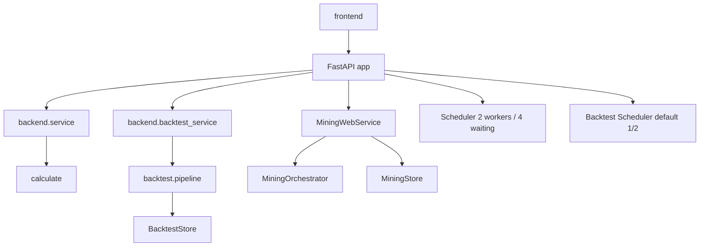

# 监测站与 Web 应用

监测站把因子评估、自动挖掘和回测统一到一个本地 FastAPI 服务中。后端负责参数校验、
任务调度、SSE 和结果读取；前端是无 Node 构建步骤的原生 HTML/JavaScript 页面。

源码位于 [apps/monitor](../../apps/monitor)。

## 1. 技术栈

| 技术 | 用途 |
|---|---|
| FastAPI / Starlette | HTTP 路由、生命周期、异常映射和静态文件 |
| Uvicorn | 本地 ASGI 服务 |
| `StreamingResponse` | 因子、回测和挖掘事件流 |
| 线程池 / Queue | 原生计算和长任务的阶段调度 |
| 原生 JavaScript | hash 路由、表单、页面渲染 |
| ECharts | 因子图、净值图、暴露和相关性热力图 |
| pytest / httpx | API、SSE、并发和前端联合测试 |

前端依赖只有仓库内 `vendor/echarts.min.js`，不需要 npm 安装。

## 2. 提供功能

### 2.1 因子监测

| 页面 | 功能 |
|---|---|
| `#/factors` | 已落盘因子搜索、方向、公式和平均覆盖率 |
| `#/factor/<name>` | 单因子参数选择、完整分析或轻量 IC |
| `#/compare` | 2～4 个因子共用参数顺序对比 |

使用 `calculate` 的指标注册表；页面不再重算指标。

### 2.2 自动挖掘

| 页面 | 功能 |
|---|---|
| `#/mining` | 运行列表 |
| `#/mining/new` | 研究假设和预算 |
| `#/mining/<run_id>` | 状态、预算、候选和事件时间线 |
| `#/mining/<run_id>/candidate/<candidate_id>` | 候选定义、证据、图表、审批和发布 |

详细流程见 [自动因子挖掘](05-factor-mining.md) 和
[Agent 编排](06-agent-orchestration.md)。

### 2.3 回测

| 页面 | 功能 |
|---|---|
| `#/backtest` | 策略运行列表和批量选择 |
| `#/backtest/new` | 创建因子 Top-N 或 provider 策略 |
| `#/backtest/<run_id>` | 绩效、净值、回撤、成本、行业、成交和持仓 |
| `#/backtest/compare` | 2～4 次成功运行共同区间对比 |

### 2.4 统一 API

后端提供三类接口：

- `/api/options`、`/api/factors*`、`/api/evaluate/stream`、`/api/compare/stream`。
- `/api/strategies*`、`/api/providers/validate`、`/api/backtests*`。
- `/api/mining/*`。

完整字段和 SSE 语义见 [API 文档](../apps/monitor/api.md)。

## 3. 使用方法

### 3.1 启动

```bash
bash tools/monitor/serve.sh
```

默认监听：

```text
http://127.0.0.1:8800
```

`MONITOR_PORT` 可修改端口，`MONITOR_PYTHON` 可指定解释器。服务固定只监听 localhost，
使用单 worker 运行，因为调度器和共享原生计算锁都在进程内。

完整挖掘还需要：

```bash
export MINING_WORKER_URL=http://127.0.0.1:8790
docker compose --env-file .env -f compose.mining.yaml up -d --build
bash tools/monitor/serve.sh
```

### 3.2 启动预检

[apps/monitor/backend/preflight.py](../../apps/monitor/backend/preflight.py) 检查：

- 主行情库。
- 因子目录库。
- ECharts 静态文件。
- 因子选项接口。
- 至少一个已落盘因子。

只缺可选依赖时会在启动阶段给出明确路径，不会自动取数或建库。

### 3.3 请求示例

```bash
curl --fail 'http://127.0.0.1:8800/api/options'
curl --fail 'http://127.0.0.1:8800/api/factors'
curl -N 'http://127.0.0.1:8800/api/evaluate/stream?factor=MOM_20&mode=ic'
```

## 4. 后端内部结构



### 4.1 `app.py`

[apps/monitor/backend/app.py](../../apps/monitor/backend/app.py) 负责：

- `create_app()` 和 FastAPI lifespan。
- 启动/关闭调度器、挖掘服务和数据库连接。
- 注册异常处理器，把领域异常映射为统一 JSON。
- 注册因子、策略、回测和挖掘路由。
- 将前端目录挂载到 `/`。

异常响应统一为：

```json
{
  "code": "MONITOR-xxx",
  "message": "用户可读说明",
  "request_id": "..."
}
```

### 4.2 `service.py`

因子评估适配层：

- `options()` 返回可选股票池、周期、指标声明和资源上限。
- `factor_list()` 交叉核对目录库和实际 Parquet。
- `prepare()` 解析查询参数，判断完整分析或轻量 IC。
- `run()` 逐个因子消费计算阶段并转换成 SSE payload。

### 4.3 `scheduler.py`

`Scheduler` 默认两执行线程、四等待名额，总容量为六：

- `reserve()` 在预检前占位，防止预检后越过容量。
- `Job.events` 队列最多缓冲两条，形成背压。
- `Job.cancel()` 对排队任务立即取消，对运行任务在当前阶段边界退出。
- `native_section()` 串行保护 DuckDB/NumPy 等原生操作。
- 等待原生锁期间可立即取消；事件发送和网络等待不持锁。

### 4.4 `backtest_service.py`

负责：

- 策略创建和 provider 参数校验。
- 回测选项、运行列表、详情和结果表读取。
- 2～4 个运行共同区间对比。
- 把 pipeline 的阶段转换成 SSE。
- 删除已结束运行。

回测调度器默认 `1` 个 worker、`2` 个等待名额。单次回测资源较大，如需并发必须显式设置
`BACKTEST_WORKERS`，并先确认内存。

### 4.5 `mining_routes.py` 和 `mining_service.py`

`mining_routes` 只做 HTTP 和错误映射；`MiningWebService` 做：

- 默认预算合并。
- 运行列表和详情视图。
- 事件分页与可续传 SSE。
- 审批资格和决定。
- 取消、恢复和中断处理。
- 正式发布批次。

服务只调用编排器和存储公开方法，不直接写候选表。

## 5. SSE 数据流

### 5.1 因子评估

```text
GET /api/evaluate/stream
  -> Scheduler.reserve
  -> service.prepare
  -> Scheduler.start
  -> service.run generator
  -> events Queue
  -> StreamingResponse
```

事件顺序：

```text
queued
status
meta
<calc stages>
done / error
```

状态变化时会插入 `status`，包含排队、等待原生锁、运行和取消耗时。长时间无事件时发送
注释心跳。收到 `done` 或 `error` 后连接关闭，页面不得自动重连因子流。

### 5.2 回测

回测流阶段包括：

- `queued`、`status`、`meta`。
- `load`、`signals`、`probe`、`baseline`、`allocation`。
- provider 状态反馈和分块进度。
- `done` 或错误。

断开 SSE 会在当前阶段边界取消回测。已完成的运行仍可通过普通 API 查询。

### 5.3 挖掘

挖掘事件先写入 `mining.event`，再通过 SSE 推送：

```text
GET /api/mining/runs/{run_id}/stream?after=<sequence>
```

每条事件有递增 `sequence` 和 SSE `id`。网络中断后页面从最后的序号重连，不会重复展示。
断开事件流不会取消运行，取消必须调用显式接口。

## 6. 前端内部结构

| 文件 | 责任 |
|---|---|
| `app.js` | hash 路由、因子页、回测页、事件消费 |
| `charts.js` | ECharts 封装、指标专用渲染和通用表格 |
| `mining.js` | 挖掘列表、新建、运行和审批流程 |
| `mining_api.js` | 挖掘请求、格式化、状态标签 |
| `mining_candidate.js` | 候选定义、四阶段证据、审批 UI |
| `stream.js` | SSE 解析 |
| `index.html` | 应用壳 |
| `style.css` | 桌面与移动端布局 |

### 6.1 `renderMetric()`

[apps/monitor/frontend/charts.js](../../apps/monitor/frontend/charts.js) 的
`renderMetric(container, key, data)` 按指标 key 分支：

- 覆盖率、IC 汇总和增量 IC：表格。
- 时序类：折线。
- 分布类：直方图或箱线图。
- 暴露：柱状图和时序。
- 相关性：热力图。
- 未知 key：通用 JSON 表格/折叠展示。

后端增加一个未识别指标时页面仍能显示数据，但专用图形需要增加渲染分支。

### 6.2 路由

前端使用 `location.hash`，无服务器路由：

- `#/factors`
- `#/factor/<name>`
- `#/compare`
- `#/mining*`
- `#/backtest*`

路由切换时中止上一个请求、释放图表实例，避免 SSE 和 ECharts 累积。

## 7. 日志与错误

Web 日志写入 `logs/apps/monitor/`，每个模块使用时间戳文件并支持 128 MB 轮转。

| 错误码 | 含义 |
|---|---|
| `MONITOR-101` | 通用参数错误 |
| `MONITOR-102` | 任务容量已满 |
| `MONITOR-103` | 依赖数据缺失或服务关闭 |
| `MONITOR-104` | 内部失败 |
| `MONITOR-105` | 请求断连或已取消 |
| `EVAL-*` | 因子评估错误 |
| `BT-*` | 回测错误 |
| `MINING-*` | 挖掘错误 |

所有可预期异常都返回请求编号。用户应先在对应模块日志中按 request ID 或 run ID 检索。

## 8. 资源与并发

- 因子完整分析受 2400 交易日和约 800 万行保护。
- 两个计算请求可以同时在线，但原生计算阶段互斥。
- 双完整分析耗时近似串行叠加；资源峰值高于单任务但不翻倍。
- 回测默认串行，因为单次执行可能占用数 GB 内存。
- 挖掘由独立 Worker 和单槽编排器限制。
- 慢 SSE 消费者触发背压，不占用原生计算锁。

## 9. 修改注意事项

1. 添加 API 必须经过 service 层，不应从路由直接写数据库。
2. 新增 SSE stage 时同步后端、前端、挖掘候选复用和测试。
3. 请求参数、错误码和 JSON 字段要保持向后兼容，页面和脚本都消费它们。
4. 不得把大 DataFrame 或非有限数直接放入事件；使用 `json_safe()`。
5. 页面不得重算指标或回测绩效，保证与后端唯一口径。
6. 新增前台资源时不能引入网络 CDN，当前本地部署需要离线可用。
7. 原生计算锁只保护服务入口；不要绕过 scheduler 并发调用底层计算包。
8. 修改移动端布局时至少验证 390px 视口、无横向溢出和交互按钮可达。

