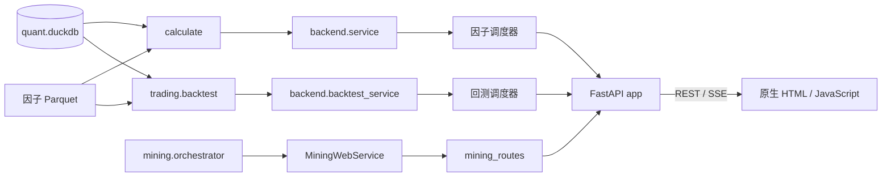

# 监测站与 Web 应用

监测站把因子评估、自动挖掘和回测放到同一个本地 FastAPI 服务中。它负责参数预检、
任务排队、SSE 事件传输、结果展示和少量操作入口；因子公式、评估指标、挖掘状态机和
回测账本仍由各自业务包负责。

源码入口位于 [apps/monitor](../../apps/monitor)。运行和维护说明见
[监测站使用说明](../apps/monitor/README.md)、[API 专题](../apps/monitor/api.md)和
[性能记录](../apps/monitor/performance.md)。

## 1. 阅读目标与职责边界

读完本篇应当能回答：

1. 浏览器请求怎样经过 FastAPI、预检、调度器和业务包，再以 SSE 事件返回。
2. 因子评估、回测和挖掘在断连、取消、容量耗尽和服务关闭时分别发生什么。
3. 前端为什么能逐阶段渲染，同时保证切换路由后旧请求不会覆盖新页面。
4. 页面上的结果从哪里读取，哪些操作会产生持久化副作用。
5. 出错时怎样用错误码和请求编号定位到正确的日志。

监测站解决的是应用集成与交互问题，不重新实现业务算法。具体边界如下。

| 层级 | 监测站负责 | 监测站不负责 |
|---|---|---|
| 因子评估 | 参数校验、容量预留、SSE 适配、指标展示 | 因子 SQL、面板构造和指标公式 |
| 自动挖掘 | 表单、运行视图、事件回放、审批和发布入口 | DSL、门禁、Worker 和状态机 |
| 回测 | 策略/运行接口、调度、进度和结果页面 | 信号、成交规则、账本和绩效公式 |
| 前端 | hash 路由、表单、状态回收和图表 | 重新计算 IC、收益、成本或统计检验 |

全链路位置如下：



关键事实以当前工作区为准，不以历史页面截图或旧性能记录为准。

## 2. 当前运行快照

2026-10-26 的只读预检结果如下。

| 项目 | 当前值 |
|---|---|
| 可评估因子 | 47 个，由因子目录库与实际 Parquet 交叉确认 |
| 行情日期范围 | 2000-01-04～2026-10-15 |
| 因子评估指标 | 13 个注册指标，12 个业务 stage |
| 因子调度 | 2 个运行线程、4 个等待名额，总容量 6 |
| 完整因子分析上限 | 2400 个交易日、800 万估计面板行 |
| 回测上限 | 2700 个交易日、800 万格、最多 16 个资源块 |
| 回测分块预算 | 每块约 150 万格 |
| 回测调度 | 默认 1 个运行、2 个等待 |
| 前端 | 原生 HTML/JavaScript 和仓库内 ECharts，无 Node 构建步骤 |
| 服务监听 | `127.0.0.1`，默认端口 8800，必须单 worker |

因子数量会随构建和 `mined` 发布变化。浏览器验收不能把当前数量当作永久契约；
若脚本把数量写死，必须单独更新。

## 3. 启动、预检与生命周期

### 3.1 启动命令

```bash
bash tools/monitor/serve.sh
```

[serve.sh](../../tools/monitor/serve.sh) 先切换仓库根目录，设置仓库根和
`apps/monitor` 的导入路径，再执行预检，最后以 `--workers 1` 启动 Uvicorn。

| 环境变量 | 默认值 | 作用 |
|---|---|---|
| `MONITOR_PYTHON` | `.venv/bin/python` | 指定服务使用的 Python |
| `MONITOR_PORT` | `8800` | 修改本地端口 |
| `BACKTEST_WORKERS` | `1` | 修改回测运行线程数 |
| `BACKTEST_WAITING` | `2` | 修改回测等待名额 |
| `MINING_WORKER_URL` | 未设置 | 指定挖掘 Worker 基础地址 |

服务不能开启多个 Uvicorn worker。因子调度器和回测调度器都是进程内对象，原生计算锁
也在进程内；多进程会得到多份容量和锁，无法实现当前并发保护。

### 3.2 启动预检

[preflight.py](../../apps/monitor/backend/preflight.py) 在 Uvicorn 启动前执行：

- 导入 FastAPI 和 Uvicorn，确认 Web 依赖存在。
- 检查主行情库、因子目录库、首页和仓库内 ECharts 文件存在。
- 调用 `service.options()`，确认可以读取交易日历和指标声明。
- 调用 `service.factor_list()`，确认至少有一个实际可评估因子。
- 打印因子数量、行情日期范围和调度容量。

预检只读取本地产物，不会下载数据、建库或重建因子。缺少文件或没有可评估因子时，
脚本以非零状态退出，不会先启动一个半可用服务。

### 3.3 FastAPI lifespan

[app.py](../../apps/monitor/backend/app.py) 的 `create_app()` 生成独立应用实例。
测试可以注入自定义 `mining_service`，生产入口使用默认实例。

启动顺序：

1. 取得或创建 `MiningWebService`。
2. 创建因子 `Scheduler()`，默认运行 2、等待 4。
3. 创建回测 `Scheduler()`，运行和等待数量从环境变量读取。
4. 在线程中初始化挖掘服务：把遗留活动运行标记为中断、清理临时目录、恢复发布所需状态。
5. 初始化完成后开始接受请求。

如果挖掘初始化失败，应用会关闭两个调度器和挖掘服务后再抛出错误，不会继续提供服务。
正常关闭时先关闭两个调度器，再关闭挖掘编排器和发布服务。关闭期间的请求得到
`MONITOR-103`；运行中的任务请求在安全边界取消并等待线程退出。

监测站最后把前端目录挂载到 `/`。因此 `/api/*` 使用 FastAPI 路由，其余静态资源由
同一服务托管，不需要单独的前端服务器或网络 CDN。

## 4. 公共 REST 接口

所有 JSON 由 `json_safe()` 处理，不能直接传输 DataFrame、NumPy 标量、NaN 或无穷值。
历史接口不增加版本前缀，修改字段时需要考虑页面和本地脚本的兼容性。

### 4.1 因子评估接口

实现位于 [service.py](../../apps/monitor/backend/service.py)。

| 接口 | 输入或输出 |
|---|---|
| `GET /api/options` | 行情起止、默认评估参数、股票池、周期、指标、stage 和资源上限 |
| `GET /api/factors` | 已实现且实际有 Parquet 的因子元数据 |
| `GET /api/factors/{name}` | 单因子定义；不存在或未落盘返回 404 |
| `GET /api/evaluate/stream` | 单因子 SSE，必须提供 `factor` |
| `GET /api/compare/stream` | 2～4 个不同因子的顺序对比 SSE，必须提供逗号分隔的 `factors` |

因子流公共参数：

| 参数 | 说明 |
|---|---|
| `start`、`end` | `YYYY-MM-DD`；省略时使用该因子的默认最近三年 |
| `universe` | 默认 `all_a`，也可选择已发布指数池 |
| `horizon` | 1、3、5、10、15、20 日 |
| `price` | `close` 或 `open` |
| `quantiles` | 5、10 或 20 组 |
| `winsorize` | `true` 或 `false` |
| `mode` | `full` 或 `ic` |
| `stages` | 逗号分隔的目标 stage；省略时按服务端注册顺序执行 |
| `metric_options` | 指标 key 到参数对象的 JSON |

重复查询键、未知键、未知股票池、非法 JSON、非法 stage 和超过资源上限都会在开流前
返回 JSON 错误。完整模式受交易日和面板行数限制；轻量 IC 只执行
`overview/ic_series/ic_dist`，支持更长区间。

`factor_list()` 先读取已落盘因子集合，再从 `quant.load_factor_list()` 筛出
`status='implemented'` 的行。只有元数据和 Parquet 同时存在才能进入列表和评估；
这避免页面展示只在目录库里存在、但实际无法读取的因子。

`prepare()` 完成所有同步预检，返回不可变 `RequestSpec`。随后 `service.run()` 逐个因子
创建计算生成器。对比请求中的因子按用户顺序执行，不会并行计算；每个因子的有效样本
可能不同。

### 4.2 回测接口

实现位于 [backtest_service.py](../../apps/monitor/backend/backtest_service.py)。

| 接口 | 行为 |
|---|---|
| `GET /api/backtest/options` | 策略、provider、股票池、基准、因子、成本默认值和资源上限 |
| `POST /api/strategies` | 创建不可变策略第一版 |
| `GET /api/strategies` | 确保内置策略存在，再列出全部策略摘要 |
| `GET /api/strategies/{id}` | 读取指定策略版本 |
| `POST /api/providers/validate` | 校验目标权重 provider 参数和必需因子 |
| `GET /api/backtests` | 最近运行列表，`limit` 默认 50 |
| `POST /api/backtests` | 同步运行；仍经过容量、预检、调度器和共享原生锁 |
| `GET /api/backtests/stream` | 流式运行并逐阶段推送 |
| `GET /api/backtests/compare` | 对比 2～4 次成功运行的共同交易日 |
| `DELETE /api/backtests/{run_id}` | 删除已结束运行；运行中返回 409 |
| `GET /api/backtests/{run_id}` | 运行状态、参数和元数据 |
| `GET /api/backtests/{run_id}/metrics` | 已落库绩效指标 |
| `GET /api/backtests/{run_id}/holding` | 逐日持仓 |
| `GET /api/backtests/{run_id}/{table}` | 其他标准结果表 |

动态结果表并不是任意 SQL 表。`BacktestStore` 只接受以下白名单：

`daily`、`position`、`order`、`rejection`、`target_weight`、`holding`、
`liquidation`、`allocation`、`corporate_action`、`industry_exposure`。

回测运行请求至少需要 `strategy_id`，还可提供 `version`、`start`、`end`、`init_cash`、
`risk_free_rate`、`universe` 和 `benchmark`。显式传入空 `benchmark` 表示无基准，
与不传字段不同。同步入口返回最终 `done` payload 并带 `X-Request-ID`；浏览器页面
使用 SSE 入口，便于展示长任务的阶段和取消等待。

运行对比只接受成功运行。服务先取各自日结果的共同交易日，再把每段净值归一为起点 1，
累计超额归一为起点 0；共同交易日少于 2 天时拒绝。

### 4.3 挖掘接口

HTTP 路由位于 [mining_routes.py](../../apps/monitor/backend/mining_routes.py)，业务适配
位于 [mining_service.py](../../apps/monitor/backend/mining_service.py)。

| 接口 | 行为 |
|---|---|
| `GET /api/mining/options` | 默认预算、硬限制、冻结窗口、审核人和 Worker 配置状态 |
| `GET/POST /api/mining/runs` | 列出运行；创建并后台执行研究假设 |
| `GET /api/mining/runs/{run_id}` | 运行、冻结上下文、预算进度和候选摘要 |
| `GET /api/mining/runs/{run_id}/events` | 按 `after` 读取持久化事件，`limit` 最大 1000 |
| `GET /api/mining/runs/{run_id}/stream` | 从 `after` 回放并持续推送 SSE |
| `POST /api/mining/runs/{run_id}/cancel` | 在安全阶段边界取消 |
| `POST /api/mining/runs/{run_id}/resume` | 仅恢复允许恢复的中断运行 |
| `GET /api/mining/runs/{run_id}/candidates/{candidate_id}` | 候选定义、四阶段证据和资格 |
| `POST /api/mining/runs/{run_id}/candidates/{candidate_id}/decision` | 记录批准或拒绝 |
| `POST /api/mining/runs/{run_id}/publication-batches` | 受理整批构建发布，返回 202 |
| `GET /api/mining/runs/{run_id}/publication-batches` | 列出发布批次 |
| `GET /api/mining/runs/{run_id}/publication-batches/{batch_id}` | 读取发布进度和产物哈希 |

创建运行必须带 `hypothesis` 和页面生成的 `idempotency_key`。`constraints` 可只覆盖
部分默认预算，服务端合并、校验并冻结。相同幂等键和相同请求返回原运行，内容不同返回
`MINING-105`。股票池、标签和价格通道由冻结上下文决定，页面不能临时修改。

审批请求必须同时提交当前 `candidate_content_hash` 和 `evidence_hash`。任一哈希变化返回
`MINING-108`；数据、目录或正式因子快照变化返回 `MINING-120`。批准只写入候选库，
正式构建和发布是后续独立动作。

发布接口要求提交本运行全部已批准候选和当前 `expected_context_hash`。后台先全量构建和
独立校验，再原子更新正式 `mined` 因子族。漏选、批次冲突或快照失效返回 `MINING-121`，
全量校验失败返回 `MINING-122`，提交、回滚或恢复失败返回 `MINING-123`。

挖掘状态机、证据组织和发布事务的完整说明见
[自动因子挖掘](05-factor-mining.md)和[Agent 编排](06-agent-orchestration.md)。

## 5. 因子评估执行路径

一次单因子请求的真实顺序如下：

```text
browser GET /api/evaluate/stream
  -> request_id = random UUID
  -> Scheduler.reserve()
  -> Job status=preflight
  -> service.prepare(query)
  -> 参数、因子、股票池、交易日、标签和资源上限预检
  -> Scheduler.start(job, service.run(spec))
  -> worker thread waits for shared native lock
  -> service.run creates calculate.evaluate(...)
  -> each next(iterator) executes inside native lock
  -> Queue(maxsize=2) buffers SSE payload
  -> StreamingResponse consumes queue
  -> queued / status / meta / stages / factor_done / done
```

关键点：

- 容量名额在预检前预留。预检失败、浏览器提前断开或启动失败都会丢弃预留，不会留下名额。
- `queued` 和预检后的 `status` 在业务计算开始前就能返回，用户能看到排队状态。
- 完整分析与轻量 IC 使用同一调度器和 SSE 外壳，但底层计算路径不同。
- 单因子 `done` 在服务适配层改成 `factor_done`，请求最后只发送一次总 `done`。
- 对比请求一个接一个计算；每个因子结束时发送自己的 `factor_done`，再开始下一个。
- `elapsed_ms` 是当前 stage 的耗时；轻量 `factor_done` 另带 `ic_load_elapsed_ms`。
- `meta` 在完整模式中表示面板已经建好，在轻量模式中表示参数和指标声明已经确定。

完整面板、指标公式、股票池和轻量 IC 一致性由
[因子评估](03-factor-evaluation.md)与[评估指标](04-factor-evaluation-metrics.md)说明。

## 6. 回测执行路径

同步和流式入口共用请求预检、回测服务、调度器和原生锁。

同步 `POST /api/backtests`：

1. 预留回测任务名额，标记 `preflight`。
2. 读取策略版本、合并运行参数，校验股票池、基准覆盖和 provider。
3. 启动后台事件生成器。
4. 在调用线程排空事件，只返回最终 `done`。
5. 错误向上抛出并转换为 HTTP JSON；成功响应带 `X-Request-ID`。

流式 `GET /api/backtests/stream` 则把业务事件直接发送给浏览器。当前可见阶段包括：

```text
queued
status
meta
load
signals
chunk
probe
orders
baseline
allocation
provider_state（仅状态型 provider）
execute
done / error
```

`chunk.phase` 可表示准备、调仓段求解、探针、基准、资金分配等子阶段。并非每次运行都会
出现全部阶段，例如不启用状态型 provider 时没有 `provider_state`。

浏览器断开回测 SSE 时，`BackgroundTask` 和流生成器会标记取消。取消在回测阶段或调仓
执行段边界生效，不能强行终止已经在原生代码中运行的 DuckDB/NumPy 调用。已完成的回测
运行保存在独立回测库，之后仍可读取。

回测业务规则、三遍账本、成本和公司行动见[回测](08-backtest.md)。

## 7. 挖掘请求与事件路径

挖掘服务与因子/回测调度器不同。它没有把每次运行放进 Web 调度线程，而是调用编排器：

- `create_run(..., background=True)` 启动后台运行。
- 浏览器读取普通详情接口获得状态、预算进度和候选摘要。
- 业务事件先写入候选库，再由事件接口和 SSE 按序号读取。
- 事件 SSE 每 0.5 秒轮询一次持久化事件，每 10 秒至少发送一次心跳。
- 运行进入 `review_ready/completed/interrupted/failed/cancelled/stale` 等终态时发送
  `done`。
- 浏览器断开 SSE 不取消运行；取消必须显式调用 `/cancel`。

事件结构至少包含 `sequence`、`stage`、`event_type`、`payload` 和 `created_at`。
SSE 的 `id` 等于序号。浏览器以最后一个序号作为 `after` 重连，按序号去重，因此网络
抖动不会把已有事件重复插入页面。

服务启动时只把遗留活动运行标为 `interrupted`，不会自动恢复。用户必须在页面上显式触发
恢复；不能恢复的状态由编排器拒绝并返回 `MINING-113`。

候选页只有在以下条件同时满足时才展示审批表单：

- 候选状态为 `review_ready`。
- 技术门禁通过。
- 已有通过的模块测试段报告，且候选属于唯一测试段领取批次。
- 当前数据、目录和正式因子快照没有变化。
- 尚无最终人工审批。

正式发布页只在候选已批准且没有其他活动发布批次时开放。页面会在后台发布期间刷新批次，
断网或关闭页面不会自动取消发布。

## 8. 调度、背压与取消

[scheduler.py](../../apps/monitor/backend/scheduler.py) 管理一个请求从排队到资源释放的
全部状态。

### 8.1 容量与状态

`Scheduler(workers, waiting)` 的总容量是两者之和。默认因子调度器是
`workers=2, waiting=4`，回测调度器是 `workers=1, waiting=2`。

任务状态包括：

`queued`、`preflight`、`running`、`waiting_native`、`cancelling`、
`success`、`failed`、`cancelled`。

状态快照包含请求编号、业务 stage、运行编号、状态版本、排队耗时、原生锁等待耗时、
运行耗时和取消等待耗时。SSE 只在 `version` 变化时发送新的 `status`。

容量满时，请求在进入预检前直接返回 429 和 `MONITOR-102`。服务关闭后新请求返回 503
和 `MONITOR-103`。

### 8.2 事件背压

`Job.events` 是 `Queue(maxsize=2)`。计算线程调用 `Job.send()` 时若队列满，会在短暂超时
后重试，直到消费者取走事件或任务被取消。这样慢客户端只会拖慢自己的任务，不会让事件
无限堆积占满内存。

事件放进队列和网络发送都在原生计算锁外。慢 SSE 消费者不会阻塞其他请求获取原生锁。

### 8.3 原生计算锁

因子完整分析、轻量 IC、回测和部分数据读取都可能进入 DuckDB/NumPy 等原生代码。
`calculate.native.native_section()` 提供进程级共享锁：

- 因子与回测调度器虽相互独立，但在原生计算阶段互斥。
- 生成器创建、每次推进、JSON 安全转换和生成器关闭都在受保护范围内。
- 等待锁时状态变为 `waiting_native`，等待期间可以立即取消。
- 事件交付、网络等待和慢消费者背压不持锁。
- 服务关闭可唤醒等待锁的任务，避免关闭被无限阻塞。

这个锁只保护经过后端的入口。直接并行调用 `calculate` 或回测底层函数不受保护。

### 8.4 取消和断连

| 场景 | 实际行为 |
|---|---|
| 排队中的因子/回测任务取消 | Future 尚未开始，可立即结束并释放容量 |
| 正在等待原生锁 | 设置取消标记并立即退出等待，不创建或推进计算 |
| 正在计算的阶段 | 当前阶段完成后，在下一次检查标记时退出 |
| 浏览器取消因子/回测流 | 前端 `AbortController` 断开连接，后台标记取消 |
| SSE 客户端意外断开 | 请求断开检测触发取消；终态已经发送时不再重复取消 |
| 挖掘 SSE 断开 | 不取消运行，前端从最后序号重连 |
| 服务关闭 | 两个调度器取消任务并等待线程退出；挖掘编排器等待关闭 |
| 生成器关闭失败 | 任务转为公开错误 `MONITOR-104`，仍释放容量和原生锁 |

取消是合作式的，不是强杀线程。用户看到 `cancelling` 后可能需要等待当前 DuckDB 查询、
指标 stage 或回测调仓段结束。页面应显示“等待安全边界”，不能把按钮点击当成立即停止。

慢消费者、取消和双完整分析的真实压力测试由
[stress.py](../../tools/monitor/stress.py)完成，不用于日常文档核验。

## 9. SSE 协议

因子和回测事件格式：

```text
event: <stage>
data: <单行 JSON>

```

每个 payload 都有 `request_id`，业务 stage 通常还有 `factor`、`stage`、`metrics` 或
运行编号。非有限数值由 `json_safe()` 转为 `null`。响应头包括：

`Content-Type: text/event-stream`、`Cache-Control: no-cache`、
`X-Accel-Buffering: no` 和 `X-Request-ID`。

长阶段每约 10 秒发送：

```text
: heartbeat

```

因子和回测在收到 `done` 或 `error` 后关闭连接。页面不得对这两类流自动重连，否则会
重新提交一次长计算。

挖掘流使用：

```text
id: <sequence>
event: mining
data: <事件 JSON>

```

终止事件是 `event: done`，流内读取异常是 `event: error`。挖掘页允许从最后序号重连。

### 9.1 开流前错误与流内错误

参数、因子不存在、容量、预检和初始化异常发生在返回 `StreamingResponse` 之前，因此
使用普通 HTTP 状态和 JSON：

```json
{
  "code": "MONITOR-101",
  "message": "用户可读说明",
  "request_id": "..."
}
```

已开始 SSE 后，计算线程异常会发送同结构的 `error` 事件并结束流。浏览器应同时处理：

1. 非 2xx 响应的 JSON 错误。
2. 流内 `error` 事件。
3. 用户主动取消产生的 `AbortError`。
4. 未收到终态的意外 EOF。

## 10. 前端结构与状态

前端主入口是 [app.js](../../apps/monitor/frontend/app.js)，使用 `location.hash` 路由，
没有服务端页面渲染和 Node 构建步骤。

| 文件 | 责任 |
|---|---|
| [app.js](../../apps/monitor/frontend/app.js) | 因子和回测页面、hash 路由、表单、共享状态 |
| [stream.js](../../apps/monitor/frontend/stream.js) | 因子/回测单次 SSE 解析，不重连 |
| [charts.js](../../apps/monitor/frontend/charts.js) | 数据表、通用结构、指标图、回测图、ECharts 生命周期 |
| [mining.js](../../apps/monitor/frontend/mining.js) | 挖掘列表、新建、运行详情、可续传事件 |
| [mining_api.js](../../apps/monitor/frontend/mining_api.js) | 挖掘 REST 错误、SSE、序号和状态文案 |
| [mining_candidate.js](../../apps/monitor/frontend/mining_candidate.js) | 候选证据、审批和整批发布 |
| [index.html](../../apps/monitor/frontend/index.html) | 应用壳、导航和固定研究口径说明 |
| [style.css](../../apps/monitor/frontend/style.css) | 桌面、移动端、表格、图表和状态样式 |

### 10.1 路由

支持的主要页面：

| 路由 | 内容 |
|---|---|
| `#/factors` | 因子搜索列表 |
| `#/factor/<name>` | 单因子详情和评估 |
| `#/compare` | 2～4 因子同参数对比 |
| `#/backtest` | 回测运行表单和历史列表 |
| `#/backtest/new` | 创建因子 Top-N 或 provider 策略 |
| `#/backtest/<run_id>` | 运行绩效和明细 |
| `#/backtest/compare?run_ids=...` | 多次成功运行共同区间对比 |
| `#/mining` | 挖掘运行列表 |
| `#/mining/new` | 提交研究假设和预算 |
| `#/mining/<run_id>` | 运行状态、预算和事件轨迹 |
| `#/mining/<run_id>/candidate/<id>` | 候选证据、审批和发布 |

`route()` 每次切换都递增 `routeVersion`，中止上一个 `AbortController`，调用
`disposeCharts()` 和 `disposeMining()`，再重建页面。异步请求返回后若版本已变化，结果
被丢弃，不能覆盖新页面。

### 10.2 共享状态

前端只在当前浏览器内存中保存轻量状态：

- `options`、`factors`：应用启动时读取一次，供因子页面使用。
- `controller`、`routeVersion`：控制当前请求和路由代次。
- `backtestOptions`：首次进入回测页面时读取，创建策略后失效。
- `preferredStrategyId`：新建策略后选中新版本。
- `selectedRuns`：回测列表选择的 2～4 个成功运行，离开或重新加载时淘汰失效项。
- `mining.options`：挖掘页面会话内缓存。
- `mining.activeController`：当前运行详情的事件流。

因子和回测结果不持久化到浏览器存储；切换路由或重新加载即丢弃。挖掘运行、事件、审批和
发布结果已经落库，页面重进后从服务端恢复。

### 10.3 因子表单与渲染

因子详情和对比共用参数表单。前端把行业和相关性 Top-N 转成 `metric_options` JSON：

```json
{
  "exposure": {"industry": "off"},
  "incremental_ic": {"industry": "off"},
  "correlation": {"top_n": 10}
}
```

提交前先按当前指标注册顺序建立结果卡片。每个 stage 到达后只更新对应卡片，不重算指标。
对比模式额外汇总 IC、多空收益和残差 RankIC，但各因子的有效样本可能不同，不能把汇总表
当成同一样本推断。

[charts.js](../../apps/monitor/frontend/charts.js) 的 `renderMetric(container, key, data)`
按指标 key 选择展示：

- 覆盖率、IC 汇总和增量 IC：表格。
- IC 时序、分位曲线、多空和换手：折线。
- IC 分布、分位均值和市值/等权对比：直方图、柱状图或误差线。
- 分位个股分布：箱线图和明细表。
- 风格暴露：系数柱、时序和统计表。
- 相关性：Top-N 表和热力图。
- 未知 key：通用标量表和可展开嵌套结构。

空结果显示服务端提示；样本不足会明确标注，不把空值解释为零 IC 或零收益。页面只消费
后端计算的字段和口径。

### 10.4 回测页面

回测列表页驱动 SSE 并显示当前阶段。完成后刷新历史运行，可进入详情或选择 2～4 个成功
运行比较。详情页并行读取指标、日结果、持仓、成交、拒单、退市处置和行业暴露，再渲染
净值、回撤、超额、换手、成本和执行校准。

新建策略页根据后端 `param_schema` 动态生成 provider 参数。切换 provider 或修改参数后，
之前校验结果失效；创建前必须重新调用 `/api/providers/validate`。策略创建成功后才进入
回测列表，失败时保留表单供修改。

回测删除按钮要求确认，并调用物理删除接口；运行中禁止删除。该操作会删除该运行的账户
结果和明细，页面必须在文案中保持不可恢复提示。

### 10.5 挖掘页面

运行页先读取普通详情和最多 1000 条历史事件，再建立可续传 SSE。断流后指数退避重连，
等待时间最多约 5 秒，并按序号去重。事件载荷只展示已保存的业务阶段与安全摘要，不展示
模型隐藏思维链、原始提示或密钥。

候选页必须同时展示候选内容哈希、审批证据哈希、技术门禁、快速筛选、完整评估和测试段。
批准与拒绝操作前要求确认；按钮禁用只防止重复点击，最终并发冲突仍由服务端哈希校验处理。

## 11. 日志与错误

### 11.1 日志

Web 后端日志由 [logging_conf.py](../../apps/monitor/backend/logging_conf.py) 写入：

```text
logs/apps/monitor/<module_with_underscores>/
```

例如：

- `logs/apps/monitor/backend_app/`
- `logs/apps/monitor/backend_scheduler/`

日志文件名由该段第一条和最后一条消息的微秒时间组成，例如
`20261026120000000000-20261026120500000000.log`。写入下一条会使文件按最后时间改名；
达到 128 MB 后创建下一段。当前没有自动清理旧日志。

因子指标、回测流水线和挖掘编排/Worker 还有各自的模块日志目录。排查时先按
`request_id` 或 `run_id` 找到后端的预检、状态和释放记录，再进入对应业务日志。

### 11.2 HTTP 错误映射

错误转换统一在 [errors.py](../../apps/monitor/backend/errors.py) 完成。

| 异常 | HTTP 状态 | 错误码来源 |
|---|---:|---|
| 通用 `MonitorError` | 使用异常中的 status | `MONITOR-*` |
| 容量耗尽 | 429 | `MONITOR-102` |
| 服务关闭或依赖产物缺失 | 503 | `MONITOR-103` |
| 请求断开/已取消 | 400 | `MONITOR-105` |
| 未分类内部错误 | 500 | `MONITOR-104` |
| 未知因子 | 404 | `EVAL-*` |
| 其他 `CalculateError` | 400 | `EVAL-*` |
| 回测运行不存在 | 404 | `BT-601` |
| 回测状态冲突 | 409 | `BT-602` |
| 其他 `BacktestError` | 400 | `BT-*` |
| `FileNotFoundError` | 503 | `MONITOR-103` |
| `MiningError` | 使用异常中的 status | `MINING-*` |

挖掘错误覆盖 400、404、409、422、429、500、502、503 和 504；具体码表见错误模块和
[自动因子挖掘](05-factor-mining.md)。内部堆栈只写日志，不发送浏览器。

排障顺序：

1. 从页面或响应读取 `code`、`request_id` 和用户消息。
2. 在 `logs/apps/monitor/backend_app/`、`backend_scheduler/` 搜索请求编号。
3. 因子错误进入 compute/指标日志；回测错误进入 backtest 日志；挖掘错误进入 mining
   和 Worker 日志。
4. 状态冲突类错误先核对当前运行状态、快照哈希和候选证据，不要反复重试相同写请求。

## 12. 运维与验收工具

[tools/monitor](../../tools/monitor) 同时包含服务启动、性能、并发、浏览器和审计工具。
它们不是生产依赖，也不都应进入日常测试。

| 工具 | 用途 | 副作用与边界 |
|---|---|---|
| [serve.sh](../../tools/monitor/serve.sh) | 生产式本地启动和预检 | 启动真实服务 |
| [benchmark.py](../../tools/monitor/benchmark.py) | 真实计算的耗时、RSS 和事件量 | 只打印结果，不写正式数据 |
| [stress.py](../../tools/monitor/stress.py) | 双任务、取消和慢消费者验收 | 默认向 `AiRecord/benchmarks/V11` 追加证据 |
| [browser_check.py](../../tools/monitor/browser_check.py) | 因子列表、详情、对比、取消和窄屏 | 需要 Playwright；对真实因子计算 |
| [backtest_check.py](../../tools/monitor/backtest_check.py) | 创建策略、运行短回测、查看详情 | 会向当前回测库写入一次运行 |
| [backtest_profile.py](../../tools/monitor/backtest_profile.py) | 回测阶段耗时和峰值内存 | 临时结果库，默认另写 AiRecord 证据 |
| [backtest_audit.py](../../tools/monitor/backtest_audit.py) | 只读检查回测执行和成本一致性 | 只读回测库，不通过时退出码 1 |
| [mining_check.py](../../tools/monitor/mining_check.py) | 挖掘页面完整浏览器夹具 | Playwright，截图默认写入 `AiRecord/evidence/mining_s7` |

常用只读或低副作用命令：

```bash
PYTHONPATH="$PWD:$PWD/apps/monitor" .venv/bin/python -m backend.preflight
.venv/bin/python -m tools.monitor.backtest_audit --help
.venv/bin/python -m tools.monitor.benchmark --case reject
```

重压和真实浏览器命令必须独立进程、串行执行；不要同时启动多个重型 benchmark 或 stress。
具体性能和并发历史见[性能记录](../apps/monitor/performance.md)。

### 12.1 当前工具偏差

阶段 09 审计只记录，不修改工具：

1. [browser_check.py](../../tools/monitor/browser_check.py) 仍断言因子列表恰为 29 个，
   而当前预检验证的是 47 个。该脚本在当前工作区会先在数量断言处失败。
2. 回测页面当前说明文字仍写“VectorBT 负责组合执行与账本”，但现役现金、持股和公司行动
   由 `LedgerPortfolio` 负责；页面文案过期，不能复制成实现结论。
3. 挖掘浏览器脚本实际默认输出 `AiRecord/evidence/mining_s7`，现有前端 README 写的是
   `mining_s8`。以脚本默认值为准。

## 13. 测试映射

当前 `apps/monitor/backend/tests` 收集 79 个测试。文档核验时全部通过，耗时约 33 秒；
只有 FastAPI TestClient 和 AnyIO 的依赖弃用警告。

| 主题 | 测试文件 | 主要证明 |
|---|---|---|
| 路由、真实轻量 IC、预检错误 | [test_app.py](../../apps/monitor/backend/tests/test_app.py) | 因子/详情接口、事件顺序、开流前 JSON、流内错误、对比 |
| 调度容量和背压 | [test_scheduler.py](../../apps/monitor/backend/tests/test_scheduler.py) | 2+4 容量、慢消费者、取消、生成器关闭 |
| 原生锁与关闭 | [test_native_concurrency.py](../../apps/monitor/backend/tests/test_native_concurrency.py) | 因子/回测互斥、锁等待、预检预留、关闭释放 |
| 并发预检 | [test_preflight_concurrency.py](../../apps/monitor/backend/tests/test_preflight_concurrency.py) | 多进程式重复预检稳定性 |
| 轻量/完整口径 | [test_consistency.py](../../apps/monitor/backend/tests/test_consistency.py) | 轻量 IC 与完整指标一致、缺数据和未知参数 |
| 回测 HTTP/SSE | [test_backtest_api.py](../../apps/monitor/backend/tests/test_backtest_api.py) | 策略/provider、同步和流式调度、结果表、删除、对比 |
| 挖掘 HTTP/SSE | [test_mining_api.py](../../apps/monitor/backend/tests/test_mining_api.py) | 运行、事件续传、启动中断、审批、快照和发布批次 |
| 挖掘错误映射 | [test_mining_errors.py](../../apps/monitor/backend/tests/test_mining_errors.py) | 400～504 的公开状态和请求编号 |
| 日志分段 | [test_logging.py](../../apps/monitor/backend/tests/test_logging.py) | 首末时间文件名和 128 MB 轮转 |

定向测试命令：

```bash
.venv/bin/python -m pytest -q apps/monitor/backend/tests
```

后端测试覆盖接口、调度、并发和持久化适配，但没有前端单元测试。前端联合行为通过
Playwright 浏览器脚本验证；脚本依赖和 Chromium 不在主项目运行依赖中。浏览器脚本未执行
时必须明确写出原因，不能用后端测试替代窄屏、图表和真实按钮交互结论。

## 14. 量化解释与操作风险

### 14.1 页面口径

- 页面只展示后端计算结果。不要在 JavaScript 中另算收益、IC、回归或回测指标。
- 股票池、标签周期、价格通道、区间、去极值和行业开关任一不同，结果就不能直接比较。
- 因子的平均覆盖率、IC、分位收益和多空净值是研究诊断，不包含完整 T+1、停牌、
  涨跌停、融券、费用、滑点和容量。
- 完整回测比研究图表多了成交和会计约束，但仍依赖数据、规则和成交近似，不等同实盘。
- 挖掘候选批准表示人工接受了当前证据，不表示候选已经成为正式因子；正式入库是后续批次。

### 14.2 长任务与资源

- 完整因子分析和回测可能运行数分钟。进度、原生锁等待和取消等待必须可见。
- 两路因子请求可以同时在线，但原生计算阶段互斥；总耗时接近串行叠加，峰值内存高于
  单任务。
- 回测默认串行是资源保护，不是为了限制功能。提高并发前应实测内存和交换区。
- 慢浏览器会让自己的事件队列背压，页面不能无限缓存 DOM 或图表。

### 14.3 操作副作用

- 删除回测会删除该运行及其结果，当前没有撤销入口。
- 拒绝候选是最终人工决定；已有审批不能被页面再次覆盖。
- 发布会在后台全量构建并切换正式 `mined` 因子目录；关闭页面不取消发布。
- 服务不可用或事件断流时，应先查看运行状态和批次状态，再决定重试；不能根据页面最后
  一条事件判断数据库一定未提交。

### 14.4 部署边界

服务固定监听 localhost，且当前接口没有用户认证或授权层。不要直接把端口暴露到公网或
无隔离的反向代理。需要远程访问时，应在外层增加认证、访问控制和 HTTPS，并单独审计删除、
审批和发布接口的权限。

日志不会自动清理，长期运行需要外部归档和容量监控。服务应保持单 worker；若改为多进程
部署，必须先重新设计跨进程容量、原生锁、运行状态和 SSE 事件分发。

## 15. 修改检查清单

修改监测站时至少检查：

1. 新接口是否经过服务层，路由是否只负责 HTTP 和错误转换。
2. 参数是否在开流前完成预检，容量名额是否在预检前预留并在失败时释放。
3. 新 stage 是否同步更新因子、回测、前端和测试；挖掘事件是否保持持久化和序号。
4. SSE payload 是否经过 `json_safe()`，是否包含 `request_id`，终态是否唯一。
5. 断连时是否符合任务类型：因子/回测取消，挖掘仅断开展示。
6. 新错误是否有稳定错误码、实际 HTTP 映射和日志定位信息，是否泄露堆栈。
7. 新前端异步路径是否受 `AbortController` 和 `routeVersion` 保护。
8. 图表、事件流和定时器是否在路由切换时释放。
9. 页面是否只展示服务端口径，是否说明样本不足和结果限制。
10. 新操作是否有确认、状态冲突和并发保护，是否明确持久化副作用。
11. 测试是否覆盖正常路径、失败路径、容量、取消和恢复；浏览器要求是否同步更新。
12. 文档中的环境变量、资源上限、错误码、日志路径、脚本参数和示例是否仍可运行。

若一次修改跨越多篇指南，应分别更新对应模块的责任边界，本篇只保留 Web 集成与交互信息，
避免复制底层算法和形成版本漂移。
