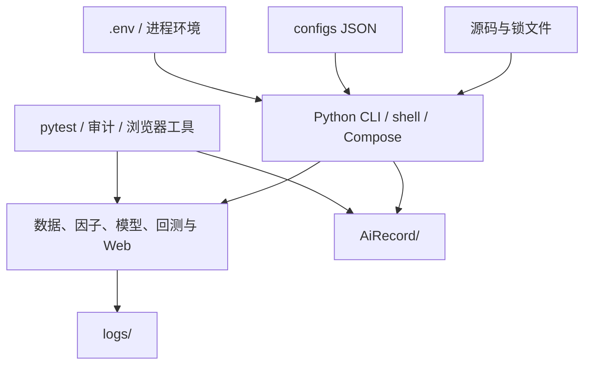

# 工程支撑

本章说明项目如何被安装、配置、测试、运行、排障和留下修改记录。它不重复数据、因子、
模型或回测的业务算法，而回答四个工程问题：

- 一台新机器要具备什么条件，才能运行或核验当前代码；
- 环境变量、JSON 配置和代码默认值发生冲突时，以谁为准；
- 测试、日志、错误码和运维工具分别能证明什么，又会改动什么；
- 一次修改怎样保留可追溯证据，同时不污染正式研究产物。

工程链路能保证“按相同输入重新执行”，不能单独保证研究结论有效。数据时点、样本外证据、
交易约束和统计不确定性仍由对应业务模块负责。

## 1. 职责边界与当前快照

工程支撑负责：

- 固定主项目和 Worker 的 Python/依赖环境。
- 统一路径、配置入口、命令行入口和运行目录。
- 定义测试层级、测试隔离方式和失败后的验证范围。
- 提供按模块分目录、可轮转的日志。
- 按业务域定义错误类、错误码和 Web 响应映射。
- 通过 Docker Compose 隔离 RD-Agent Worker、模型 Key 和作业状态。
- 提供只读审计、真实运行、性能剖析和浏览器验收工具。
- 用 Git 与 `AiRecord/` 记录需求、计划、变更、差异和证据。

工程支撑不负责：

- 判断行情清洗、因子、模型或回测算法在金融意义上是否正确。
- 把测试通过解释成收益有效，或把日志完整解释成数据正确。
- 自动修复历史脚本中的旧路径、旧日期和旧断言。
- 保证外部 Tushare、模型供应商或 Docker 镜像仓库随时可用。
- 把所有实验产物变成 Git 内容；大数据库、日志和证据仍留在本地。

以 2026-10-26 的当前工作区为例：

| 项目 | 当前状态 |
|---|---|
| 主项目 Python | `3.12.3`，`pyproject.toml` 要求 `>=3.12` |
| Worker Python | `3.11`，使用固定 digest 的 Debian slim 镜像 |
| 主依赖 | `requirements.txt` 列出直接依赖，`requirements.lock` 锁定完整环境 |
| Worker 依赖 | `research/mining_worker/requirements.lock` 带包哈希 |
| pytest 收集 | 124 个测试文件，1,134 个用例 |
| 测试根目录 | `tests` 593、评估 111、回测 351、监测后端 79 个用例 |
| 本地数据 | `data/databases/quant.duckdb` 存在，`data/factors` 有 297 个族年文件 |
| 当前环境检查 | `pip check` 无损坏依赖，Compose 配置可通过 `docker compose config` 解析 |

这些数字用于说明当前本地环境，不是代码常量。依赖以两个锁文件为准，测试数量以
`pytest --collect-only` 为准，数据范围以数据库 manifest 和因子目录库为准。

## 2. 工程链路中的位置



主项目在宿主机运行，使用仓库根的 `.venv`。RD-Agent Worker 在独立容器中运行，只通过
回环地址和 Bearer Token 访问。监测站与 Worker 是两个进程；监测站不接收 DeepSeek Key。

## 3. 环境与依赖

### 3.1 从代码到可运行环境

根目录 [README.md](../../README.md) 给出当前安装顺序。可复现的最小步骤是：

```bash
cd /home/hanwen/quant
python3.12 -m venv .venv
.venv/bin/python -m pip install -r requirements.lock
.venv/bin/python -m pip install -e . --no-deps
.venv/bin/pip check
.venv/bin/python -m pytest --collect-only -q
```

[pyproject.toml](../../pyproject.toml) 使用 scikit-build-core 的 setuptools 兼容后端，
保留 setuptools 的物理目录映射，并由 CMake 构建顶层扩展 `quant_native`：

| 物理目录 | 导入包名 |
|---|---|
| `core/common` | `common` |
| `core/data/quant` | `quant` |
| `core/data/scripts` | `scripts` |
| `core/factors` | `factors` |
| `core/kernels` | `kernels` |
| `research/evaluation/calculate` | `calculate` |
| `research/modeling/alpha` | `alpha` |
| `trading/backtest` | `backtest` |
| `apps/monitor/backend` | `backend` |
| `research/mining` | `mining` |
| `research/mining_worker` | `mining_worker` |
| `native` | C++ 扩展 `quant_native` |

这层映射解释了为什么文档中的命令仍使用
`.venv/bin/python -m scripts.build_db.build`，而文件实际位于 `core/data/scripts/`。

`kernels` 是批量数值核的稳定导入入口，当前包含 Python 回退、Numba 研究原型和 C++
Spearman、逐日排名、逐日 Pearson、MAD、z-score、融合标准化、分位分组、多标签分位
收益、分位换手与逐行 Spearman 后端；它不替代 `calculate.native` 的并发锁。相关性、
IC/RankIC、多周期衰减、增量 IC、风格暴露和分位图/换手默认使用 `auto`，扩展可用时
选择 native，不可导入时回退 Python。当前实际 C++ 替换模块数为 9。构建方式和替换状态见
[C++ 批量计算扩展](../native/README.md) 和
[批量计算核](../core/kernels/README.md) 中的台账。

源码构建需要 CMake、Ninja、pybind11 和 scikit-build-core；版本固定在
`requirements.txt` 与 `requirements.lock`。编辑安装会编译
`native/src/*.cpp` 并把扩展放在源码根目录，普通 wheel 则把扩展打包到顶层。

### 3.2 两套依赖锁

主项目：

- [requirements.txt](../../requirements.txt) 是直接依赖，全部使用精确版本。
- [requirements.lock](../../requirements.lock) 是完整环境的精确版本快照。
- [tests/test_dependencies.py](../../tests/test_dependencies.py) 校验直接依赖、锁文件和
  当前安装版本三者一致。
- `requirements.lock` 当前不是带哈希的 `uv` 锁文件，因此固定的是版本，不是包文件内容。

Worker：

- [research/mining_worker/requirements.in](../../research/mining_worker/requirements.in)
  只声明 `rdagent==1.0.0` 和 `Flask==3.1.3`。
- [research/mining_worker/requirements.lock](../../research/mining_worker/requirements.lock)
  由 `uv pip compile --generate-hashes` 生成，Docker 安装时使用 `--require-hashes`。
- Worker 运行时版本还由
  [configs/mining/worker.json](../../configs/mining/worker.json) 校验为 RD-Agent 1.0.0、
  Python 3.11。

主项目与 Worker 的依赖不能混装。特别是 RD-Agent 及模型供应商传递依赖只属于 Worker
镜像，不应加入主项目运行环境的升级范围。

### 3.3 环境和数据的可复现边界

代码环境可复现不代表研究结果一定可复现。当前至少还有以下变量：

- 本地数据库、因子 Parquet 和模型产物不进入 Git，必须通过 manifest、文件哈希和运行
  ID 判断它们是否相同。
- Tushare 中转服务和上游数据可能修订。
- Docker 镜像固定了 digest，但外部模型服务、网络和供应商返回不是确定性的。
- 模型训练的随机种子固定只覆盖代码能控制的随机源，不保证第三方服务逐字节复现。
- 浏览器验收依赖 Playwright、Chromium、本机字体和页面时序，截图不是稳定二进制产物。

因此，复现结论应写成“哪个提交、哪套依赖、哪个数据版本、哪个配置和哪次运行”，不能只
写“在同一项目目录运行成功”。

## 4. 配置体系与优先级

### 4.1 配置文件

当前配置全部是仓库内 JSON，代码运行时读取并校验：

| 文件 | 读取方 | 主要内容 | 影响范围 |
|---|---|---|---|
| `configs/alpha/train_ridge.json` | 模型训练 CLI | Ridge/ElasticNet、预处理和 Top-N | 训练规格与模型身份 |
| `configs/alpha/train_lightgbm_ensemble.json` | 模型训练 CLI | LightGBM 参数和固定五种子 | 训练规格与模型身份 |
| `configs/alpha/train_sklearn_hist_gbdt.json` | 模型训练 CLI | 直方图 GBDT 参数 | 训练规格与模型身份 |
| `configs/alpha/development_evaluation_v85.json` | 模型评估计划 | 候选、参照、经济和风险门 | 评估计划与下游证据 |
| `configs/alpha/holdout_windows.json` | 最终留出入口 | 已用/未来窗口、是否封存 | 可用于留出的日期范围 |
| `configs/alpha/final_holdout_2024_2026.json` | 最终留出入口 | 冻结折、候选和参照 | 特定留出验证 |
| `configs/mining/catalog.json` | 挖掘、DSL、Web | 数据版本、84 个允许字段、34 个算子 | 冻结上下文的字段和算子哈希 |
| `configs/mining/evaluation.json` | 候选门禁与评估 | 前视、覆盖率、相关性和质量阈值 | 候选证据 |
| `configs/mining/orchestrator.json` | 编排和 Web 默认值 | 轮次、候选、LLM 调用和失败率预算 | 新运行的默认约束 |
| `configs/mining/worker.json` | 主服务与 Worker | RD-Agent/Python 版本、模型、超时、批量 | Worker 协议和上下文模型 |

模型训练并非只由 `train_*.json` 决定。当前 `model_id` 还覆盖数据集 ID、数据集版本、
切分、训练规格、模型后端代码摘要；修改训练配置会形成新的模型身份。评估计划、冻结留出
计划和运行 manifest 也各有自己的稳定 ID。

挖掘运行开始时，会把数据指纹、研究窗口、标签/股票池/价格通道、字段目录、算子目录、
已有因子、预算和模型名写入 `FrozenContext`。其中任何一项内容参与
`context_hash`。但“配置已修改”不会自动把所有旧运行和审批改成失效：

1. 已落库的冻结上下文保持原样。
2. 新运行会生成新上下文。
3. 编排、页面审批、候选评估和发布只在各自的快照检查入口拒绝已经漂移的运行。
4. `worker.json` 的模型名会进入新上下文；超时等运行时参数变化不等于历史证据自动失效。

这一边界与阶段 05、06 的详细状态机一致。修改配置后，应新建运行，不应改写旧运行上下文。

### 4.2 环境变量

环境变量按进程读取，不存在一个统一的全局配置对象。

| 进程 | 变量 | 作用与默认 |
|---|---|---|
| 取数 | `TUSHARE_TOKEN` | 必需；缺失时抛错，不静默跳过 |
| 取数 | `TUSHARE_HTTP_URL` | 中转地址；为空时 Tushare 客户端使用其默认地址 |
| 监测站脚本 | `MONITOR_PYTHON` | Python 路径，默认 `.venv/bin/python` |
| 监测站脚本 | `MONITOR_PORT` | 监听端口，默认 `8800` |
| 监测站 | `BACKTEST_WORKERS` / `BACKTEST_WAITING` | 回测执行槽和等待槽，默认 `1` / `2` |
| 监测站 | `MINING_WORKER_URL` | Worker 地址；未配置时挖掘接口报 `MINING-119` |
| 监测站 | `MINING_WORKER_TOKEN_FILE` | Worker Token 路径，默认 `data/mining_worker/token` |
| 监测站 | `MINING_WORKER_TIMEOUT` | 客户端总超时；默认取 Worker 配置 |
| Worker | `FACTOR_DEEPSEEK_API` | 只在 Compose 中读取，再映射为容器内 `DEEPSEEK_API_KEY` |
| Worker | `MINING_WORKER_TOKEN_FILE` | 容器内默认 `/run/secrets/mining_worker_token` |
| Worker | `MINING_WORKER_STATE_DIR` | 容器内默认 `/state` |
| Worker | `MINING_WORKER_LOG_DIR` | 容器内日志根目录 `/logs` |
| Worker | `MINING_WORKER_JOB_TIMEOUT` | 单个生成作业时限，默认取配置 |
| Worker | `CHAT_MODEL` | Worker 模型名，默认取 `worker.json` |

### 4.3 优先级

当前配置优先级必须按调用路径理解：

1. 已经存在的进程环境变量优先。
2. 数据脚本调用 `load_env_file()` 时，读取仓库根 `.env`，只补充当前进程尚未设置的键。
   它不会覆盖已有环境变量。
3. JSON 配置文件提供该模块的默认值或显式规格；具体调用参数可以覆盖页面默认值。
4. 代码常量是最后兜底，例如路径、端口和超时。

两个容易误判的边界：

- `tools/monitor/serve.sh` 不自动 `source .env`。自动挖掘前必须在启动终端显式
  `export MINING_WORKER_URL=...`；Tushare 变量只在取数代码调用 `load_env_file()` 时加载。
- `docker compose --env-file .env` 用 `.env` 做 Compose 插值，但只有 Compose 文件中显式
  列出的变量会进入容器。Key 不会因此进入监测站进程。

## 5. 命令行入口

### 5.1 主链路

工程文档不重复各模块全部参数。需要先确认“脚本是否存在、当前参数是什么、是否有副作用”
时，优先运行：

```bash
.venv/bin/python -m <module> --help
```

典型入口：

| 业务域 | 代表性命令 | 性质 |
|---|---|---|
| 数据 | `python -m scripts.sources.fetch_all status` | 只读状态检查 |
| 数据 | `python -m scripts.clean.pipeline` | 重建清洗产物 |
| 数据 | `python -m scripts.build_db.build` | 删除并重建正式主库 |
| 因子 | `python -m scripts.build_factors.build` | 覆盖因子年度文件 |
| 因子 | `python -m scripts.build_factors.validate` | 写目录库并做自检 |
| 模型 | `python -m scripts.build_alpha.build_dataset` | 写模型数据集 |
| 模型 | `python -m scripts.build_alpha.train` | 训练并登记模型 |
| 模型 | `python -m scripts.build_alpha.predict` | 重放指定模型预测 |
| 回测 | `python -m backtest` | 执行真实账本回测 |
| 监测站 | `bash tools/monitor/serve.sh` | 预检并启动本地 Web |
| Worker | `docker compose ... up -d --build` | 构建并启动 RD-Agent Worker |

`fetch_all` 和清洗入口不是标准 `argparse` 子命令，不能用统一的 `--help` 推断全部动作；
应查阅阶段 01 文档中的动作表。模型和回测命令的必填参数、产物 ID 和输出目录见阶段 07、
08。阶段 10 只负责说明入口属于哪个运行环境和会产生哪类副作用。

### 5.2 最小运行前检查

```bash
.venv/bin/python --version
.venv/bin/pip check
.venv/bin/python -m pytest --collect-only -q
.venv/bin/python -m scripts.sources.fetch_all status
```

启动监测站前，脚本还会执行 [backend.preflight](../../apps/monitor/backend/preflight.py)：

- 检查 FastAPI、Uvicorn 可导入。
- 检查主库、因子目录库、前端首页和 ECharts 本地文件存在。
- 读取可评估因子；没有因子时拒绝启动。
- 只启动一个 Uvicorn worker。

预检不取数、不建库，也不验证全部业务计算。启动成功只说明本地数据和依赖满足入口条件。

## 6. 测试体系

### 6.1 测试根目录

`pyproject.toml` 的 `testpaths` 固定四个根：

| 位置 | 当前用例数 | 主要职责 |
|---|---:|---|
| `tests/` | 656 | 数据、因子、核契约、模型、挖掘契约与跨模块联测 |
| `research/evaluation/calculate/tests/` | 111 | 评估面板、13 指标、一致性和原生计算 |
| `trading/backtest/tests/` | 351 | 信号、订单、账本、成本、快照、提供者和存储 |
| `apps/monitor/backend/tests/` | 79 | API、SSE、调度、取消、并发和错误映射 |

当前没有自定义 pytest marker；按范围执行使用目录或 node ID，不用 `-m real` 等不存在的
标签。收集全部用例：

```bash
.venv/bin/python -m pytest --collect-only -q
```

全量运行：

```bash
.venv/bin/python -m pytest -q
```

项目规则是：全量测试大部分通过、只修改少数失败相关内容后，只复跑相关目录、文件或节点，
不重复全量测试。

### 6.2 测试层级

1. 纯单元测试：参数、公式、状态机和边界，通常只使用 `tmp_path` 或合成 DataFrame。
2. 模块联测：真实数据库只读，产物写入临时目录，例如因子构建后交给评估。
3. 真实数据短区间：验证生产 schema 和接口口径，但限制日期或行数。
4. API/SSE 测试：用 FastAPI `TestClient` 验证协议、调度和错误；它会缓冲响应，不能代替
   真实 HTTP 背压测试。
5. 浏览器验收：独立工具，需要 Playwright/Chromium，不属于 pytest 四个根目录。
6. 性能和资源测试：工具或专门测试，关注耗时和峰值 RSS，不与普通正确性测试混为一谈。

### 6.3 隔离并非全局只读

当前测试的隔离程度因目录而异：

- 监测站根 `conftest.py` 把默认挖掘运行替换为临时 DuckDB 和临时数据目录。
- 评估测试会构造临时因子目录和临时目录库，但读取正式主库。
- 回测接口测试大量使用临时结果库；部分快照测试会复制正式主库到临时目录。
- 因子构建、验证和发布测试通常把 Parquet、目录库和 `mined` 目录写到 `tmp_path`。

同时必须知道以下例外：

- [tests/test_project_layout.py](../../tests/test_project_layout.py) 硬性断言
  `data/databases/quant.duckdb`、因子目录和模型目录存在，不做 skip。缺少本地数据时，
  全量测试不能被视为可在纯代码检出环境直接通过。
- 多个真实库测试在数据库缺失时 `pytest.skip`，跳过不等于对应业务已被验证。
- 模型卡和正式模型测试读取 `data/models` 中的模型、评估、监控和生命周期产物。
- [tests/test_alpha_registry.py](../../tests/test_alpha_registry.py) 的正式模型测试会调用
  `rebuild_registry(MODEL_DATA_DIR)`，写入 `data/models/index.json`。因此完整测试不是
  全部只读。
- [apps/monitor/backend/tests/test_app.py](../../apps/monitor/backend/tests/test_app.py)
  的 `test_routes_and_real_ic` 读取正式因子并执行短区间 IC。

因此：

- 修改文档或无状态工具时，先跑相关轻量测试。
- 修改正式产物构建或登记时，允许在临时目录中做完整校验，再对正式目录做只读核验。
- 需要全量测试前，先备份或确认 `data/models/index.json`、缓存和证据目录可重新生成。
- 不能用“全量测试通过”推导“研究流程没有数据污染”；仍需检查测试是否触碰正式目录。

### 6.4 当前不适合自动化套件的测试

默认不把以下操作放进普通测试：

- 数小时全量取数或完整建库；
- 全历史因子重建、长期训练、最终留出重放；
- 付费模型调用；
- 浏览器压力和移动端截图；
- 大规模真实回测及容量测试。

这些操作应由专门验收工具执行，并写明输入快照、耗时、输出位置和恢复方式。

## 7. 日志体系

### 7.1 路由与目录

共享日志实现位于
[core/common/logging_conf.py](../../core/common/logging_conf.py)。
[core/common/paths.py](../../core/common/paths.py) 的 `log_root_for()` 先决定业务域，
`get_logger()` 再把模块名中的点替换为下划线，作为子目录名。

| 模块前缀 | 日志根 |
|---|---|
| `calculate.*` | `logs/research/evaluation/` |
| `alpha.*`、`scripts.build_alpha.*` | `logs/research/modeling/` |
| `mining.*` | `logs/research/mining/` |
| `scripts.build_factors.*`、`build_factors.*` | `logs/core/factors/` |
| `backtest.*` | `logs/trading/backtest/` |
| `backend.*` | `logs/apps/monitor/` |
| 其他数据脚本 | `logs/core/data/` |

例如 `calculate.panel` 写入 `logs/research/evaluation/calculate_panel/`。

### 7.2 文件名和轮转

`TimestampedFileHandler` 的当前行为：

- 第一次写入才创建文件，没有日志不留空文件。
- 文件名格式为 `YYYYMMDDHHMMSSffffff-YYYYMMDDHHMMSSffffff.log`，前后分别为该段首条
  和最后一条记录的时间。
- 每条写入后重命名结束时间并 flush。
- 当前段再加下一条消息会超过 128 MB 时，先关闭旧段，再开始新段。
- logger 的 `propagate=False`，同一目录已经挂载处理器时不会重复挂载。
- 历史日志不会自动删除。

处理器没有跨进程文件锁。多个进程同时写同一模块目录时，重命名和轮转可能冲突；批量任务
应串行，或把不同任务写入不同日志根。

`handleError()` 处理的是日志写入自身故障，它不会把业务异常变成成功。业务代码仍须把异常
向上抛出。

### 7.3 脱敏

Worker 的
[logging_conf.py](../../research/mining_worker/logging_conf.py) 只记录白名单标量，
明确排除 `hypothesis`、`expression`、`formula`、`response`、`prompt`，字符串最多 200 字符。
子进程错误还会遮盖常见 API Key 和 Bearer Token。

不得写入日志的内容：

- `TUSHARE_TOKEN`、DeepSeek/OpenAI Key。
- Worker Token、Authorization Header。
- 完整 Prompt、完整模型响应和未脱敏研究假设。
- `.env` 全文或浏览器 secret。

### 7.4 排障顺序

1. 从页面或命令记录 `request_id`、`run_id`、`candidate_id` 或 `job_id`。
2. 根据错误码确定业务域。
3. 进入该域的日志根，再定位具体模块和记录时间。
4. 对照数据库中的运行状态、manifest、输入快照或候选事件。
5. 日志和数据库冲突时，以数据库中的业务状态为事实，以日志解释执行过程。

日志是运行证据，不是数据版本、成交、审批或模型状态的替代品。

## 8. 错误体系

### 8.1 各域基类

项目当前按业务域定义独立异常树，没有单一的全局异常基类：

| 业务域 | 基类 | 主要错误码 |
|---|---|---|
| 数据、因子、回测公共根 | `scripts.errors.QuantError` | `SRC-*`、`CLEAN-*`、`FACTOR-*` |
| 因子评估 | `calculate.errors.CalculateError` | `EVAL-*` |
| 模型 | `alpha.errors.AlphaError` | `ALPHA-*` |
| 挖掘 | `mining.errors.MiningError` | `MINING-*` |
| 回测 | `backtest.errors.BacktestError`，继承 `QuantError` | `BT-*` |
| Web 入口 | `backend.errors.MonitorError` | `MONITOR-*` |

除 `MiningError` 外，大多数异常类只带稳定 `code` 和 `message`，不带 HTTP 状态。HTTP 状态
由 [backend/errors.py](../../apps/monitor/backend/errors.py) 按类型映射。

### 8.2 错误码定位

数据与因子：

| 范围 | 含义 |
|---|---|
| `SRC-100`～`SRC-103` | 数据源、权限、限流和空数据 |
| `CLEAN-101`～`CLEAN-102` | 原始读取、对齐和交易日历 |
| `CLEAN-201`～`CLEAN-202` | 复权、收益和复权因子缺失 |
| `CLEAN-301`～`CLEAN-302` | 生命周期、停牌和涨跌停规则 |
| `CLEAN-401` | 数据库写入 |
| `CLEAN-501` | 数据校验 |
| `FACTOR-101` | 因子注册 |
| `FACTOR-201`～`FACTOR-202` | 因子构建与产物 |
| `FACTOR-301` | 因子自检 |
| `FACTOR-401` | 因子 API |

评估：

| 错误码 | 含义 | Web 映射 |
|---|---|---|
| `EVAL-101`～`EVAL-104` | 参数、面板、股票池和因子 | 未知因子为 404，其余 400 |
| `EVAL-201` | 指标注册或计算 | 400 |
| `EVAL-301`～`EVAL-303` | 拆分、风格和行业 | 400 |

批量计算核：

| 错误码 | 含义 |
|---|---|
| `KERNEL-001` | 数组形状、dtype 或内存连续性 |
| `KERNEL-002` | 分组 offset 边界或单调性 |
| `KERNEL-003` | 最小样本数或 MAD 参数 |
| `KERNEL-004` | 后端名称或后端可用性 |

模型：

| 错误码 | 含义 |
|---|---|
| `ALPHA-101`～`ALPHA-102` | 配置和研究数据 |
| `ALPHA-201`～`ALPHA-202` | 切分与预处理 |
| `ALPHA-301`～`ALPHA-302` | 模型训练、预测和评估 |
| `ALPHA-401`～`ALPHA-405` | 产物、登记、监控、生命周期和最终留出 |

当前监测站没有专门的 `AlphaError` 映射；若直接从 Web 调用并逃逸到兜底处理器，会返回
`MONITOR-104` 和 HTTP 500。调用方需要保留原始 Alpha 错误码用于日志定位。

挖掘：

| 错误码 | 含义 | 建议 HTTP |
|---|---|---|
| `MINING-101` | 请求或领域契约 | 400 |
| `MINING-102` | 已有运行占槽 | 429 |
| `MINING-103` | Worker 不可用 | 503 |
| `MINING-104` | 候选定义 | 400 |
| `MINING-105` | 幂等或内容冲突 | 409 |
| `MINING-106` | 候选评估 | 422 |
| `MINING-107` | 测试段状态冲突 | 409 |
| `MINING-108` | 审批冲突 | 409 |
| `MINING-109` | 发布失败 | 500 |
| `MINING-110` | 记录不存在 | 404 |
| `MINING-111` | 状态迁移冲突 | 409 |
| `MINING-112` | 候选库故障 | 503 |
| `MINING-113` | 运行不可恢复 | 409 |
| `MINING-114` | 表达式校验 | 400 |
| `MINING-115` | 目录漂移 | 500 |
| `MINING-116`～`MINING-119` | Worker 超时、取消、响应和配置 | 504/409/502/503 |
| `MINING-120` | 数据或规则快照过期 | 409 |
| `MINING-121`～`MINING-123` | 发布冲突、校验和文件系统 | 409/422/503 |

回测：

| 错误码 | 含义 | Web 映射 |
|---|---|---|
| `BT-101` | 策略规格 | 400 |
| `BT-201` | 数据对齐 | 400 |
| `BT-301` | 执行 | 400 |
| `BT-401` | 资源上限 | 400 |
| `BT-501` | 取消 | 400 |
| `BT-601` | 运行不存在 | 404 |
| `BT-602` | 运行状态冲突 | 409 |
| `BT-701` | 输入快照冲突 | 400 |

Web：

| 错误码 | 含义 |
|---|---|
| `MONITOR-101` | 参数或页面操作非法 |
| `MONITOR-103` | 数据产物缺失，HTTP 503 |
| `MONITOR-104` | 未预期内部错误，HTTP 500 |

错误类构造本身不写日志，也不会自动附加请求堆栈。调用层必须记录并向上反馈；未知异常不应
被改成成功响应或静默 `pass`。

## 9. Docker Worker

### 9.1 构建边界

[.dockerignore](../../.dockerignore) 采用白名单，只允许：

- `research/mining_worker/**`
- `core/common/__init__.py`
- `core/common/logging_conf.py`
- `configs/mining/worker.json`

因此 Docker build context 不包含行情数据库、因子、模型、前端、测试、日志和 `.env`。

[research/mining_worker/Dockerfile](../../research/mining_worker/Dockerfile)：

- 固定 `python:3.11-slim-bookworm` 的 digest。
- 用 `--require-hashes` 安装 Worker 锁文件。
- 只复制 Worker、公共日志和 Worker 配置。
- 暴露端口 8790。
- 以 `python -m mining_worker` 启动。

Dockerfile 本身没有固定 `USER`；Compose 通过
`MINING_WORKER_UID/MINING_WORKER_GID` 指定宿主机 UID/GID，默认 1000。挂载目录必须允许
该用户写入，否则作业库或日志会启动失败。

### 9.2 Compose 边界

[compose.mining.yaml](../../compose.mining.yaml) 当前设置：

- 端口只绑定 `127.0.0.1:8790`，不暴露到局域网。
- 根文件系统只读。
- `./data/mining_worker` 挂载到 `/state`，保存 `jobs.sqlite` 和 Token。
- `./logs/research/mining` 挂载到 `/logs`。
- `/tmp` 使用 tmpfs，承接 RD-Agent trace 等临时文件。
- `FACTOR_DEEPSEEK_API` 映射为容器内 `DEEPSEEK_API_KEY`。
- Token 通过 Compose secret 读取 `data/mining_worker/token`。
- 健康检查请求容器内 `/health`。

生成 Token：

```bash
.venv/bin/python -c \
  'from common.paths import DATA_DIR; from mining.worker_client import ensure_worker_token; ensure_worker_token(DATA_DIR / "mining_worker" / "token")'
```

`ensure_worker_token()` 生成至少 32 字符的 URL-safe 随机值，文件权限为 `0600`。主服务
和 Worker 必须读取同一 Token 文件内容。

启动：

```bash
docker compose --env-file .env -f compose.mining.yaml up -d --build
curl --fail --silent http://127.0.0.1:8790/health
```

健康接口不要求 Bearer Token，但会检查 Token 是否已配置、RD-Agent 版本是否为 1.0.0、
模型 Key 是否存在。它不调用外部模型，所以 `status=ready` 只表示配置和进程就绪，不证明
下一次付费调用一定成功。

停止：

```bash
docker compose --env-file .env -f compose.mining.yaml stop
docker compose --env-file .env -f compose.mining.yaml down
```

`down` 不删除 bind mount 中的作业库、Token 或日志。删除这些本地目录会丢失 Worker
幂等记录和排障证据，必须显式确认范围。

### 9.3 启动监测站

```bash
export MINING_WORKER_URL=http://127.0.0.1:8790
bash tools/monitor/serve.sh
```

启动脚本先运行预检，再以单 Uvicorn worker 启动。不要依靠多个 Uvicorn worker 提升并发：
原生计算锁、调度器和本地文件状态按单进程设计。

## 10. 运维与验收工具

运行工具前先看三件事：是否读取正式数据、是否写正式产物、是否调用外部付费服务。工具名称
或文档中的“检查”不能替代这一判断。

### 10.1 监测、回测和挖掘

| 工具 | 主要副作用 | 前置条件与边界 |
|---|---|---|
| `tools/monitor/serve.sh` | 启动服务并写日志 | 需要主库、因子目录库、前端资源；单 worker |
| `backend.preflight` | 只读 | 检查依赖、核心文件和可评估因子 |
| `browser_check.py` | 写截图 | 需要监测站和 Chromium；会执行短区间评估 |
| `benchmark.py` | 只打印 JSON | 读取正式因子和主库，可能计算完整 IC |
| `operator_baseline.py` | 写 `AiRecord/benchmarks/V105` 证据 | 固定真实金标准、输入哈希、逐 stage 耗时和 RSS；完整评估较慢，应独立运行 |
| `stress.py` | 写 `AiRecord/benchmarks` JSONL | 本地或真实 HTTP 并发/取消/背压 |
| `mining_check.py` | 写截图，启动临时夹具 | 使用临时挖掘库和确定性候选，不调用付费模型 |
| `backtest_check.py` | 执行真实回测并写结果库、截图 | 会改变回测历史列表 |
| `backtest_audit.py` | 只读指定回测库 | 默认仍指向旧 `db/backtest.duckdb`，当前应显式传 `--db data/databases/backtest.duckdb` |
| `backtest_profile.py` | 跑真实回测，默认写 `AiRecord/benchmarks` | 结果库使用临时目录；`--no-evidence` 可关闭证据写入 |
| `tools/mining/worker_smoke.py` | 调 Worker、可能付费、写证据 JSON | 需要 Worker、Token、模型 Key；不是 Mock 测试 |

`browser_check.py` 当前仍断言因子列表有 29 行，而当前因子目录为 47 个已实现因子。它不能
作为当前全量因子页面的直接验收，运行前应先核对并修正该断言。本阶段只记录问题，不修改
业务工具。

### 10.2 V5 数据工具

| 工具组 | 性质 | 当前注意事项 |
|---|---|---|
| `watch.sh`、`poll.sh`、`diag_coverage.py` | 只读 | `watch.sh` 依赖历史 `chain.log` 和日志目录存在 |
| `scan_codes.py`、`probe_legacy_code.py` | 只读 | 扫描原始分片，耗时随数据量增长 |
| `audit_core_resources.py` | 只读 | 读取核心资源 manifest 和实际 Parquet |
| `audit_corporate_actions.py` | 只读 | 默认仍是旧 `db/quant.duckdb`，应显式传 `--db data/databases/quant.duckdb` |
| `audit_sw_industry.py` | 只读 | 默认仍是旧 `db/quant.duckdb`，应显式覆盖 `--db` |
| `audit_indexes.py` | 只读 | 截止日期仍是 `2026-09-28`，不是动态 manifest 日期 |
| `audit_checks.py` | 只读 | 仍读取旧根目录 `clean/`，当前产物在 `data/clean/` |
| `run_clean_build.sh` | 重建清洗和正式主库 | 会覆盖主要数据产物，且只跑 `tests` 根测试 |
| `run_full_chain.sh` | 取数、清洗、建库 | 截止日仍是 `20260928`，可能数小时，不应当作日常只读命令 |
| `apply_fix_20260928_2.py` | 直接改写源码 | 历史定点修复脚本，已执行；不得重复运行 |

这些旧路径和旧日期是当前实现风险。正式补数和验收应优先使用根 README 或阶段 01 的显式
命令，并在运行 V5 脚本前逐项核对参数。

### 10.3 工具选择原则

- 只想知道环境和文件是否存在：运行预检或 `fetch_all status`。
- 想验证一个错误码或单元逻辑：运行定向 pytest。
- 想验证真实数据短区间：显式限制日期并写临时目录。
- 想验证页面交互：先启动服务，再运行浏览器工具并接受其截图和本地状态副作用。
- 想验证付费 Worker：使用低预算 smoke，并记录 job ID、模型、耗时和脱敏结果。
- 想重建正式产物：先备份、确认磁盘和日期，再运行一次明确的重建入口。

## 11. 数据、日志和记录目录

| 路径 | 是否进入 Git | 生命周期与恢复 |
|---|---|---|
| `data/source/` | 否 | 外部分片和 manifest，可重新取数 |
| `data/clean/` | 否 | 可由原始分片重建 |
| `data/databases/quant.duckdb` | 否 | 可完整重建；重建期间并非原子替换 |
| `data/factors/` | 否 | 内置因子可重建，已发布 `mined` 由发布链管理 |
| `data/models/` | 否 | 数据集、模型、预测、评估、监控和生命周期，原则上不覆盖 |
| `data/factor_mining/` | 否 | 候选文件、测试段和发布证据 |
| `data/databases/backtest.duckdb` | 否 | 策略版本、运行、成交、持仓和结果 |
| `data/mining_worker/` | 否 | Worker 作业库和 Token |
| `logs/` | 否 | 运行证据，需要人工保留和清理 |
| `AiRecord/` | 否 | 本地计划、变更、差异、版本和证据 |

`data/`、`logs/` 和 `AiRecord/` 均在 `.gitignore` 中。复制 Git 仓库不会复制研究数据，
新机器必须重新取数/建库或从受控位置恢复本地数据。

## 12. 修改记录与维护流程

### 12.1 `AiRecord/`

| 目录 | 内容 |
|---|---|
| `plans/` | 修改前计划 |
| `changes/` | 修改后总结 |
| `diffs/` | 文件及行数增删，用于回滚溯源 |
| `progress/` | 每个 version ID 的详细需求和验收 |
| `version.md` | 需求提出与解决的版本索引 |
| `evidence/` | 真实运行、截图和审计证据 |
| `benchmarks/` | 性能和资源原始结果 |

单次记录名使用 `YYYYMMDD-X.md`。`X` 是当天第几次修改；需求拆分到可验收的细粒度编号，
并在完成后对照 `progress/Vxxx.md` 检查是否完整实现。

本指南逐篇完善任务有明确例外：用户已选择不创建或更新 `AiRecord` 记录，改由
[PROJECT_GUIDE_PROGRESS.md](../../PROJECT_GUIDE_PROGRESS.md) 保存进度、差距、验证和交接。
后续普通代码任务仍按 `AiRecord/` 规则执行。

### 12.2 工程修改流程

```text
确认需求、阶段边界和起始提交
  -> 读取当前代码、配置、测试和现有文档
  -> 记录计划与验收标准
  -> 修改最小范围
  -> 先跑相关定向测试
  -> 需要时再跑模块/短区间联合测试
  -> 检查正式目录是否被测试污染
  -> 对照需求逐条验收
  -> 记录变更、diff、遗留问题和下一阶段
  -> 检查 git diff 与未跟踪文件
```

### 12.3 修改检查清单

- 环境变量和 JSON 配置的读取方、优先级及默认值是否仍一致。
- `pyproject.toml` 包映射和实际目录是否一致。
- 直接依赖与根锁文件、Worker 锁文件是否同步。
- 新测试是否写临时目录，是否意外依赖正式数据库或模型。
- 全量测试前是否确认 `data/models/index.json` 等正式产物可重建。
- 新日志路径是否经过 `log_root_for()`，文件名和轮转是否保持 128 MB。
- 新错误是否有稳定码、是否向上抛出、是否映射正确的 HTTP 状态。
- 未知异常是否仍返回 `MONITOR-104`，页面是否只暴露 `request_id`。
- Docker context 是否包含密钥、数据或无关目录。
- Worker 的 Key、Token、状态和日志边界是否保持不变。
- 运维工具是否标明只读、重建、付费和截图/证据副作用。
- 历史 V5 脚本的旧路径和旧日期是否仍存在；如仍存在，是否在文档中明确警示。
- 修改后是否只影响任务范围内的文件。

## 13. 工程知识与研究边界

固定环境、日志和错误码解决的是可操作性和可追溯性，不直接提高统计显著性。

必须区分：

- **代码可运行**：依赖安装、预检和入口通过。
- **单元正确**：局部函数和边界测试通过。
- **联合正确**：数据、因子、模型、回测和 API 在协议上衔接。
- **研究可复现**：提交、依赖、配置、数据版本和输入快照均可定位。
- **研究有效**：经过合适样本外检验、成本约束和风险解释。
- **可交易**：还要满足真实账户、容量、流动性、交易规则和运行风险。

测试、日志和审计工具主要证明前四项中的工程部分。最终留出已经消耗、模块测试段与历史
模型留出存在重叠、LLM 生成路径不完全确定等事实，不会因工程体系完善而消失。

## 14. 最小可复现核验示例

以下命令不重建正式数据：

```bash
cd /home/hanwen/quant
.venv/bin/python --version
.venv/bin/pip check
.venv/bin/python -m pytest --collect-only -q
.venv/bin/python -m pytest -q \
  tests/test_common_logging.py \
  tests/test_logging_conf.py \
  tests/test_project_layout.py \
  tests/test_dependencies.py \
  tests/test_backtest_audit.py \
  tests/test_backtest_profile.py \
  tests/test_mining_worker_client.py \
  tests/test_mining_worker_service.py \
  research/evaluation/calculate/tests/test_logging_conf.py \
  trading/backtest/tests/test_logging_conf.py \
  apps/monitor/backend/tests/test_logging.py \
  apps/monitor/backend/tests/test_preflight_concurrency.py
docker compose --env-file .env -f compose.mining.yaml config --quiet
```

当前这组定向测试为 46 个用例。`docker compose config` 只解析配置，不构建或启动容器。

最终检查：

```bash
git diff --check
git status --short
```

文档任务还应核对相对链接存在、代码围栏成对，并确认 `git diff --name-only` 只列允许修改
的文件。
