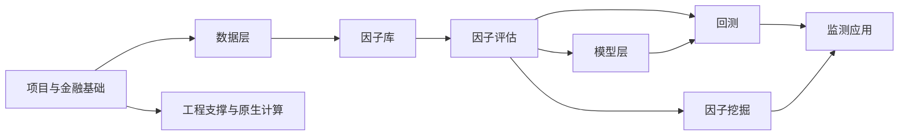

# 项目学习拆分表

这张表是后续逐模块学习的顺序和边界。每个学习单元都按已确认的示例粒度编写：先补基础知识，再说明模块作用、边界、输入输出、子模块关系、典型流程、结果解释和限制。

本表只列学习计划，不替代源码和现有工程文档。状态为“示例已完成”的内容只表示已经验证讲解方式；后续仍可继续扩展指标细节。

## 学习顺序

先学习数据、因子和评估，是因为模型、回测和因子挖掘都依赖这三部分的口径。模型层、回测和因子挖掘会分别按更细的单元讲解，不会在一章中把所有源码文件混在一起。

## 待分析总表

| 编号 | 模块 | 学习单元 | 主要内容 | 前置知识 | 状态 |
|---|---|---|---|---|---|
| A1 | 项目基础 | 量化研究全链路 | 股票、交易日、收益、标签、因子、模型、组合和回测之间的关系 | 无 | 待分析 |
| A2 | 项目基础 | 项目目录与数据流 | 顶层目录、公开入口、数据产物和主链路 | A1 | 待分析 |
| A3 | 项目基础 | 研究证据与限制 | 研究结果、回测结果、最终留出和已知限制如何区分 | A1 | 待分析 |
| B1 | 数据层 | 外部数据与原始分片 | 行情、财务、指数、行业、公司行动和来源数据 | A1-A2 | 待分析 |
| B2 | 数据层 | 清洗、生命周期与交易状态 | 上市、退市、停牌、ST、股票代码和可交易性 | B1 | 待分析 |
| B3 | 数据层 | 复权、价格口径与收益 | 原始价、后复权、前复权、涨跌幅和研究/交易价格分工 | B1-B2 | 待分析 |
| B4 | 数据层 | 涨跌停、交易单位与质量校验 | 限幅、封板、最小单位、异常检查和清洗产物 | B2-B3 | 待分析 |
| B5 | 数据层 | DuckDB 主库与读取接口 | 表的职责、标签表、只读读取和下游数据契约 | B1-B4 | 待分析 |
| C1 | 因子库 | 因子是什么以及因子族 | 动量、技术、估值、基本面、流动性和波动率因子 | A1-B3 | 待分析 |
| C2 | 因子库 | 因子定义、注册与目录 | 因子元数据、方向、依赖字段、回看窗口和状态 | C1 | 待分析 |
| C3 | 因子库 | 因子构建与 Parquet 产物 | 因子值如何成为可供评估和模型读取的数据 | C1-C2 | 待分析 |
| C4 | 因子库 | 因子自检与缺失数据 | 行集、非有限值、前视、方向和覆盖率检查 | C2-C3 | 待分析 |
| C5 | 因子库 | 因子算子与时间窗口 | 滞后、滚动窗口、截面排序、缺失值和计算边界 | C1-C3 | 待分析 |
| D1 | 因子评估 | 评估面板与股票池 | 因子值、未来收益、股票池和交易状态如何对齐 | A1-B5-C1 | 示例已完成基础部分 |
| D2 | 因子评估 | IC、RankIC 与有效样本 | 相关性、逐日截面、方向、样本门槛和统计解释 | D1 | 示例已完成 |
| D3 | 因子评估 | 分位收益与多空价差 | 分组、等权、市值加权、单调性和研究曲线 | D1-D2 | 待分析 |
| D4 | 因子评估 | 换手、衰减与相关性 | 信号稳定性、持有周期和因子重复信息 | D1-D3 | 待分析 |
| D5 | 因子评估 | 风格暴露与增量 IC | 行业/风格解释、残差信号和风险混杂 | D1-D2 | 待分析 |
| D6 | 因子评估 | 评估入口、stage 与监测页面 | 评估调度、流式结果、轻量 IC 和页面展示边界 | D1-D5 | 待分析 |
| E1 | 原生计算 | Python、Numba 与 C++ 后端 | 为什么需要批量计算核以及回退关系 | A2 | 待分析 |
| E2 | 原生计算 | 排名、相关、分箱与回归计算核 | 这些核服务哪些研究指标 | D2-D5 | 待分析 |
| E3 | 原生计算 | 一致性、并发与性能边界 | 后端选择、互斥、基准和数值一致性 | E1-E2 | 待分析 |

## 模型层：细粒度拆分

模型层把“因子值”转换成“预测分数”，再把分数交给组合和回测。它不能和回测混成一章，因为模型评价回答“预测得怎么样”，回测回答“按交易规则执行后怎么样”。

| 编号 | 学习单元 | 主要问题 | 前置知识 | 状态 |
|---|---|---|---|---|
| M1 | 监督学习与横截面预测基础 | 特征、标签、训练、预测和泛化分别是什么 | A1、C1 | 待分析 |
| M2 | 模型数据契约 | 观察时点、标签可用时点、特征可用时点和样本键 | B5、C3、M1 | 待分析 |
| M3 | 周频数据集与面板 | 为什么从日频因子组织成周频训练样本 | M2 | 待分析 |
| M4 | 标签设计 | 未来 5 日收益、开盘/收盘价格通道和排序标签 | B3、M2 | 待分析 |
| M5 | 缺失值、去极值与标准化 | 预处理解决什么问题，哪些处理可能引入偏差 | C5、M2 | 待分析 |
| M6 | 时间切分基础 | 训练期、验证期、测试期、滚动窗口和时间泄漏 | M1-M5 | 待分析 |
| M7 | Purged walk-forward 与 embargo | 重叠标签为什么需要清除和隔离 | M4、M6 | 待分析 |
| M8 | 线性模型 | Ridge 等线性模型如何形成基线 | M1-M7 | 待分析 |
| M9 | GBDT 模型 | LightGBM 与 sklearn HistGBDT 的作用和差异 | M1-M7 | 待分析 |
| M10 | 模型后端与统一契约 | 不同训练后端如何提供相同输入输出 | M8-M9 | 待分析 |
| M11 | 子模型集成与分数合并 | 多个模型如何组合，rank 分数代表什么 | M8-M10 | 待分析 |
| M12 | 预测产物与来源追踪 | 模型、预测、配置、数据哈希和运行记录如何关联 | M10-M11 | 待分析 |
| M13 | 预测评价与基线 | RankIC、收益、基线、暴露和模型比较 | D2-D5、M12 | 待分析 |
| M14 | 评估计划与验收门禁 | 哪些条件允许进入下一阶段，哪些结果会失败 | M13 | 待分析 |
| M15 | 风格暴露与风险分析 | 模型分数是否只是行业或风格暴露的替代品 | D5、M13 | 待分析 |
| M16 | 分数到组合 | 预测分数如何变成选股、权重、调仓和风险约束 | M11、M15 | 待分析 |
| M17 | 最终留出验证 | 为什么留出窗口只能使用一次，失败意味着什么 | M6-M16 | 待分析 |
| M18 | 模型注册与生命周期 | candidate、accepted、frozen、retired 等状态的意义 | M12-M17 | 待分析 |
| M19 | 模型监控 | 预测漂移、表现下降、暴露变化和运行健康度 | M12、M18 | 待分析 |
| M20 | 模型与回测集成 | 预测产物怎样进入策略、账本和验收 | M16-M19、T1-T6 | 待分析 |

## 回测层：细粒度拆分

回测不是“把收益率累乘起来”。它要回答：如果当时真的按给定信号、价格、资金、交易规则和费用执行，组合状态会怎样变化。因此每个执行约束都单独拆开。

| 编号 | 学习单元 | 主要问题 | 前置知识 | 状态 |
|---|---|---|---|---|
| T1 | 回测与组合基础 | 信号、持仓、订单、成交、现金、净值和基准是什么 | A1、D3 | 待分析 |
| T2 | 策略规格与运行身份 | 策略版本、参数、运行 ID 和可复现性 | T1 | 待分析 |
| T3 | 回测输入数据契约 | 原始价、复权研究值、标签、股票池和交易日 | B3-B5、T1 | 待分析 |
| T4 | 信号时点与执行时点 | 收盘产生信号后何时可以交易，如何避免前视 | T3 | 待分析 |
| T5 | 股票池与可交易性 | 上市、停牌、ST、涨跌停和买卖方向限制 | B2-B4、T3 | 待分析 |
| T6 | 策略适配器 | 因子线性、因子排序、ML 排序和最终留出策略如何提供信号 | C1、M16、T4 | 待分析 |
| T7 | 目标权重与订单 | 目标组合如何变成买卖方向和目标股数 | T4-T6 | 待分析 |
| T8 | 资金分配与最小交易单位 | 现金预算、整手、最小申报量和余数分配 | T7 | 待分析 |
| T9 | 换手、单股上限与风险约束 | 组合如何限制集中度和调仓幅度 | T7-T8 | 待分析 |
| T10 | 订单拒绝、重试与现金补回 | 交易被限制时，持仓目标如何延续和修正 | T5、T8-T9 | 待分析 |
| T11 | A 股 T+1 | 为什么当天买入的股票不能当天卖出 | B2-B4、T5 | 待分析 |
| T12 | 停牌与涨跌停执行 | 无法成交、封板和不同买卖方向的影响 | T5、T10-T11 | 待分析 |
| T13 | 费用、滑点与冲击 | 佣金、印花税、过户费、成交金额和价格影响 | T7、T10 | 待分析 |
| T14 | 公司行动 | 分红、送转、拆并股如何改变现金和持仓数量 | B3、T3、T11 | 待分析 |
| T15 | 账本与组合状态 | 每天如何从旧状态转移到新状态 | T7-T14 | 待分析 |
| T16 | 执行引擎与分块运行 | 日历循环、长区间分块和状态连续性 | T15 | 待分析 |
| T17 | 风险与覆盖检查 | 组合、订单、现金和数据覆盖是否满足运行条件 | T5、T9、T15 | 待分析 |
| T18 | 绩效指标 | 收益、波动、Sharpe、回撤、超额和成本如何解释 | T15、D3 | 待分析 |
| T19 | 归因与基准 | 收益来自哪些持仓、行业、交易或基准差异 | T18、D5 | 待分析 |
| T20 | 结果存储与读取 | 回测运行、日结果、订单、指标和状态如何保存 | T15-T19 | 待分析 |
| T21 | CLI、API 与页面集成 | 从启动回测到查看结果的完整入口 | T20、W1-W4 | 待分析 |
| T22 | 端到端回测场景与限制 | 因子、ML、最终留出三类策略如何走完整链路 | T1-T21、M20 | 待分析 |

## 因子挖掘层：细粒度拆分

因子挖掘的目标不是让模型随意生成公式，而是把假设、候选、证据、统计门禁、人工审批和正式发布连接成可追踪流程。因此它会同时按“研究过程”和“工程状态”拆分。

| 编号 | 学习单元 | 主要问题 | 前置知识 | 状态 |
|---|---|---|---|---|
| F1 | 因子挖掘基础 | 为什么要挖掘因子，候选和正式因子有什么区别 | C1-C4、D1-D2 | 待分析 |
| F2 | 假设、机制与可证伪条件 | 一个研究想法怎样变成可检查的假设 | F1 | 待分析 |
| F3 | DSL 与表达式 | 因子表达式、字段、算子和类型约束是什么 | C5、F1 | 待分析 |
| F4 | 安全算子与表达式 DAG | 为什么要限制算子、窗口和依赖关系 | F3 | 待分析 |
| F5 | 候选身份与来源追踪 | 候选 ID、来源、公式、版本和 provenance 如何稳定 | F2-F4 | 待分析 |
| F6 | 统一输入契约 | 手工假设、自由探索、资料驱动和 CoSTEER 如何进入同一流程 | F2、F5 | 待分析 |
| F7 | Worker 与模型调用基础 | Worker、提示、响应、超时和外部模型的角色 | M1、F6 | 待分析 |
| F8 | Worker 协议与版本 | V1、V2、V3 协议如何传递任务和结果 | F6-F7 | 待分析 |
| F9 | 资料驱动研究材料 | PDF、研究报告、证据字段和转换为候选 | F2、F5、F8 | 待分析 |
| F10 | 代码沙箱与安全边界 | 为什么候选研究代码需要隔离、限制和产物清单 | F7-F8 | 待分析 |
| F11 | 研究工具与知识输入 | 数据查询、已有因子、统计工具和证据如何供 Worker 使用 | D1-D6、F10 | 待分析 |
| F12 | 候选评估 | 候选如何复用因子评估面板和指标口径 | D1-D6、F5 | 待分析 |
| F13 | 技术、开发与选择阶段 | 候选从能计算到有研究证据经历哪些阶段 | F12 | 待分析 |
| F14 | 完整评估与测试留出 | 为什么要把开发、完整评估和测试段隔离 | D1-D2、M6-M7 | 待分析 |
| F15 | 统计诊断与多重检验 | 搜索大量候选后，偶然好结果如何识别 | D2、F13 | 待分析 |
| F16 | 稳定性与交易成本证据 | 候选是否跨时间、股票池和成本假设稳定 | D3-D5、T13 | 待分析 |
| F17 | 搜索控制与试验记录 | 搜索预算、轮次、试验、评分卡和停止条件 | F13-F16 | 待分析 |
| F18 | 状态机与运行恢复 | 输入、候选、证据、审核和运行状态如何推进与恢复 | F5、F13、F17 | 待分析 |
| F19 | 存储、事件与证据链 | 运行记录、候选记录、证据、哈希和审计如何关联 | F5、F18 | 待分析 |
| F20 | 审核、审批与原子发布 | 为什么候选必须人工审核，发布如何避免半成品 | C2-C4、F18-F19 | 待分析 |
| F21 | V1/V2/V3 兼容与迁移 | 旧协议、旧存储与 V3 如何共存和迁移 | F8、F19-F20 | 待分析 |
| F22 | 编排、Worker 故障与恢复 | 搜索编排、超时、重试、取消和持久化恢复 | F7-F8、F17-F21 | 待分析 |
| F23 | 挖掘页面与联合场景 | 从启动搜索到查看候选、审批和发布的完整流程 | F18-F22、W1-W4 | 待分析 |

## 监测与工程支撑

| 编号 | 模块 | 学习单元 | 主要内容 | 前置知识 | 状态 |
|---|---|---|---|---|---|
| W1 | 监测应用 | FastAPI 后端与服务边界 | 路由、服务层、预检、错误映射和只读数据 | D6、T21、F23 | 待分析 |
| W2 | 监测应用 | SSE、调度与取消 | 长任务、排队、背压、断连和取消 | W1 | 待分析 |
| W3 | 监测应用 | 前端页面与图表 | 因子、挖掘和回测页面如何消费后端结果 | W1-W2 | 待分析 |
| W4 | 监测应用 | 监测场景与资源保护 | 并发、内存、性能和用户可见错误 | W1-W3 | 待分析 |
| P1 | 工程支撑 | 路径、配置与依赖 | 包映射、环境变量、锁文件和数据目录 | A2 | 待分析 |
| P2 | 工程支撑 | 日志与错误 | 按模块日志、错误码和定位路径 | A2 | 待分析 |
| P3 | 工程支撑 | 测试层级 | 单元、联合、集成、真实数据、原生、Docker 和浏览器测试 | A2 | 待分析 |
| P4 | 工程支撑 | 运行工具与证据 | demo、审计、benchmark、验收和 AiRecord | P1-P3 | 待分析 |
| P5 | 工程支撑 | 已知限制与维护边界 | 哪些问题属于数据、研究、交易、外部服务或环境限制 | A3、P1-P4 | 待分析 |
