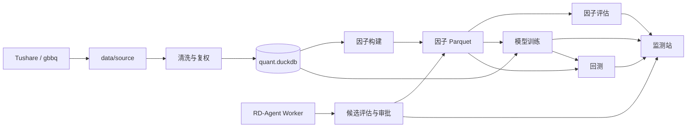
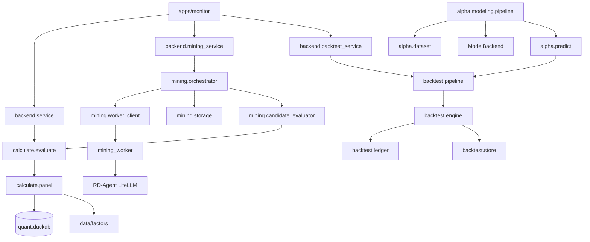

# 量化研究全链路项目指南

本目录是一套面向开发、研究和维护人员的工程手册。它按业务域说明当前仓库如何从
A 股原始数据走到因子研究、模型训练、回测和监测页面，并给出可以直接定位的源码入口。

文档以仓库在 2026-10-25 的代码、配置和锁定依赖为准。历史产物或旧文档中的阶段性结论
只用于解释演进过程，不替代当前实现。

## 项目定位

这是一个单仓库、全链路的 A 股量化研究项目，覆盖：

1. 从 Tushare 和中转服务获取行情、财务、指数、行业及公司行动数据。
2. 清洗复权、停复牌、ST、涨跌停和生命周期信息，构建 DuckDB 主库。
3. 以 DuckDB SQL 注册和计算因子，将因子值按年写成 Parquet。
4. 计算因子覆盖率、IC、分层、换手、衰减、风格暴露和相关性。
5. 使用受控 DSL 和 RD-Agent Worker 自动生成候选因子，人工审批后原子发布。
6. 构建周频数据集，训练线性模型和 GBDT，评估、监控并管理模型生命周期。
7. 使用原始价执行账本模拟 A 股交易规则、成本、公司行动和资金约束。
8. 通过 FastAPI、SSE 和原生 JavaScript 页面展示因子、挖掘和回测结果。



## 文档索引

| 文档 | 回答的问题 |
|---|---|
| [共享基础与数据层](01-foundation-and-data.md) | 路径、日志、取数、清洗、建库和 `quant` 读取接口如何工作 |
| [因子库](02-factor-library.md) | 因子如何定义、注册、构建、自检和读取 |
| [因子评估](03-factor-evaluation.md) | 评估面板、指标注册、stage、轻量 IC 和前后端如何衔接 |
| [因子评估指标](04-factor-evaluation-metrics.md) | 页面上的 13 个指标分别怎么算、怎么看、有哪些限制 |
| [自动因子挖掘](05-factor-mining.md) | V1/V2 契约、DSL、候选存储、门禁、审核和发布边界 |
| [Agent 编排与 RD-Agent](06-agent-orchestration.md) | Worker v1～v4、证据搜索、分析工具、代码沙箱和基座边界 |
| [ML 模型层](07-ml-modeling.md) | 从数据选择到训练、指标、分析、监控和留出的全过程 |
| [回测](08-backtest.md) | VectorBT 的关系、自定义账本和一次回测的完整数据流 |
| [监测站](09-monitor-web.md) | FastAPI、SSE、调度器、API 和前端页面 |
| [工程支撑](10-engineering-support.md) | 配置、脚本、测试、日志、错误、Docker 和维护记录 |

如果第一次阅读，建议按 `01 → 02 → 03 → 08 → 07 → 05 → 09` 的顺序；需要专门理解
因子研究时，把 `04` 紧接在 `03` 后，需要专门理解 Agent 时，把 `06` 紧接在 `05` 后。

## 技术栈总览

| 层次 | 主要技术 | 当前用途 |
|---|---|---|
| 语言与运行 | Python 3.12 | 主项目、数据、因子、模型、回测和 Web 后端 |
| 隔离 Worker | Python 3.11、Docker | 固定 RD-Agent 1.0.0 的独立运行环境 |
| 数据处理 | pandas 2.3、NumPy 2.2、PyArrow 25 | 面板处理、Parquet、计算与序列化 |
| 数据库 | DuckDB 1.5 | 行情主库、因子目录库、候选库和回测结果库 |
| 数值计算 | SciPy、Numba、C++20/pybind11 | 统计计算、JIT 辅助和显式批量核 |
| 机器学习 | scikit-learn 1.9、LightGBM 4.7、joblib | 线性模型、GBDT、模型持久化 |
| 外部行情 | Tushare 1.4.29、HTTP 中转 | 行情、财务、指数和行业数据 |
| Agent | RD-Agent 1.0.0、DeepSeek 兼容 LiteLLM | 生成受控候选表达式 |
| Web | FastAPI 0.141、Starlette 1.6、Uvicorn 0.53 | REST、SSE 和静态页面 |
| 前端 | 原生 HTML/JavaScript、ECharts | 无 Node 构建步骤的本地监测站 |
| 回测 | 自定义 `LedgerPortfolio` | 原始价、A 股规则、公司行动和成本 |
| 历史基础库 | VectorBT 0.28.5 | 早期组合执行接口来源，当前保留依赖和元数据 |
| 测试 | pytest 9.1 | 单元、联合、真实数据和浏览器验收 |

版本以 [requirements.txt](../../requirements.txt) 和
[requirements.lock](../../requirements.lock) 为准。Worker 使用自己的
[requirements.lock](../../research/mining_worker/requirements.lock)，不能与主项目
环境混装。

## 业务域与源码

| 业务域 | 源码 | 公开包名 | 主要产物 |
|---|---|---|---|
| 共享基础 | `core/common` | `common` | 路径、集中日志 |
| 数据平台 | `core/data` | `quant`、`scripts` | 原始分片、清洗 Parquet、`quant.duckdb` |
| 因子库 | `core/factors` | `factors` | 因子定义、`data/factors/`、`factors.duckdb` |
| 因子评估 | `research/evaluation/calculate` | `calculate` | 流式指标结果，不落库 |
| 自动挖掘 | `research/mining` | `mining` | 候选库、候选 Parquet、发布批次 |
| 挖掘 Worker | `research/mining_worker` | `mining_worker` | Worker 作业库和候选草稿 |
| ML 模型 | `research/modeling/alpha` | `alpha` | 数据集、模型、预测、评估和监控包 |
| 回测 | `trading/backtest` | `backtest` | 回测结果库、策略版本和归因 |
| 监测应用 | `apps/monitor` | `backend` | REST、SSE 与静态前端 |

配置集中在 `configs/`，测试位于 `tests/`、各业务域的 `tests/` 目录，运维工具位于
`tools/`。

## 一次全链路的数据形态

```text
Tushare 分片
  -> 按年清洗的日线长表，单位统一为元、股
  -> DuckDB 的 md/ref/fin/evt/meta schema
  -> 每个因子的年度 Parquet
  -> 评估面板或模型周频数据集
  -> 模型预测/回测目标权重
  -> 成交、持仓、日结果和绩效指标
```

几个必须始终一致的口径：

- 股票代码统一为 `SH600000`、`SZ000001`、`BJ920000`；指数保留 `000300.SH` 格式。
- 因子和标签使用后复权价，回测成交使用原始价，公司行动由账本单独处理。
- 收盘生成信号，下一交易日开盘执行。
- 全 A 池要求可买、非 ST、非退市整理期并上市满 60 个自然日。
- 指数池使用上一个已结束月份的月末权重快照，避免未来成分信息。
- 财务字段在公告日次一交易日起可用，连接条件是 `trade_date > available_date`。

## 数据与运行产物

| 路径 | 内容 |
|---|---|
| `data/source/` | 外部接口原始分片与下载清单 |
| `data/clean/` | 按年清洗的日线数据与异常表 |
| `data/databases/quant.duckdb` | 行情、标签、辅助数据和元数据主库 |
| `data/factors/` | 内置因子和已发布 `mined` 因子的 Parquet |
| `data/databases/factors.duckdb` | 因子定义、覆盖率、自检和构建记录 |
| `data/models/` | 数据集、模型、预测、评估、监控和生命周期 |
| `data/factor_mining/` | 候选运行目录、因子值和评估证据 |
| `data/databases/factor_mining.duckdb` | 挖掘运行、候选、事件和审批状态 |
| `data/databases/backtest.duckdb` | 策略版本、运行、日结果、成交和持仓 |
| `logs/` | 按业务域和模块分目录的结构化日志 |
| `AiRecord/` | 计划、变更、差异、进度和证据；已纳入 Git 的记录随仓库提交 |

`data/` 和 `logs/` 在 Git 忽略范围内，不能把其中的数据文件当成代码交付物。
`AiRecord/` 的文档和证据用于项目追溯；新增文件是否需要跟踪以当前 Git 状态为准。

## 核心模块调用链



## 术语

| 术语 | 含义 |
|---|---|
| `FactorSpec` | 因子名、族、公式、步骤、SQL 层、回看窗口和方向 |
| 评估面板 | 因子值、标签、股票池、市值和风格原料按 `stock_code + trade_date` 对齐后的表 |
| stage | 评估结果的一段流式事件，如 `overview`、`bins`、`decay` |
| `Metric` | 可注册的指标声明，绑定 key、名称、stage 和计算函数 |
| `FrozenContext` | 挖掘运行期间不可变的数据、口径、目录、规则和预算快照 |
| `candidate` | Agent 生成的候选因子定义及其评估证据 |
| `model_id` | 由数据集、折、训练规格和代码哈希确定的模型标识 |
| provider | 把行情、因子和可交易标记转换为目标权重矩阵的接口 |
| 原始价账本 | 以真实价格、股数、现金和税务批次记账的执行层 |
| 研究模拟器 | 用周频标签收益和成本快速比较模型的简化研究工具 |
| 输入快照 | 对数据、规则、策略和外部模型产物内容生成的可复现摘要 |

## 已知边界

- 文档不会把研究图表等同于可执行交易结果。分位净值、多空价差和多周期衰减没有完整模拟
  T+1、涨跌停、停牌、资金和成本；这些只能由回测模块回答。
- 自动挖掘的模块测试段与历史模型最终留出存在区间重叠，不能因此宣称独立样本发现。
- 2024-2026 模型最终留出已消耗且状态为 `fail_final_holdout`；该结果不会被后续文档
  改写成成功。
- 原生计算锁只覆盖后端入口，直接并行调用底层 `calculate` 函数不在保护范围内。
- VectorBT 仍是锁定依赖，但正式回测不再由它负责现金与持股记账。

## 维护要求

修改任何模块时，应同步检查本指南中的：

1. 源码公开入口、数据结构和状态字段。
2. 上下游调用关系与数据流箭头。
3. 配置项、错误码、日志路径和产物目录。
4. 前端 API/SSE 事件与后端参数。
5. 已知边界和验收结论。

