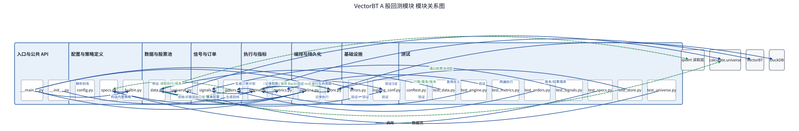

# 模块结构

## 模块树

- 入口与公共 API
  - `__main__.py`
  - `__init__.py`
- 配置与策略定义
  - `config.py`
  - `specs.py`
  - `builtin.py`
- 数据与股票池
  - `data.py`
  - `universe.py`
- 信号与订单
  - `signals.py`
  - `providers.py`
  - `strategies/`
  - `orders.py`
- 执行与指标
  - `engine.py`
  - `metrics.py`
- 编排与持久化
  - `pipeline.py`
  - `store.py`
- 基础设施
  - `errors.py`
  - `logging_conf.py`
- 外部依赖
  - `quant` 读取层
  - `calculate.universe`
  - `VectorBT`
  - `DuckDB`
- 测试
  - `tests/conftest.py`
  - `tests/test_data.py`
  - `tests/test_engine.py`
  - `tests/test_metrics.py`
  - `tests/test_orders.py`
  - `tests/test_signals.py`
  - `tests/test_providers.py`
  - `tests/test_specs.py`
  - `tests/test_store.py`
  - `tests/test_universe.py`

## 模块条目

### 入口与公共 API

- 功能：接收 CLI 请求并暴露 Python 调用接口。
- 定位：用户和上层服务进入回测包的边界。
- 调用：`pipeline`、`store`、`builtin`。
- 被调用：命令行、父项目服务或 Python 调用方。
- 核心逻辑位置：`__main__.py:main`、`__init__.py:__all__`。
- 下级模块：`__main__.py`、`__init__.py`。

### 配置与策略定义

- 功能：定义路径、资源上限、策略参数、执行规则、成本和基准。
- 定位：所有运行都依赖的不可变输入层。
- 调用：`data`、`signals`、`orders`、`pipeline`、`store`。
- 被调用：入口、编排、数据、信号、订单和存储模块。
- 核心逻辑位置：`specs.py:StrategySpec`、`config.py:MAX_PANEL_CELLS`、`builtin.py:BUILTINS`。
- 下级模块：`config.py`、`specs.py`、`builtin.py`。

### 数据与股票池

- 功能：读取行情/因子/基准，统一矩阵契约，生成全 A 或指数成分池。
- 定位：外部数据与回测算法之间的适配边界。
- 调用：`quant`、`calculate.universe`、`errors`、`logging_conf`。
- 被调用：`pipeline`、`signals`、`orders`、`engine`。
- 核心逻辑位置：`data.py:load_market_data`、`data.py:MarketData.__post_init__`、`universe.py:membership_frame`。
- 下级模块：`data.py`、`universe.py`。

### 信号与订单

- 功能：把因子变成目标权重，再按 A 股规则生成可提交订单计划。
- 定位：策略逻辑和交易规则的核心层。
- 调用：`data.MarketData`、`specs`、`universe`、`providers`、`logging_conf`。
- 被调用：`engine`。
- 核心逻辑位置：`signals.py:build_signal_targets`、`signals.py:build_target_weights`、
  `providers.py:get_provider`、`orders.py:apply_rules`、`orders.py:build_order_plan`。
- 下级模块：`signals.py`、`providers.py`、`strategies/`、`orders.py`。

### 执行与指标

- 功能：调用 VectorBT 两遍执行，生成标准结果并计算绩效。
- 定位：把规则层的计划转换为真实现金、持仓和净值的边界。
- 调用：`VectorBT`、`signals`、`orders`、`metrics`、`data`、`specs`。
- 被调用：`pipeline`、直接 Python API。
- 核心逻辑位置：`engine.py:run_backtest`、`engine.py:_run_portfolio`、`metrics.py:summarize`。
- 下级模块：`engine.py`、`metrics.py`。

### 编排与持久化

- 功能：管理策略版本、运行生命周期、阶段事件和标准结果表。
- 定位：把一次回测变成可观察、可取消、可复现的运行实例。
- 调用：`data`、`engine`、`specs`、`store`、`errors`、`logging_conf`、DuckDB。
- 被调用：`__main__`、上层服务。
- 核心逻辑位置：`pipeline.py:iter_run`、`store.py:finish_run`。
- 下级模块：`pipeline.py`、`store.py`。

### 基础设施

- 功能：统一异常码和按模块的日志文件。
- 定位：横切能力，不承载策略算法。
- 调用：`config`、父项目 `scripts.errors`、标准库 logging。
- 被调用：几乎所有业务模块。
- 核心逻辑位置：`errors.py:BacktestError`、`logging_conf.py:get_logger`。
- 下级模块：`errors.py`、`logging_conf.py`。

### 外部依赖

- 功能：提供行情/因子读取、股票池定义、组合执行和结果数据库。
- 定位：`backtest` 不重复实现的外部能力边界。
- 调用：`data.py` 调用 `quant`，`universe.py` 调用 `calculate.universe`，`engine.py` 调用 VectorBT，`store.py` 调用 DuckDB。
- 被调用：数据、股票池、执行和持久化模块。
- 核心逻辑位置：`data.py:load_market_data`、`universe.py:resolve_universe`、`engine.py:_run_portfolio`、`store.py:_ensure_schema`。
- 下级模块：`quant` 读取层、`calculate.universe`、`VectorBT`、`DuckDB`。

### 测试

- 功能：验证数据契约、信号、规则、执行、指标、存储和股票池。
- 定位：对业务口径和跨模块联动的回归保护。
- 调用：各业务模块、pandas/numpy、pytest。
- 被调用：开发验证流程。
- 核心逻辑位置：`tests/conftest.py:make_data`、各 `test_*.py`。
- 下级模块：`tests/conftest.py`、8 个测试文件。

## 关系图

读图说明：箭头表示调用或数据依赖，节点与本文件模块树一一对应；外部 `quant`、`calculate`、VectorBT 和 DuckDB 作为依赖节点展示。

