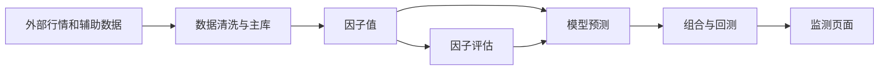
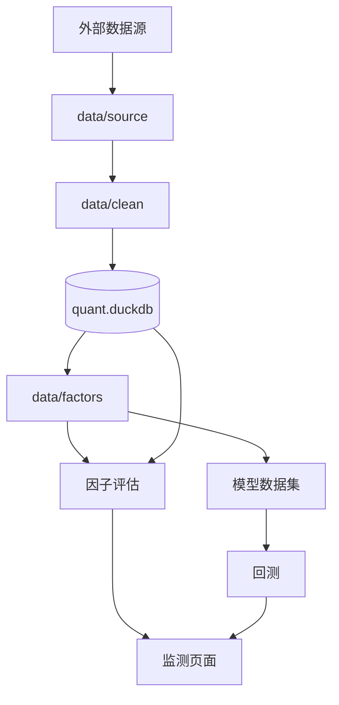

# A1-A3 项目与量化研究基础

本章不从代码开始。先建立一套能看懂项目的共同语言，再说明项目的目录、数据流和结论边界。

## A1：量化研究全链路

### 先补基础知识

一只股票可以被理解为“某家公司的一份可交易权益”。股票在交易所开放的日期交易，这些日期叫交易日。项目的最小研究记录通常由两部分组成：

```text
股票代码 + 交易日期
```

例如：

```text
SH600000 + 2025-01-02
```

在这个日期上，项目可以记录收盘价、成交额、市值、股票状态和因子值。

**收益**表示一段时间内价格变化的比例。最简单的计算是：

```text
收益 = (结束价格 - 开始价格) / 开始价格
```

**因子**是给股票打分或排序的一种方法。比如“过去 20 个交易日涨得多不多”可以形成动量因子。因子值不是收益，也不是价格预测，它只是后续研究用来排序股票的信号。

**标签**表示研究者希望解释或预测的结果。在本项目中，标签主要是从某个决策时点开始，未来 1、3、5、10、15 或 20 个交易日的收益。

**模型**可以把多个因子合成一个预测分数。**组合**则是把股票和现金按一定比例放在一起。**回测**是在历史数据上模拟“当时按照某个信号买卖”会发生什么。

### 模块在项目中的位置

项目的主链路是：



数据层回答“历史上发生了什么”。因子库回答“怎样把历史数据变成信号”。因子评估回答“信号和未来收益有没有关系”。模型层回答“多个信号合起来能否形成预测”。回测回答“按交易规则执行后组合怎样变化”。

### 它负责什么

项目基础负责建立理解整个量化研究工程所需要的金融概念、时间顺序和研究链路。

### 它不负责什么

它不直接判断哪个因子好，也不保证模型或回测结果未来有效。它只是帮助读者正确理解后续模块。

### 输入与输出

| 项目 | 内容 |
|---|---|
| 输入 | 股票、交易日、价格、收益、因子、标签、模型和组合等概念 |
| 输出 | 一张从数据到研究结论再到交易模拟的全链路地图 |
| 下游 | A2、A3，以及数据、因子和评估文档 |

### 一次典型流程

假设研究者想知道“过去 20 日上涨较多的股票，未来 5 日是否继续上涨”。

1. 数据层为每只股票准备历史价格。
2. 因子库把过去 20 日价格变化转换成 `MOM_20` 因子值。
3. 标签表记录同一观察日之后 5 个交易日的收益。
4. 评估模块比较因子排序和未来收益排序。
5. 如果关系稳定，模型或策略可以继续使用它；如果关系不稳定，研究者应停止或修改假设。

### 结果如何理解

这个流程只能说明历史数据中是否存在某种关系。它还没有说明买入时能否成交、交易成本是多少、资金是否足够，以及关系是否会持续到未来。

### 常见误区与限制

- 因子值高，不等于股票一定上涨。
- 未来收益标签是研究目标，不是已经执行的订单。
- 历史上有效，不等于未来有效。
- 忽略时间顺序会产生前视偏差，也就是把未来信息偷偷带回过去。

### 本节范围

本节不展开具体因子公式、模型算法和回测账本。

## A2：项目目录与数据流

### 先补基础知识

一个完整研究项目通常会把“数据准备”“研究计算”“交易模拟”和“展示”分开。这样做的原因是：不同模块的责任不同，某个模块出错时可以定位问题，也可以让多个下游模块复用同一份数据。

### 模块在项目中的位置

项目的主要目录可以按职责理解：

| 目录 | 提供什么 |
|---|---|
| `core/common` | 路径、日志等共享基础能力 |
| `core/data` | 数据获取、清洗、建库和读取 |
| `core/factors` | 因子定义、算子、注册和发布读取 |
| `research/evaluation` | 因子评估指标和评估面板 |
| `research/modeling` | 特征、训练、预测、模型生命周期和监控 |
| `trading/backtest` | 交易规则、账本、订单、组合和回测结果 |
| `research/mining` | 受控因子挖掘、审核和发布 |
| `apps/monitor` | FastAPI、SSE 和前端页面 |
| `native`、`core/kernels` | 批量数值计算的后端和统一入口 |

项目的物理目录与 Python 导入包并不完全同名。例如 `research/evaluation/calculate` 对外使用的包名是 `calculate`，`trading/backtest` 对外使用的包名是 `backtest`。这是项目打包配置决定的，学习时以公开包名和文档入口为准。

### 它负责什么

项目结构负责把数据资产、业务模块、计算后端和展示入口组织成可追踪的研究链路。

### 它不负责什么

目录本身不是业务结论。看到某个文件夹存在，不代表其中的能力已经自动接入全部下游，也不代表对应结果已经经过最终留出验证。

### 输入与输出



核心产物包括：原始分片、清洗后的 Parquet、`quant.duckdb` 主库、因子 Parquet、模型产物、回测数据库和日志。

### 一次典型流程

用户执行一次因子评估时，页面请求先到 `apps/monitor/backend`，后端准备参数和资源，然后调用 `calculate`。评估模块只读 `quant.duckdb` 和因子 Parquet，计算结果通过 SSE 事件返回页面。它不会反向修改因子文件或行情主库。

### 结果如何理解

模块分层的价值是“同一份数据口径可以被多个研究流程复用”。如果数据层的价格或日期口径发生变化，因子、评估、模型和回测都可能受到影响，因此数据契约比单个函数更重要。

### 常见误区与限制

- 一个模块能被导入，不代表它已经经过真实数据验收。
- 文档中的当前数据规模属于本地快照，不是永久代码常量。
- 公开入口和内部辅助脚本的稳定性不同，后续应优先学习公开入口。

### 本节范围

不展开每个目录中的全部辅助文件，具体数据和业务模块在后续章节分别说明。

## A3：研究证据与限制

### 先补基础知识

量化研究通常经历几个证据层次：

1. **统计关系**：因子值和未来收益是否存在关系。
2. **分层结果**：高因子组和低因子组的收益是否有差异。
3. **模型预测**：多个特征组成的预测分数是否比基线更好。
4. **交易回测**：考虑订单、费用、停牌、涨跌停和现金后，组合是否仍有表现。
5. **样本外验证**：在没有参与调参的最终留出区间上是否仍然成立。

证据越靠后，越接近真实使用，但也越依赖更多假设。任何一层都不能自动替代其他层。

### 模块在项目中的位置


### 它负责什么

它负责帮助读者判断一个数字能够支持什么结论，以及不能支持什么结论。

### 它不负责什么

它不替研究者给出收益承诺，也不把测试通过、历史收益或页面展示包装成实盘能力。

### 输入与输出

| 证据 | 可以回答 | 不能单独回答 |
|---|---|---|
| IC/RankIC | 因子排序是否和未来收益有关 | 是否扣除交易成本后赚钱 |
| 分位收益 | 高低因子组是否有收益梯度 | 是否能按目标权重成交 |
| 模型指标 | 预测分数是否优于基线 | 组合是否受现金和涨跌停约束 |
| 回测结果 | 在给定规则和历史数据下组合如何变化 | 未来一定复制历史表现 |
| 最终留出 | 冻结方案在新时间段的表现 | 可以继续用同一窗口反复调参 |

### 一次典型流程

如果某因子的 RankIC 为正，研究者只能先说“历史截面排序方向与预期一致”。随后还要检查有效天数、分组收益、换手、风格暴露、交易成本和样本外表现。任何一步失败，都应降低结论强度。

### 结果如何理解

项目 README 已明确：研究结果不构成稳定 Alpha，也不是实盘交易系统。这个边界不是免责声明，而是研究流程的一部分。

### 常见误区与限制

- **前视偏差**：使用当时尚不可得的数据。
- **幸存者偏差**：只看今天仍存在的股票，忽略退市股票。
- **样本选择偏差**：只展示有利的年份、股票池或参数。
- **重叠标签问题**：多个持有期标签共享同一段未来收益，统计量不是完全独立。
- **交易可实现性问题**：研究曲线不一定考虑成交限制、费用和资金。

### 本节范围

具体统计指标、模型门禁、回测限制和最终留出结果分别在 D、M、T 文档中继续解释。

