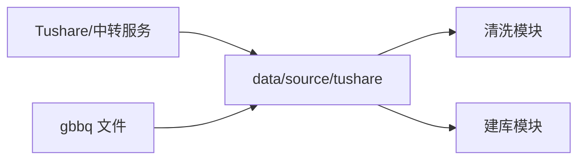
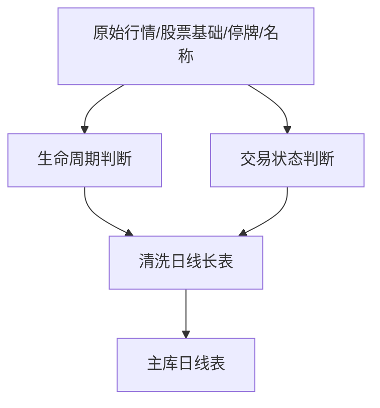
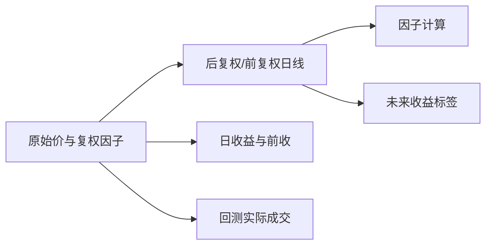
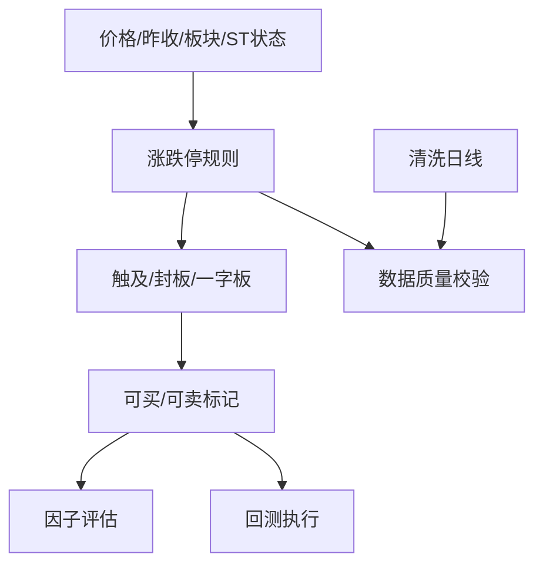
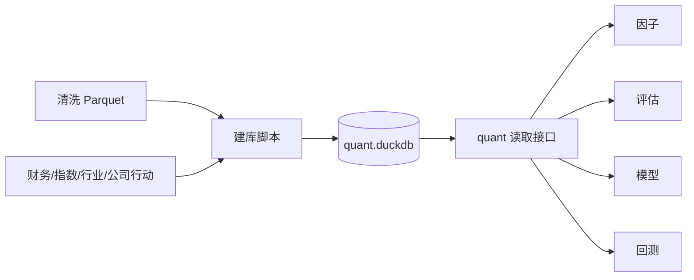

# B1-B5 数据层

数据层的任务不是“把文件下载下来”这么简单。它要把来源不同、字段不同、时间口径不同的资料，整理成后续因子、评估、模型和回测都能理解的共同数据语言。

## B1：外部数据与原始分片

### 先补基础知识

研究股票时，单靠收盘价不够。还需要知道：

- 股票什么时候上市和退市；
- 某天是否停牌；
- 当天是否触及涨跌停；
- 公司是否分红、送转或配股；
- 股票属于哪个行业或指数；
- 财务数据在什么时候对市场可见。

这些信息来自不同数据源。原始分片就是把外部来源按接口和时间保存下来，先保留来源事实，再由清洗层统一口径。

### 模块在项目中的位置

相关入口位于 `core/data/scripts/sources`，主要产物位于 `data/source`。项目使用 Tushare 及中转服务获取行情、财务、指数和行业资料，也使用固定版本的 `gbbq` 文件补充公司行动等信息。



### 它负责什么

它负责按来源、接口和时间保存可以追溯的原始数据，为清洗和建库提供输入。

### 它不负责什么

它不直接判断数据是否适合研究，也不把不同接口的字段自动当成已经统一的价格、单位和日期口径。

### 输入与输出

| 输入 | 输出 |
|---|---|
| 外部 API、固定文件、环境变量中的访问配置 | 按接口/年份/月分片的原始文件、采集状态和失败记录 |

### 一次典型流程

采集某年的日线时，系统将行情、复权因子、日线基础指标和涨跌停数据分别落地。后续清洗模块再按股票代码和交易日期把它们合并。某个接口失败时，原始目录和日志能帮助判断是“没有取到”还是“取到了但字段异常”。

### 结果如何理解

原始分片是证据起点，不是最终研究表。它保留了来源的原貌，也保留了来源之间可能存在的代码、字段和时间差异。

### 常见误区与限制

- 下载成功不等于字段正确。
- 不同接口的日期可能表示交易日、公告日或登记日，不能只按字段名猜。
- 财务数据必须关注公告可用时间，不能把后来公布的数字放回过去。

### 本节范围

不展开网络重试和具体供应商协议，只说明原始数据在项目中的职责。

## B2：清洗、生命周期与交易状态

### 先补基础知识

股票不是从项目第一天到最后一天一直可交易。它可能：

- 尚未上市；
- 正常交易；
- 临时停牌；
- 退市或进入退市整理期；
- 名称发生变化；
- 代码被历史主体重复使用。

如果研究忽略这些状态，就可能在股票还没有上市时给它生成因子，或在它不能交易时把它当作正常成交样本。

### 模块在项目中的位置

核心代码位于 `core/data/scripts/clean`，公共读取入口位于 `core/data/quant`。清洗层将原始分片变成年度日线 Parquet，再由建库层写入 DuckDB。



### 它负责什么

它负责给每个股票-交易日记录确定统一身份、生命周期、停牌状态、ST 状态和可交易状态。

### 它不负责什么

它不替某个策略决定股票池，也不负责模拟订单。它只是提供下游判断所需的状态字段。

### 输入与输出

重要输出包括：

| 字段类别 | 说明 |
|---|---|
| `stock_code` | 统一后的股票代码，例如 `SH600000` |
| `status` | `trading`、`suspended` 等状态 |
| `list_date`、`delist_date` | 上市和退市时间边界 |
| `is_st`、`is_delisting` | 历史状态标记 |
| `is_resume` | 停牌后恢复交易的标记 |
| `can_buy_*`、`can_sell_*` | 供评估和回测使用的可交易条件 |

### 一次典型流程

某只股票在 2024-03-01 上市，2024-03-10 至 2024-03-12 停牌。清洗层会保留上市期内的记录，把 3 月 10 日至 12 日标成停牌，而不是把这几天误认为正常收益为 0。复牌日还要保留恢复交易信息，供标签、因子和回测解释价格变化。

### 结果如何理解

状态列决定一条记录能否进入某个研究样本，也决定回测当天能否下单。它们不是装饰字段。

### 常见误区与限制

- 缺行情不一定等于停牌，也可能是数据缺失；项目会结合来源和上市期判断。
- `in_universe` 是研究股票池标记，`can_buy_close` 是交易可买标记，两者不是同一个概念。
- 历史 ST 状态需要按日期理解，不能只看今天的名称。

### 本节范围

不展开每条异常记录的修复策略，只说明状态如何服务下游模块。

## B3：复权、价格口径与收益

### 先补基础知识

公司分红、送股、配股或拆分后，价格会发生“机械变化”。如果直接把原始收盘价拼成长序列，除权日可能看起来像暴跌或暴涨，但这不一定是真实经济收益。

**后复权**把历史价格调整到较新的价格基准，适合比较历史价格变化和构造研究因子。项目口径是：

```text
后复权价 = 原始价 × 复权因子
```

**前复权**把价格调整到较早的基准。项目主研究口径使用后复权价，回测实际成交则使用原始价格，再由账本处理公司行动。

### 模块在项目中的位置

复权和收益相关字段由清洗、建库和标签模块共同产生，口径定义集中在 `core/data/quant/schema.py`、`core/data/scripts/clean/adjust.py` 和 `core/data/scripts/build_db/labels.py`。



### 它负责什么

它负责提供一致的研究价格、原始交易价格、日收益和未来收益标签。

### 它不负责什么

它不把后复权价格当成真实成交价，也不把标签直接当作已经执行的投资收益。

### 输入与输出

| 输出 | 主要用途 |
|---|---|
| `md.daily_bar` | 原始价格和原始交易事实 |
| `md.daily_hfq` | 因子、评估和标签的研究价格 |
| `md.daily_qfq` | 另一种研究观察口径 |
| `md.fwd_return` | 未来 1/3/5/10/15/20 个交易日标签 |
| `ret`、`pre_close` | 日收益、涨跌停和校验 |

### 一次典型流程

在 2025-01-02 观察一只股票，因子使用当天及以前的后复权价格。若主标签选择 5 日收盘通道，则标签表示从当天收盘到未来第 5 个交易日收盘的收益。若回测需要实际成交，则改用原始价格和公司行动账本。

### 结果如何理解

研究价解决“如何比较历史信号”，原始价解决“如何模拟真实交易”。两者服务不同问题，不能混用。

### 常见误区与限制

- 前复权价格的基准可能包含未来信息，不适合作为项目默认标签价格。
- `shift(1)` 是过去值，未来标签通常需要向前取值。
- 停牌段不能简单填成 0 收益；项目按上一有效价格处理持有期口径，并对决策点置空标签。
- 未来标签在区间末端天然会缺失，不是数据错误。

### 本节范围

不解释具体 SQL 窗口表达式，只说明价格和标签在各模块中的职责分工。

## B4：涨跌停、交易单位与质量校验

### 先补基础知识

A 股交易有价格涨跌幅限制，也有最小申报单位。即使策略想买入，股票处于涨停封板状态时也可能买不进去；即使策略想卖出，跌停或停牌也可能卖不出去。

因此数据层不仅要保存价格，还要保存：

- 涨停价和跌停价；
- 是否触及或封住涨跌停；
- 是否适用价格限制；
- 是否可以买入或卖出；
- 成交量是股数，成交额是元，价格是元。

### 模块在项目中的位置

相关清洗代码位于 `core/data/scripts/clean/limits.py`、`adjust.py` 和 `validate.py`，结构字段位于 `core/data/quant/schema.py`。



### 它负责什么

它负责把市场交易限制转成结构化字段，并通过校验发现单位、价格、状态和行集异常。

### 它不负责什么

它不模拟盘口深度、排队位置、部分成交和撤单，也不决定策略最终怎样分配现金。

### 输入与输出

典型字段包括 `limit_up`、`limit_down`、`is_limit_up`、`is_limit_down`、`is_one_word_board`、`can_buy_close` 和 `can_sell_close`。

质量校验会关注行集是否完整、收益是否合理、停牌状态是否一致、涨跌停规则是否符合板块和日期，以及是否出现非有限值。

### 一次典型流程

如果某股票当天触及涨停但没有成交，清洗层会保留涨停状态和不可买标记。评估层可以把它作为历史样本，回测层则根据策略方向判断该日是否允许成交。

### 结果如何理解

这些字段把“想交易”与“能够交易”区分开，避免回测把理论目标直接当成成交结果。

### 常见误区与限制

- 涨停价不等于一定成交。
- `can_buy` 和 `can_sell` 需要结合方向理解。
- 当前回测仍不模拟集合竞价队列、盘口深度和部分成交。

### 本节范围

不展开每个板块的历史限幅规则表，只说明这些规则在数据和回测之间的连接作用。

## B5：DuckDB 主库与读取接口

### 先补基础知识

数据库是把许多表按统一字段和关系保存起来的工具。项目使用 DuckDB，因为它适合本地分析型查询，能直接读取 Parquet，也能让多个研究模块用只读方式访问同一份数据。

项目主库按业务分成多个 schema：

| schema | 作用 |
|---|---|
| `md` | 市场数据和未来收益标签 |
| `ref` | 股票、指数、行业和公司行动参考数据 |
| `fin` | 财务数据 |
| `evt` | 事件或运行相关数据 |
| `meta` | manifest、字典和校验信息 |

### 模块在项目中的位置

物理主库默认是 `data/databases/quant.duckdb`。路径由 `core/common/paths.py` 统一解析，读取入口主要位于 `core/data/quant/db.py`、`loaders.py` 和 `loaders_factors.py`。



### 它负责什么

它负责提供统一、可只读复用的行情、标签、股票池辅助数据、财务和公司行动数据。

### 它不负责什么

它不替调用方选择最终股票池，不负责研究指标，不负责模型训练，也不负责订单执行。

### 输入与输出

常见读取能力包括：`quant.load_panel()`、`quant.load_label()`、`quant.load_stock_basic()`、`quant.load_index_weight()`、`quant.load_corporate_actions()` 和财务面板读取接口。

### 一次典型流程

因子评估调用只读连接读取 `md.daily_hfq`、`md.fwd_return` 和指数权重；因子值从 `data/factors/<family>/year=*/part.parquet` 读取。两边以 `stock_code + trade_date` 对齐，再形成评估面板。

### 结果如何理解

主库是下游模块的共同事实来源。读取接口的价值不是隐藏所有数据库细节，而是固定字段、日期、单位和缺失值口径。

### 常见误区与限制

- 主库存在不代表所有表都覆盖同一日期范围。
- 股票池通常由下游根据状态、上市天数和指数快照重新计算。
- 改动数据库口径可能同时影响因子、评估、模型和回测，不能只看一个调用方。

### 本节范围

不逐表列出全部列定义，详细字段以 `core/data/quant/schema.py` 和现有数据字典为准。

