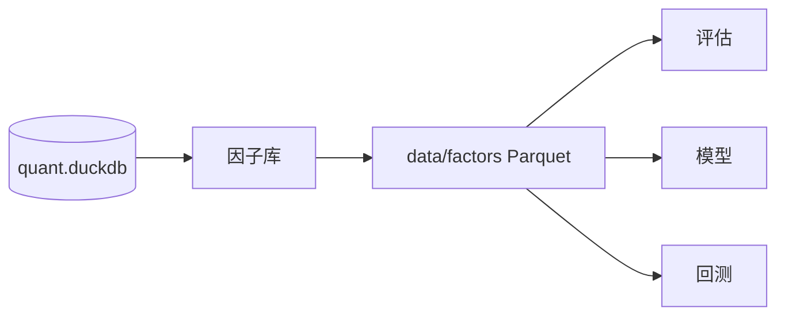
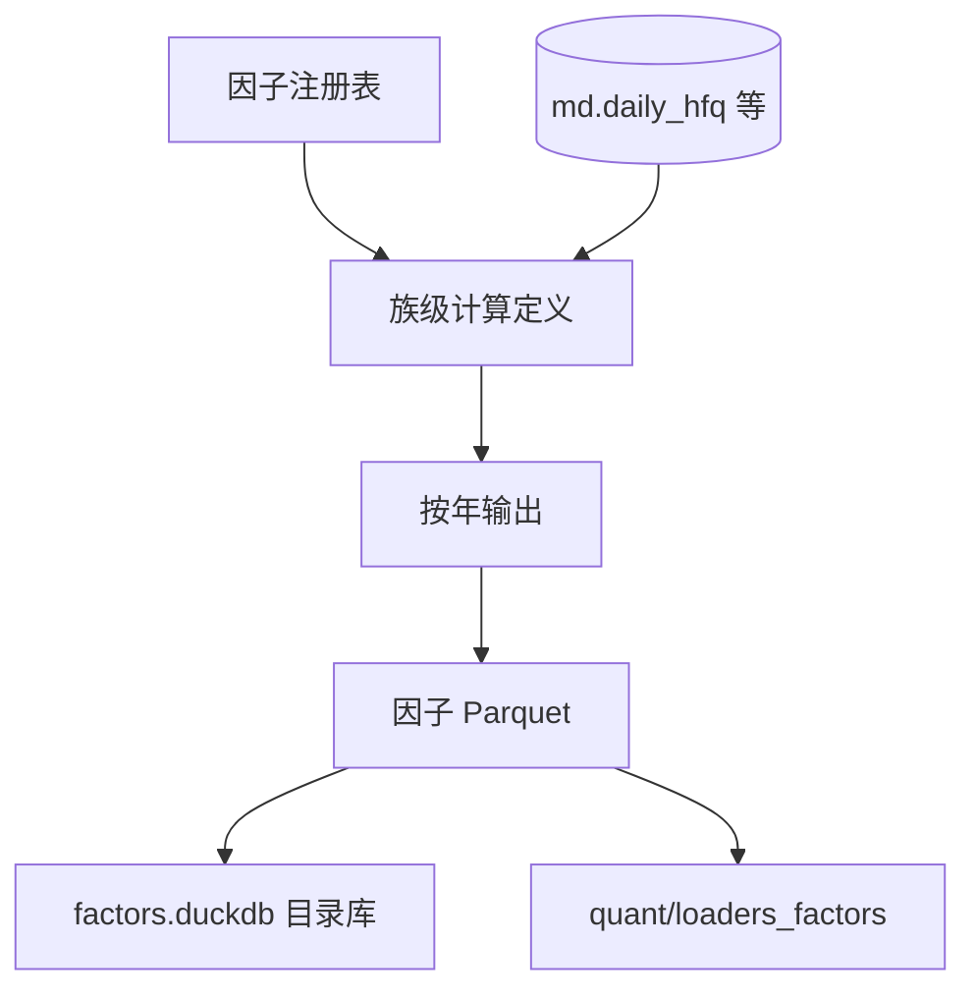
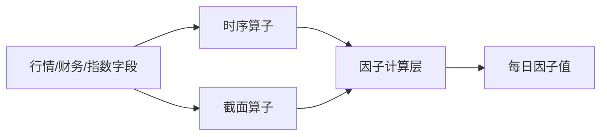

# C1-C5 因子库

因子库位于数据层之后、评估和模型之前。它把“我想研究某种市场现象”的想法，变成每天每只股票都可以读取的数值信号。

## C1：因子是什么以及因子族

### 先补基础知识

因子是一种把股票转换成数值的规则。这个数值的主要用途是排序，而不是直接预测价格。

例如：

```text
MOM_20 = 最近 20 个交易日的价格变化
```

如果某天：

| 股票 | 因子值 |
|---|---:|
| A | 0.20 |
| B | 0.05 |
| C | -0.10 |

研究者可以先把 A 排在 B 前面，把 B 排在 C 前面，再观察这个排序和未来收益是否有关。

项目把因子按研究主题分成不同族：动量与反转、波动与风险、流动性、量价关系、技术形态、估值与规模、财务与质量、A 股特色、市场与相对强度，以及 Alpha101、Alpha191 等复现族。

### 模块在项目中的位置



### 它负责什么

它负责按照统一的数据和时间口径计算、保存和读取因子值。

### 它不负责什么

它不负责选择最终股票池，不负责判断因子是否能赚钱，也不负责模拟交易成本和成交限制。

### 输入与输出

| 输入 | 输出 |
|---|---|
| 后复权行情、财务、指数或其他允许的数据源 | 因子定义、因子值、因子覆盖率和因子自检记录 |

### 一次典型流程

研究者提出“近期上涨较多的股票可能继续上涨”。因子库使用后复权价格计算 `MOM_20`，为每个股票-交易日生成一个值。评估模块随后使用这些值做 IC 和分位分析。

### 结果如何理解

一个因子是研究假设的数值化表达。因子库证明的是“这个公式被一致地算出来”，不是“这个假设一定正确”。

### 常见误区与限制

- 因子值不是收益率。
- 高因子值只表示按该因子规则排序靠前。
- 因子覆盖率高不代表因子质量高。
- 不同因子族之间可能包含重复信息。

### 本节范围

不解释每个具体因子的金融机制，重点放在因子库共同能力。

## C2：因子定义、注册与目录

### 先补基础知识

为了让一个因子能够被多个模块使用，除了数值公式，还需要描述它的身份和含义：

- 名称是什么；
- 属于哪个族；
- 依赖哪些字段；
- 需要回看多少交易日；
- 数值越大表示看多还是看空；
- 用白话怎样解释；
- 是否依赖指数或财务等附加数据。

这相当于给每个因子附带一张“说明卡”。

### 模块在项目中的位置

公共定义位于 `core/factors/registry.py`，具体族位于 `core/factors/momentum.py`、`technical.py`、`valuation.py` 等文件。目录库由 `core/data/scripts/build_factors/catalog.py` 维护。

### 它负责什么

它负责登记因子的身份、金融说明、方向、依赖和构建所需的定义。

### 它不负责什么

它不负责实际交易，也不负责在注册时证明因子已经通过完整历史评估。

### 输入与输出

项目的 `FactorSpec` 可以用以下方式理解：

| 信息 | 作用 |
|---|---|
| `name` | 统一引用名称，例如 `MOM_20` |
| `family` | 决定族和产物目录 |
| `formula`、`description`、`steps` | 供人阅读和文档展示 |
| `layers` | 表示计算表达式的业务定义 |
| `lookback` | 说明需要的历史窗口 |
| `direction` | 表示高值预期看多还是看空 |
| `fields`、`extra_sources` | 说明依赖的数据来源 |

### 一次典型流程

新增一个因子时，研究者先在对应族中登记名称、公式和白话步骤。构建器之后可以从注册表发现它，不需要再为这个因子单独修改总构建脚本。目录库则记录定义、覆盖率和构建状态。

### 结果如何理解

注册表是“因子是什么”的统一来源。数值文件是“因子在每一天是多少”的来源。两者配合，才能让评估和模型知道自己读取的是什么信号。

### 常见误区与限制

- `direction` 只表达预期方向，不会改变因子值。
- `lookback` 是计算历史需要，不等于策略持有期。
- 有定义不等于已有落盘数据。
- 目录库是索引和元数据，不是因子值的唯一事实来源。

### 本节范围

不展开注册器的异常分支和正则校验细节。

## C3：因子构建与 Parquet 产物

### 先补基础知识

研究模块不应该每次使用因子时重新从原始行情计算。项目把因子按族、按年份保存成 Parquet，后续读取时可以直接加载需要的列。

Parquet 是一种适合分析的列式文件格式。它可以只读取需要的因子列，也可以按年份组织大数据，减少一次性载入全部历史的压力。

### 模块在项目中的位置

构建入口是 `core/data/scripts/build_factors/build.py`，SQL 组织位于 `sql.py`，产物路径是：

```text
data/factors/<family>/year=YYYY/part.parquet
```

### 它负责什么

它负责按统一历史窗口计算各族因子，并把因子值按族和年度写成可复用产物。

### 它不负责什么

它不负责在构建阶段选择某个策略的股票池，也不负责自动完成因子质量的最终研究判断。

### 输入与输出



每个因子文件通常保留 `stock_code`、`trade_date` 和该族的多个因子列。停牌等无法计算的记录会保留行，但因子值可以为空。

### 一次典型流程

构建 `momentum` 族时，系统先准备足够的历史数据计算滚动窗口，再生成年度分区。构建完成后，目录库记录文件、因子定义、覆盖率和校验结果。评估模块读取目标因子列，不需要重新计算同一族的其他因子。

### 结果如何理解

Parquet 是因子数值的可复用产物，目录库负责帮助发现和描述这些产物。两者分开可以让研究计算和元数据查询各自保持清楚。

### 常见误区与限制

- 只重建某个年度的一段日期可能留下不完整年度文件。
- 因子构建成功只说明计算和落盘完成，不说明研究结论成立。
- 因子窗口需要跨年度历史，不能简单把每年当成互不相关的起点。

### 本节范围

不展开 SQL 生成和文件发布事务的内部步骤。

## C4：因子自检与缺失数据

### 先补基础知识

因子可能因为数据缺失、窗口不足、除法分母为零或表达式错误而产生空值或极端值。自检的任务是区分：

```text
合理缺失  !=  计算错误
```

例如新上市股票没有足够的 20 日历史，动量为空是合理的；但因子使用了未来数据，或者落盘行数与日线行数不一致，就是错误。

### 模块在项目中的位置

自检入口是 `core/data/scripts/build_factors/validate.py`，结果写入目录库的校验表和构建记录，并生成因子文档所需的元数据。

### 它负责什么

它负责检查因子行集、数值状态、前视风险、空值一致性和方向诊断。

### 它不负责什么

它不负责证明因子有经济意义，也不替代完整的 IC、分层、成本和样本外分析。

### 输入与输出

| 检查 | 主要问题 |
|---|---|
| 行集 | 是否与日线主表的股票-日期键一致 |
| 数值 | 是否有 NaN、无穷、截面常数等异常 |
| 前视 | 截断历史后重算是否与落盘值一致 |
| 空值 | 合理缺失是否在重算和落盘之间一致 |
| 方向 | RankIC 的方向是否与定义中的 `direction` 一致 |

### 一次典型流程

构建完成后，校验器抽取若干交易日，在只使用当日及以前数据的条件下重新计算因子，并与已落盘值比较。如果截断重算的空值位置或数值差异异常，构建结果不能被当作可信产物。

### 结果如何理解

自检结果回答的是“因子值是否按照声明被正确生成”。它不能回答“这个因子是否值得投资”。

### 常见误区与限制

- 方向检查是诊断，不是收益保证。
- 空值过多可能是数据覆盖不足，也可能是窗口设计过长。
- 通过前视检查不代表没有所有形式的研究偏差，股票池和财务可用时点仍需单独检查。

### 本节范围

不逐项解释每条校验 SQL，只说明校验结果在研究链路中的含义。

## C5：因子算子与时间窗口

### 先补基础知识

很多因子都依赖“过去一段时间”。例如过去 20 日平均价格、过去 14 日波动率或过去 5 日最高价。这类计算需要明确：

- 哪些记录属于同一只股票；
- 日期如何排序；
- 窗口按交易日还是自然日计算；
- 停牌是否占用窗口；
- 历史不足时返回什么。

项目还支持截面算子，也就是在同一交易日比较所有股票，例如按市值或收益做排名。

### 模块在项目中的位置

算子集中在 `core/factors/ops.py`，数据源定义在 `core/factors/sources.py`。因子族模块使用这些算子表达自己的公式。



### 它负责什么

它负责提供可复用的滞后、滚动聚合、排名、标准化和截面比较能力。

### 它不负责什么

它不决定一个算子在金融上是否有意义，也不自动替使用者处理所有数据源的时点问题。

### 输入与输出

典型算子类别包括：滞后与差分、均值和标准差、最小值和最大值、时间序列排名、截面排名、相关性和标准化。输出通常是与股票-日期键对应的一个数值列。

### 一次典型流程

计算 `MOM_20` 时，系统对同一股票按交易日排序，取当前价格与 20 个交易日前价格进行比较。历史不足时保持空值，不能填成 0；计算区间前必须保留足够历史，否则区间开始处会被错误地当成没有动量。

### 结果如何理解

算子是因子定义的基础积木。相同的算子口径必须在因子库、评估和模型预处理中保持一致，否则不同模块看到的“同一个因子”可能其实不是同一个东西。

### 常见误区与限制

- 先过滤日期再计算窗口，会让区间开始处缺少历史。
- 自然日和交易日不是一回事。
- `NaN`、无穷和零方差需要按统一口径处理。
- 截面排名只说明同一天股票之间的相对位置。

### 本节范围

不把每个算子翻译成 SQL 代码，具体因子公式可查 `docs/core/factors/formulas.md`。

