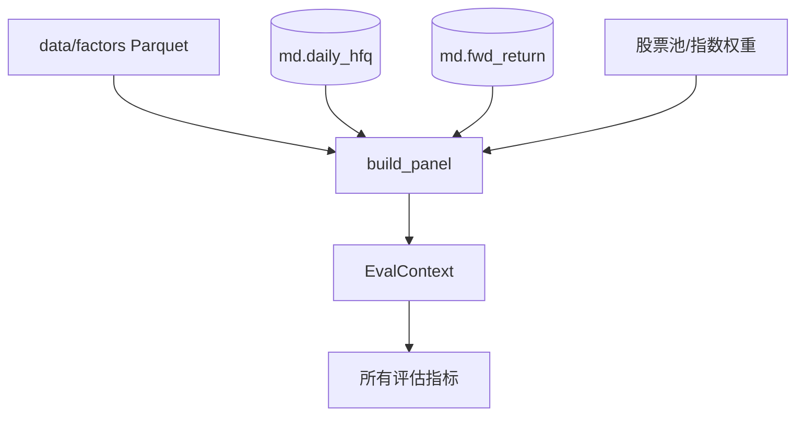
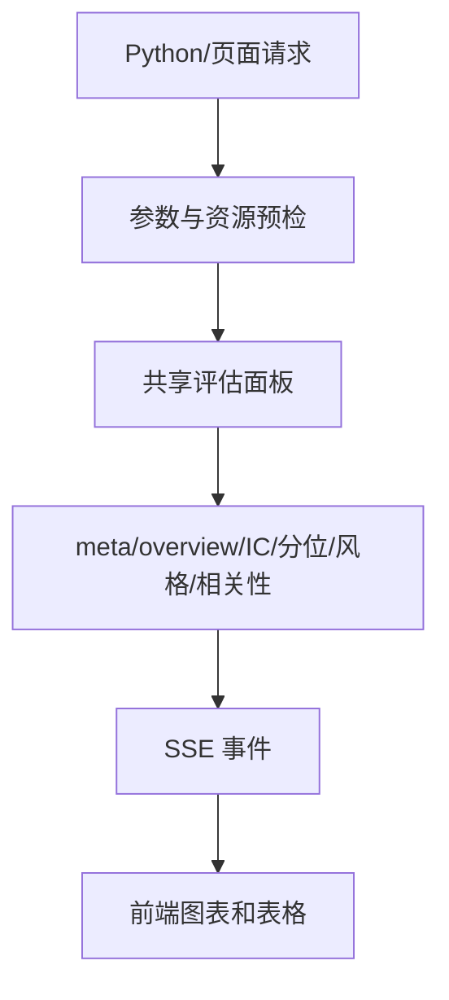

# D1-D6 因子评估

因子评估的核心问题是：

> 当天因子值较高的股票，未来收益是否通常也更好？这种关系是否稳定、是否独立于明显风格、是否值得进入下一阶段研究？

评估结果是研究证据，不是自动生成的交易收益。

## D1：评估面板与股票池

### 先补基础知识

因子值和未来收益必须来自同一个观察时点。例如在 2025-01-02 收盘后观察因子，就只能使用当天及以前可得到的信息；标签则记录之后发生的收益。

评估面板就是把这些内容放到同一张表中：

| 股票 | 日期 | 因子值 | 未来收益 | 是否在股票池 |
|---|---|---:|---:|---|
| A | 2025-01-02 | 0.82 | 0.031 | 是 |
| B | 2025-01-02 | 0.15 | -0.012 | 是 |

股票池可以是全 A 可交易股票，也可以是某个指数的历史成分股。研究股票池决定了“比较谁”。

### 模块在项目中的位置

核心代码位于 `research/evaluation/calculate/panel.py`，入口和参数位于 `calculate.evaluate`、`calculate.params` 和 `calculate.universe`。



### 它负责什么

它负责把因子、标签、股票池、交易状态和辅助字段对齐成一次评估共用的样本。

### 它不负责什么

它不计算最终指标，不修改数据库，也不负责交易执行。

### 输入与输出

面板的关键字段包括 `stock_code`、`trade_date`、`factor`、`label`、`label_1d`、`in_universe`、`is_st`、`can_buy_close`、市值、换手和估值字段。

### 一次典型流程

评估 `MOM_20` 的 5 日表现时，系统从因子文件取 `MOM_20`，从 `md.fwd_return` 取 `fwd_ret_close_5`，再按股票和日期连接。停牌、股票池外、因子缺失或未来标签缺失的记录会按照各指标的样本规则处理。

### 结果如何理解

面板决定了所有指标使用的样本口径。先构建共享面板，再计算多个指标，可以避免每个指标各自读取数据造成口径不一致。

### 常见误区与限制

- 面板中有一行，不代表这行一定有有效标签。
- 股票池成员资格不是永远固定的。
- 标签周期越长，区间末端自然缺失越多。
- 完整面板有交易日数和行数保护；轻量 IC 可以走独立路径。

### 本节范围

不逐列解释 SQL，重点掌握“对齐”和“样本边界”。

## D2：IC、RankIC 与有效样本

### 先补基础知识

相关性是用一个数描述两个变量是否一起变化。因子研究通常按交易日做横截面相关：每天把股票放在一起比较，而不是把所有日期混成一个样本。

**IC** 使用 Pearson 相关，关心数值变化关系。**RankIC** 使用 Spearman 相关，关心排序关系。

```text
RankIC_t = corr(rank(当天因子值), rank(未来收益))
```

### 模块在项目中的位置

IC 指标位于 `research/evaluation/calculate/metrics/ic.py`，逐日计算由评估上下文和公共 daily 计算能力提供。

### 它负责什么

它负责计算每日 IC/RankIC、时间序列、分布、均值、ICIR、t 值、正值比例和方向一致性。

### 它不负责什么

它不模拟买卖，不扣交易成本，也不把相关系数直接解释为收益率。

### 输入与输出

| 输出 | 含义 |
|---|---|
| `mean` | 日度相关的平均水平 |
| `std` | 日间波动 |
| `ICIR` | 平均相关相对于波动的稳定程度 |
| `t` | 均值偏离 0 的统计量，但要注意时序相关 |
| `positive_ratio` | 相关系数为正的交易日比例 |
| `valid_days` | 实际有足够有效股票的交易日数 |

有效交易日少于 20 天时，项目会保留天数但把主要汇总数值置空，避免短样本产生过强结论。

### 一次典型流程

某交易日有效股票有 200 只。系统按 `MOM_20` 排序，再按未来 5 日收益排序，得到当天 RankIC。重复所有交易日后，汇总平均值，并与因子定义中的 `direction` 比较。

### 结果如何理解

RankIC 均值为正表示因子高值股票的未来收益排名总体更靠前。它是历史排序关系，不是 3% 收益承诺。

### 常见误区与限制

- 正值比例高但均值很小，可能表示方向一致但信号很弱。
- t 值受到重叠持有期和时序相关影响，不能机械当成独立样本检验。
- Pearson 的去极值设置不影响 RankIC。
- 单日极端值必须结合有效股票数查看。

### 本节范围

本节只讲 IC 家族，不展开分组收益和风格拆分。

## D3：分位收益与多空价差

### 先补基础知识

分位分析把股票按因子值分成若干组，例如 10 组：

```text
第 1 组：因子值最低
第 10 组：因子值最高
```

如果第 10 组长期比第 1 组表现好，说明因子排序可能有收益梯度。

### 模块在项目中的位置

指标集中在 `research/evaluation/calculate/metrics/bins.py`，公共分组能力位于 `calculate.binning`。

### 它负责什么

它负责计算分位组收益、单调性、分位累计曲线、收益分布和最高组减最低组的多空价差。

### 它不负责什么

它不处理真实订单、T+1、费用、滑点、涨跌停和现金约束。

### 输入与输出

分组支持等权和分位内市值加权。分组后的收益通常使用 1 日标签生成累计曲线，避免每天累乘 5 日重叠收益。

### 一次典型流程

每个交易日先按因子值排序并分为 10 组，再计算每组当天的 1 日未来收益。将第 10 组收益减去第 1 组收益得到日度价差，再观察均值、正值比例、累计路径和最大回撤。

### 结果如何理解

高组高、低组低且中间组有梯度，比只有最高组突然跳高更能支持“因子有排序能力”。但分位曲线仍然不是净交易回测。

### 常见误区与限制

- 市值加权和等权结果差异大时，信号可能混入规模暴露。
- 多空价差没有自动模拟融券、借券成本和成交限制。
- 分组收益的标签可能重叠，统计独立性有限。

### 本节范围

不展开每个分位图 payload 的字段格式。

## D4：换手、衰减与相关性

### 先补基础知识

**换手**描述股票或分组成员变化有多快。换手高，通常意味着调仓频繁、成本压力可能更大。

**衰减**描述因子预测能力随持有周期变化的过程。一个因子可能只在未来 1 日有效，也可能在未来 20 日仍然有效。

**因子相关性**描述不同因子是否提供相似信息。两个因子高度相关时，把它们放进模型未必得到两份独立信息。

### 模块在项目中的位置

换手和自相关位于 `metrics/turnover.py`，衰减位于 `metrics/decay.py`，多因子相关性位于 `calculate/correlation.py`。

### 它负责什么

它负责衡量信号成员稳定性、持有周期表现和因子之间的重复程度。

### 它不负责什么

它不替回测计算真实订单换手，也不自动决定模型应该删除哪些因子。

### 输入与输出

| 分析 | 典型输出 |
|---|---|
| 分位换手 | 全池和各分位的成员变化率 |
| 因子自相关 | 当前排序与滞后 1/5/20 日排序的相似程度 |
| 衰减 | 不同持有周期的 RankIC 和分组收益 |
| 相关性 | 因子对之间的逐日截面 Spearman 及有效天数 |

### 一次典型流程

系统把连续交易日的因子排序转成分位组号，只比较相邻日期共同存在的股票。若大量股票跨组，换手上升；再分别用 1、3、5、10、20 日标签观察预测能力随周期变化。

### 结果如何理解

高 IC 但高换手的因子可能需要更谨慎地进入回测。高相关因子适合进一步研究组合冗余，而不是简单相加。

### 常见误区与限制

- 分位换手不等同于真实资金换手。
- 相关性矩阵因成对有效样本不同，不一定是可直接用于组合优化的协方差矩阵。
- 衰减收益使用不同周期标签，不能把不同周期的数字直接当成同一种收益比较。

### 本节范围

不展开相关性矩阵的数值优化和组合构建。

## D5：风格暴露与增量 IC

### 先补基础知识

一个因子看起来有效，可能只是因为它偏好某些行业或风格。例如高因子值股票大多来自小盘股，那么收益关系可能来自规模风格，而不完全来自因子本身。

**风格暴露**描述因子与规模、波动率、价值、流动性等风险特征的关系。**增量 IC**尝试在剔除这些风格影响后，继续观察因子是否保留预测关系。

### 模块在项目中的位置

风格定义位于 `calculate/styles.py`，暴露计算位于 `calculate/exposure.py`，对应指标位于 `metrics/exposure.py`。

### 它负责什么

它负责描述因子与风格/行业变量的关系，并估计控制这些变量后剩余的预测能力。

### 它不负责什么

它不证明因果关系，也不保证“残差 IC”可以直接转成无风险收益。

### 输入与输出

输入包括因子值、风格字段和可选行业信息。输出包括暴露、回归信息、原始 RankIC 与残差 RankIC 的对照。

### 一次典型流程

系统按交易日整理股票的因子值和风格值，对风格缺失按项目口径处理，再比较原始因子排序和控制风格后的剩余排序与未来收益的关系。

### 结果如何理解

如果控制风格后 IC 明显下降，说明因子可能主要是在重复某种风格；如果仍保留一定关系，说明它可能包含增量信息。

### 常见误区与限制

- 控制后的残差关系不是因果证明。
- 风格缺失的填补不等于股票事实上没有该风格暴露。
- 行业数据的时点必须避免使用当时不可得的未来分类信息。

### 本节范围

不讲回归算法的矩阵实现，只讲暴露分析的研究目的。

## D6：评估入口、stage 与监测页面

### 先补基础知识

一次完整评估包含多个指标。如果所有指标算完后才返回，页面会长时间没有反馈。项目把结果拆成多个 `stage`，按顺序逐段输出。

### 模块在项目中的位置

评估核心位于 `research/evaluation/calculate`，Web 适配位于 `apps/monitor/backend`，页面位于 `apps/monitor/frontend`。

### 它负责什么

它负责接收评估参数、构建共享面板、按固定顺序计算指标，并把 JSON 结果通过 Python、API 或 SSE 交给调用方。

### 它不负责什么

它不负责修改因子，不写普通评估结果库，也不负责把页面曲线变成交易指令。

### 输入与输出



### 一次典型流程

用户选择因子、日期、股票池和标签周期。后端先检查参数和面板规模，再输出 `meta`，随后依次输出 `overview`、IC、分位、换手、衰减、暴露和相关性，最后输出 `done`。如果在面板构建阶段发现数据不存在，错误会在业务事件开始前返回。

### 结果如何理解

stage 是输出组织方式，不是新的金融指标。它让页面能逐步展示结果，也让长任务能够被取消和监控。

### 常见误区与限制

- 页面显示为空，不一定表示结果为 0，也可能是有效样本不足或标签缺失。
- 轻量 IC 和完整评估不是同一条资源路径。
- 原生计算阶段有并发保护，吞吐和安全之间存在权衡。

### 本节范围

不分析前端 CSS 和具体事件序列字段，重点掌握评估计算和页面之间的边界。

