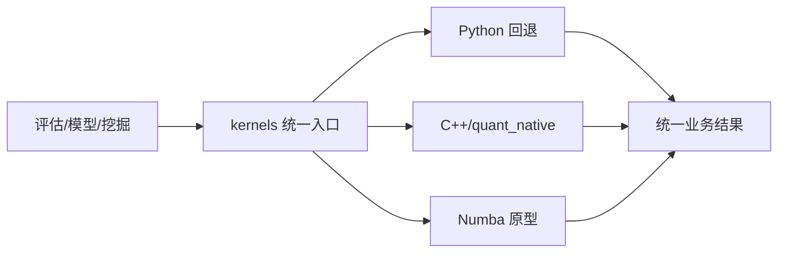

# E1-E3 原生计算

原生计算不是一个新的金融研究模块。它是为评估、模型预处理和挖掘相关性提供更快批量计算的基础设施。它应该保持业务口径不变，只改变计算执行速度和资源使用方式。

## E1：Python、Numba 与 C++ 后端

### 先补基础知识

研究数据通常有几百万行。用 Python 逐行处理很容易变慢。更适合的方式是把一批数据组织成数组，一次完成排名、相关性或标准化。

项目保留多种后端：

| 后端 | 作用 |
|---|---|
| Python | 参考实现和没有扩展时的回退 |
| Numba | 研究原型和性能探索 |
| C++/pybind11 | 已验证的批量计算核 |
| `auto` | 根据当前环境选择可用后端 |

### 模块在项目中的位置

统一入口是 `core/kernels`，C++ 扩展位于 `native`。业务模块不应直接导入 `quant_native`，而是通过 `kernels` 选择后端。

### 它负责什么

它负责为上层业务提供与后端无关的批量数组计算能力，并在原生扩展不可用时保持 Python 回退。

### 它不负责什么

它不定义 IC、分组收益或风格暴露的业务含义，也不应改变这些指标的缺失、并列和最小样本规则。

### 输入与输出

输入通常是连续的数值数组和按交易日组织的分组边界。输出是相关系数、排名、分箱、收益矩阵、换手或回归结果。

### 一次典型流程

评估模块把面板按交易日稳定整理成数组，调用 `kernels` 计算每日 RankIC。如果 C++ 扩展可用，`auto` 选择 native；如果扩展不可用，则使用 Python 回退。上层只读取统一结果，不需要知道底层后端。

### 结果如何理解

原生计算的成功主要表示“同一业务计算更快或资源更合适”。它不意味着因子本身更有效。

### 常见误区与限制

- 加速后端不能修复错误的数据口径。
- C++ 结果与 Python 金标准必须做一致性验证。
- 运行期原生异常不能被简单吞掉，否则会掩盖真实错误。

### 本节范围

不讲 pybind11、内存布局和 C++ 类的内部实现。

## E2：排名、相关、分箱与回归计算核

### 先补基础知识

因子评估和模型预处理常见的批量运算包括：

- **排名**：把股票因子值转成相对次序；
- **相关**：比较因子排序和未来收益排序；
- **去极值与标准化**：减少异常值影响，让不同特征更容易比较；
- **分箱**：把股票分成低到高的若干组；
- **回归**：估计因子与风格变量之间的暴露关系。

这些都是数学计算核，但它们必须服从上层业务定义。例如并列值如何排名、NaN 是否剔除、最少多少只股票才计算，都属于业务口径。

### 模块在项目中的位置

`core/kernels` 的能力被 `calculate.daily`、`calculate.correlation`、`calculate.binning`、`calculate.exposure`、`alpha.kernel_ops` 和挖掘相关性模块使用。

### 它负责什么

它负责按固定数组契约批量完成研究指标所需的数学运算。

### 它不负责什么

它不决定股票池、不读取业务数据库、不发布因子，也不独立产生页面结果。

### 输入与输出

| 计算核 | 服务的上层概念 |
|---|---|
| `daily_rank_pct` | 每日截面排名、模型特征/标签排序 |
| `daily_pearson` | Pearson IC |
| `pairwise_spearman` | 因子相关性 |
| `daily_winsorize_mad` | IC 和风格数据去极值 |
| `daily_zscore` | 风格和模型特征标准化 |
| `daily_quantile_bins` | 分位组 |
| `bin_returns_multi` | 多标签分位收益 |
| `bin_turnover` | 分位换手 |
| `daily_ols` | 风格暴露回归 |

### 一次典型流程

以分位收益为例：上层先按日期把数据排好，并提供每个日期的起止位置；计算核只负责在每组内统计收益。它不会自己决定“哪些股票属于全 A”，也不会把组收益解释成已扣成本的组合收益。

### 结果如何理解

计算核是“数学服务层”。它的输出必须回到评估或模型模块的上下文中解释，不能脱离业务契约单独解读。

### 常见误区与限制

- 数组分组边界错了，会让结果看似有数但对应错误交易日。
- 原生核和 Python 回退必须在 NaN、无穷、并列和常数输入上保持一致。
- 同名的“标准化”可能有样本标准差和总体标准差两种口径，不能混用。

### 本节范围

不逐个解释 C++ 函数参数和循环结构。

## E3：一致性、并发与性能边界

### 先补基础知识

加速计算至少要同时回答三个问题：

1. 算得对不对？
2. 多个任务同时运行时会不会互相影响？
3. 速度提升是否值得增加维护和资源成本？

项目用 Python 结果作为重要对照，并通过固定基准记录耗时、内存和输出差异。

### 模块在项目中的位置

统一后端由 `core/kernels/backend.py` 管理。评估服务的原生阶段保护位于 `research/evaluation/calculate/native.py`，性能和一致性工具位于 `tools/monitor` 以及相关测试中。

### 它负责什么

它负责定义后端选择、结果一致性、原生阶段互斥和性能验收边界。

### 它不负责什么

它不保证整个 Python 进程所有函数都可以安全并行，也不保证原生库没有未知环境问题。

### 输入与输出

验收通常关注：

| 维度 | 问题 |
|---|---|
| 数值一致性 | native/auto 与 Python 结果是否在允许容差内一致 |
| 资源 | 耗时、峰值内存和线程数是否可接受 |
| 并发 | 两个任务是否会同时进入不安全的原生阶段 |
| 取消 | 等待原生阶段的任务能否在进入计算前取消 |
| 失败 | 扩展不可用时是否正确回退，运行期错误是否向上反馈 |

### 一次典型流程

两个页面请求同时进入评估。调度器可以让它们在阶段边界交替推进，但原生计算阶段使用共享保护，避免两个任务同时进入可能不安全的区域。背压或网络等待时不应长时间占用原生锁。

### 结果如何理解

性能基准只能说明当前机器和当前数据上的资源表现。它不能改变指标的金融解释，也不能证明整个系统已经在所有环境下稳定。

### 常见误区与限制

- 速度提升不能抵消数据口径错误。
- 仅有单元测试通过，不等于长时间并发、真实数据和浏览器链路都稳定。
- 当前项目文档仍记录部分原生阶段的未知崩溃风险和有限的联合验收证据。

### 本节范围

不展开线程实现、Eigen 求解器和 C++ 内存管理；这些属于实现维护主题，不是本批次的功能学习目标。

