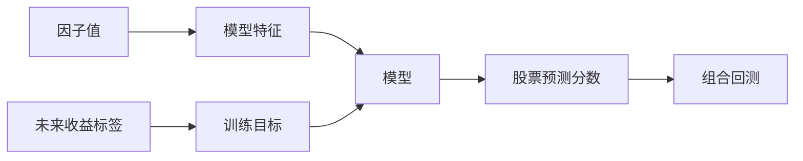

# M1-M20 模型层

模型层位于因子评估之后、回测之前。它把当天可见的因子和上下文特征转换成股票之间可比较的预测分数，再把分数交给组合和回测模块。

模型层最重要的边界是：

```text
模型分数 != 组合权重
模型评价 != 交易回测
训练完成 != 样本外有效
```

核心代码位于 `research/modeling/alpha`，训练脚本位于 `core/data/scripts/build_alpha`，配置位于 `configs/alpha`。

## M1：监督学习与横截面预测基础

### 先补基础知识

监督学习就是给模型一批“输入和已知结果”，让模型学习二者的关系。项目中的输入是因子和上下文特征，结果是未来收益或未来收益的横截面排名。

“横截面预测”表示在同一天比较股票，而不是只预测一只股票下一天的精确价格。模型更关心：

```text
今天哪些股票相对更值得排在前面？
```

### 模块在项目中的位置



### 它负责什么

它负责学习特征和未来收益排序之间的关系，并输出同一信号日内可比较的预测分数。

### 它不负责什么

它不负责生成因子、不负责处理真实成交，也不负责保证预测分数一定带来正收益。

### 输入与输出

输入是股票-信号日样本、特征列和标签列。输出是模型文件、预测分数、训练配置和可追踪的 manifest。

### 一次典型流程

系统在某个周频信号日读取 50 个根特征及其缺失指示，标签是未来 5 个交易日开盘到开盘收益的排名。模型学习训练区间的排序关系，再对后续未参与训练的股票样本输出分数。

### 结果如何理解

分数越高只表示模型认为该股票的未来相对排名更高。它不是预测价格，也不是直接应该买入的金额。

### 常见误区与限制

- 训练集上的拟合好不代表未来有效。
- 分数的绝对大小通常没有直接经济单位。
- 只有经过组合、交易规则和成本处理后，才能讨论策略表现。

### 本节范围

不展开具体算法公式，后续 M8、M9 分别说明线性模型和 GBDT。

## M2：模型数据契约

### 先补基础知识

模型研究最容易出错的地方不是算法，而是时间。每个样本都要明确：

- 特征在什么时候可见；
- 标签对应未来哪段时间；
- 训练时是否只使用当时已经知道的数据；
- 样本键是否唯一。

### 模块在项目中的位置

数据契约由 `ResearchContract`、`DatasetSpec` 和模型数据集构建流程共同约束。

### 它负责什么

它负责固定标签、价格通道、股票池、调仓频率、上市天数和开发期边界。

### 它不负责什么

它不负责评估模型是否优秀，也不负责在契约不允许时自动放宽时间范围。

### 输入与输出

当前研究口径包括 `fwd_ret_open_5`、`all_a`、周频信号、上市满 60 个自然日以及开发期与最终留出期的边界。

### 一次典型流程

数据集构建器先验证标签和时间粒度，再按 `stock_code + trade_date` 对齐因子、日线状态和标签。如果请求跨入封存留出区间，普通数据集入口会拒绝，只有专门的最终留出入口可以打开。

### 结果如何理解

数据契约是“这次模型研究到底在回答什么问题”的定义。契约改变后，模型 ID 和研究结论都应视为新的版本。

### 常见误区与限制

- 只改标签周期而不改模型 ID，会让不同研究口径混在一起。
- 训练数据可用不等于标签当时可见。
- 运行日期和公告日期不是一回事。

### 本节范围

不展开数据类的字段校验实现。

## M3：周频数据集与面板

### 先补基础知识

日频数据每天都有样本，但如果模型每天调仓，交易成本和标签重叠会更复杂。项目把研究信号安排在每周最后一个交易日，形成周频样本。

### 模块在项目中的位置

入口是 `alpha.dataset.build_dataset()`，它读取因子 Parquet、主库行情、标签、交易日历、行业和因子目录库。

### 它负责什么

它负责把日频市场资料整理成固定的周频模型样本，并保存数据集 manifest。

### 它不负责什么

它不训练模型、不切分最终折，也不执行回测。

### 输入与输出

输出数据集的主键仍是 `stock_code + trade_date`，但 `trade_date` 只保留每周信号日。manifest 记录数据版本、因子版本、特征列和标签口径。

### 一次典型流程

系统先用完整交易日历找出每周最后交易日，再将因子、状态和未来 5 日标签连接到这些日期。之后筛掉不满足股票池和上市天数条件的样本，按固定列顺序写出数据集。

### 结果如何理解

数据集是模型层的事实输入。它不是简单的“因子文件子集”，而是已经包含研究时间、标签和可交易样本定义的训练材料。

### 常见误区与限制

- 周频日期不能用自然周最后一天替代交易日历。
- 数据集的 `eligible` 样本规则与回测最终成交规则仍不完全相同。
- 重新构建数据集会影响模型 ID 和预测产物。

### 本节范围

不逐列列出数据集所有辅助字段。

## M4：标签设计

### 先补基础知识

标签是模型试图预测的结果。项目当前主模型使用未来 5 个交易日开盘到开盘收益：

```text
在信号日之后的下一个开盘附近进入
在之后第 5 个交易日的开盘附近退出
```

排序模型还会把同一信号日的收益转换成横截面排名。

### 模块在项目中的位置

标签来源是 `md.fwd_return`，研究契约在 `research/modeling/alpha/config.py` 中固定。

### 它负责什么

它负责定义模型要学习的未来结果，以及这个结果和信号时间之间的关系。

### 它不负责什么

它不模拟订单成交，也不替回测处理滑点、费用和公司行动。

### 输入与输出

输入是数据层生成的未来收益标签。输出是模型数据集中的 `label` 和训练目标 `label_rank`。

### 一次典型流程

在周五信号日，模型只读取周五收盘前已经形成的特征。标签从后续交易日的开盘价格计算，区间末端因未来价格尚未完整而为空。

### 结果如何理解

标签决定模型学到的是“未来开盘收益排序”，不是“下一分钟价格变化”或“长期价值”。改变标签就改变了研究问题。

### 常见误区与限制

- 用信号日之后才公布的数据做特征会造成前视。
- 5 日标签在相邻信号日之间可能重叠。
- 研究标签和回测真实成交仍需由回测层再次对齐。

### 本节范围

不展开标签 SQL 的窗口实现。

## M5：缺失值、去极值与标准化

### 先补基础知识

不同因子的量纲差异很大。市值可能是很大的金额，波动率可能在小数范围内，某些股票还可能缺少财务或历史窗口。预处理把这些输入转换成更适合模型学习的形式。

### 模块在项目中的位置

核心代码是 `alpha.preprocess` 和 `alpha.kernel_ops`，数值后端由 `kernels` 提供。

### 它负责什么

它负责按交易日做截面排名、1%/99% 分位裁剪、总体标准差 z-score、缺失指示和可选的行业/市值中性化。

### 它不负责什么

它不生成原始特征、不改变股票池定义，也不负责模型折切分。

### 输入与输出

输入是带原始因子、上下文、标签和 `eligible` 的数据集。输出是固定顺序的模型矩阵、缺失列和诊断报告。

### 一次典型流程

系统先只在 `eligible=True` 样本上处理每个交易日的特征，再进行 rank 或 z-score，缺失值按当前模式填充，并可保留缺失指示列。中性化和 `clip_z` 的先后顺序属于契约的一部分。

### 结果如何理解

预处理改变的是模型看到的特征表达，不应被误读成新的金融信号。

### 常见误区与限制

- 评估层的样本标准差和模型层的总体标准差不是同一口径。
- 把缺失值简单填成 0 可能把“没有数据”误认为“中性”。
- 预处理必须在每个时间截面内完成，不能用未来日期的整体统计量。

### 本节范围

不展开数组核的内部排序实现。

## M6：时间切分基础

### 先补基础知识

金融数据不能像普通图片数据一样随机打乱。未来数据不能进入过去的训练过程，因此通常按时间切分训练、验证和测试。

### 模块在项目中的位置

切分由 `alpha.split`、`alpha.modeling.folds` 和固定研究配置共同管理。

### 它负责什么

它负责把历史按时间分成训练区间和后续预测区间，形成可重复的滚动验证折。

### 它不负责什么

它不训练模型，也不根据测试结果临时修改折定义。

### 输入与输出

输出是带 `fold_id`、训练起止日期和预测起止日期的折清单。

### 一次典型流程

一个折使用过去若干年的样本训练，再预测下一段周频数据。之后窗口向前滚动，新的折继续只使用当时已经发生的数据。

### 结果如何理解

滚动折模拟“模型随着时间推进不断使用新历史”的研究过程，比随机切分更接近金融应用。

### 常见误区与限制

- 随机切分会让相邻日期的信息相互泄露。
- 验证期如果反复用于挑参数，也会逐渐变成训练信息。
- 折定义是研究契约的一部分，不能只看平均分数。

### 本节范围

下一节专门说明重叠标签带来的 purge 和 embargo。

## M7：Purged walk-forward 与 embargo

### 先补基础知识

即使训练和测试日期不重叠，标签本身也可能跨过边界。例如一个 5 日标签从训练末日开始，收益计算延伸到了测试期。**Purge** 会删除边界附近的训练样本；**Embargo** 会在测试边界附近再留出隔离区。

### 模块在项目中的位置

规则由研究契约和折构建逻辑共同执行，当前 `purge_days` 和 `embargo_days` 至少要覆盖标签周期之外的隔离要求。

### 它负责什么

它负责减少重叠标签和时间邻近造成的信息泄露。

### 它不负责什么

它不解决所有数据泄露，例如特征本身使用了错误的公告日期，仍需数据层和特征审计发现。

### 输入与输出

输入是时间折、标签周期、purge 和 embargo 配置。输出是每折可训练和可预测的日期范围。

### 一次典型流程

如果测试折从 2020-01-01 开始，训练末尾靠近该日期的样本会被删除；测试开始后的隔离日期也不会用于不该看到它的训练或调参流程。

### 结果如何理解

更严格的时间隔离通常会减少可用样本，但能让样本外指标更可信。

### 常见误区与限制

- purge 不是“把未来全部删除”，而是针对标签重叠边界。
- embargo 不代表模型完全没有市场状态变化风险。
- 保护规则越复杂，越要记录到 manifest 里，否则结果难以复现。

### 本节范围

不展开折切分函数的日期算法。

## M8：线性模型

### 先补基础知识

线性模型把多个特征按权重相加，得到预测分数。它的优点是简单、容易解释，适合做基线。项目使用 Ridge 作为线性参照。

### 模块在项目中的位置

线性后端位于 `research/modeling/alpha/modeling/backends/linear.py`，统一训练流程位于 `modeling/pipeline.py`。

### 它负责什么

它负责提供一个稳定、可解释、可比较的线性预测基线。

### 它不负责什么

它不负责自动挑选因子、不负责交易组合优化，也不代表线性模型一定弱。

### 输入与输出

输入是预处理后的特征矩阵和 `label_rank`。输出是每折模型文件、系数元数据和标准预测分片。

### 一次典型流程

每个 walk-forward 折独立拟合 Ridge，再对下一时间段输出分数。所有折的预测拼成一个完整的样本外预测集。

### 结果如何理解

Ridge 的作用不仅是候选模型，也是“复杂模型是否真的有增量价值”的参照。

### 常见误区与限制

- 线性模型不能自动说明因子有因果作用。
- 系数大小受到预处理影响，不能脱离标准化口径比较。
- 基线表现差不代表复杂模型一定值得使用。

### 本节范围

不解释具体正则化求解过程。

## M9：GBDT 模型

### 先补基础知识

GBDT 通过许多棵树逐步拟合残差或排序目标，能够表达非线性和特征交互。项目支持 LightGBM 和 sklearn HistGBDT 两类后端。

### 模块在项目中的位置

后端位于 `research/modeling/alpha/modeling/backends`，训练契约由统一 pipeline 管理。

### 它负责什么

它负责提供非线性截面排序模型，并与线性基线共享数据、折和预测契约。

### 它不负责什么

它不自行修改标签、股票池或最终留出规则。

### 输入与输出

输入是同一份预处理特征和标签，输出是树模型文件、后端配置、折预测和 manifest 元数据。

### 一次典型流程

训练流程按折调用后端的 `fit_fold` 和 `predict`，统一流水线负责保存模型和合并预测。不同后端只负责算法差异。

### 结果如何理解

GBDT 的复杂度可能提高开发期拟合能力，但也提高过拟合、参数敏感和解释难度。

### 常见误区与限制

- 复杂模型开发期指标高，可能只是更好地记住历史。
- LightGBM 和 sklearn 后端的参数不能直接互换。
- 模型类型变化必须形成新的模型身份和产物目录。

### 本节范围

不比较具体树深、学习率和叶子数。

## M10：模型后端与统一契约

### 先补基础知识

如果每种算法都自己处理数据、折、文件和预测，项目会产生很多重复逻辑。统一后端契约让算法只负责“如何训练一折”，其余交给公共流水线。

### 模块在项目中的位置

契约位于 `modeling/contracts.py`，后端注册位于 `modeling/backends/__init__.py`，公共流程位于 `modeling/pipeline.py`。

### 它负责什么

它负责约束不同算法使用相同的训练、预测、保存、加载和元数据接口。

### 它不负责什么

它不替算法选择研究目标，也不让后端绕过公共时间切分和最终验收。

### 输入与输出

统一后端需要提供构建配置、单折训练、重拟合、预测、保存、加载和 manifest 元数据能力。

### 一次典型流程

训练器根据 `backend` 名称取得后端，再把同一折数据交给后端。后端返回模型对象和预测结果，公共流程负责产物结构、哈希和恢复。

### 结果如何理解

统一契约把“算法可替换”和“研究口径稳定”分开，便于比较模型而不改变实验流程。

### 常见误区与限制

- 新增后端不应自行改变股票池或组合规则。
- 统一接口不能消除不同算法的统计差异。
- 后端源代码变化会影响模型 ID 和可复现性。

### 本节范围

不展开后端自动发现的模块加载细节。

## M11：子模型集成与分数合并

### 先补基础知识

集成是让多个模型共同给出一个分数。不同随机种子或不同训练子模型可能犯不同的错误，合并后有时更稳定。

### 模块在项目中的位置

集成相关能力位于 `alpha.ensemble` 和训练流水线，当前主模型是五种子 LightGBM rank 集成。

### 它负责什么

它负责把多个子模型的预测合成标准化的最终分数。

### 它不负责什么

它不替评估计划决定候选是否通过，也不直接执行股票买卖。

### 输入与输出

输入是同一预测区间内多个子模型的标准预测，输出是模型级预测分片和合并哈希。

### 一次典型流程

五个子模型分别按折和种子输出分数，集成器检查股票-日期键一致，再按约定方法合并，最终只暴露一个标准 `score` 列给下游。

### 结果如何理解

集成结果通常表示“多个模型共同认为的相对排序”，不表示五个独立收益相加。

### 常见误区与限制

- 子模型之间高度相似时，集成带来的独立信息有限。
- 集成方法改变后必须产生新模型身份。
- 集成不能弥补所有子模型共同的时间泄露。

### 本节范围

不展开各种融合权重的数学比较。

## M12：预测产物与来源追踪

### 先补基础知识

模型研究不是只保存一个模型文件。还要知道模型用的是什么数据、什么特征、什么代码、什么折，以及预测文件是否完整。

### 模块在项目中的位置

产物管理位于 `alpha.modeling.artifacts`、`alpha.artifacts`、`alpha.predict` 和 `modeling.manifests`。

### 它负责什么

它负责保存模型、预测、数据集、配置、代码哈希和运行 manifest，并验证这些产物之间的关系。

### 它不负责什么

它不解释模型经济意义，也不替回测重新生成缺失预测。

### 输入与输出

标准预测至少包含 `trade_date`、`stock_code`、`score`。模型快照还要包含模型文件、训练数据集和预测内容哈希。

### 一次典型流程

回测读取模型预测前，先获取模型 artifact snapshot，确认预测文件、数据集和模型身份一致。任何分片缺失或哈希不匹配都应失败关闭。

### 结果如何理解

来源追踪让一个回测结果可以回到具体模型和具体数据，而不是只剩一个不可解释的收益数字。

### 常见误区与限制

- 文件存在不代表文件内容仍属于当前模型。
- 预测重新计算和读取已落盘预测是两条不同路径。
- 产物校验通过只说明可复现，不说明收益有效。

### 本节范围

不列出所有 manifest 字段。

## M13：预测评价与基线

### 先补基础知识

模型评价要和基线比较。常见基线包括 Ridge 和简单的全因子 rank 规则。单看模型收益，无法知道复杂模型是否真的带来增量。

### 模块在项目中的位置

评估入口位于 `alpha.evaluate`、`scripts.build_alpha.evaluate` 和 `evaluation_executor`。

### 它负责什么

它负责比较候选模型、基线、预测分数和研究组合的统计与经济指标。

### 它不负责什么

它不替最终账本处理所有交易规则，也不允许用最终留出结果反复调参。

### 输入与输出

输入包括预测、标签、分数策略、持仓规则、基准和风险门。输出包括 RankIC、净超额、Sharpe、回撤、换手和年度分解。

### 一次典型流程

每个候选都用相同研究期和持仓规则评价，再与 Ridge 和规则基线比较。若候选只在总收益一项改善而其他关键指标变差，不能简单说它更好。

### 结果如何理解

评价计划回答“在固定研究契约下，候选是否优于参照”，不是回答“未来一定赚钱”。

### 常见误区与限制

- 多次查看开发期结果并挑选最优，会产生选择偏差。
- 年度结果比总平均更能暴露收益集中在哪些年份。
- 研究模拟器和完整账本的口径不同，不能混称。

### 本节范围

不展开每项指标的公式。

## M14：评估计划与验收门禁

### 先补基础知识

门禁是预先写好的通过条件。它能减少研究者看完结果后再修改标准的问题。

### 模块在项目中的位置

计划对象位于 `alpha.evaluation_plan`，执行位于 `build_alpha.evaluation_executor`，门槛配置位于 `configs/alpha`。

### 它负责什么

它负责冻结候选、参照、评分规则、持仓规则和研究阈值，并记录每次判断的证据。

### 它不负责什么

它不把“通过门禁”解释成统计显著，也不自动替研究者改变计划。

### 输入与输出

输入是模型预测和研究契约。输出是不可变的评估报告、通过/失败状态和输入哈希。

### 一次典型流程

执行器读取计划和候选产物，先核对所有声明文件，再按同一规则计算指标，最后应用 P3 经济门和组合风险门。

### 结果如何理解

门禁提供一致的比较标准，不能替代经济判断和样本外验证。

### 常见误区与限制

- 门槛本身可能有研究假设，不能当作自然定律。
- 改阈值应生成新的计划或版本。
- 计划引用的任一输入变化都可能使旧报告失效。

### 本节范围

不复述所有配置字段。

## M15：风格暴露与风险分析

### 先补基础知识

模型分数可能只是偏好某些规模、流动性或行业。风险分析就是检查组合是否在无意中集中暴露于这些维度。

### 模块在项目中的位置

相关能力位于 `alpha.exposure`、`alpha.risk` 和模型评估计划。

### 它负责什么

它负责测量分数或目标组合的风格暴露、行业集中度和相关风险门。

### 它不负责什么

它不负责模拟成交，也不保证暴露低就一定盈利。

### 输入与输出

输出包括市值、流动性、行业主动权重和滚动暴露等风险摘要。

### 一次典型流程

模型先产生分数，组合转换成目标持仓后，风险门在滚动窗口内检查风格和行业上限。超过门槛的候选会被拒绝或降级。

### 结果如何理解

风险分析帮助区分“模型带来的信息”与“模型重复了已有风险暴露”。

### 常见误区与限制

- 风格中性不是无风险。
- 目标组合的暴露不等于真实成交后的暴露。
- 缺失风格数据需要明确记录，不能默认视为零暴露。

### 本节范围

不讲风险回归的矩阵实现。

## M16：分数到组合

### 先补基础知识

模型输出分数后，还要决定买哪些股票、每只多少权重、多久调仓以及是否平滑。这个转换就是组合构造。

### 模块在项目中的位置

模型组合能力位于 `alpha.portfolio`、`alpha.risk` 和下游策略适配器。

### 它负责什么

它负责把模型分数转换成研究目标组合或目标权重。

### 它不负责什么

它不负责判断股票当天是否真正能成交，最终执行由回测账本负责。

### 输入与输出

输入是股票分数、股票池、Top-N、等权/加权规则和风险门。输出是目标持仓或目标权重矩阵。

### 一次典型流程

系统按信号日分数选出前 30 只股票，按等权形成目标组合，再把目标交给回测层。回测层可能因为现金、整手、涨跌停或停牌而无法完全达到目标。

### 结果如何理解

目标组合是“想要的组合”，不是“实际持有的组合”。

### 常见误区与限制

- Top-N 越小，集中度和单股交易影响可能越大。
- 目标权重总和小于 1 时，剩余部分是现金，不是缺失数据。
- 分数平滑会改变换手和响应速度。

### 本节范围

订单分配和现金约束留到回测 T7-T10。

## M17：最终留出验证

### 先补基础知识

最终留出是一段事先封存的未来时间。它不能用于训练、调参或挑选模型。只有方案冻结后才使用一次。

### 模块在项目中的位置

入口位于 `alpha.final_holdout` 和 `scripts.build_alpha.final_holdout`。

### 它负责什么

它负责在冻结模型、冻结计划和新时间窗口上执行一次最终验证。

### 它不负责什么

它不负责在失败后自动换模型或重新调参。

### 输入与输出

输出是封存的最终留出报告、模型比较、完整账本结果和状态，例如当前 `fail_final_holdout`。

### 一次典型流程

模型先在开发期完成训练和选择，留出入口打开 2024-01-01 至 2026-10-15 窗口，生成预测和完整账本，最后记录状态并封存。

### 结果如何理解

最终留出失败表示冻结方案没有通过预先设定的经济门槛，不等于代码链路失败。

### 常见误区与限制

- 看到留出结果后重新调参，再用同一窗口验证，不再是独立留出。
- 留出窗口被消耗后，不能把它当成未来干净测试集。
- 留出结果仍受历史数据质量和交易模型假设影响。

### 本节范围

不讨论下一次留出窗口的研究计划。

## M18：模型注册与生命周期

### 先补基础知识

模型会经历训练、评价、接受、部署、降权、回滚和退休。生命周期把这些状态和实际可用行为分开记录。

### 模块在项目中的位置

注册位于 `alpha.registry`，生命周期位于 `alpha.lifecycle`，索引位于 `data/models/index.json`。

### 它负责什么

它负责验证模型产物、建立模型索引、记录下游评价和根据监控决定状态转换。

### 它不负责什么

它不自动把训练完成的模型部署为主模型，也不替策略层执行订单。

### 输入与输出

输出区分训练状态和 downstream 的评估、完整账本、监控、生命周期及最终留出状态。

### 一次典型流程

登记器扫描模型目录和 manifest，确认文件、预测和数据集一致后重建索引。生命周期根据监控告警决定保持主模型、半仓、回滚到 Ridge 或暂停。

### 结果如何理解

模型状态是“它在研究和部署流程中的位置”，不是单一的性能分数。

### 常见误区与限制

- `status=trained` 不代表已完成评估和回测。
- 回滚模型也需要有完整、可追踪的产物。
- 生命周期规则是预先设定的控制策略，不是收益预测。

### 本节范围

不逐项解释索引 JSON 的结构。

## M19：模型监控

### 先补基础知识

模型上线或进入研究运行后，表现可能随市场状态变化。监控观察最近一段时间的预测质量、超额、回撤、换手、缺失和暴露。

### 模块在项目中的位置

监控位于 `alpha.monitor` 及相关 policy、metrics 和 report 模块。

### 它负责什么

它负责生成滚动监控包、告警和给生命周期使用的观测。

### 它不负责什么

它不重新训练模型、不修改最终留出、不自动替换候选。

### 输入与输出

输入是现有预测、标签、完整账本和目标暴露。输出是 monitoring artifact、告警、报告和 manifest。

### 一次典型流程

监控读取最近 13 个周频信号日，至少需要 8 个有效观测。若 RankIC 连续为负、回撤过大或缺失率过高，就向生命周期输出 warning 或 alert。

### 结果如何理解

监控反映当前状态是否偏离预期，不等同于重新做一次完整研究。

### 常见误区与限制

- 监控窗口短，可能受短期市场状态影响。
- 告警不一定说明模型失效，但应触发预先规定的动作。
- 监控本身不能修复错误的标签或交易数据。

### 本节范围

不展开告警阈值的全部配置表。

## M20：模型与回测集成

### 先补基础知识

模型输出的是预测分数，回测需要的是信号、目标组合和可执行订单。因此两者之间必须有清楚的适配边界。

### 模块在项目中的位置

模型预测产物通过 `backtest` 的 ML provider 或策略适配器进入回测；输入快照记录模型文件、数据集和预测哈希。

### 它负责什么

它负责把固定模型预测以可验证的形式交给策略和回测层。

### 它不负责什么

它不在回测阶段重新训练、不重新平滑分数，也不替回测层执行交易规则。

### 输入与输出

输入是标准预测分片、模型快照和策略配置。输出是回测 provider 读取的信号和目标权重。

### 一次典型流程

回测开始时校验模型快照，再按信号日读取股票分数，provider 生成目标权重，账本根据次日开盘、现金和规则执行。

### 结果如何理解

这条链路能回答“这个模型在给定交易规则下的历史表现”，不能把模型指标和账本指标互相替代。

### 常见误区与限制

- 预测产物完整不代表目标组合一定成交。
- 回测表现下降可能来自模型、成本、交易限制或资金分配任何一层。
- 需要同时看模型评估、provider 状态和账本结果。

### 本节范围

具体订单、账本和交易限制见回测文档。

