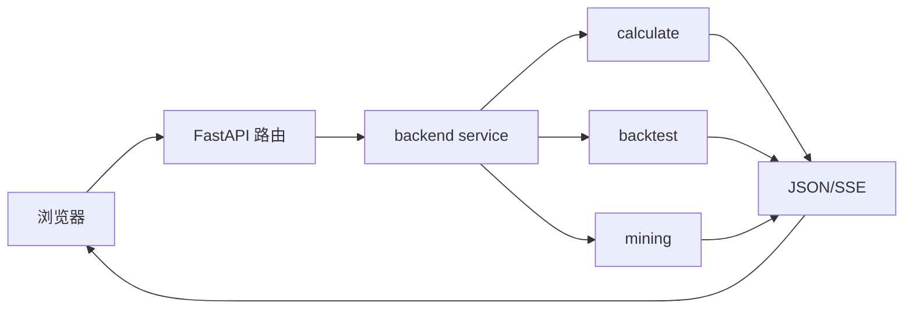

# W1-W4 监测应用

监测应用把因子评估、回测和因子挖掘接到同一个本地 Web 服务。它主要解决“怎样启动、观察、取消和查看研究任务”，不重新实现各业务模块的金融算法。

源码位于 `apps/monitor`，服务默认监听 `127.0.0.1:8800`，使用原生 HTML/JavaScript 和本地 ECharts。

## W1：FastAPI 后端与服务边界

### 先补基础知识

Web 应用通常分成：

- 路由：接收 HTTP 请求；
- 服务层：准备参数和调用业务模块；
- 业务模块：执行评估、回测或挖掘；
- 响应层：把结果转成 JSON 或事件流。

### 模块在项目中的位置

### 它负责什么

它负责把用户请求转换成业务模块能理解的参数，并把结果转成稳定的 HTTP 响应。

### 它不负责什么

它不计算 IC、订单、账本或候选公式，也不绕过业务模块的质量门禁。

### 输入与输出

输入是查询参数、JSON 请求和操作动作。输出是选项、因子列表、回测状态、挖掘状态、错误码和业务结果。

### 一次典型流程

浏览器请求 `/api/options`，服务读取交易日历和指标声明；请求因子评估时，服务完成参数预检并把任务交给 scheduler，最后通过普通 JSON 或 SSE 返回。

### 结果如何理解

后端是应用适配层。它的成功只表示请求被正确调度和响应，不代表金融结论成立。

### 常见误区与限制

- API 选项是当前环境快照，不是永远固定的枚举。
- 页面展示的数据可能来自重新计算或已有回测结果，需看接口语义。
- Web 错误码和业务错误码要结合日志定位。

### 本节范围

不逐路由列出全部 API 字段。

## W2：SSE、调度与取消

### 先补基础知识

普通 HTTP 请求通常等待完整结果。SSE（Server-Sent Events）允许服务在一个连接中持续发送事件，适合长时间评估、回测和挖掘任务。

调度器则控制同时运行的任务数量，避免多个大任务把内存和原生计算资源全部占满。

### 模块在项目中的位置

调度位于 `apps/monitor/backend/scheduler.py`，事件适配位于 `service.py`、`backtest_service.py` 和 mining service。

### 它负责什么

它负责排队、容量预留、事件流、背压、取消、断连和服务关闭时的安全收口。

### 它不负责什么

它不改变指标计算、账本或挖掘状态机的业务逻辑。

### 输入与输出

输入是任务请求和取消信号。输出是 queued、running、stage、progress、error、done 等事件。

### 一次典型流程

评估任务先预约容量，再生成器式推进各 stage；客户端读取速度变慢时，事件队列处理背压；用户取消时，任务在安全边界关闭生成器并释放容量。

### 结果如何理解

调度状态描述资源和通信状态，不是研究结果的好坏。

### 常见误区与限制

- 取消不能中断已经进入原生计算的阶段。
- 多进程 Uvicorn 会产生多份容量和锁，不符合当前设计。
- 断开浏览器连接不一定等同于业务任务瞬间停止。

### 本节范围

不解释 asyncio、线程和队列的内部实现。

## W3：前端页面与图表

### 先补基础知识

前端页面通常只负责把 API 返回的数据变成表单、卡片、图表和状态提示。图表不是新的计算层。

### 模块在项目中的位置

前端位于 `apps/monitor/frontend`，主要文件包括 `app.js`、`charts.js`、`stream.js`、`mining*.js`。

### 它负责什么

它负责路由、参数表单、SSE 事件消费、图表更新、运行状态展示和用户操作。

### 它不负责什么

它不在浏览器重新计算 IC、收益、成本或审批资格。

### 输入与输出

输入是 REST/SSE 数据。输出是因子详情、对比、回测结果、挖掘候选和错误提示。

### 一次典型流程

用户选择因子和日期，前端打开评估 SSE；收到 `meta` 后建立页面结构，收到不同 stage 后逐段更新卡片和曲线，收到 `done` 后结束加载。

### 结果如何理解

页面是业务结果的可视化投影，必须回到 API 和业务文档理解指标含义。

### 常见误区与限制

- 图表中的累计曲线不一定是净交易净值。
- 页面旧请求需要在路由切换时停止更新，避免覆盖新页面。
- 前端显示空值时要结合 API 的样本不足字段判断。

### 本节范围

不分析 CSS 和视觉组件细节。

## W4：监测场景与资源保护

### 先补基础知识

监测应用面对的是长任务、大数据和并发请求。资源保护包括输入上限、线程容量、等待名额、原生锁和安全关闭。

### 模块在项目中的位置

预检在 `preflight.py`，调度和原生保护在 backend scheduler/native，性能记录在 `docs/apps/monitor/performance.md`。

### 它负责什么

它负责在任务开始前拒绝明显超限请求，在运行中保护内存、并发和原生阶段，并把失败转成可定位的错误。

### 它不负责什么

它不保证外部数据、Worker 或原生扩展永远可用。

### 输入与输出

输出包括预检结果、容量状态、运行耗时、错误码、请求编号和日志路径。

### 一次典型流程

服务启动时检查主库、因子库、首页和 ECharts；用户提交大评估时先检查交易日和面板上限；两个任务并发时在阶段边界交替，避免同时进入不安全原生区。

### 结果如何理解

资源保护保证系统可控，不提高指标的金融质量。

### 常见误区与限制

- 预检通过只说明入口资源齐备，不代表完整业务计算已经成功。
- 性能基准依赖机器、数据和后端版本。
- 部分原生阶段仍有已知的崩溃风险和有限联合验收证据。

### 本节范围

不展开浏览器自动化验收脚本。

