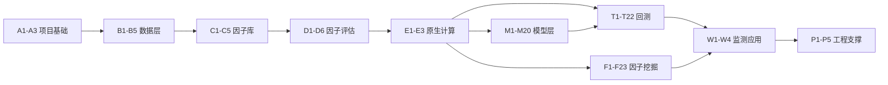

# 项目学习文档：A1-E3

这组文档是面向初学者的项目学习材料，覆盖项目基础、数据层、因子库、因子评估、原生计算、模型层、回测、因子挖掘、监测应用和工程支撑。

## 阅读顺序



推荐按顺序阅读。后面的模块会反复使用前面定义的词，例如“交易日”“后复权价”“未来收益标签”“因子值”和“股票池”。

| 文档 | 覆盖单元 | 作用 |
|---|---|---|
| [项目基础](A-foundations.md) | A1-A3 | 建立金融、量化研究和项目全链路的共同语言 |
| [数据层](B-data-layer.md) | B1-B5 | 说明原始数据如何变成可供研究使用的主库 |
| [因子库](C-factor-library.md) | C1-C5 | 说明研究假设如何变成可重复读取的因子值 |
| [因子评估](D-factor-evaluation.md) | D1-D6 | 说明如何判断因子是否有历史预测证据 |
| [原生计算](E-native-computation.md) | E1-E3 | 说明批量计算核为什么存在，以及它和业务指标的关系 |
| [模型层](F-model-layer.md) | M1-M20 | 说明特征、标签、时间切分、训练、预测、评估、生命周期和回测集成 |
| [回测层](G-backtest.md) | T1-T22 | 说明信号、目标权重、订单、A 股规则、账本、成本、归因和结果存储 |
| [因子挖掘](H-factor-mining.md) | F1-F23 | 说明假设、DSL、Worker、候选评估、证据、审批和原子发布 |
| [监测应用](I-monitor-web.md) | W1-W4 | 说明 FastAPI、SSE、调度、前端和资源保护 |
| [工程支撑](J-engineering-support.md) | P1-P5 | 说明路径、配置、日志、错误、测试、工具和限制边界 |

## 本批次的共同边界

这些文档解释模块提供的功能、数据关系和研究含义，不逐行解释函数内部实现。模型训练、组合回测和自动因子挖掘留到后续批次。

整个项目还需要始终区分：

```text
历史统计关系  !=  可执行交易收益
模型预测分数  !=  组合权重
回测模拟结果  !=  未来真实表现
测试通过      !=  金融结论成立
```

