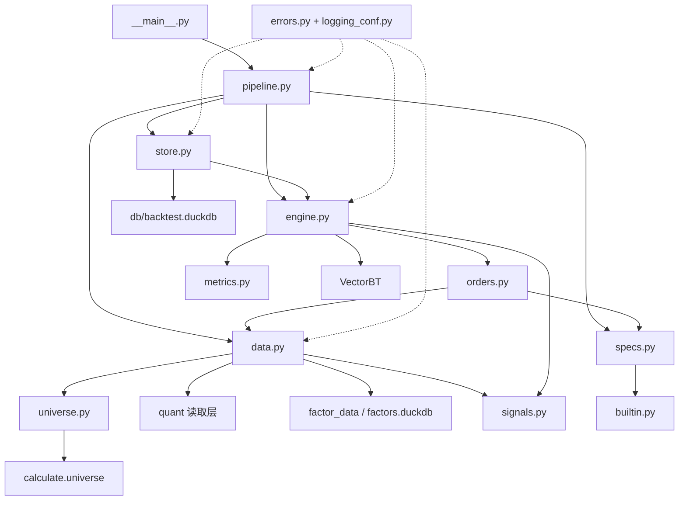

# VectorBT A 股回测项目构成与完整回测流程

> V48 P0-1 后，正式执行记账已改由 `backtest/ledger.py` 的原始价账本负责；
> 本文中关于 VectorBT 负责现金、持仓和公司行动的段落属于旧口径，阅读时以
> `docs/backtest/corporate_action_ledger.md` 和 `docs/backtest/data_contract.md` 为准。

> 分析日期：2026-10-15
> 分析范围：`/home/hanwen/quant/backtest`，当前 Git 提交 `66f564d (V20: 价格改前复权口径、退市强制清算、版本元数据与复现性测试)`。
> 说明性质：本文是基于源码、测试和已有项目文档的静态学习说明，没有执行构建、启动或测试命令。

## 1. 先看结论：这个项目解决什么问题

`backtest/` 不是从零实现一个现金账本和撮合器，而是一个**基于 VectorBT 的 A 股日频回测适配层**：

- `VectorBT` 负责按目标仓位执行订单，并计算现金、持仓、费用、组合价值和净值；
- `backtest` 负责把 A 股数据和交易规则整理成 VectorBT 能消费的矩阵；
- `backtest` 还负责因子信号、股票池、停牌/涨跌停拒单、板块申报单位、卖出印花税、最低佣金、退市强制清算、绩效指标和结果落库；
- `quant` 负责从 `db/quant.duckdb` 读取行情、交易日历、股票基础信息、指数和版本信息；
- `calculate.universe` 负责统一股票池定义，避免因子评估与回测使用两套成分和可交易口径。

可以把它概括为：

```text
策略配置
   ↓
股票池 + 行情 + 因子 + 基准
   ↓
信号分数 → 目标权重
   ↓
下一交易日执行目标
   ↓
规则状态机过滤 → 拒单/强平/费用矩阵
   ↓
VectorBT 探针运行 → VectorBT 最终运行
   ↓
日结果/订单/持仓/指标/元数据
   ↓
DuckDB 的 bt.* 结果表
```

## 2. 项目构成

### 2.1 当前目录

```text
backtest/
├── __init__.py          # 对外导出公共 API
├── __main__.py          # python -m backtest 的命令行入口
├── builtin.py           # 内置策略及固定 strategy_id
├── config.py            # 路径和资源上限
├── data.py              # quant 数据读取适配与 MarketData 契约
├── engine.py            # 两遍 VectorBT 执行和标准化结果
├── errors.py            # 回测专用异常码
├── logging_conf.py      # 按模块分目录的文件日志
├── metrics.py           # 从标准化日结果计算绩效
├── orders.py            # 订单状态机、交易规则、费用和退市强平
├── pipeline.py          # 策略版本 → 取数 → 执行 → 落库的编排
├── signals.py           # 因子打分、可选股票、调仓日和目标权重
├── specs.py             # 不可变策略配置和运行参数
├── store.py             # DuckDB 策略版本、运行状态和结果表
├── tests/
│   ├── conftest.py
│   ├── test_data.py
│   ├── test_engine.py
│   ├── test_metrics.py
│   ├── test_orders.py
│   ├── test_signals.py
│   ├── test_specs.py
│   ├── test_store.py
│   └── test_universe.py
├── logs/                # backtest 自己的模块日志
└── docs/                # 本次补充的项目学习文档
```

本次新增的说明材料：

```text
项目构成与完整回测流程.md       # 根目录总说明
version.md                      # 本次文档需求版本记录
progress/V1.md                  # V1 需求拆分和完成标准
AiRecord/                       # 本项目的计划、变更和差异记录
docs/project-learning/          # 分层学习报告和模块关系图
```

### 2.2 分层结构

| 层次 | 文件 | 主要职责 |
|---|---|---|
| 入口层 | `__main__.py` | 解析 CLI 参数，初始化存储，消费阶段事件并打印 JSON |
| 编排层 | `pipeline.py` | 读取策略版本、应用运行级覆盖、加载数据、启动后台线程、处理取消和运行状态 |
| 配置层 | `specs.py`、`builtin.py`、`config.py` | 定义策略、交易成本、基准、路径、资源上限和内置策略 |
| 数据层 | `data.py`、`universe.py` | 读取行情/因子/基准，构造统一宽表，处理指数成分和数据对齐 |
| 信号层 | `signals.py` | 因子截面处理、可交易过滤、调仓周期、Top-N 目标权重 |
| 规则与订单层 | `orders.py` | 目标权重平移、方向状态机、拒单、最低佣金、印花税、退市强平 |
| 执行层 | `engine.py` | 探针 VectorBT、最终 VectorBT、日结果、持仓、校准信息和 `BacktestResult` |
| 指标层 | `metrics.py` | 累计/年化收益、波动率、Sharpe、回撤、换手、超额等 |
| 持久化层 | `store.py` | 策略不可变版本、运行生命周期、标准结果表和元数据 |
| 基础设施 | `errors.py`、`logging_conf.py` | 错误码、模块日志、日志轮转 |

### 2.3 模块依赖关系



箭头表示调用或数据依赖；`VectorBT` 是执行内核，`backtest` 的订单规则并不通过自维护现金账本实现，而是通过目标权重矩阵、拒单后的 `NaN` 和费用矩阵传给 VectorBT。

## 3. 一次完整回测的执行流程

下面以命令行入口为起点，按实际代码顺序说明。示例命令由 `__main__.py` 的模块文档和已有 `docs/backtest/README.md` 推断，实际执行应在父目录 `/home/hanwen/quant` 下进行：

```bash
cd /home/hanwen/quant
.venv/bin/python -m backtest --strategy mom20 \
    --start 2024-01-01 --end 2026-09-28
```

### 第 1 步：解析请求并准备策略存储

代码位置：`__main__.py:23-34, 37-62`。

1. `_parser()` 解析：
   - `--strategy`：`mom20` 或 `multifactor`；
   - `--strategy-id`：直接指定 DuckDB 中的策略 ID；
   - `--version`：指定策略版本；
   - `--start`、`--end`：回测区间；
   - `--init-cash`：默认 1,000,000；
   - `--universe`、`--benchmark`：运行级覆盖。
2. `BacktestStore()` 初始化 `db/backtest.duckdb`，创建 `strategy` 和 `bt` schema 以及结果表。
3. `store.ensure_builtins()` 确保内置策略已经写入策略表；重复执行不会重复创建，定义变化时追加版本。
4. CLI 把参数组装成 `RunRequest`，交给 `iter_run()`。

此时还没有读取行情，也没有运行 VectorBT。

### 第 2 步：读取策略版本，应用运行级覆盖，登记 run

代码位置：`pipeline.py:28-61, 79-108`。

1. `store.get_version(strategy_id, version)` 读取策略配置 JSON，并通过 `StrategySpec.from_dict()` 恢复为不可变配置对象。
2. `effective_spec()` 应用本次请求的覆盖：
   - `universe` 覆盖前先用 `resolve_universe()` 校验；
   - `benchmark` 覆盖构造新的 `BenchmarkSpec`；
   - 原来的已保存版本不修改，覆盖后的配置会随本次结果元数据保存。
3. `request.params` 构造 `BacktestParams`，校验日期为严格 `YYYY-MM-DD`、起始日不晚于结束日、初始资金为正数。
4. `store.start_run()` 在 `bt.run` 中登记一条 `running` 状态记录，生成唯一 `run_id`。
5. 先产生 `meta` 阶段事件，包含 `run_id`、策略版本、配置哈希、股票池、基准、因子、区间和资金。

### 第 3 步：按股票池加载行情、因子、交易规则和基准

代码位置：`pipeline.py:111-128`，`data.py:330-400`。

#### 3.1 解析股票池

`resolve_universe()` 复用 `calculate.universe.resolve_universe()`，当前支持：

- `all_a`：全 A 可交易股票池；
- `index:<指数代码>`：指数成分池，例如 `index:000300.SH`、`index:000905.SH`。

统一可交易过滤来自 `calculate.universe`：收盘可买、非 ST、上市满 60 个自然日。指数池额外使用**上一个已结束月份的月末权重快照**，避免使用当月尚未完整披露的成分，形成前视。

#### 3.2 先做资源上限检查

`universe.check_limits()` 和 `data.load_market_data()` 在取数前检查：

- 最大交易日数：`MAX_TRADE_DAYS = 2700`；
- 最大单块面板单元格：`MAX_PANEL_CELLS = 8_000_000`；超出后自动按约 150 万格流式分块。

超过时抛出 `ResourceLimitError`，错误码是 `BT-401`，并提示缩短区间或改用指数池。这样做的原因是宽表每个字段都会占用一份日期 × 股票矩阵，不能等读完数据才发现内存不足。

#### 3.3 逐字段读取并变成宽表

`_load_field()` 对 `PANEL_FIELDS` 逐个调用 `quant.load_panel()`，再执行：

```text
长表(trade_date, stock_code, field)
    → pivot(index=trade_date, columns=stock_code)
    → 日期 × 股票宽表
```

价格和市值字段使用 `float32`；布尔交易状态缺失填成 `False`，意味着不可交易。

关键口径：

| 字段 | 读取口径 | 作用 |
|---|---|---|
| `open`、`close` | `qfq` 前复权 | 开盘成交价和每日估值价；包含分红/送转影响，价格水平更接近真实交易价 |
| `can_buy_close`、`can_buy_open_next`、`can_sell_open_next` | `raw` | 股票池和执行日可交易判断 |
| `is_suspended`、`is_st`、涨跌停标记 | `raw` | 交易规则判断 |
| `total_mv` | `raw` | 市值加权 |

所有面板必须共用同一个日期索引和股票列。`MarketData.__post_init__()` 会检查形状、日期、列、因子、上市日和退市日；失败抛 `DataAlignmentError`，错误码 `BT-201`。

#### 3.4 读取因子和指数成分

- `_load_factor()` 从 `factor_data` 读取指定因子，不加载策略不需要的因子；
- 指数池调用 `membership_frame()` 构造日期 × 股票的成分布尔矩阵；
- `list_date` 和 `delist_date` 来自股票基础表；
- `versions` 从数据库 manifest 读取，最终进入运行元数据。

#### 3.5 读取并严格对齐基准

`_load_benchmark()`：

1. 调用 `quant.load_index_daily()`；
2. 按回测交易日 `index` `reindex`；
3. 任何回测日缺基准都直接抛 `DataAlignmentError`，不再静默按零收益计算超额；
4. 调用 `quant.load_index_basic()` 获取名称；
5. 根据代码或名称识别 `total_return` / `price`；
6. 返回基准序列和 `benchmark_info`，包含代码、名称、收益口径、起止日期。

默认基准是 `H00300.CSI` 沪深 300 全收益指数，使组合前复权收益与含分红基准保持一致。

数据加载完成后，`iter_run()` 产生 `load` 事件，包含交易日数、股票数、因子、是否有成分矩阵和是否有基准。

### 第 4 步：裁剪区间和准备估值价格

代码位置：`engine.py:296-305`，`data.py:116-145`。

`run_backtest()` 先检查面板非空；指数池必须带 `membership`。然后调用 `data.crop(start, end)`：

- 只保留闭区间内的交易日；
- 区间内没有交易日就抛 `BT-201`；
- 基准也同步裁剪，并更新 `benchmark_info.start/end`；
- 不修改股票列，因为列代表本次面板中可能出现的股票。

估值价使用：

```python
valuation = data.close.ffill(axis=0)
```

停牌日 `close` 可以是 `NaN`，但组合净值需要沿用上一有效收盘价；真正的成交价仍然使用 `data.open`，开盘价为空时 VectorBT 不会产生有效成交。

### 第 5 步：构造因子分数、可选股票和信号日目标权重

代码位置：`signals.py:17-137`。

#### 5.1 确认调仓日

`rebalance_mask()` 支持：

- `daily`：每天调仓；
- `weekly`：每个 `W-FRI` 周期最后一个交易日；
- `monthly`：每个月最后一个交易日。

策略第一版固定 `signal_at="close"`，所以信号使用当日收盘可知信息；固定 `execute_at="next_open"`，避免把收盘信号用于当日成交。

#### 5.2 构造多因子分数

`build_scores()` 对每个因子：

1. 检查输入面板中是否存在；
2. 可选地按日期做 1%/99% winsorize；
3. 可选地做截面标准化：

   `z = (factor - 当日均值) / 当日截面标准差`；
4. 乘以因子权重；
5. 把各因子结果相加。

例如内置多因子策略：

```text
score = z(MOM_20) + z(EP_TTM) - z(VOL_20)
```

无效值、正负无穷会转为 `NaN`，之后不能入选。

#### 5.3 生成可选股票矩阵

`eligible_mask()` 要求同时满足：

- `can_buy_close=True`；
- 非停牌；
- 非 ST；
- 上市满 60 个自然日；
- 如果是指数池，当天属于指数成分。

#### 5.4 Top-N 和权重

`build_target_weights()` 在每个调仓日：

1. 只保留可选且分数有限的股票；
2. 按分数从高到低排序；
3. 记录排名矩阵 `ranks`；
4. 取前 `top_n`；
5. 所有股票先填 0，表示未入选股票应清仓；
6. 入选股票写入正权重：
   - `equal`：每只 `1 / N`；
   - `market_cap`：按正的、有限的 `total_mv` 归一；缺失市值用选中股票市值中位数填补；全缺失时退回等权。

目标权重矩阵的三种状态非常重要：

| 值 | 含义 |
|---|---|
| `NaN` | 今天不提交订单，保持原仓位 |
| `0` | 今天目标是空仓，需要清仓 |
| 正数 | 今天目标持仓比例 |

### 第 6 步：把信号日目标移到下一交易日执行

代码位置：`orders.py:58-64`。

```python
targets = execution_targets(target_weights)
```

实现就是 `target_weights.shift(1)`：

- 信号日在 `t`；
- 最早执行日在 `t+1` 开盘；
- 第一行没有前一日信号，因此为空。

这一步使 `T+1` 时点约束结构性满足，不需要在同一天再做一套买卖 T+1 拒单。

### 第 7 步：第一次 VectorBT 探针运行

代码位置：`engine.py:60-102, 316-319`。

第一次调用 `_run_portfolio()`：

- `close=valuation`：用于组合估值；
- `price=data.open`：用于开盘成交；
- `size=targets`；
- `size_type="targetpercent"`：探针与基准遍按目标权重换算下单量，板块单位由账本归一化；
- `fees=0`、`fixed_fees=0`；
- `slippage`、`boards=data.board`：账本按板块解析最小申报量和递增单位；
- `cash_sharing=True`；
- 公司行动与公司行动账本由 `ledger.py` 处理。

探针的目的不是得到最终收益，而是得到每笔实际成交的：

- 买入还是卖出；
- 实际成交量；
- 实际成交价；
- 实际成交额。

`_probe_frame()` 将 VectorBT 订单转换为：

```text
trade_date, stock_code, side, value
side = 1 表示买，-1 表示卖
value = abs(Size) × Price
```

为什么需要探针：VectorBT 的 `fees` 是日期 × 股票单元格费率，A 股印花税只收卖出，最低佣金又按每笔收取，必须先知道真实成交额和方向才能准确构造费用矩阵。

### 第 8 步：规则状态机过滤订单并生成费用

代码位置：`orders.py:111-144, 185-263, 266-343`。

#### 8.1 交易日标记的时点平移

`can_buy_open_next` 和 `can_sell_open_next` 的第 `t` 行描述的是下一交易日开盘，所以 `_shifted_flags()` 把它们向下平移一格使用；第一行视为不可交易。

#### 8.2 持仓状态机

`apply_rules()` 不用探针成交结果直接推断下一次方向，而是维护每只股票的：

- `held`：规则状态机认为当前是否持仓；
- `shadow`：上一次成功提交的目标权重。

每个执行日根据当前目标和状态判断：

| 状态 | 目标 | 意图 |
|---|---:|---|
| 持有 | 0 | 卖出 |
| 空仓 | 正数 | 买入 |
| 持有 | 正数且比上次大 | 买入 |
| 持有 | 正数且比上次小 | 卖出 |
| 持有 | 正数且相同 | 再平衡，方向未知 |

被规则拦下的格子会保留原状态，目标置成 `NaN`，下一次调仓继续重试。这避免了一次停牌卖出失败后股票永远留在组合中。

#### 8.3 拒单规则

默认执行限制来自 `ExecutionSpec`：

- 停牌拒单；
- 涨停不买；
- 跌停不卖；
- 主板/创业板按 100 股整数倍；科创板最低 200 股并按 1 股递增；北交所最低 100 股并按 1 股递增；
- 收盘信号、次日开盘执行。

再平衡方向不明确时，只要买侧或卖侧任意一侧被封，就整格不提交，避免误触涨停买入或跌停卖出。

拒单写入：

```text
trade_date, stock_code, reason
```

原因包括 `suspended`、`limit_up_or_not_buyable`、`limit_down_or_not_sellable`。

#### 8.4 退市强制清算

`liquidation_cells()` 处理区间内退市股票：

1. 读取 `delist_date`；
2. 找每只股票最后一个有开盘价的日期；
3. 如果该日期不是回测最后一天，则生成强卖格；
4. 强卖绕过停牌、涨跌停限制；
5. 如果退市日在区间末，按区间末估值口径保留，不额外强平。

强制清算明细最终落入 `bt.liquidation`。如果 VectorBT 没有返回对应成交，`_liquidation_records()` 会用参考开盘价补齐记账，同时写日志警告。

#### 8.5 费用矩阵

`fee_matrices()` 生成两张与面板同形的矩阵：

```text
fees = 佣金率 + 卖出时的印花税率
fixed_fees = max(0, 最低佣金 - 佣金率 × 探针成交额)
```

默认参数：

- 佣金率：`0.0003`；
- 最低佣金：`5.0`；
- 卖出印花税：`0.0005`；
- 滑点：`0.0005`。

探针没有记录但最终又出现的格子，可以按状态机意图判断买卖方向；由于没有真实探针成交额，不补最低佣金差额，并在校准信息中记录兜底笔数。

### 第 9 步：第二次 VectorBT 最终运行

代码位置：`engine.py:321-330`。

第二次调用 `_run_portfolio()`：

- 使用规则过滤后的 `plan.target_percent`；
- 使用 `plan.fees`；
- 使用 `plan.fixed_fees`；
- 其余参数与探针相同。

VectorBT 在这一遍产生权威的：

- 现金；
- 持仓数量；
- 组合价值；
- 成交订单；
- 费用；
- 现金不足时的部分成交/裁剪。

适配层不重复维护现金账本，成交、现金、公司行动和税批次统一由原始价账本记录，避免多套账本口径漂移。

### 第 10 步：标准化日结果、持仓和校准信息

代码位置：`engine.py:133-279, 332-369`。

#### 10.1 日结果 `daily`

`_daily_frame()` 从 VectorBT 组合对象生成：

- `portfolio_value`：组合总价值；
- `cash`：现金；
- `holdings_value`：持仓市值；
- `return`：日收益；
- `nav`：从 1 开始的净值；
- `drawdown`：相对历史净值高点的回撤；
- `cost`：当日订单费用；
- `turnover`：当日成交额相对组合价值的换手；
- `benchmark_return`、`benchmark_nav`、`excess_return`：有基准时追加。

#### 10.2 其他结果

- `_holdings_frame()`：逐日逐股持仓市值和权重，只保留实际有仓位的格子；
- `portfolio.orders.records_readable`：成交明细；
- `portfolio.positions.records_readable`：往返持仓记录，不是逐日持仓；
- `plan.target_percent`：最终提交给 VectorBT 的目标权重；
- `plan.rejection`：规则拒单；
- `_liquidation_records()`：退市强平明细。

#### 10.3 `metadata` 和 `calibration`

运行元数据包含：

- 策略完整配置和 `strategy_hash`；
- 区间、资金、股票池、基准；
- `price_adjust="qfq"`；
- 行情和因子版本；
- VectorBT 版本；
- 面板规模；
- 排名格数；
- 运行耗时；
- 费用和权重偏差校准。

校准字段用于验证回测内部口径，而不是展示装饰。例如：

- `probe_orders`、`final_orders`；
- `planned_orders`、`rejected_orders`；
- `forced_liquidations`；
- `fallback_fee_orders`；
- `fee_matrix_max_diff`；
- 目标权重与实际权重的中位数、95 分位、最大偏差。

### 第 11 步：计算绩效指标

代码位置：`metrics.py:14-95`。

`summarize(daily)` 只从标准化 `daily` 表计算，不让前端自己重算。主要指标：

- 区间累计收益；
- 年化收益：按 252 个交易日折算；
- 年化波动率；
- Sharpe；
- 最大回撤；
- Calmar；
- 日胜率、月胜率；
- 年化换手；
- 总成本；
- 有基准时的基准收益、超额年化收益、tracking error、information ratio、超额胜率。

无效值、无穷值和分母为 0 的比率会转成 `None`，使结果能安全序列化为 JSON。

### 第 12 步：写入 DuckDB 并结束运行

代码位置：`pipeline.py:147-175`，`store.py:280-331`。

成功时：

1. `finish_run()` 将结果按表写入 `bt.*`；
2. `bt.run.status` 更新为 `success`；
3. `metadata_json` 保存元数据和指标；
4. `finished_at` 写入结束时间；
5. `iter_run()` 产生 `done` 事件；
6. CLI 打印各阶段 JSON，并最后打印摘要。

失败时：

- `RunCancelled`：`cancel_run()`，状态为 `cancelled`，错误码 `BT-501`；
- `BacktestError`：`fail_run()`，状态为 `failed`；
- 其他异常：同样写入失败状态后重新抛出。

## 4. 关键数据结构

### 4.1 `MarketData`

定义位置：`data.py:57-83`。

`MarketData` 是本项目最重要的输入契约，所有 `DataFrame` 必须使用同一组：

```text
index   = 交易日
columns = stock_code
```

| 字段 | 类型 | 含义 |
|---|---|---|
| `open` / `close` | `DataFrame[float32]` | 前复权价格 |
| `can_buy_close` | `DataFrame[bool]` | 信号日收盘能否买入 |
| `can_buy_open_next` | `DataFrame[bool]` | 下一交易日开盘能否买入 |
| `can_sell_open_next` | `DataFrame[bool]` | 下一交易日开盘能否卖出 |
| `is_suspended` / `is_st` | `DataFrame[bool]` | 停牌/ST 状态 |
| `is_limit_up` / `is_limit_down` | `DataFrame[bool]` | 涨跌停状态 |
| `total_mv` | `DataFrame[float32]` | 总市值 |
| `factors` | `dict[str, DataFrame]` | 因子名到因子矩阵 |
| `list_date` | `Series` | 每只股票上市日，索引必须等于股票列 |
| `delist_date` | `Series | None` | 退市日，决定是否强制清算 |
| `membership` | `DataFrame | None` | 指数池逐日成分矩阵 |
| `benchmark` | `Series | None` | 已严格对齐的基准收盘价 |
| `benchmark_info` | `dict | None` | 基准代码、名称、价格/全收益口径和覆盖区间 |
| `versions` | `dict | None` | 数据版本和因子版本 |

### 4.2 策略配置对象

定义位置：`specs.py`。

```text
StrategySpec
├── SignalSpec       因子、权重、winsorize、standardize
├── PortfolioSpec    Top-N、等权/市值权重、只做多
├── RebalanceSpec    daily/weekly/monthly、close → next_open
├── ExecutionSpec    停牌/涨跌停限制、T+1；交易单位由 MarketData.board 解析
├── CostSpec         佣金、最低佣金、印花税、滑点
└── BenchmarkSpec    指数代码
```

`StrategySpec.to_json()` 生成稳定 JSON，`config_hash` 取 SHA-256 前 16 位，用来识别策略定义是否变化。`from_dict()` 对未知字段、嵌套对象和 tuple 字段进行恢复和校验。

### 4.3 `OrderPlan`

定义位置：`orders.py:45-56`。

| 字段 | 含义 |
|---|---|
| `target_percent` | 规则过滤后提交给 VectorBT 的目标权重 |
| `fees` | 逐格百分比费用 |
| `fixed_fees` | 最低佣金差额 |
| `rejection` | 规则拒单明细 |
| `direction` | 状态机判定的买/卖/再平衡方向矩阵 |
| `liquidations` | 实际提交的退市强平格 |
| `plan_stats` | 探针订单、计划订单、拒单、强平等统计 |

### 4.4 `BacktestResult`

定义位置：`engine.py:38-51`。

它把 VectorBT 原始组合对象和项目标准化产物放在一起，包含 `portfolio`、`daily`、`orders`、`positions`、`holdings`、`target_weights`、`rejections`、`metrics`、`metadata` 和 `liquidations`。

## 5. 各代码文件的作用与重要函数

下面按文件逐个说明，行号以 2026-10-15 分析时的源码为准。

### 5.1 `__main__.py`：命令行入口

- `__main__.py:23-34` `_parser()`：定义 CLI 参数和帮助文本；
- `__main__.py:37-62` `main()`：创建 `BacktestStore`、确保内置策略、组装 `RunRequest`、遍历 `iter_run()`、打印阶段 JSON；
- `__main__.py:60-61`：只把项目定义的 `BacktestError` 转成用户可读的“回测失败”。

它不负责业务计算，作用是把命令行参数接到 `pipeline`。

### 5.2 `__init__.py`：公共 API 门面

`__init__.py:3-29` 集中导出 `StrategySpec`、`MarketData`、`run_backtest`、`BacktestStore`、`build_target_weights`、`build_order_plan`、`summarize` 等公共符号。

调用方可以：

```python
from backtest import StrategySpec, BacktestParams, load_market_data, run_backtest
```

这层不添加算法，只是稳定导出接口。

### 5.3 `config.py`：路径和资源边界

重要常量：

- `BACKTEST_ROOT`：当前回测包根目录；
- `PROJECT_ROOT`：父项目根目录；
- `DEFAULT_BACKTEST_DB`：`db/backtest.duckdb`；
- `FACTOR_DB`、`FACTOR_DIR`：因子目录库和因子文件根目录；
- `LOG_DIR`：`backtest/logs`；
- `MAX_TRADE_DAYS=2700`；
- `MAX_PANEL_CELLS=8_000_000`；自动分块预算 `CHUNK_CELL_BUDGET=1_500_000`。

配置层不读取父项目内部的路径配置，而是显式定义回测所依赖的数据产物位置。

### 5.4 `specs.py`：策略定义和参数校验

重要对象和函数：

- `_date(value, name)`：严格校验 ISO 日期；
- `SignalSpec`：保证因子非空、权重数量一致且不全为 0；
- `PortfolioSpec`：当前只支持 `top_n`、`equal/market_cap`、只做多；
- `RebalanceSpec`：当前只支持日/周/月，且固定 close → next_open；
- `ExecutionSpec`：定义停牌/涨跌停开关；交易单位由 `ref.stock_basic.market` 对应的板块规则解析；
- `CostSpec`：校验所有成本非负；
- `BenchmarkSpec`：校验基准代码非空或为 `None`；
- `StrategySpec.to_dict()` / `to_json()`：保存稳定配置；
- `StrategySpec.config_hash`：配置内容哈希；
- `StrategySpec.from_dict()`：从数据库 JSON 恢复策略；
- `BacktestParams`：校验区间和初始资金。

设计要点是使用 `@dataclass(frozen=True)`：策略版本保存后不能原地修改，运行级覆盖使用 `dataclasses.replace()` 产生新对象。

### 5.5 `builtin.py`：内置策略

`BUILTINS` 定义两套固定策略：

1. `builtin-mom20-top30`：`MOM_20`，Top-30，全 A，月频等权；
2. `builtin-multifactor-top30`：`MOM_20 + EP_TTM - VOL_20`，Top-30，全 A，月频等权。

两套策略都在收盘生成信号、次日开盘执行。`builtin_ids()` 返回固定 ID 元组。

`BacktestStore.ensure_builtins()` 会把它们当成普通策略版本写入数据库，因此前端内置策略和未来用户策略共享同一套读取/运行/落库路径。

### 5.6 `universe.py`：股票池和指数成员

此文件只负责回测侧的宽表化和取数范围缩小，定义本身来自 `calculate.universe`。

重要函数：

- `_calendar()`：读取截止日期前交易日历；
- `_weights()`：读取指数权重快照；
- `resolve_universe()`：把 `UniverseError` 转成回测的 `SpecError`；
- `_month_end_snapshot()`：计算每月最后一个交易日；
- `_member_rows()`：将第 M 月映射到第 M-1 月月末权重；
- `membership_frame()`：构造逐日逐股成分布尔矩阵，快照缺失月份全为 False 并记录 warning；
- `universe_stocks()`：返回指数区间内成分并集，供行情/因子查询缩小股票范围；
- `check_limits()`：在读大面板前执行资源限制检查。

最重要的反前视规则是 `_member_rows()` 的“上月月末快照”。

### 5.7 `data.py`：数据适配和 `MarketData` 契约

重要函数：

- `MarketData.__post_init__()`：检查所有面板的形状、日期、股票列和辅助序列；
- `MarketData.crop()`：裁剪日期区间，同时裁剪基准、成分和因子；
- `_load_field()`：逐字段调用 `quant.load_panel()` 并透视成宽表；
- `_load_factor()`：读取并对齐因子宽表；
- `_load_versions()` / `_dataset_version()`：读取数据和因子版本；
- `_load_benchmark()`：严格对齐基准，补充名称和收益口径；
- `load_market_data()`：完成股票池解析、资源预检、行情字段、因子、成分、上市/退市日期、基准和版本信息的汇总。

这个文件的核心不是“读数据”本身，而是把不同来源的数据收敛成 VectorBT 可以安全消费的同索引宽面板。

### 5.8 `signals.py`：从因子到目标权重

重要函数：

- `rebalance_mask()`：确定日/周/月调仓日期；
- `_cross_section()`：按日期做截面标准化；
- `build_scores()`：winsorize、标准化并进行线性因子组合；
- `eligible_mask()`：叠加可买、非停牌、非 ST、上市 60 日和指数成分；
- `_weights_for()`：等权或市值权重，市值缺失时用中位数/等权兜底；
- `build_target_weights()`：生成带有 `NaN/0/正数` 语义的目标权重和排名。

最需要记住的是：目标权重是“信号日的目标”，不是执行日订单；真正执行前还要经过 `execution_targets()` 平移。

### 5.9 `orders.py`：交易规则和费用

重要对象/函数：

- `OrderPlan`：订单规划结果；
- `execution_targets()`：目标权重向后平移一格；
- `probe_matrices()`：将探针成交明细铺成矩阵；
- `_shifted_flags()`：把 next-open 规则标记对齐到执行日；
- `liquidation_cells()`：发现区间内退市股票的最后有效行情日；
- `_liquidation_matrix()` / `_liquidation_rows()`：将强平明细映射为矩阵；
- `apply_rules()`：状态机判定方向、过滤停牌/涨跌停、记录拒单、允许失败交易重试；
- `fee_matrices()`：根据探针成交额生成费率和最低佣金差额；
- `build_order_plan()`：把所有步骤汇总成 `OrderPlan`。

这个文件的边界是“规则层”，不维护现金余额；现金和真实成交由 VectorBT 负责。

### 5.10 `engine.py`：VectorBT 执行内核适配

重要函数：

- `_run_portfolio()`：统一封装 `vbt.Portfolio.from_orders()`；
- `_order_records()`：读取并规范化 VectorBT 订单记录；
- `_probe_frame()`：提取探针方向和成交额；
- `_daily_frame()`：构造标准日结果；
- `_holdings_frame()`：构造逐日逐股持仓；
- `_fee_witnesses()`：核对实际费用与费用矩阵；
- `_weight_witnesses()`：核对目标权重和实际权重偏差；
- `_liquidation_records()`：把强平计划和真实成交对齐；
- `run_backtest()`：按信号 → 探针 → 规则 → 最终执行 → 指标 → 元数据的顺序串起一次回测。

`_run_portfolio()` 的关键参数是目标口径（`targetpercent` 或 `targetamount`）、`price=data.open`、`close=valuation` 和 `boards=data.board`；最终遍按板块规则生成的目标股数执行。

### 5.11 `metrics.py`：绩效指标

重要函数：

- `_number()`：把结果变成有限浮点或 `None`；
- `_ratio()`：安全除法；
- `_annualize()`：按 252 日年化；
- `summarize()`：从 `daily` 统一计算绩效。

指标计算集中在这里，确保前端、接口和离线读取使用同一口径。

### 5.12 `store.py`：版本、运行和结果持久化

重要对象/函数：

- `BacktestStore.__init__()`：创建数据库目录并确保 schema；
- `_ensure_schema()`：创建 `strategy.definition`、`strategy.version`、`bt.run` 和七张结果表；
- `_insert_version()`：写入策略首版；
- `create_strategy()`：新建随机 ID 的策略；
- `ensure_strategy()`：固定 ID 幂等创建，配置变化时追加版本；
- `ensure_builtins()`：写入内置策略；
- `get_version()`：读取当前或指定版本；
- `start_run()`：登记 `running`；
- `_write_frame()`：向结果表动态补列并追加 DataFrame；
- `finish_run()`：写入结果并标记 success；
- `fail_run()` / `cancel_run()`：结束失败或取消运行；
- `get_result_table()` / `get_metrics()`：读取标准结果或从日表重算指标。

七张结果表是：

```text
bt.daily
bt.position
bt.order
bt.rejection
bt.target_weight
bt.holding
bt.liquidation
```

策略版本只追加不覆盖，运行结果按 `run_id` 隔离。

### 5.13 `pipeline.py`：运行编排和阶段事件

重要对象/函数：

- `RunRequest`：策略 ID、区间、版本、资金和运行级覆盖；
- `effective_spec()`：生成真正执行的策略配置；
- `_run_in_thread()`：后台线程调用 `run_backtest()`，把阶段事件放入队列；
- `iter_run()`：流式执行并产生 `meta/load/signals/probe/orders/execute/done`；
- `_check_cancelled()`：在阶段边界检查取消；
- `run()`：消费整个生成器，只返回最终 `done` 摘要。

这里的线程不是为了并行运行多次回测，而是为了让编排器可以在 VectorBT 执行期间继续消费进度并响应取消检查。项目本身没有在 `backtest` 源码中实现线程池、进程池、协程或 GPU 并行。

### 5.14 `errors.py`：错误码

| 异常 | 错误码 | 场景 |
|---|---|---|
| `BacktestError` | `BT-000` | 所有可预期回测错误基类 |
| `SpecError` | `BT-101` | 策略/参数/股票池配置非法 |
| `DataAlignmentError` | `BT-201` | 行情、因子、基准或成分矩阵无法对齐 |
| `ExecutionError` | `BT-301` | VectorBT 执行或结果提取失败 |
| `ResourceLimitError` | `BT-401` | 区间或面板超出资源上限 |
| `RunCancelled` | `BT-501` | 调用方主动取消 |

`BacktestError` 继承父项目 `scripts.errors.QuantError`，因此可以沿用项目级错误处理体系。

### 5.15 `logging_conf.py`：模块日志

- `TimestampedFileHandler`：按“起始时间-结束时间”命名日志文件，超过 128MB 自动轮转；
- `get_logger(module_name)`：按模块名创建 logger，例如 `backtest.engine` 写入 `logs/backtest_engine/`；
- logger 不向 root logger 传播，避免重复输出；
- 日志写入失败只调用 `handleError()`，不反向打断回测主流程。

已有日志目录包括 `backtest_data`、`backtest_engine`、`backtest_pipeline`、`backtest_signals` 和 `backtest_universe`。

### 5.16 `tests/`：测试如何覆盖业务口径

| 测试文件 | 覆盖重点 |
|---|---|
| `test_data.py` | 面板对齐、区间裁剪、真实数据读取、前复权、除权日、基准缺日、版本信息、股票池和资源限制 |
| `test_engine.py` | 订单手数、费用、持仓、涨跌停拒单、缺成分矩阵、空区间、最低佣金、退市强平、可复现性、基准元数据 |
| `test_metrics.py` | 指标手工核对、基准超额、无基准和空结果 |
| `test_orders.py` | 目标平移、探针矩阵、停牌/涨跌停、拒单重试、再平衡、印花税、最低佣金、退市强平 |
| `test_signals.py` | 调仓日、Top-N、等权、市值权重、多因子负权重、平因子、指数成分、新股过滤 |
| `test_specs.py` | JSON 往返、未知字段、日期和资金、权重、股票池、基准覆盖 |
| `test_trading_rules.py` | 四个板块的最低申报量、递增单位、零股清仓和容量截断 |
| `test_store.py` | 策略版本不可变、内置策略幂等、运行状态、失败/取消、结果表写入、指标重算 |
| `test_universe.py` | 上月快照、成分并集、全 A 错误、未知股票池和资源上限 |

测试夹具 `tests/conftest.py` 统一构造小型 4 日 × 3 股票 `MarketData`，使规则和执行测试可以隔离真实大数据。

## 6. 运行方式、依赖和边界

### 6.1 运行方式

可确认的入口是：

```bash
python -m backtest
```

依据：`__main__.py` 中存在 `if __name__ == "__main__": main()`，且模块文档给出 `.venv/bin/python -m backtest ...` 示例。

由目录和父项目文档推断，实际需要：

1. 在 `/home/hanwen/quant` 父项目目录执行；
2. 使用父项目 `.venv`；
3. 具备 `db/quant.duckdb`、`db/factors.duckdb` 或 `factor_data/` 等数据产物；
4. 已安装 `pandas`、`numpy`、`duckdb`、`vectorbt` 等依赖；
5. `quant` 和 `calculate` 可被 Python 导入。

本次没有启动验证，因此不能把依赖是否完整、某一具体区间是否能成功运行写成“已验证”。

### 6.2 代码明确支持的边界

当前策略配置明确限制：

- 只做多；
- 只支持 Top-N；
- 只支持日/周/月调仓；
- 只支持收盘生成信号、次日开盘执行；
- 交易单位按板块解析，`execution.lot_size` 仅保留旧配置兼容；
- 不在回测模块内实现分钟级撮合、融资融券、做空、行业/单股风险约束和 ML 策略。

### 6.3 资源和复现注意事项

- 前复权价格口径的价格水平依赖行情库截止日，运行元数据中的 `versions` 和 `price_adjust` 是复现依据；
- 指数池使用上月末快照，不要改成当月快照，否则会产生前视；
- 不要绕过 `check_limits()`，全 A 长区间会同时放大多个宽表；
- 探针和最终运行必须使用同一套目标权重，否则费用校准失去意义；
- 被规则拒单的股票必须保留状态并在下次调仓重试；
- `position` 是往返持仓记录，逐日仓位必须读取 `holding`；
- 基准缺交易日必须报错，不能补 0 收益。

## 7. 一句话记忆版

一次回测就是：

```text
固定版本策略
→ 按统一股票池取出对齐的前复权行情、原始交易标记和因子
→ 在信号日做截面打分并生成 Top-N 目标权重
→ 把目标平移到下一交易日开盘
→ 用持仓状态机处理停牌、涨跌停、拒单重试和退市强平
→ 先零费用探针获取真实成交额，再带真实费用最终执行
→ 从 VectorBT 生成日结果、成交、持仓、指标和校准元数据
→ 按 run_id 写入 DuckDB，供 CLI、接口和前端读取
```
